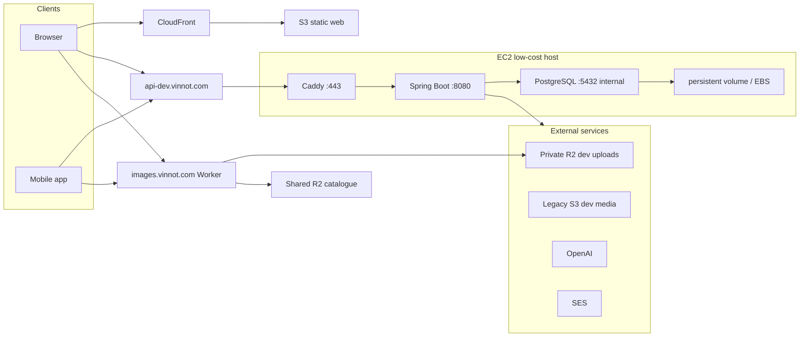
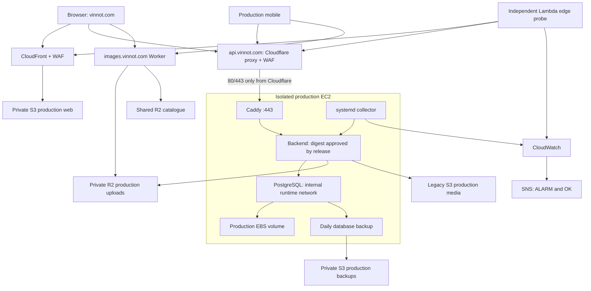
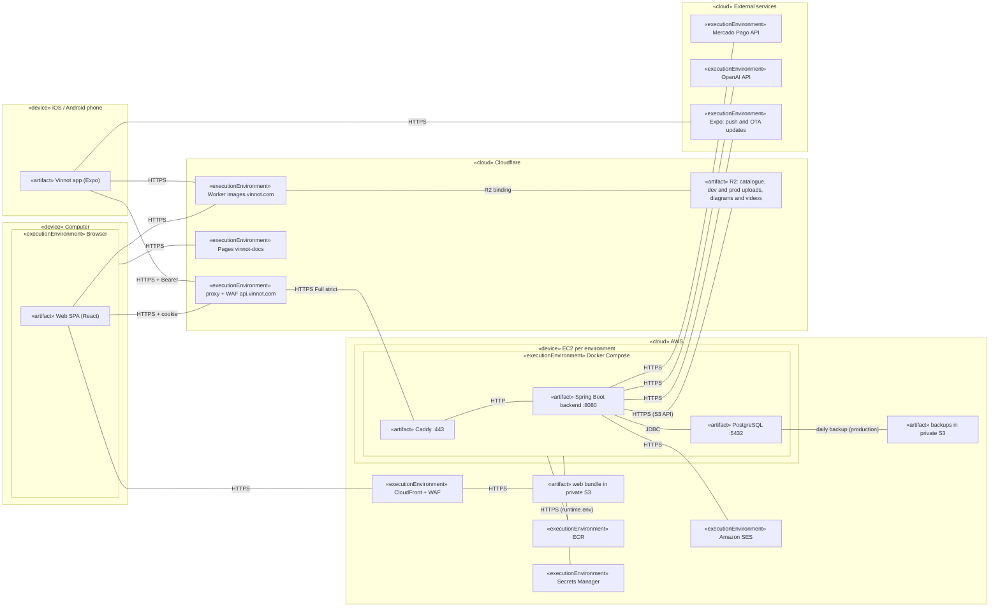
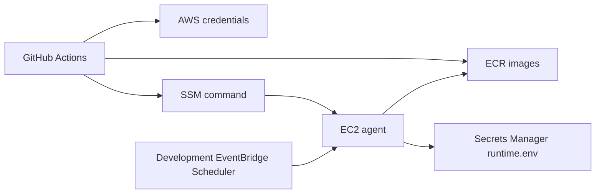
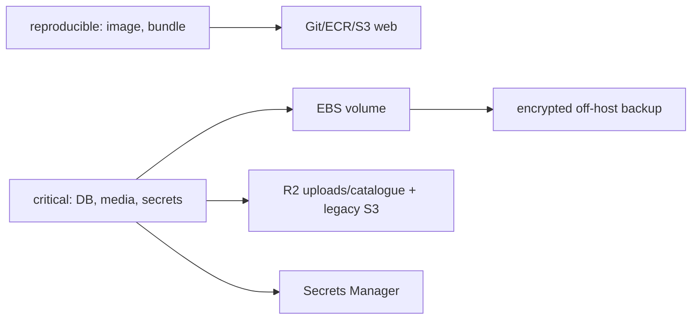

# Deployment maps

## Development runtime

[View the full “Development runtime” diagram](https://images.vinnot.com/docs/diagrams/v1/en/infra-diagrams-deployment-map-d3b0ca9f359d.svg)

## Isolated production runtime

Production templates define a host, network, volumes, secrets and storage separate
from development. Since 2026-10-30 the templates describe the public launch: the
API goes through the Cloudflare proxy and WAF, and the security group opens 80
and 443 only to the Cloudflare ranges. Until the owner applies the
[runbook](../architecture/aws-deployment.md#put-cloudflare-in-front-of-the-api),
clients reach Caddy directly. The development scheduler does not stop this host. This diagram
describes configuration rather than certifying a release or operational test.

[View the full “Isolated production runtime” diagram](https://images.vinnot.com/docs/diagrams/v1/en/infra-diagrams-deployment-map-b2f942e9253e.svg)

## UML deployment diagram

Shows in UML deployment notation the physical and execution nodes, the artifacts that run on each one and the protocols that connect them. Development and production repeat the EC2 node on separate hosts; monitoring and the control plane are left out.

[View the full “UML deployment diagram” diagram](https://images.vinnot.com/docs/diagrams/v1/en/infra-diagrams-deployment-map-82cba128f0e3.svg)

## Control plane

[View the full “Control plane” diagram](https://images.vinnot.com/docs/diagrams/v1/en/infra-diagrams-deployment-map-5e97f7a29005.svg)

## Data boundary

[View the full “Data boundary” diagram](https://images.vinnot.com/docs/diagrams/v1/en/infra-diagrams-deployment-map-c6fef61b5b99.svg)

