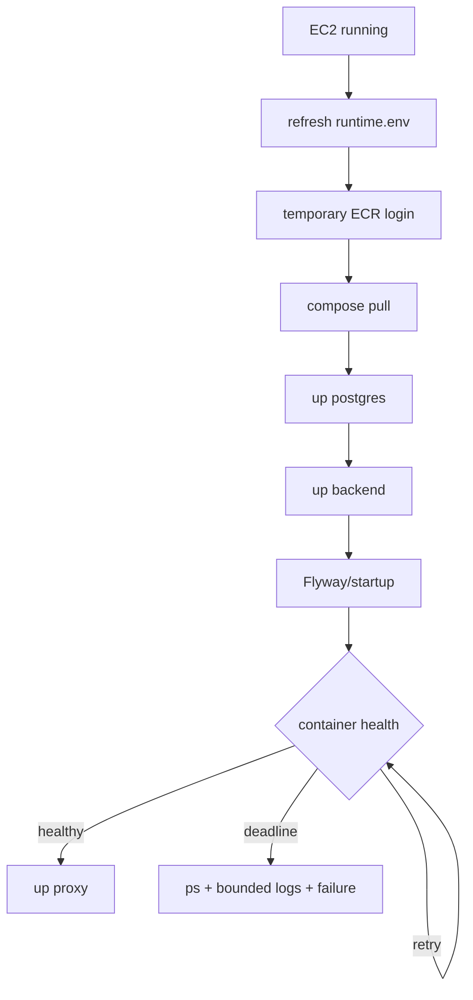
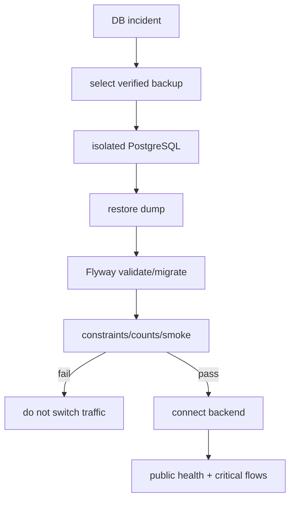
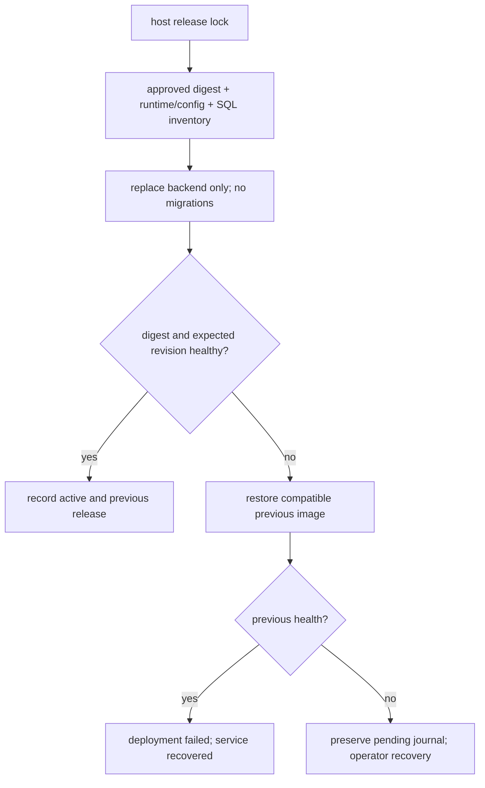

# Runtime and recovery diagrams

## Safe development startup order

[View the full “Safe development startup order” diagram](https://images.vinnot.com/docs/diagrams/v1/en/infra-diagrams-runtime-and-recovery-7d6544d42a59.svg)

## Database recovery

[View the full “Database recovery” diagram](https://images.vinnot.com/docs/diagrams/v1/en/infra-diagrams-runtime-and-recovery-00f8af75db7e.svg)

## Production application recovery

[View the full “Production application recovery” diagram](https://images.vinnot.com/docs/diagrams/v1/en/infra-diagrams-runtime-and-recovery-1d0185551b3c.svg)
