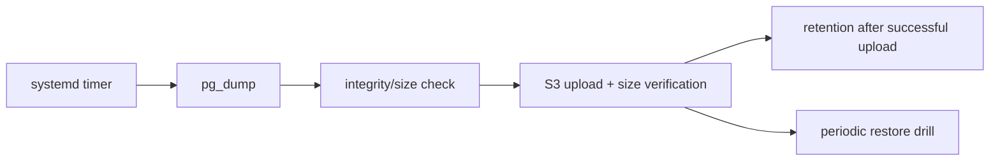

# Backup and disaster recovery

## Critical assets

| Asset | Source | Recovery |
|---|---|---|
| PostgreSQL | EC2 volume | verified dump + Flyway recreation |
| uploads | private R2 and historical S3 originals | inventory + verified private copy + DB references |
| runtime config | Secrets Manager + versioned files | regenerate without plaintext secrets |
| backend/web | ECR/Git commit/build | reproducible redeploy |
| DNS/certificates | provider + Caddy | recreation runbook |

A Docker image is not a database backup. A dump never restored is insufficient
evidence.

A PostgreSQL dump contains references and V27 inventories, not R2 bytes. The
database timer backs up only PostgreSQL; it does not automatically back up R2
objects. Recover media by reconciling DB, objects and inventories through the
[catalogue](catalog-images-r2.md) and [upload](user-images-r2.md) runbooks. Preserve
private migration originals/manifests and retain S3 while needed for compatibility
or rollback. A storage bucket is not a backup copy.

## Local backup pipeline

The versioned timer runs `backup-local-db.sh` at 04:00 UTC (01:00 in Argentina),
with up to 15 minutes of jitter, before the scheduled 02:00 Argentina shutdown.
`Persistent=true` catches up a missed execution when the host starts; it does not
guarantee that the host stays running.

In development, the service runs as `ec2-user` with Docker and backup-directory access, without
reading `runtime.env`. The script runs `pg_dump` directly inside
`vinnot-dev-postgres-local`; it does not need the application's full secrets.
Requirements are Bash, Docker, AWS CLI, jq and Linux `flock`, `stat` and `date`.
The instance role needs S3 upload, metadata-read, listing and deletion permissions
for the `database-backups/` prefix according to retention.

A non-blocking lock prevents simultaneous backups. The custom dump is written
with restrictive permissions to a partial file; only after checking non-zero
size and reading its index with `pg_restore --list` is it published as
`local-*.dump`. It is uploaded to S3 and ContentLength is checked before retention.
Errors exit non-zero. The trap removes only that run's partial file; a finalized
dump remains if upload or verification fails. Size/index checks replace neither
an actual restore nor an end-to-end checksum.

Local retention uses `find -mtime +2` (whole days); in development, remote objects older than
eight days are removed. `VINNOT_BACKUP_SKIP_RETENTION=true` supports a drill
without deleting existing copies. Bucket encryption and failure alerting must
be checked in the environment configuration. Backups must leave the host to
cover host/volume loss.

### Production isolation

`backup-local-db.sh prod` explicitly selects `/opt/vinnot-prod`, the production
PostgreSQL container, database `vinnot_prod`, read-only role `vinnot_prod_backup`
and the dedicated production backup bucket. An omitted argument retains the dev
contract; unknown or extra arguments are rejected before any external operation.
`install-systemd-units.sh prod` installs `vinnot-prod-backup.timer` and service,
reusing the shared schedule with production-only systemd drop-ins. The production
service runs as root because the runtime directory is restricted to root; database
access still uses the read-only backup role, not application or owner credentials.

Production S3 lifecycle expires current copies after 30 days and retains replaced
versions for 30 days from replacement. Versioning may therefore retain physical
data longer than the current-copy window. The host can upload and read metadata,
but cannot list or delete remote backups; only S3 applies remote retention.
Local retention remains two complete days. Skipping retention affects only local
cleanup in production, not the bucket's independently configured lifecycle.

The target is a daily off-host copy (nominal RPO 24 hours) and recovery within
four hours. Scheduling jitter, failed jobs and time since the last successful
upload can increase actual data loss. These are operational targets, not a
guarantee: monitor successful uploads and measure full recovery on a representative
dataset before accepting the environment.



[View the full “Production isolation” diagram](https://images.vinnot.com/docs/diagrams/v1/en/infra-operations-backup-and-disaster-recovery-e536bdaa4709.svg)

## Restore procedure

1. declare incident and freeze writes if partial service remains;
2. identify backup by timestamp/checksum;
3. provision compatible PostgreSQL in isolation;
4. restore and run Flyway/schema validation;
5. verify counts, constraints, test user and critical flows;
6. connect backend, health and smoke tests;
7. switch traffic only after explicit decision;
8. record actual data loss and cause.

For a drill, use an isolated database and volume without connecting an application
with real email, S3 or provider credentials to the restored dump. An
`external_effects` copy can contain pending jobs: starting its workers could resend
emails or delete real files. Inspect schema and queue states with read-only SQL
first; test restarts using synthetic jobs and adapters without external effects.
Do not automatically replay completed rows or empty the queue to simulate success.

## Recovery from a failed deployment

1. Preserve the previous image digest, configuration and pre-change backup.
2. Read `flyway_schema_history` and startup logs before choosing an action.
   V17–V19 add session/revision fields and the durable journal; do not run Flyway
   manually when these migrations are already recorded as successful.
3. Prefer roll-forward for application failures. Restoring a previous binary
   requires checking compatibility with the current schema and contracts.
   A version ignoring `session_version` or `external_effects` is not a safe
   rollback merely because it can start.
4. Do not delete Flyway rows, run repair or drop columns on a live database as a
   rollback mechanism.
5. Restore a database only with authorization, a maintenance window and accepted
   temporal data loss. Validate the copy before switching connections.

This runbook defines the procedure; per-drill evidence, versions, timings and
acceptance remain outside canonical documentation.

## RPO/RTO

No numbers are promised without measurement. RPO is bounded by backup frequency
and off-host copy. RTO includes host, image, restore, migration, validation, DNS
and cache. Drill results live outside canonical docs; discovered missing steps
update this runbook.

## Migration from/to RDS

Migration scripts verify connectivity, version, dump/restore and counts. Source
is not destroyed before verification and an observation period. Returning to RDS
is a scaling/HA choice, not an improvised restore.

## Acceptance criteria

- automated backup with failure alert;
- encrypted off-host copy;
- documented/tested retention;
- periodic restore drill;
- credentials restored from manager, not dump;
- integrity and smoke-test evidence;
- known owner and escalation.

## Verifiable local drill and evidence boundary

`infra/postgres/restore-inventory.sql` produces only per-table counts, constraints,
search projection and Flyway history/checksums. Capture that inventory during the
approved backup's quiescent window; a later inventory under traffic may represent
a different snapshot.

This command requires a local dump, known checksum, approved inventory and an
immutable PostgreSQL image ID already available locally:

```bash
node scripts/verify-isolated-restore.mjs "$DUMP" "$SHA256" "$BASELINE_JSON" "$POSTGRES_IMAGE_ID"
```

The script verifies the checksum before creating a container, uses `--network none`,
no published ports, bounded memory/CPU and synthetic credentials. It performs a real
restore with exit-on-error, compares the complete inventory and removes its own
container/volume even on failure. It never starts backend, outbox, email or AI.
The report contains timings and hashes, not row contents. Keep dump/inventory outside
Git and remove working copies according to the drill authorization.

This drill measures the database. Accepting the four-hour end-to-end RTO also requires
measuring host/volume recovery, runtime/secrets, images and necessary S3 objects,
Caddy/certificates, health, browser checks and any traffic switch. Validate controlled
accounts and relationships without using real accounts as fixtures. Confirm destination,
permissions, window, cost and cleanup before that drill. Nominal RPO remains 24 hours
with daily copies and 30-day remote retention.

## Publication and recovery compatibility

### Application drill on an AWS copy

Verify the temporary target identifier before sending commands and add a second
guard inside the host. Use an encrypted delete-on-termination disk, no ingress,
SSM and a role limited to the selected images and backup objects. Schedule
termination outside the host before restoring, then verify deletion of the drill's
instance, volume, rules, profile, role and schedule.

Wait for PostgreSQL over loopback TCP: its temporary initialization server can
accept Unix socket connections before shutting down to start the final server.
Restore under the non-login owner, compare inventory and run the separate
migration runner. When the candidate adds no migrations, record validation without
changes and measure lock waiting/release; do not invent a migration or edit history
to simulate one.

To start the application against copied data, use synthetic credentials, a
read-only SQL role and an internal Docker network without published ports.
Disable paid AI calls and select local providers; defer effects and event workers
beyond the drill window and disable the retention cron. Support cleanup can run
at startup: the read-only role prevents it from changing the copy. Disabling
Flyway alone does not prevent external effects. Never sign in with real accounts
or reuse their tokens as fixtures.

Check managed object references against the bucket in addition to SQL counts.
If the copy has no user objects, record that scope; do not present operational
files as recovered attachments. Measure provisioning, download, restore,
migration and health separately. The isolated drill does not certify DNS,
public TLS, traffic switching or physical mobile acceptance.

### Contract matrix

| Contract | Compatible previous version and candidate | Recovery criterion |
|---|---|---|
| Web/session | In-memory access token, HttpOnly refresh with explicit origin/header | Restore session and logout; never resume JavaScript refresh-token persistence |
| Native/session | Bearer and SecureStore v2 snapshot with legacy-key reads | Refresh, identity and logout without resurrecting old tokens |
| Legal | Explicit version/hash selection and configured backend | Collapsing text never records acceptance; check server flag rather than infer it from UI |
| Cellar | Compatible 1,000-entry list, internal queries up to 200 | Read/write and ownership; never recover the binary preceding the legacy-window fix |
| Schema | Exact SQL/checksum inventory; schema changes handled separately | No downgrade, repair or applied-migration edits |
| External effects | Preserve session version, AI ledger and durable outbox | Never recover binaries ignoring these controls or start copied workers against real providers |
| Distributed mobile | Record installed and candidate build/channel/runtime before claiming compatibility | Native configuration/modules require a binary; JS/assets require a compatible, explicitly authorized OTA |

Legal attribution and presentation changes do not require a new schema or change
the acceptance contract. They do not constitute physical native acceptance.
