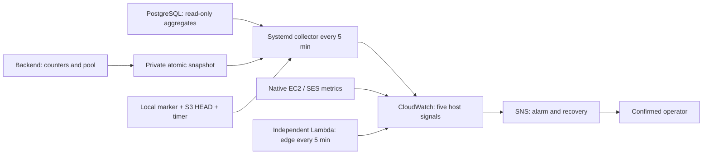

# Infrastructure observability and incidents

## Architecture and scope

Low-cost monitoring combines aggregate host signals with CloudWatch alarms that
run independently of the observed process. It does not query user accounts,
generate AI content, write business data or send SES test emails. SNS is the
notification channel.



[View the full “Architecture and scope” diagram](https://images.vinnot.com/docs/diagrams/v1/en/infra-operations-observability-and-incidents-debfef39b6dc.svg)

Code lives in `infra/aws-low-cost/monitoring/`, units in `systemd/`, and the
template is generated by `scripts/build-monitoring-stack.mjs`. The collector
accepts only the declared production account, region and instance; it checks the
physical host ID and STS account before publishing. The service requires Docker
access and runs as root with private configuration/state, a read-only filesystem
except for its state directory, 128 MiB memory and 10% CPU quota. Do not grant
Docker access to additional users merely to run this procedure.

## Signals and thresholds

The five host signals and `EdgeHealthy` are booleans: 1 means the checks in that
group passed. Specific reasons, measurements and deltas remain in
`/var/lib/vinnot-monitor/latest.json`, mode 0600. No per-user, route, wine,
request or exception dimensions are exported to CloudWatch.

| Signal | Conditions requiring attention | Initial diagnosis |
|---|---|---|
| ServiceHealthy | API/containers unhealthy; snapshot older than 180 s; at least 3 HTTP 5xx and 5% of requests; 20% of requests over 5 s with at least 10 samples | health, release, HTTP deltas, proxy |
| ResourcesHealthy | available memory below 256 MiB; free disk below 3 GiB; container above 90%; PostgreSQL connections above 80%; missing pool metrics, waiters or timeout | memory, disk, connections and pool |
| BackupHealthy | unverifiable/unencrypted backup, age over 30 h, failed service or inactive timer | timer, service, marker and S3 HEAD |
| EffectsHealthy | task exhausted at 10 attempts; next attempt overdue by more than 30 min; transactional email failure | outbox metadata and SES |
| AiHealthy | provider error/timeout/429/quota; admission failure; reserved plus spent exceeds 80% of USD 8; pending/unknown reservation older than 1 h | counters by cause and ledger |
| EdgeHealthy | failed independent probe, missing publication or response incompatible with access mode | DNS, certificate and external access |
| EC2 StatusCheckFailed | instance/system failure | EC2 status and host events |
| EC2 CPUCreditBalance | below 12 credits for three periods | sustained load and Standard-mode credits |
| SES delivery | Bounce, Reject or Complaint above zero | account-wide reputation/suppression and delivery rejection |

Values are in `config.example.json` and the alarm generator. Disk headroom allows
local backups and artifact preparation before exhaustion; available RAM reserves
capacity for the host/proxy and operations. Twelve credits represent roughly six
minutes with two fully occupied vCPUs, before newly earned credits. Threshold
changes require measurements and review; do not automatically enable Unlimited
or increase instance size in response.

CloudWatch uses 300-second periods, usually two breaches out of three; credits
requires three of three. AI, effects and SES notify after one period. Missing
custom or EC2 signals count as breaches: a dead host, collector or probe cannot
artificially retain healthy status. SES without events is normal. Notifications
include ALARM and OK; delivery depends on sampling/evaluation and is not instant.

HTTP/provider counters are cumulative per process. The collector calculates
deltas between consecutive snapshots of the same process at most 900 s apart;
a restart or first observation establishes a new baseline.
Snapshot freshness is evaluated at collection completion: the backend can update
it while other signals are being read. Backup age includes that collection time;
future or stale snapshots are still rejected.

Latency is the share of requests over 5 s plus a duration sum, not an invented p95. Health, OPTIONS and
documentation checks skipped by the filter do not inflate request counters.
Timeouts remain distinct from valid responses without functional matches.

## Probe modes and external availability

The probe has two modes, chosen with the stack's `AcceptanceMode` parameter:

| Mode | When it is used | What it requires |
|---|---|---|
| `public` (default) | The site is launched | Web 200 and API `/api/actuator/health` 200 with `status=UP`. It verifies TLS, bounds responses and rejects redirects. |
| `private` | Only when the site is deliberately closed to the public | A 403 rejection from the web edge and API DNS resolution. **It does not certify the API's external path or content behind the restriction.** |

Production is launched, so the correct mode is `public`. When updating an existing stack,
`aws cloudformation deploy` keeps the previous value of any parameter you do not pass: pass
`AcceptanceMode=public` explicitly, as shown in
[Apply the public launch alignment](../architecture/aws-deployment.md#apply-the-public-launch-alignment).
The mode always changes together with access; do not open security groups or WAF to
satisfy the monitor. The host checks internal health, and CloudWatch independently
detects loss of the host. Health UP does not prove scan accuracy.

The probe has one five-minute schedule, a 20-second timeout and a maximum event
age of 60 seconds, with retries disabled in both EventBridge and Lambda. It uses
the account’s available unreserved concurrency; no quota increase or reservation
is required for accounts with small limits. It has no function URL or public
invocation permission.

## Installation and permissions

1. Inventory existing alarms, metrics, SNS, budgets and resources. Review
   recipients and marginal cost before creating the stack.
2. Generate and validate the template:

   ```bash
   node scripts/build-monitoring-stack.mjs /tmp/vinnot-monitoring-stack.json
   aws cloudformation validate-template --template-body file:///tmp/vinnot-monitoring-stack.json
   ```

3. Apply the reviewed stack with an approved `OperatorEmail`; the default mode is `public`.
   It requires `CAPABILITY_IAM`: the existing host role gains only
   `cloudwatch:PutMetricData` for `Vinnot/Production`; a Lambda role allows that
   same publication and writes to its specific log group. The monitor receives
   no secrets, backups, remote SSM or IAM administration permissions. SNS accepts
   notifications only from this account's `vinnot-prod-*` alarms. The recipient
   must confirm the email subscription.
4. Publish the backend containing `OperationalSnapshotWriter` through the
   production release flow and check `/tmp/vinnot-operations.json` inside the
   container. The private aggregate file contains no keys or payloads.
5. Transfer reviewed files with checksums, preserving the `infra/aws-low-cost/`
   directory structure, then run as operator on the host:

   ```bash
   bash install-production-monitoring.sh --activate
   systemctl status vinnot-prod-monitor.timer --no-pager
   systemctl show vinnot-prod-monitor.service -p Result -p ExecMainStatus
   cat /var/lib/vinnot-monitor/latest.json
   ```

The installer preserves existing operator configuration. The collector reads
neither `runtime.env` nor Secrets Manager. It queries PostgreSQL through the
existing backup role and uses HEAD for the exact object; it neither lists nor
deletes backups. `backup-local-db.sh` advances `backups/last-success.json` only
after validating the archive and remote size. On first installation,
`adopt-production-backup-marker.sh` validates the latest local archive through
`pg_restore --list`, HEAD, size and encryption before creating the marker. It
does not change the recovery point: the collector uses the older of the archive
filename timestamp and S3 modification time, so re-uploading an old archive cannot
make it appear recent. Adoption creates no additional backup and never replaces
an existing marker. Without a verifiable copy the monitor is not activated; never
manufacture a timestamp to turn an alarm green.

## Response and recovery

1. Confirm group, onset and scope; record the incident ID and owner in the
   private operations record. Read the snapshot and alarm state.
2. Correlate the latest deployment, opaque request IDs and bounded logs. Never
   copy credentials, payloads, email addresses or images into an incident.
3. For outages, inspect EC2, containers, proxy, API and DB; follow
   [deployment](../guides/deployment.md) and
   [recovery](backup-and-disaster-recovery.md). An alert does not authorize
   restart, rollback, restore or traffic switching without diagnosis and agreed scope.
4. For resources, identify consumers, queries and connections before changing
   limits; preserve volumes/backups. Do not delete business data to free space.
5. For backups, inspect Result/ExecMainStatus/timer and the encrypted object;
   distinguish dump failure from upload failure. Check whether the operation is
   still active before retrying. Separately record date, revision, target and
   scope of the last actual restore drill; backup age does not prove restorability.
6. For AI, preserve ledger/cache and inspect causes/reservations. The
   `AI_PAID_CALLS_ENABLED=false` switch and existing resource limits stop new paid
   calls; apply through controlled configuration procedures. Never delete
   reservations or raise the USD 8 production allowance to silence an alarm.
   The ledger does not measure calls made outside the app with the same key.
7. For email, distinguish rejected SES requests from bounced messages,
   complaints and ambiguous delivery.
   Inspect SES and suppression; SNS remains independent of SES. Do not resend to
   real recipients merely to test a repair.
8. Verify recovery with healthy samples, an OK notification and the affected
   flow within the authorized scope. Record cause, mitigation and prevention.

## Outbox and safe retry

`python3 /opt/vinnot-monitor/effects.py` displays at most 100 metadata rows,
without payload or deduplication keys. An explicit retry requires the observed
UUID, attempt count and `next_attempt_at`:

```bash
python3 /opt/vinnot-monitor/effects.py --retry-storage-id "$TASK_ID" \
  --expected-attempts 10 --expected-next-at "$OBSERVED_NEXT_ATTEMPT"
```

Only the four storage cleanups with existing reference checks are eligible. The
update compares ID, kind, attempts and timestamp with bounded statement/lock
waits; it cannot modify a changed/claimed task, and replaying the command cannot
reset it again. The worker retains bounded batches, `SKIP LOCKED` and backoff.
The command uses the existing runtime role only for that update. Email is
excluded: SES and DB commit are not a transaction, and exactly-once delivery is
not guaranteed. Ambiguous delivery requires operator investigation, never
automatic replay. Notification rows show their `notification_type` and
`last_error_type` only; exhausted ones are deleted 30 days after creation.

## Email bounces and complaints

`infra/aws-low-cost/email-feedback-stack.json` creates, per environment, the SES
configuration set `vinnot-<env>`, the SNS topic and SQS queue
`vinnot-<env>-email-feedback` with its dead-letter queue, the alarm
`vinnot-<env>-EmailFeedbackDeadLetters` and an IAM policy on
`vinnot-<env>-low-cost-host-role` allowing only that queue and
`ses:SendEmail` through that configuration set.

Rollout, per environment (dev first), with an operator AWS session:

1. Confirm the host role exists: `aws iam get-role --role-name vinnot-<env>-low-cost-host-role`.
2. Deploy: `aws cloudformation deploy --region us-east-1 --stack-name vinnot-<env>-email-feedback
   --template-file infra/aws-low-cost/email-feedback-stack.json --capabilities CAPABILITY_NAMED_IAM
   --parameter-overrides Environment=<env> AlarmTopicArn=<operations topic or empty>`.
3. Check that the outputs match `EMAIL_SES_CONFIGURATION_SET` and
   `EMAIL_FEEDBACK_QUEUE_URL` in the Compose file, then deploy the backend. The
   stack must exist first: without its IAM policy, sending through the
   configuration set is denied and every email fails.
4. Once per account, enable SES account suppression:
   `aws sesv2 put-account-suppression-attributes --suppressed-reasons BOUNCE COMPLAINT`
   (check with `aws sesv2 get-account`).
5. Verify with the SES mailbox simulator (`bounce@simulator.amazonses.com`,
   `complaint@simulator.amazonses.com`), never a real recipient: one
   `email_suppressions` row per address and an empty dead-letter queue.

Rollback: remove both variables from the Compose file and redeploy the backend,
then delete the stack. Suppressions already recorded stay in the database.

Dead-letter messages are SES events the backend could not read. Inspect them in
the SQS console; they contain recipient addresses, so do not copy them into
incidents. Purge them once the cause is fixed.

## Ownership, channels and acceptance

Installation requires a confirmed recipient, responsible operator, attention
hours and escalation agreement in the private operations record. Active alarms
do not imply 24/7 on-call coverage. Without a backup operator, the sole owner
records that risk and coverage window before launch. The owner handles user
communications using confirmed impact/status, without disclosing sensitive
details or promising an unmeasured recovery time.

Acceptance has three layers: synthetic service/backup/outbox faults and recovery
in tests; published samples and ALARM/OK transitions in CloudWatch; recipient
confirmation of delivery. Test the channel through a dedicated temporary alarm
and drill namespace, never by stopping the API or inserting fixtures into
production. Remove the temporary alarm/emitter and retain private evidence.
`set-alarm-state` tests notification but does not replace exercising the
evaluator with threshold-crossing samples.

## Retention, privacy and cost

Docker retains local logs up to `10m` per file and three files per container; this
is not a centralized archive. Lambda logs retain seven days and contain only
scope/result/failure type. The collector retains the latest sample and baseline
locally with private permissions. Basic Actuator health stays public; health
details and other operational endpoints require ADMIN. OpenAPI/Swagger describe
the API contract and require an ADMIN account's email and password; their
presence does not itself demonstrate secret exposure. A WARN line
"Daily catalog quota exhausted; account locked" means an account was locked
automatically for reading the catalog in bulk.

The stack has six fixed-cardinality custom series and nine alarms (the SES alarm
evaluates three metrics). It creates no instances, load balancers, NAT, paid
dashboards or centralized application-log storage. Review allowances and prices
for [CloudWatch](https://aws.amazon.com/cloudwatch/pricing/),
[Lambda](https://aws.amazon.com/lambda/pricing/) and [SNS](https://aws.amazon.com/sns/pricing/)
at application time. Reuse the existing AWS budget; it is an alert, not a shutoff
or guaranteed maximum bill. Estimates and observed consumption remain in the
private record.

## Tests and traceability

- `scripts/test/production-monitoring.test.mjs` exercises policy/collector/probe
  fixtures, recovery and IAM/topology restrictions.
- `ProductionDatabaseRolesPostgresIntegrationTest` executes the actual monitoring
  and retry SQL against migrated PostgreSQL and real roles.
- Backend tests cover private atomic files, Actuator, AI/SES failure classification
  and counters without personal data.
- Backup tests verify that a failed upload cannot advance the valid recovery point.
