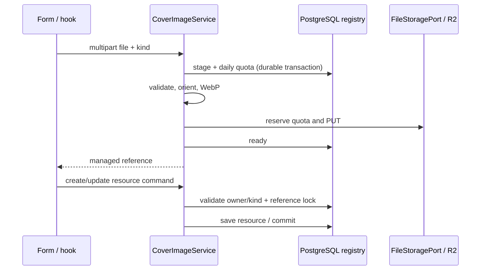

# User images: WebP and R2

## Layers and composition

`FileStoragePort` retains avatar and label contracts. `R2FileStorageService` handles new WebP writes when `app.storage.provider=r2`; `R2StorageConfiguration` composes an R2-compatible S3 client and a separate AWS adapter for old references. Compose defaults remain S3. Backend runtime secrets provide R2 credentials; web/Expo bundles never contain them.

`ImageOptimizationPort` separates processing from storage. `WebpImageOptimizer` validates actual MIME, an 8 MiB input limit and 24 million pixels before decoding, applies EXIF orientation, normalizes to sRGB/ARGB and preserves transparency. It invokes `cwebp` with fixed arguments, no shell, quality 85, method 3, reduced memory and `-metadata none`; the reconstructed image copies no original metadata. GIF becomes a photo of its first frame. Dockerfile and CI install the `webp` encoder; local development needs `cwebp` in PATH or its path in `app.uploads.webp-encoder`.

| Purpose | Maximum long edge | Maximum output bytes |
|---|---:|---:|
| Avatar | 512 px | 128 KiB |
| Label | 1600 px | 512 KiB |
| Cover | 1600 px | 512 KiB |

Originals are never upscaled. Two concurrent jobs and ten seconds per encoder bound resources; saturation, encoder failure or absence produces a retryable service error. Oversized output is rejected; no second automatic variant is generated. Temporary scanner processing retains its contract; identifying an existing wine does not persist its photo through this implementation.

## Organization and delivery

| Content | R2 key | Delivery |
|---|---|---|
| Argentine catalogue | `wines/ar/{UUID}/{SHA}.webp` | Shared `vinnot-catalog-images` bucket, Worker |
| Avatar | `uploads/{environment}/avatars/avatar_{owner}_{UUID}.r2.webp` | Worker, 60 s public cache |
| Approved/public label | `uploads/{environment}/wine-labels/wine_label_{UUID}.r2.webp` | Worker, 60 s public cache |
| Quarantined label | `uploads/{environment}/quarantine/wine_label_{UUID}.r2.webp` | Authorized admin API, no cache |
| Event cover | `uploads/{environment}/events/{UUID}.webp` | Resource-authorized API, no cache |
| Route cover | `uploads/{environment}/wine-routes/{UUID}.webp` | Resource-authorized API, no cache |
| Social slide or illustration | `uploads/{environment}/social/posts/{UUID}/{instagram\|tiktok}-NN-{hash}.jpg` or `…/hero-{hash}.png` | Worker, `image/jpeg` or `image/png`, immutable one-year cache |

Uploads use separate `vinnot-user-uploads-dev` and `vinnot-user-uploads-prod` buckets; the catalogue retains a single copy and identical URLs for both databases. Direct public R2/r2.dev access stays disabled. `wrangler.jsonc` only declares the catalogue; `wrangler.uploads.jsonc` adds the `DEV_UPLOADS` and `PROD_UPLOADS` bindings and is the configuration that gets deployed (see [Worker deployment](catalog-images-r2.md#worker-deployment)). The Worker only permits GET/HEAD/OPTIONS and explicit key formats; it exposes no writes, listings, quarantine or covers, and performs no paid transformations.

Removing an avatar/label deletes the object through the existing queue; an already cached public copy may remain for up to 60 seconds. Catalogue objects retain annual immutable caching. Covers return `Cache-Control: no-store`; mobile disables disk caching for `/uploads/covers/` and new public R2 user URLs. Copies previously downloaded by devices/older releases cannot be removed remotely. Cover delivery traverses the API to enforce privacy; R2 storage does not eliminate that backend traffic/cost.

## Cover upload and reference

`POST /uploads/covers` accepts multipart `file` and `kind=EVENT|WINE_ROUTE`. Identity comes from the authenticated principal. Permissions are EVENT_CREATE/UPDATE/UPDATE_OWN or WINE_ROUTE_CREATE/UPDATE/UPDATE_OWN according to kind. The response contains `id`, `imageUrl`, `width`, `height`, `size`; `imageUrl` is `/api/uploads/covers/{UUID}.webp`.

`CoverImageService` first records durable intent and reserves the daily quota before processing; it then optimizes, stores bytes and marks `ready`. Only then does it return a usable reference. Resource commands validate kind and owner/staff; retaining an existing reference takes a row lock. The resource transaction holds this lock until commit, serializing attachment against cleanup. The server never downloads arbitrary user-supplied URLs.

`GET /uploads/covers/{UUID}.webp` reevaluates access: owner of an unattached upload, staff, resource organizer/creator, or a public reader of a visible resource. Events are public after publication while their status is not DRAFT; routes are public only in PUBLISHED. An unready or inaccessible cover returns 404. Frontends fetch authenticated draft previews without sending tokens to external hosts. Cards and details also resolve managed covers through the presentation hook and authenticated service; old URLs retain native delivery without that extra request. Selectors expose upload/error state, retain the previous reference after failure and disable saving while uploading. Closing/cancelling prevents late responses from being applied.



[View the full “Cover upload and reference” diagram](https://images.vinnot.com/docs/diagrams/v1/en/infra-operations-user-images-r2-4976f56e79ae.svg)

## Integrity, quotas and recovery

V27 adds `storage_operation_budgets`, `managed_cover_images` and `r2_avatar_inventory`. Operation/byte reservations and inventory survive business transaction rollback. PUT uses `If-None-Match:*`; retrying an existing key succeeds only after verifying identical bytes. The client uses path-style addressing and disables chunked encoding and optional AWS-specific checksums for R2 compatibility; it does not request the AES256 option used by the S3 adapter. The SDK performs no automatic retries. Timeouts are 3 s connection, 10 s socket, 12 s attempt and 15 s call.

Per environment: 512 MiB conservatively reserved bytes, 5000 writes/month and 100000 backend R2 reads/month. Publication copies and ambiguous failures consume reservations; deletion does not automatically restore allocation. Avatars and covers also reserve up to 20 uploads/user/UTC day before image processing; covers have a separate HTTP `media-upload` bucket using the configured wine-submission limits (10/day by default), without sharing their counters; labels retain submission-flow quotas and the global limit. Accounting requires PostgreSQL and stops new operations when unavailable or exhausted. DELETE cleanup retains independent capacity. Social slides and illustrations do not use the 512 MiB: they reserve their own monthly byte allowance (`APP_STORAGE_R2_SOCIAL_MAX_MONTHLY_BYTES`, 1 GiB by default, at most 4 GiB) plus one write of the shared monthly allowance, because they are replaced on every copy edit; each object weighs up to 5 MB and is written once. Replaced ones are deleted by `social-media-cleanup` only when no post and no pending job uses them.

Cloudflare consumption is assessed in aggregate: catalogue, both environments, migration, reads and Worker. Backend counters do not count public Worker reads or other clients. Workers Free has its own quota; the USD 5 alert is a notification, not a billing cutoff. Increasing limits, changing plans or enabling paid transformations requires capacity/cost reassessment.

`TransactionalFileStorageAdapter` retains the avatar/label outbox. Abandoned and replaced covers reconcile after two hours; `ManagedCoverMaintenance` schedules up to 100 orphans daily, including cascading resource/account deletion. Cleanup locks the row and rechecks references before deleting. Old URLs retain reads/deletes through the S3 adapter; enabling R2 does not delete historical buckets/objects.

## Activation and rollback

1. Create each private Standard bucket and a backend credential limited to object operations in its bucket; save it in the environment runtime secret. Never reuse the temporary migration token.
2. Configure `APP_STORAGE_R2_ACCOUNT_ID`, `APP_STORAGE_R2_ACCESS_KEY_ID`, `APP_STORAGE_R2_SECRET_ACCESS_KEY`, `APP_STORAGE_R2_BUCKET`; compose fixes environment, public domain and quotas. Preserve existing S3 for historical reads.
3. Apply V27 using environment migration runner/roles. Deploy the tested candidate and install Worker bindings with `wrangler.uploads.jsonc`; verify every private path returns 404 at the Worker.
4. Enable `APP_STORAGE_PROVIDER=r2` first in development. Verify avatar, submission/label, private/published event and route, replacement, deletion and historical references. Measure encoder CPU/memory on the host before promotion.
5. Provider activation is independent of changing the catalogue: reuse the Argentine batch URLs without another upload.

To stop new writes, set `APP_STORAGE_R2_WRITES_ENABLED=false` while retaining the R2 adapter, bindings and credentials: existing URLs remain readable. Blindly switching back to S3 can lose reads of R2 quarantine/covers even if the Worker still serves public avatars/labels. Application rollback preserves V27 and requires a release compatible with both providers; never perform destructive schema downgrade or object deletion as rollback.

Before migrating historical files: inventory references and pending effects, private backup/manifest, dry-run and resource CAS updates, body/URL verification and a rollback window. Do not copy accounts, private media or catalogue between environments. Retain S3 until references and installed client versions reconcile. Promoting an old quarantined label reads the legacy original, optimizes it and publishes to R2; it does not write another public copy to S3.

### Bounded historical upload migration

The `user-media-release` CLI in `scripts/wine-images` handles owned avatars and managed public labels. `plan` only reads DB/S3: it saves originals, WebP bytes and a checksummed manifest in a private directory. It rejects external sources, catalogue images, inconsistent ownership, over 100 references, legacy covers or quarantined labels requiring another mapping. Private configuration contains `database_url`, `aws_profile`, `r2_account`, `r2_access_key` and `r2_secret_key`; the AWS profile resolves temporary credentials through AWS CLI.

```sh
user-media-release plan --environment development --config /private/dev-media.json --directory /private/dev-media-run
user-media-release stage --environment development --config /private/dev-media.json --directory /private/dev-media-run --manifest-sha SHA
user-media-release apply --environment development --config /private/dev-media.json --directory /private/dev-media-run --manifest-sha SHA
user-media-release rollback --environment development --config /private/dev-media.json --directory /private/dev-media-run --manifest-sha SHA
```

`stage` uses the same conservative durable budgets as the backend, writes with `If-None-Match:*` and reads each object back to verify bytes/MIME. Also check public URLs before `apply`. `apply` locks and compares each expected reference: a concurrent replacement/deletion rolls back the entire batch. It updates avatar inventory and wine revision; an identical second execution changes zero rows. `rollback` only restores references still matching that manifest's result. S3 originals remain available for old URLs and recovery; the tool never deletes objects or buckets. Back up the directory outside `/tmp` before closing the operation. Use a separate manifest and destination credentials per environment; never copy media between environments.

The `test_user_media_postgres.py` tests require `USER_MEDIA_TEST_DATABASE_URL` targeting an isolated PostgreSQL database named `vinnot`; they create and remove an exclusive schema. They cover atomic commit, idempotence, rollback, concurrent conflicts, integrity, pending effects and quotas. Never run them against development or production.

### Approval and optional catalogue queries

The wine adapter's three label-candidate queries use independent read transactions. A PostgreSQL timeout rolls back only that query, allowing already retrieved usable candidates to remain available while preserving the approval transaction and lock. When no search produced usable evidence, the unavailable error remains: a timeout is never interpreted as proof that no duplicate exists. SQL, ranking and filters are unchanged. The operation may temporarily need one additional pool connection; preserve existing limits and timeouts.

## Reproducible validation

`mvn verify` covers `WebpImageOptimizerTest`, `RasterOrientationTest`, `R2FileStorageServiceTest`, `CoverImageServiceTest` `ManagedImagesPostgresIntegrationTest` and `SessionAccessHttpPostgresIntegrationTest`, using real PostgreSQL and HTTP security in Testcontainers. `node --test infra/cloudflare/catalog-images/worker.test.mjs` verifies isolation, private keys, caching and methods. Web/mobile suites cover services, transport, cancelled editing and upload failures; architecture, lint, types and documentation retain existing gates.

The Argentina catalogue reuses one copy and the same URLs in both databases.
Production promotion is a mapping operation separate from the uploads provider,
with snapshots, a manifest, dry run and journal as described in the
[catalogue runbook](catalog-images-r2.md); it needs no new build or OTA.

## Active configuration, credentials and verification

Environments use separate private upload buckets, R2 provider and V27; the
catalogue retains one shared copy. Compose keeps S3 as a compatibility default:
R2 activation requires explicit runtime configuration. Historical S3 originals
remain for earlier URLs and rollback. User-upload activation does not itself
apply the Argentine catalogue mapping.

Current backend credentials limit objects to their bucket and expire on
**January 3, 2027**. Rotate before expiry, update the secret, materialize runtime
configuration and verify each environment. The aggregate USD 5 alert is not a
billing cutoff; quotas and Workers Free are the active controls. Never publish
values in docs, frontend code or logs.

Verify a release through API/web revision and health, provider/encoder/V27,
legacy URL and new WebP reads, replacement/removal, quarantine and cover
visibility. Expired Bearer must return 401; an inaccessible draft, 404; its owner
with a valid session, 200. Check the Expo manifest and actual served bytes for
platform/channel/runtime against the clean export. A merge, bundle export or
published OTA does not replace these reads.

Interactive acceptance uses a compatible native client to check avatar,
approved label, event/route covers, replacement, removal and fallback. Record
emulator versus physical device; do not attribute paid OCR/AI testing to
presentation acceptance using fixtures. Active SHA, OTA groups, manifests,
disposable accounts, backups and execution evidence belong in the private
operational archive outside Git. Reconcile and remove fixtures when finished.
