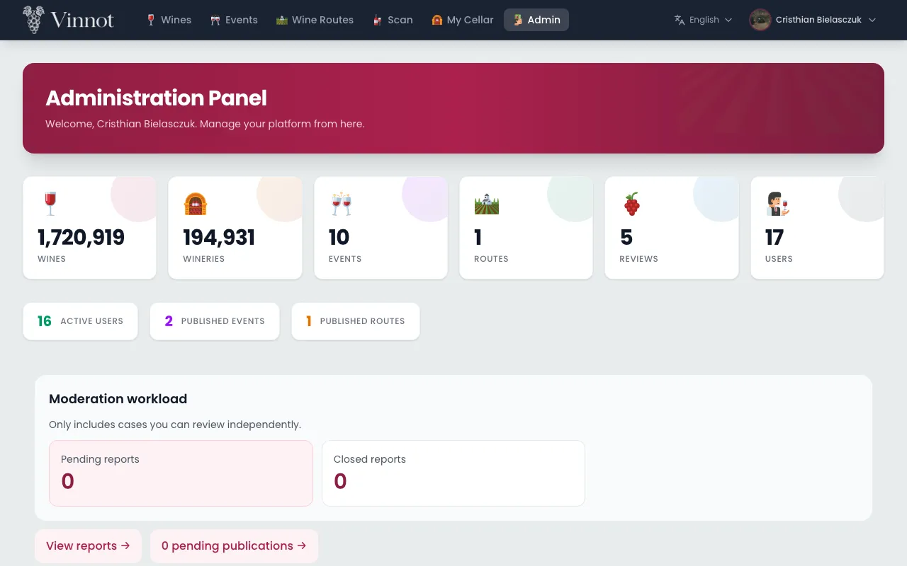
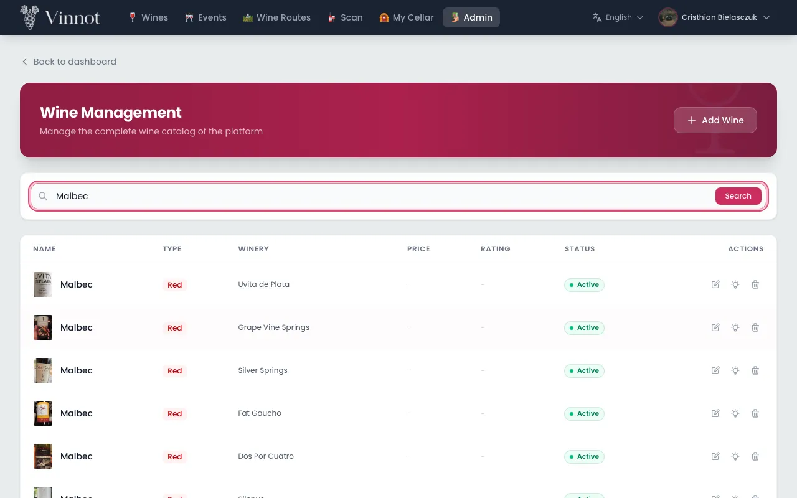
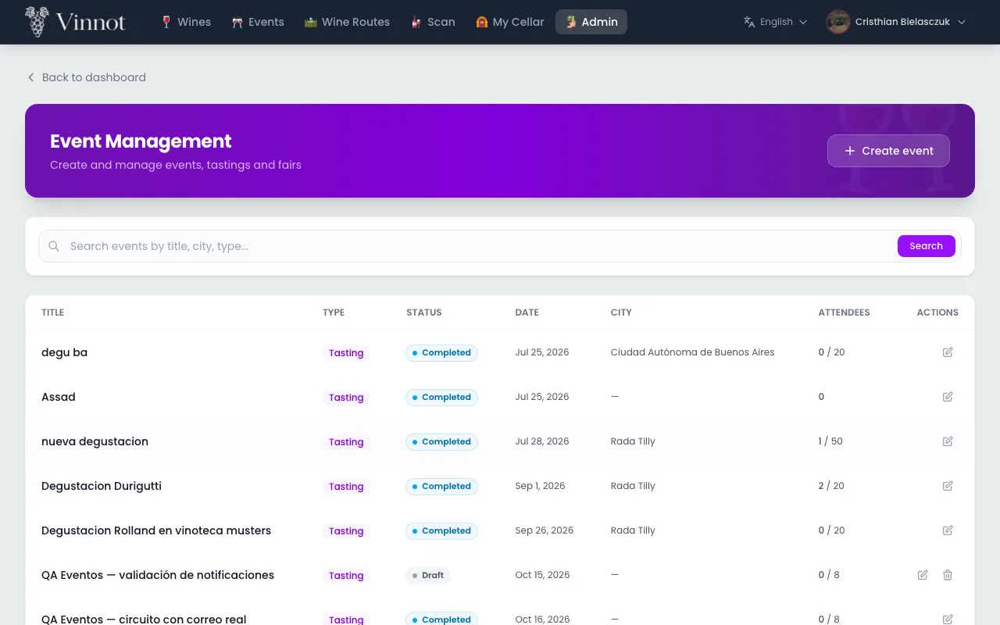
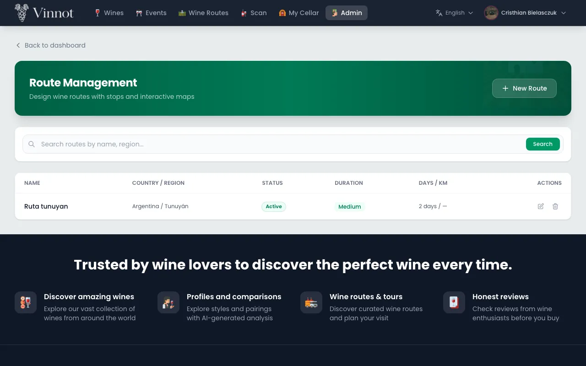
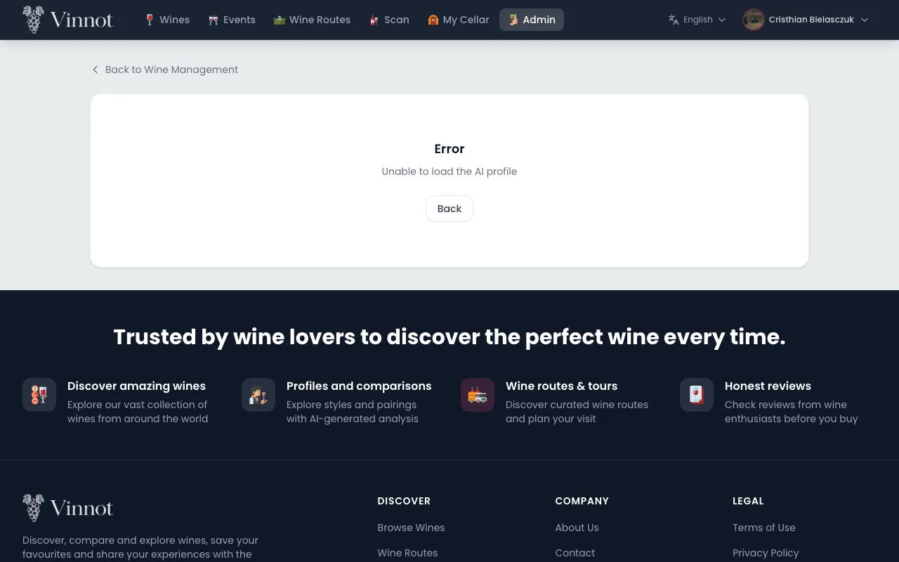
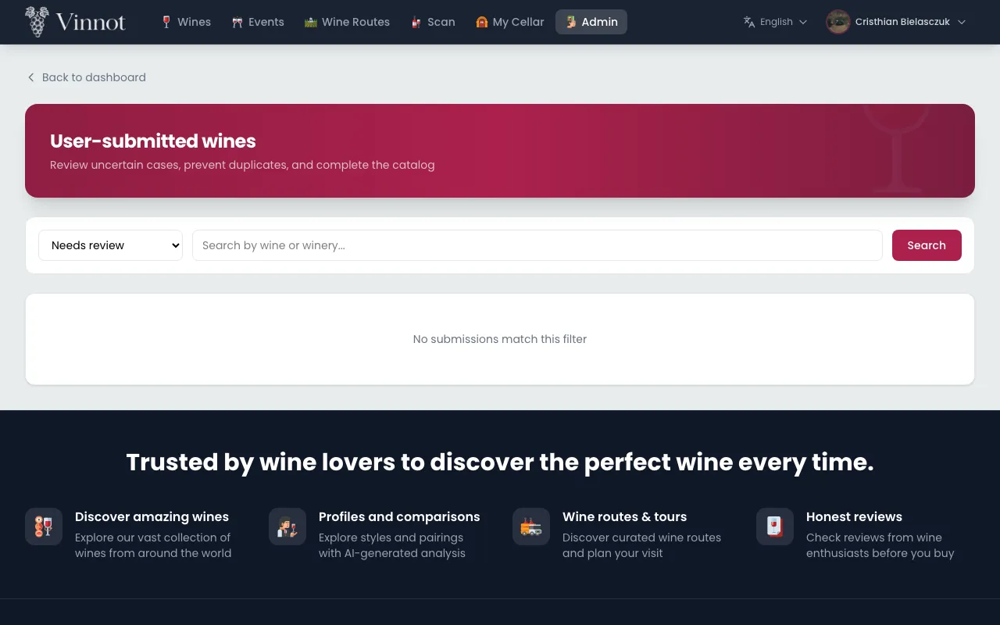
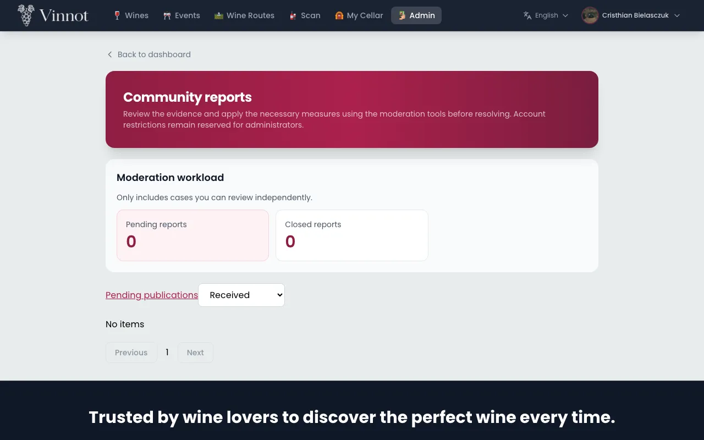
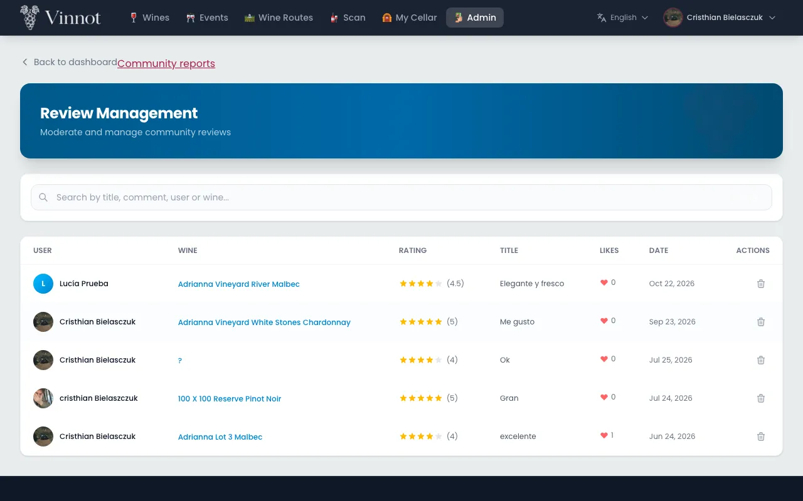
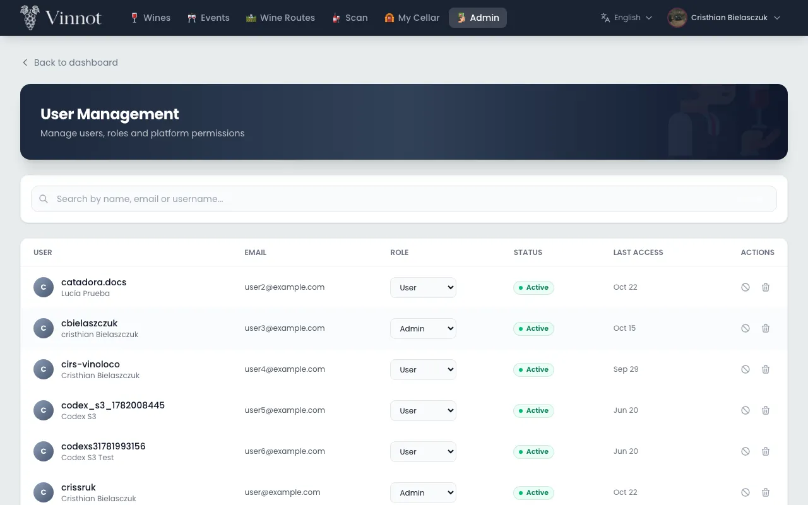
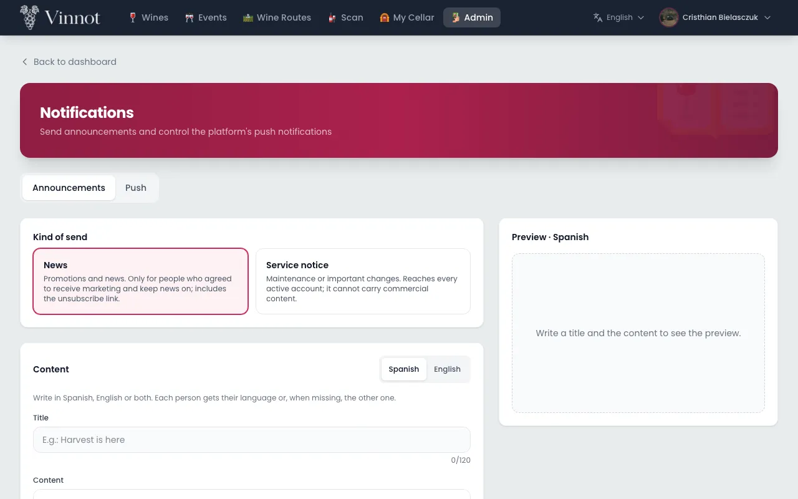

# Administration and moderation manual

This manual is for Vinnot team members with the moderator or administrator role. It
explains how to use the admin panel on the web (`/admin`) and the "Admin" section of the
app: managing the catalog, reviewing what the community sends and, for administrators,
managing accounts and communications.

Sections marked **Administrators only** are not shown to moderators.

## Contents

- [Roles and access](#roles-and-access)
- [Confirm your identity](#confirm-your-identity)
- [Dashboard](#dashboard)
- [Wines](#wines)
- [Wineries](#wineries)
- [Events](#events)
- [Wine routes](#wine-routes)
- [AI profiles](#ai-profiles)
- [Proposed wines](#proposed-wines)
- [Reports](#reports)
- [Pending publications](#pending-publications)
- [Reviews](#reviews)
- [Users and roles](#users-and-roles)
- [Suspend or reactivate accounts](#suspend-or-reactivate-accounts)
- [Announcements](#announcements)
- [History and metrics](#history-and-metrics)
- [Push control](#push-control)
- [App versions](#app-versions)
- [Social posts](#social-posts)
- [Team digest](#team-digest)

## Roles and access

The panel accepts two team roles. Every action checks the role again, so an option you
cannot see does not work through another path either.

| Can… | Moderator | Administrator |
|---|---|---|
| Use the panel and create or edit wines, wineries, events and routes | Yes | Yes |
| Edit or regenerate AI profiles | Yes | Yes |
| Review proposed wines, reports, publications and reviews | Yes | Yes |
| Delete wines, wineries and routes, and cancel events | No | Yes |
| Manage users and roles, and suspend accounts | No | Yes |
| Send announcements, control push and set the minimum app version | No | Yes |

To get in, open "Admin" from the menu on the web or in the app.

- There is always at least one active, non-suspended administrator.
- Nobody can remove their own admin access.

More detail: [Administration and moderation](../modules/admin/README.md).

## Confirm your identity

**Administrators only.** Before a sensitive action (deleting from the catalog or deleting
a review, cancelling an event, changing roles, suspending or deleting accounts, sending
announcements or tests, or changing push settings or the minimum app version), Vinnot asks you to confirm it is you.

1. Start the action as usual.
2. If you have not confirmed your identity in the last 5 minutes, the confirmation dialog opens.
3. Enter your "Vinnot password" or, if your account uses Google or Apple, confirm with that provider.
4. Click "Confirm and perform action". The pending action runs once.

- The confirmation lasts 5 minutes; you are not asked again during that time.
- If the password is wrong, the dialog stays open and offers "Set or recover my password".
- If you click "Cancel", leave or switch accounts, the action does not run.

Use case: [UC-USR-12](../modules/users/use-cases/uc-usr-12-reauthenticate.md).

## Dashboard

The "Administration Panel" sums up the state of the platform and leads to each area.

1. Open "Admin".
2. Look at the totals for wines, wineries, events, routes, reviews and users, with active users, published events and published routes.
3. Go to each management area from the quick actions. The first one, "Moderation workload", opens the pending reports and publications.

- Moderators do not see the user total or the shortcuts to users and notifications.
- If a query fails, the panel shows an error with a retry option; it never shows zero pending items because of an error.

Use case: [UC-ADM-01](../modules/admin/use-cases/uc-adm-01-dashboard.md).

## Wines

"Wine Management" is where the wine catalog is created and edited.

1. Open "Manage Wines". The list includes inactive wines and supports search and paging.
2. Click "Add Wine" or pick a wine to edit it.
3. Fill in the sections. On the web they are "Identity", "Composition", "Description and photo", "Prices" and "Taste profile"; in the app, "General details", "Grapes and allergens", "Descriptions", "Image and price" and "Taste profile". Each section opens and closes, and shows a summary of what you entered.
4. In "Winery", type to search for it. If it does not exist, choose the "+ Create winery" row with the name you typed (in the app, "Create winery"), fill in the country and, if you want, the region, and click "Create and select". The new winery stays selected.
5. In "Grape variety" (in the app, "Grapes"), search for and pick one or more grapes. If one is not on the list, type it and choose "+ Other" (in the app, "Other").
6. For the photo, click "Choose photo"; on the web you can also drag it in. It uploads as soon as you choose it. If the photo is already published online, you can paste its address.
7. Mark "Featured" and, when editing, "Active".
8. Click "Create Wine" or "Save Changes".

- Winery, name and type are required.
- If a value is missing or invalid, the error shows next to the field and its section opens marked.
- The photo can be up to 5 MB: JPEG, PNG, GIF or WebP on the web; JPEG or PNG in the app. If it cannot be uploaded, you see the error and the photo does not change. While it uploads, you cannot save.
- If you close with unsaved changes, "Discard changes?" (in the app, "Discard your changes?") asks you to confirm.
- An inactive wine does not appear in the public catalog.
- If you clear an optional field, that value is deleted; fields you do not touch keep their value.
- **Administrators only:** deleting a wine asks for confirmation and your identity. The wine is deleted together with its reviews, its cellar entries and its AI profile.

Use case: [UC-ADM-02](../modules/admin/use-cases/uc-adm-02-manage-wines.md).

## Wineries

"Winery Management" keeps wineries, their location and their contact details.

1. Open "Manage Wineries" and search for the winery.
2. Click "Add Winery" or pick one to edit it.
3. Fill in the "Identity", "Location", "Contact" and "Images" sections: name, founded year, Spanish and English descriptions, country, region, address, email, phone, website, logo and cover image.
4. In "Location", type the name or address and click "Find on the map" (in the app, use the search in "Map location"), or place the point on the map. Latitude and longitude are under "Advanced: exact coordinates" (in the app, "Advanced").
5. In "Logo" and "Cover image", click "Choose photo". Each image uploads as soon as you choose it.
6. Click "Create Winery" or "Save Changes".

- Name and country are required. If a value is missing or invalid, the error shows next to the field and its section opens marked.
- Latitude and longitude are saved or cleared together.
- In the app, when the phone is Argentine, choose in "Line type" whether it is "Mobile" or "Landline". A landline does not get the 9 that Argentine mobile numbers carry. When editing, "Landline" is preselected if the saved number has no 9. On the web, the phone is typed as is.
- If you close with unsaved changes, you are asked to confirm.
- **Administrators only:** when a winery is deleted, its wines stay in the catalog without a winery and the winery is removed from routes.

Use case: [UC-ADM-03](../modules/admin/use-cases/uc-adm-03-manage-wineries.md).

## Events

In "Event Management" the team creates and edits events with the same editor organizers
use.

1. Open "Manage Events" and search by text, type or city.
2. Click "Create event" or pick one to edit it.
3. Fill in dates, location, price, capacity, contact, cover, registration and status.
4. Save your changes.

- If you do not choose an organizer, the event belongs to whoever creates it.
- Some status changes are not allowed; when that happens, the editor shows the error.

### Cancel an event

**Administrators only.** An event is never deleted: it is cancelled and keeps its history.

1. On the event, click "Cancel event".
2. Choose the "Reason for cancellation"; "Unforeseen circumstances" is preselected.
3. If you chose "Other reason", "Additional details (optional)" appears so you can explain the cancellation to attendees.
4. Click "Cancel event" and confirm your identity. "Keep event" closes the dialog without changes.

- Active registrations are cancelled, and attendees and the organizer are notified.
- Online payments are refunded automatically.
- The editor's status does not offer "Cancelled": an event is only cancelled with the "Cancel event" action.

Use case: [UC-ADM-04](../modules/admin/use-cases/uc-adm-04-manage-events.md).

## Wine routes

"Route Management" is where routes and their stops are designed.

1. Open "Manage Routes" and click "New Route" or pick one to edit it.
2. Fill in the sections. On the web they are "Details", "Duration and distance", "Stops" and "Cover image"; in the app, "Details", "Location", "Stops" and "Cover and map". They hold name, description, country, region, subregion, status, duration, days, distance and cover; in the app, also the "Recommended types".
3. To add a winery as a stop, search for it in "Add a winery as a stop" (in the app, "Search winery"). If it does not exist, choose the "+ Create winery" row with the name you typed (in the app, "Create winery") and fill in the country and, if you want, the region: the winery is created and added as a stop.
4. For a place that is not a winery, fill in "Add a manual stop" (in the app, "Add manual stop") with name, type, address and minutes, and click "Add stop".
5. Reorder, remove or adjust the minutes of each stop. Use "Fix location" when a stop has no coordinates.
6. Choose the status: "Draft", "Active" (published) or "Archived".
7. Click "Create Route" or "Save Changes".

- Stops are saved as a full list: what you see when you save replaces the previous list.
- A route has up to 100 stops.
- On the web, "Estimated duration (min)" follows the stops' total minutes until you type another value; "Use the stops' total" goes back to that total. In the app, the saved duration is the stops' "Total time".
- Distance is not calculated: type the "Total distance (km)".
- If a value is missing or invalid, the error shows next to the field and its section opens marked. If you close with unsaved changes, you are asked to confirm.
- Publishing needs at least one stop; a draft can be saved without stops.
- Fixing a stop's location does not change the linked winery.
- Only published routes show up in Wine routes.
- **Administrators only:** deleting a route removes it with all its stops.

Use case: [UC-ADM-05](../modules/admin/use-cases/uc-adm-05-manage-routes.md).

## AI profiles

A wine's AI profile (in the app, "Expert profile") can be corrected by hand or generated
again.

1. Open the wine in "Wine Management" and, in the "Taste profile" section, click "Edit Full AI Profile" on the web or "Edit full expert profile" in the app. The button appears when you edit an existing wine.
2. Edit the texts, lists and scores for the active language.
3. Click "Save full profile".

- Editing does not use AI: it saves exactly what you wrote.
- Scores go from 0 to 100, and the summary is required.
- "Regenerate AI Profile" ("Regenerate expert profile" in the app) asks for confirmation, generates both languages again and replaces manual edits.
- In the app, if you leave with unsaved changes, you are asked to confirm.

Use case: [UC-AI-03](../modules/ai/use-cases/uc-ai-03-edit-ai-profile.md).

## Proposed wines

Users propose wines they could not find in the catalog. The team decides whether they are
published.

1. Open "Review submitted wines" (in the app, "User-submitted wines" on the panel; the screen is titled "Wine submissions"). The list starts with the ones in "Needs review", 20 at a time.
2. Pick a submission to see its details and the submitted label.
3. Check the "Catalog check": each winery, country, region and grape shows as "Existing catalog entry" or "Proposed new value" (in the app, "existing catalog entry" or "proposed new value").
4. Choose the decision: "Approve as new wine", "Merge with existing wine", "Request corrections" or "Reject". On the web each option explains what it does.
5. When approving as new, you can correct the data before publishing (in the app, tap "Correct wine fields (optional)"): name, winery, type, vintage, grapes, country, region and alcohol. The winery is searched in the catalog, or the typed name is used as a new winery; country and region are picked from a list. Anything you leave unchanged is published as the user sent it.
6. When merging, search the catalog by name for the "Existing wine" and pick it.
7. Choose the "Reason" (in the app, "Reason for the decision") from that decision's options; the first one is preselected. If you choose "Other", write the reason.
8. Click the decision's button. On the web it carries the decision's name; in the app, "Approve and publish", "Merge into the chosen wine", "Request corrections" or "Reject submission".

- The reason is required, up to 500 characters, and the person who proposed the wine receives it.
- If someone else already decided that submission, your decision is not applied.
- The person who proposed the wine receives an email with the result.

Use case: [UC-ADM-06](../modules/admin/use-cases/uc-adm-06-review-wine-submissions.md). Full flow: [Proposed wines](../modules/wines/submissions.md).

## Reports

Community reports are reviewed in "Community reports", "Reports" tab.

1. Open the list and filter by status: "Received", "Under review", "Resolved" or "Dismissed".
2. Click "View details" to read the report and its evidence.
3. Click "Take review": the report moves to "Under review" and is assigned to you.
4. In "Decision" (in the app, "What you do with the report"), choose "Mark resolved" or "Dismiss" (in the app, "Resolve" or "Dismiss").
5. Choose the "Reason for the decision" (in the app, "Decision and actions taken"); the first option is preselected. If you choose "Other", write the "Decision details".
6. Click the decision's button: "Mark resolved", "Dismiss" or "Remove content and resolve".

- If the report is about a review or a comment, you can also choose "Remove content and resolve" (in the app, "Remove the content"), with its own reasons. It asks for confirmation, deletes the content and closes the report; the author is notified with the reason.
- The reason is required, up to 2000 characters. A closed report cannot be reopened.
- You do not see reports you made or reports about your own content.
- If someone else already took the case, you cannot decide it.
- The person who reported receives the result. Closed reports are deleted after 90 days.
- Account measures, such as suspension, are taken by an administrator.

Use case: [UC-ADM-07](../modules/admin/use-cases/uc-adm-07-moderate-reports.md). Community rules: [Community](../modules/community/README.md).

## Pending publications

New reviews and comments are published instantly. This queue only holds older pending
items and edits that have not been approved yet.

1. Open "Community reports", "Publications" tab.
2. Review each pending publication.
3. Click "Approve publication", or "Reject publication" and choose the "Rejection reason"; "Offensive language" is preselected.
4. If you choose "Other reason", you can add "Details for the author (optional)".

- The reasons are: offensive language, spam or promotion, not about the wine, personal data and other reason.
- If the content changed since you opened it, the decision is not applied and the current version loads.
- You cannot decide on your own content.
- The author receives the decision by email. Approving recalculates the wine's statistics.

Use case: [UC-ADM-08](../modules/admin/use-cases/uc-adm-08-review-publications.md).

## Reviews

"Review Management" lists reviews and removes inappropriate ones.

1. Open "Review Management" (in the app, "Moderate reviews").
2. Find the review and open its details.
3. Click delete and confirm in "Delete review?".

- Deletion is permanent and the author is notified.
- If you are an administrator, your identity is also requested.
- If the review came in through a report, remove it from [Reports](#reports) so the reason is recorded.

Use case: [UC-ADM-09](../modules/admin/use-cases/uc-adm-09-manage-reviews.md).

## Users and roles

**Administrators only.** "User Management" is where roles are changed and accounts are
deleted.

1. Open "Manage Users" and search by name, email or username.
2. Check each account's roles, verification and status.
3. Choose the role: user, moderator, partner or administrator.
4. On the web, check the change in "Change role" and click "Change role"; in the app, tap "Save role". Confirm your identity if asked.

To correct an account's name, on the web press the edit details button on its row and in the app open the account; edit "First name" and "Last name" under "Account details" and press "Save details". Both names are saved together, up to 100 characters each.

- The account keeps the user role plus the chosen role.
- On the web, the role does not change until you confirm; "Cancel" leaves it as it was.
- Changing the role signs that account out of all its open sessions.
- You cannot remove your own admin access or leave the platform without active administrators.
- To delete an account, click "Delete", confirm and confirm your identity.
- Each account shows its seal and points ([Points and seals](points-and-seals.mdx)); a locked or inactive account shows no seal. Deleting an account removes its points.

Use case: [UC-ADM-10](../modules/admin/use-cases/uc-adm-10-manage-users.md).

## Suspend or reactivate accounts

**Administrators only.** Suspending locks an account that breaks the rules.

1. In "User Management", pick the account and click "Suspend".
2. Choose the reason; "Spam" is preselected.
3. If you choose "Other", you can write "Details (optional)" of up to 255 characters.
4. Confirm, then confirm your identity.

To reactivate, pick the suspended account and click "Reactivate".

- Reasons: spam, harassment, fraud, impersonation, terms violation and other.
- The details are shared with the suspended person.
- Suspending signs the account out and stops its push notifications. The person receives an email with the reason, and another one when reactivated.
- You cannot suspend your own account or the last active administrator.
- Suspending is not the same as one user blocking another in the community.

### Automatic suspension

Vinnot suspends an account by itself when it reads far more of the catalog in one day
than a person would, which is how bulk copying of the catalog looks. The account shows
as suspended with the reason "TERMS_VIOLATION: Automatic suspension: daily catalog quota
exceeded" and the person receives the usual suspension email. Administrator and
moderator accounts are never suspended this way. If it was a mistake, reactivate the
account as usual.

### API documentation

The API documentation (Swagger) asks for a username and password. Use your administrator
email and password. Only active administrator accounts can open it.

Use case: [UC-ADM-11](../modules/admin/use-cases/uc-adm-11-suspend-user.md).

## Announcements

**Administrators only.** From "Notifications", "Send announcement" tab, you send messages
to a segment of accounts.

1. Choose the "Kind of send": "News" or "Service notice".
2. Write the title and content in Spanish, English or both. Use the "Formatting" bar for headings, bold, links and buttons.
3. Under "Channel", choose "Email", "Push notification" or both. Then choose the language, country or region, and role. For push, choose which screen it opens when tapped.
4. Check the "Reach", which updates live with the number of accounts by email and by push notification.
5. Check the "Preview", built with the real templates. On the web, the email looks as it arrives. On the app, the email is drawn with the same format in the language you are previewing, and "View plain-text version" shows the text version the email also carries.
6. Click "Send me a test" to receive it yourself.
7. Click "Send". In "Send the announcement?" check the total of accounts and how many get it by email and by push notification, click "Yes, send" and confirm your identity.
8. Follow the result in the "History and metrics" tab. [History and metrics](#history-and-metrics) explains it.

- The title has up to 120 characters on one line; the content, up to 5000. Links must start with `https://`.
- Each account receives the announcement in its language, when that version is written.
- It only reaches active, non-suspended accounts. News only reaches people who accepted marketing communications; a service notice reaches the whole segment.
- One account can get it through both channels, so the total can be lower than the sum.
- The send goes out in batches over the following minutes. It cannot be scheduled or undone.
- If no account matches the segment and channels, "Send" stays disabled and the reason is shown next to the button: widen the segment or add a channel. On the app it is also explained while the reach is being worked out or when it could not be worked out. The test still reaches you.

Use case: [UC-ADM-12](../modules/admin/use-cases/uc-adm-12-send-announcements.md).

## History and metrics

**Administrators only.** From "Notifications", "History and metrics" tab, you see what
happened to each announcement and to the platform's pushes.

1. "Sends" (on the app, "Sent announcements") holds the latest 20 announcements and tests: who sent them, to how many accounts and whether they are still going out ("Sending"). Tests carry the "Test" mark.
2. Each send sums up its results per channel. On the web, "Email · Sent … · Failed …" and "Push · Accounts reached … · Opened …"; on the app, the failed pushes too.
3. Click "See results" (on the app, "See metrics") to open the details. They show the numbers of the channels the send used and update while it is still going out.
4. Check "Push delivery by type" (on the app, "Pushes per type") for the "Period" of today, 7 or 30 days. It includes every push of the platform, not only announcements.
5. Check "Engagement" (on the app, "Engagement pushes"): for each engagement push, "Sent", "Opened", "Open rate", "Opt-outs" and whether it is "Paused". On the web it has its own period; on the app it uses the same period as the table above.

How to read an announcement's details (the app's name in brackets):

- "Sent" ("Emails sent"): emails the mail provider accepted. A bounce that comes in later is not subtracted.
- "Failed" ("Emails that will not arrive"): the address was blocked by a bounce or a complaint, or the retries ran out.
- "Accounts reached" ("Accounts the push was sent to"): counts accounts, not devices. An account with two phones adds one.
- "Failed messages" ("Failed pushes (messages)"): counts messages, one per device, including those the push service rejected later. The same push can show as sent and as failed.
- "Opened" ("Accounts that opened the push"): accounts that tapped the notification, as the app reports it, so it can stay below the real figure. The open rate is opened over accounts reached.
- In a test written in both languages, each language counts as one send.
- Numbers are approximate: a retried delivery may be counted twice.
- Announcements sent before these results existed show zero.

Use cases: [UC-ADM-12](../modules/admin/use-cases/uc-adm-12-send-announcements.md) and [UC-ADM-13](../modules/admin/use-cases/uc-adm-13-control-push.md).

## Push control

**Administrators only.** From "Notifications", "Push settings" tab, you turn each push
notification type on or off.

1. Open the "Push settings" tab. You see the server provider, the "Push types" with their status and the "Latest changes".
2. Turn a type on or off.
3. If the type is transactional, confirm in "Turn … off?" with "Turn off".
4. Confirm your identity.

- What was already sent is in [History and metrics](#history-and-metrics).
- Pushes of a type that is off are discarded, not postponed, and the metrics count them as "Switched off".
- Transactional types are the ones people cannot turn off in their preferences.
- The provider is configured on the server and is only shown here.
- A "Paused" engagement type is switched off, by an administrator or on its own because its opt-outs went over the limit. Turn it on again in "Push types".

Use case: [UC-ADM-13](../modules/admin/use-cases/uc-adm-13-control-push.md).

## App versions

**Administrators only.** From "App versions", on the web, you set the minimum app version
for iOS and for Android. Versions older than the minimum cannot be used until they are
updated.

1. Wait until the App Store or Google Play has approved and published the new version.
2. Open "App versions" in the web admin menu. Each platform shows its "Minimum" and who changed it and when; the "Recent changes" are below.
3. In "Minimum version", type the version in major.minor.patch format, for example `0.3.0`, and press "Save".
4. If the version is higher than the current one, confirm in "Raise the … minimum to …?" with "Raise minimum".
5. Confirm your identity.

- Raise the minimum only after the store has published that build. If you raise it earlier, people cannot update yet and the app stays blocked for them.
- Each platform has its own minimum: iOS and Android are usually published at different times.
- "Remove minimum" leaves the platform at "No minimum: no build is blocked". Lowering or removing the minimum does not ask for the raise confirmation.
- Anyone with an older version sees "Update Vinnot to continue", which cannot be closed, and the "Update" button opens the store. The change applies the next time they open the app or return to it.
- If the app cannot read the minimum, it works as usual.
- The full release procedure is in the [distribution guide](../frontend-mobile/guides/distribution.md#forcing-the-update).

Use case: [UC-ADM-15](../modules/admin/use-cases/uc-adm-15-minimum-app-version.md).

## Social posts

**Administrators only.** From "Social posts", on the web, you review the social media posts
the marketing agent plans, writes and illustrates. Nothing is published without approval: yours,
or automatic on the pillars where you turn it on. When automatic publishing is on in the server,
an approved post goes out by itself at its slot on Instagram, Facebook and Threads, and reaches
TikTok as a draft; while it is off, download the slides and upload them by hand. The app shows
the same, except connecting networks, which happens on the web.

1. Open "Social posts" in the web admin menu. The queue on the left shows "Pending approval"; the tabs filter by the other statuses: "Draft", "Approved", "Rejected", "Scheduled", "Published" and "Failed".
2. Pick a post from the queue. Each row shows the date and time of the slot, the status, the content pillar and, when it applies, the wine day.
3. Review "Slides": the final images of the post, in order (cover, one per copy slide and closing with the call to action and the legal line).
   - Switch the format with "Instagram" (portrait 4:5, 1080x1350) or "TikTok" (full screen 9:16, 1080x1920).
   - The "AI illustration" badge means the cover uses a watercolor painted for this post; "Pillar vignette" means the pillar's fixed drawing was used, with the reason below (AI off or over budget, image without a transparent background, failed request).
   - Under "Download slides", each number opens or downloads that slide of the selected format. When the browser opens it in a new tab, save it from there.
   - When the post has no slides yet, a text preview shows instead.
4. Review the caption with its legal line, the hashtags, the alt text and the call to action.
5. Review "Generation": the model and provider, the attempts, the "Mock" label when the copy came from mock mode, and the fact check. "Fact check: flagged" lists what the check questioned.
6. Apply one of the actions:
   - "Approve": the post becomes "Approved" and records who approved it and when.
   - "Reject": write a reason (optional) and click "Confirm rejection"; it becomes "Rejected".
   - "Edit": fix the hook, the slides (3 to 7), the caption, the hashtags, the alt text and the call to action, then click "Save changes". An approved post goes back to "Pending approval".
   - "Regenerate": the AI rewrites the copy of a pending or rejected post, which goes back to "Pending approval".
   - "New illustration": paints another cover and renders the slides again. The post keeps its status: an approved post stays approved. It is not available when the post has no copy, is already scheduled or is already published.
7. Click "Plan now" to fill the next two weeks without waiting for Monday. The notice shows how many posts were created and the planned period.
8. Check "Wine days": the list on the right shows the wine days of this month and the next, with their priority ("P1" is a must).

### Publications on the networks

1. Open a "Scheduled", "Published" or "Failed" post. The "Publications" section shows one row per network (Instagram, Facebook, Threads, TikTok) with its status: "Queued", "Publishing", "Published", "Draft sent" or "Failed".
2. On a published network, "View on <network>" opens the post on the network. Below are the date, the attempts and the latest metrics (views, reach, likes, comments, saves, shares and new followers, depending on what each network gives). "No metrics yet." means the daily reading has not run yet.
3. "Draft sent" on TikTok: open the TikTok app with the brand account and finish publishing the draft from your inbox. You get an email and a push every time one arrives.
4. When a network is "Failed", its error shows (for example "the connection with the network expired or was revoked"). Fix the cause (reconnect the network, or request a new illustration if the slides failed) and click "Retry" on that network. The network goes back to the queue and the post becomes "Scheduled"; "The publication is queued again." appears.
   - If "That publication is no longer failed." appears, someone else already retried it or it finished.
   - If automatic publishing or that network is off in the server, the retry is not accepted.

- A post goes out by itself when it is approved, its time has arrived and its Spanish slides are ready. Each network may have its own time on the post's day: by default TikTok publishes at 19:30 (Argentina time) and the other networks at the post's time. The post shows "Scheduled" until every network is done. It is published in Spanish with the Instagram slides (4:5) on Instagram, Facebook and Threads and the TikTok slides (9:16) on TikTok.
- Once publishing starts, the post can no longer be edited, regenerated, rejected or get another illustration: the published images do not change.
- If the slides are not ready 6 hours after the post's time, the post becomes "Failed" and you get an email. A post approved more than 12 hours late is no longer published.
- A transient network error is retried by itself, up to 5 attempts. When a network fails for good, you get an email and a push with the network and the reason.

### Change the date and time, or publish now

Each post shows when it goes out on each enabled network (for example Instagram at 12:30 and TikTok at 19:30 of the same day).

1. "Change date and time" is available while the post has not started publishing (draft, pending, approved or rejected). Pick the date and the time in Argentina time and confirm. The post keeps its status: an approved post stays approved.
   - The time must be in the future.
   - Each date has a single post: if another post already goes out that day, the change is not accepted. Changing only the time within the same day is fine.
   - A wine-day post mentions its day in the copy: if you move it to another date, review the copy (edit or regenerate it).
2. "Publish now" is available on an approved post whose slides are ready, while automatic publishing is on with at least one network. Confirm, and the post goes out right away on every enabled network (TikTok too, without waiting for its evening time). It becomes "Scheduled" and the "Publications" section shows each network.
   - If the slides are not ready, publishing is off, or the post changed in the meantime (for example, it had just started publishing by itself), the action is not accepted and nothing changes.

### Content pillars

The "Content pillars" panel lists the pillars with their weight, their performance and two switches.

1. "Active" decides whether the planner uses the pillar. Switch it off to stop getting posts of that pillar. The last active rotating pillar cannot be switched off: "It cannot be switched off: it is the last active pillar the planner rotates." appears. Switching "Wine day" off stops planning wine days.
2. "Auto-approve" approves the pillar's pending posts by itself 24 hours before their slot, only when the slides are ready and the fact check passed. The others keep waiting for your review. Posts approved this way show "Approved automatically on <date>". It is off on every pillar until you turn it on, and the server must have it on too.
3. "Performance" shows the factor the planner multiplies the pillar's weight by: above 1 when its posts get more interactions per view than the average of the last 90 days, below 1 when they get fewer (between 0.5 and 2). It stays neutral (×1.00) until the pillar has 3 measured posts.

### Network connections

The "Network connections" panel shows each network and its connection.

1. Instagram and Facebook show "Configured on the server" or "Not configured on the server": they are configured with the server's secrets, not from here ([setup guide](../infra/guides/social-networks-setup.md)).
2. On Threads or TikTok, click "Connect", sign in with the brand account on the network and accept the permissions. Back on the page, "<network> is connected." appears with the account and the expiry date. When something fails, "<network> could not be connected. Try again." appears.
3. When the network shows "The access could not be renewed: connect it again.", click "Reconnect". You also get an email and a push when it happens.
4. "Disconnect" removes the Threads or TikTok connection; its publications fail until it is connected again.
5. "This network's app is not configured on the server." means the network app's credentials are missing on the server.

- Threads and TikTok access is renewed by itself before it expires.
- When more than 10 minutes pass between "Connect" and the return, or the server restarts in between, the connection fails: try again.

- Automatic planning runs on Mondays at 9:00 (Argentina time) and fills Tuesday, Wednesday and Thursday at 12:30, the days and hour with the most engagement. A wine day inside the two weeks is posted that very day at 9:30; when it falls on Tuesday, Wednesday or Thursday it takes that day's place.
- There is never more than one post per day. A wine day on another day is an extra post: must-post days ("P1") always go out, the rest only while the week has fewer than 4 posts. Of two wine days on the same date, the higher priority one goes out.
- Planning twice never creates duplicate posts, and posts you moved to another date or time are respected: planning again does not add another post that day.
- The legal line "Beber con moderación. Prohibida su venta a menores de 18 años." always closes the caption: if you remove it while editing, it is appended again.
- Copy limits: hook up to 60 characters, slide title up to 40, slide body up to 160, caption up to 600 (legal line included), alt text up to 200, and between 5 and 10 hashtags, always including `#vinnot`.
- A post in "Draft" has no copy yet: generation is pending or failed and is retried every 30 minutes on its own. The detail shows the error.
- When an action no longer matches the current status (for example, approving something someone else just rejected), you see "The post changed status and this action no longer applies".
- When planning leaves new posts to approve, every administrator receives an email with a link to the queue.
- Slides are rendered on their own in the background after the copy is written, regenerated or edited. Meanwhile "Rendering the slides… They will show up here on their own." shows and the page refreshes by itself. Editing only the caption, hashtags or alt text does not change the slides.
- When the slides fail, the reason shows (for example, "the text does not fit. Shorten the copy.") with the suggestion to request a new illustration, which renders them again. When the text does not fit, shorten it first with "Edit".

Use cases: [UC-MKT-01](../modules/marketing/use-cases/uc-mkt-01-plan-week.md) (plan the week), [UC-MKT-02](../modules/marketing/use-cases/uc-mkt-02-approve-post.md) (approve a post) [UC-MKT-03](../modules/marketing/use-cases/uc-mkt-03-wine-day-calendar.md) (wine-day calendar), [UC-MKT-04](../modules/marketing/use-cases/uc-mkt-04-render-post-media.md) (illustration and slides) [UC-MKT-05](../modules/marketing/use-cases/uc-mkt-05-new-illustration.md) (new illustration), [UC-MKT-06](../modules/marketing/use-cases/uc-mkt-06-publish-post.md) (publish to the networks), [UC-MKT-07](../modules/marketing/use-cases/uc-mkt-07-retry-publication.md) (retry a network), [UC-MKT-08](../modules/marketing/use-cases/uc-mkt-08-collect-metrics-weight-pillars.md) (metrics and pillar performance), [UC-MKT-09](../modules/marketing/use-cases/uc-mkt-09-auto-approve-by-pillar.md) (auto-approve by pillar), [UC-MKT-10](../modules/marketing/use-cases/uc-mkt-10-connect-network-account.md) (connect a network), [UC-MKT-11](../modules/marketing/use-cases/uc-mkt-11-reschedule-post.md) (change date and time) and [UC-MKT-12](../modules/marketing/use-cases/uc-mkt-12-publish-post-now.md) (publish now).

## Team digest

No action is needed. Every 15 minutes, when there is new work, each active, unsuspended
administrator and moderator receives an email in Spanish.

- The email counts new proposed wines waiting for review and new open reports, with links to each queue.
- When there is a single wine or a single report, the email names the wine or the reason.
- When there is nothing new, no email is sent. Each new item is announced only once.
- Items that arrived in the last few minutes may appear in the next digest.

Use case: [UC-ADM-14](../modules/admin/use-cases/uc-adm-14-moderation-digest.md).
