# App user manual

This manual explains how to use the Vinnot app to discover wines, scan labels, keep your cellar, write reviews, register for events and explore wine routes. The app is the same on iOS and Android: the steps and button names match on both systems.

Names in quotes (“”) are the texts you see on screen with the app in English. To change the language, see [Your account](#your-account).

Event organizers and the Vinnot team have their own manuals; this one covers what any visitor or signed-in user can do.

## Contents

- [Install the app and create an account](#install-the-app-and-create-an-account)
- [Update the app](#update-the-app)
- [Accept the terms](#accept-the-terms)
- [Allow notifications](#allow-notifications)
- [Find your way around the app](#find-your-way-around-the-app)
- [Scan a wine label](#scan-a-wine-label)
- [Search for wines manually and propose a new one](#search-for-wines-manually-and-propose-a-new-one)
- [The wine and winery pages](#the-wine-and-winery-pages)
- [Write a review](#write-a-review)
- [Your cellar](#your-cellar)
- [AI profile and comparison](#ai-profile-and-comparison)
- [Taste quiz](#taste-quiz)
- [Events: register, pay and see your tickets](#events-register-pay-and-see-your-tickets)
- [Wine routes and maps](#wine-routes-and-maps)
- [Share and open links](#share-and-open-links)
- [Choose your notifications](#choose-your-notifications)
- [Report or block](#report-or-block)
- [Your account](#your-account)
- [Help and contact](#help-and-contact)

## Install the app and create an account

Download the app from your store and create an account with your email, or with Google or Apple.

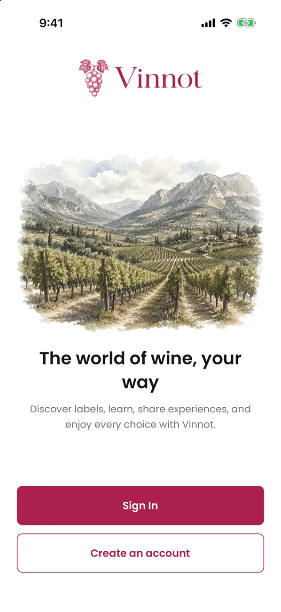

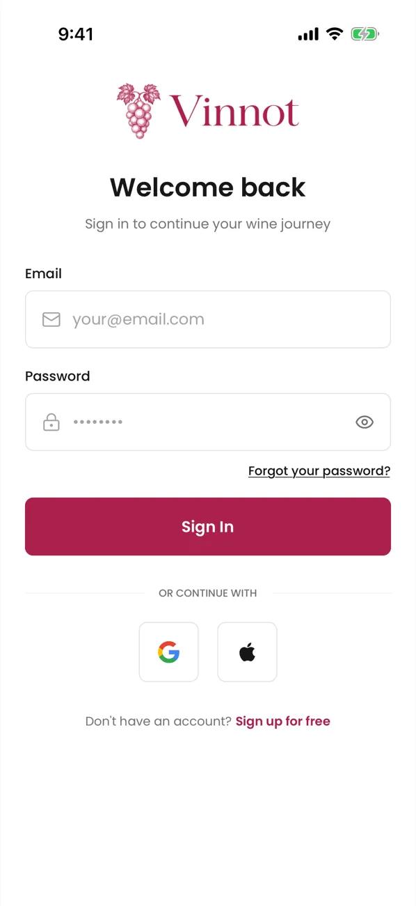

1. Install Vinnot from the [App Store](https://apps.apple.com/app/vinnot/id6817992780) or [Google Play](https://play.google.com/store/apps/details?id=com.vinnot.app).
2. Open the app. If you are not signed in, you see the welcome screen with “Sign In” and “Create an account”.
3. Choose “Create an account” and fill in username, first name, last name, email, password and password confirmation.
4. Tick the terms checkbox and send the form.
5. Open the verification email we send you and tap the link. Then sign in.

To sign in with Google or Apple, tap its button under “or continue with”. The first time, the app asks “What should we call you?”: pick a name with “Use this name”, or tap “Not now” to keep the temporary name.

To sign in later, use your email or username and your password. If you forgot it, tap “Forgot your password?”, enter your email and follow the link you receive. If the link was already used or has expired, the app tells you when you open it and offers “Request a new link”.

> - The username has 3 to 40 characters: letters, numbers, dots, hyphens or underscores.
> - The password needs at least 8 characters with an uppercase letter, a lowercase letter and a number.
> - Signing up does not sign you in: verify your email first. The link is valid for 24 hours; if it expired, request a new one from the same screen.
> - Apple appears only on iOS; Android offers Google.
> - The app remembers your session. When you open it again, you go straight to the home screen.

Use cases: [UC-USR-21](../modules/users/use-cases/uc-usr-21-welcome.md), [UC-USR-01](../modules/users/use-cases/uc-usr-01-sign-up.md), [UC-USR-02](../modules/users/use-cases/uc-usr-02-verify-email.md), [UC-USR-03](../modules/users/use-cases/uc-usr-03-sign-in.md), [UC-USR-04](../modules/users/use-cases/uc-usr-04-social-sign-in.md), [UC-USR-05](../modules/users/use-cases/uc-usr-05-complete-profile.md), [UC-USR-06](../modules/users/use-cases/uc-usr-06-restore-session.md), [UC-USR-09](../modules/users/use-cases/uc-usr-09-request-password-recovery.md), [UC-USR-10](../modules/users/use-cases/uc-usr-10-reset-password.md).

## Update the app

When your app version is no longer supported, opening it shows “Update Vinnot to continue” instead of the app.

1. Tap “Update”. The Vinnot listing opens in the App Store or Google Play.
2. Install the update and open the app again.

> - This screen cannot be closed: the app works again once the new version is installed.
> - If the app cannot check the version, for example without a connection, it opens as usual.

Use case: [UC-ADM-15](../modules/admin/use-cases/uc-adm-15-minimum-app-version.md).

## Accept the terms

Before you use the private parts of the app, you need to accept the current version of the terms.

1. When you sign up with email, tick the terms checkbox on the same form. You can expand the text before accepting it.
2. If you signed in with Google or Apple, or the terms changed, the app shows “Before we continue”.
3. Tick the checkbox and tap “Accept and continue”.

If you prefer not to accept yet, tap “Not now · sign out”. The app asks again the next time you sign in.

> - When a new version is published, you have 30 days to accept it and you can keep using the app meanwhile.
> - If the app cannot check your status, it shows “We couldn't verify your agreement” with an option to reload.
> - If the phone has no internet, it shows “No connection” with an illustration and “Try again”.
> - Help, contact and legal information open without accepting the terms.

Use cases: [UC-LEG-02](../modules/legal/use-cases/uc-leg-02-accept-at-sign-up.md), [UC-LEG-03](../modules/legal/use-cases/uc-leg-03-check-acceptance.md), [UC-LEG-04](../modules/legal/use-cases/uc-leg-04-accept-current-version.md), [UC-LEG-05](../modules/legal/use-cases/uc-leg-05-decline-and-sign-out.md).

## Allow notifications

Push notifications tell you about your tickets, event changes, wines and routes picked for you and activity on your reviews. They are on in your account; the phone permission decides whether they arrive.

1. The first time you open the app on a phone, “Turn on notifications” appears. Tap “Turn on”: the phone asks whether to allow notifications.
2. Tap “Allow” in the phone's prompt. If you are signed in, the app registers the phone for your account.
3. If you tap “Not now”, the app does not ask again until the next time you open it from scratch.

> - While notifications are off and you are signed in, every time you open the app from scratch “Turn on notifications” appears. Tap “Turn on”, or “Not now”. If you tapped “Don't Allow” in the phone's prompt, only Settings can turn them on: “Open Settings” takes you straight there. Returning to the app from the background does not show it.
> - If you decline the permission, the phone stops receiving pushes for your account.
> - After a ticket is confirmed, if you have not answered the permission yet, “Get updates about your events” appears.
> - On Android, the phone settings show one channel per kind of alert (“Tickets and account”, “Community”, “Recommendations”, “Events near you”, “Reminders” and “News”), so you can mute just one.
> - On iOS you cannot receive push notifications without this permission.
> - When you tap a notification, the app opens the related section: a ticket, an event, a wine, a route or a winery. If you are not signed in, it opens it after you sign in.
> - Alerts that can wait are not sent between 10 pm and 8 am in your time zone: they arrive from 8 am.

Use cases: [UC-NOT-03](../modules/notifications/use-cases/uc-not-03-allow-push.md), [UC-NOT-04](../modules/notifications/use-cases/uc-not-04-register-device.md), [UC-NOT-05](../modules/notifications/use-cases/uc-not-05-receive-push.md).

## Find your way around the app

The bottom bar has five tabs: “Home”, “Wines”, “Events”, “Routes” and “Profile”.

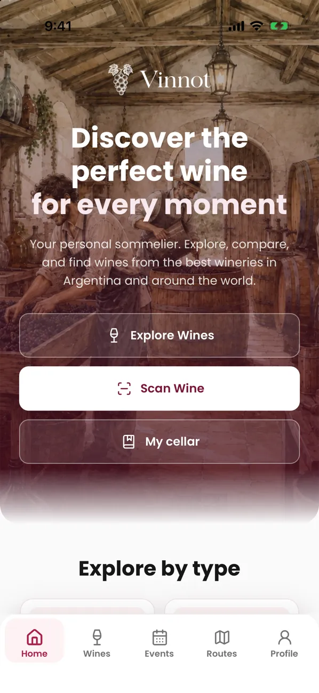

1. “Home” has shortcuts to “Wines”, “Events”, “Wine routes”, “Scan” and “My cellar”.
2. Tap a grape in “Popular grape varieties” to see its wines. Each grape is painted with the color of its wine.
3. In “Everything you need for wine discovery”, each card opens its section: “Wines”, the scanner, “Events” or “Routes”.
4. Further down you see “Featured wines”, “Nearby events” and “Wine routes”. Tap any card to open it.
5. Pull down to refresh the home screen.

> - “Nearby events” only appears if you allowed location access.
> - If you tap “Wines” again while viewing a wine, you go back to the catalog.
> - If “Featured wines”, “Nearby events” or “Wine routes” cannot load, that section shows the reason and “Retry” instead of looking empty.

Use cases: [UC-USR-22](../modules/users/use-cases/uc-usr-22-home.md), [UC-USR-23](../modules/users/use-cases/uc-usr-23-navigate.md).

## Scan a wine label

The scanner recognizes a wine from a photo of its label. You need to be signed in.

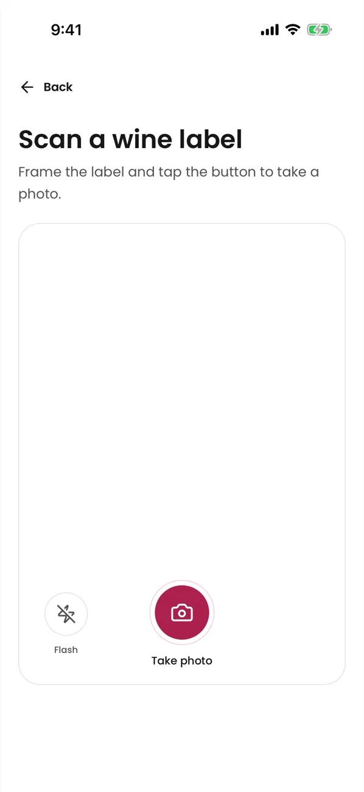

1. Tap “Scan” on the home screen or “Scan label” in “Wines”.
2. Allow camera access.
3. Frame the label and tap “Take photo”. Use “Flash” if needed.
4. Wait while the app shows “Analyzing...”.
5. Check the result:
   - “Wine Found!”: tap “View Details” to open its page.
   - “Possible matches”: pick the right wine.
   - No match: search manually or propose the wine (see the next section).
6. If the wine is not yours, tap “Not my wine”. To start over, tap “Scan another wine”.

> - If the photo is too dark, has glare, is out of focus or too small, the app tells you and asks for another shot.
> - If the analysis takes too long, the app keeps the photo so you can retry or search for the wine by name.
> - Messages from the scanner, and from a wine opened from it, appear on top of the scanner screen.
> - You can scan up to 30 labels per hour. If you reach the limit, the app tells you and suggests waiting a few minutes or searching for the wine by name.
> - If the photo is not a JPG or PNG up to 8 MB, has too much text or the server is busy, the app explains what happened and keeps the photo.
> - If the recognized wine had no image, opening it with “View Details” makes your photo its image. It never replaces an existing image, and picking a suggestion never changes any wine's photo.

Use cases: [UC-WIN-05](../modules/wines/use-cases/uc-win-05-scan-label.md), [UC-WIN-08](../modules/wines/use-cases/uc-win-08-attach-label-photo.md).

## Search for wines manually and propose a new one

You can search the catalog with text and filters and, if a wine is missing, propose it with a photo of its label.

### Search the catalog

1. Open “Wines”.
2. Type in “Search by wine name or winery...”. The search starts at 2 characters.
3. Use “Filter” to pick type, grape, country or region.
4. Scroll to the end of the list to load more wines.
5. Each card shows its review count, for example “(5) reviews”. Tap the underlined number or the word “reviews” to open the wine straight on its reviews.

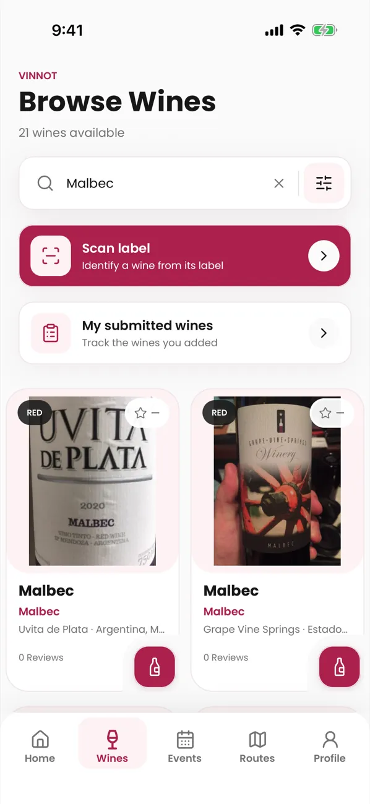

> - The first time, the app suggests your location's country. If you clear the filters, it does not suggest it again.
> - Changing the country clears the selected region.
> - Only the first 500 results can be browsed; refine your search if you cannot find the wine.
> - Under the title, the app says how many wines there are. Below 500 it shows the exact number; from 500 it says “Thousands of wines to discover” with no filters, “More than 500 wines from Argentina” when you only filter by country, or “More than 500 wines match your search”. While it loads it says “Searching wines…”.

### Add a wine you could not find

1. If the search finds nothing, you see “No wines found”. Tap “Add your wine”. If you had filters, “Clear” removes them.
2. The scanner opens with the title “Add your wine”. Take a photo of the label.
3. If the wine is already on Vinnot, the app shows it. If not, the form to propose it opens, with the name you searched already filled in when the label does not have one.
4. Review the details and tap “Submit for validation”.

If you don't have the wine with you, tap “Add without a photo” under “Don't have the bottle with you?” and fill in the details: only the name and the winery are required. Without a photo, the wine is not published right away: an administrator reviews it first and the proposal stays “Under review”. If the wine was already on Vinnot, the proposal takes you to the existing wine.

### Search from the scanner and propose a wine

1. In the scanner, tap “Search” and type at least 2 characters of the wine or winery name.
2. If your wine appears, tap it to open its page.
3. If it does not, tap “Can't find your wine? Add it”.
4. Review the detected details. Only “Wine name” and “Winery” are required; you can add type, vintage, grapes, country, region, alcohol and notes.
5. Tap “Submit for validation”.

To track your proposals, open Profile → “My submitted wines”. Each one shows its status: “Processing”, “Published”, “Existing wine”, “Under review”, “Changes requested” or “Rejected”.

> - If every check is safe, the wine is published right away. If there is any doubt, it stays “Under review” for the team.
> - If the wine already existed, the proposal takes you to the existing wine.
> - After you submit, a message tells you in your language what happened: published, already in the catalog, under review, changes requested or rejected.
> - You can propose up to 10 wines per day. Every status change is sent to you by email.

Use cases: [UC-WIN-01](../modules/wines/use-cases/uc-win-01-search-catalog.md), [UC-WIN-02](../modules/wines/use-cases/uc-win-02-page-catalog.md), [UC-WIN-06](../modules/wines/use-cases/uc-win-06-manual-search-from-scan.md), [UC-WIN-07](../modules/wines/use-cases/uc-win-07-submit-wine.md), [UC-WIN-09](../modules/wines/use-cases/uc-win-09-track-submissions.md), [UC-WRY-03](../modules/wineries/use-cases/uc-wry-03-countries-and-regions.md).

## The wine and winery pages

The wine page gathers the wine's details and its AI profile in two tabs: “Info” and “Profile”. The reviews close “Info”: scroll to the end to read them.

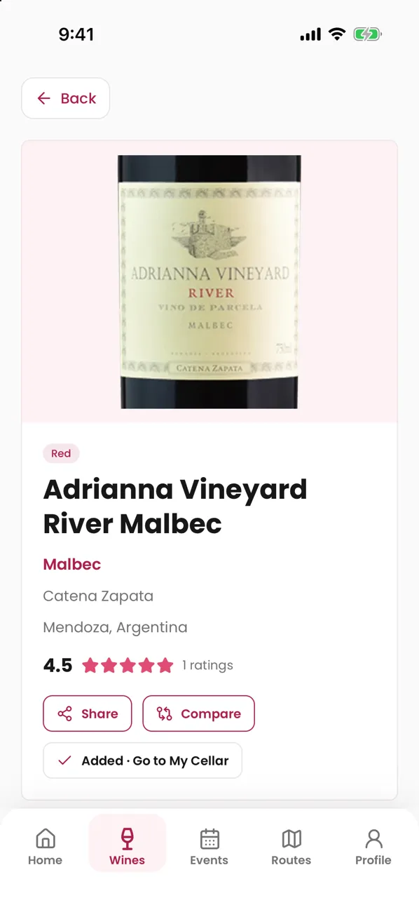

1. Open a wine from the catalog, the home screen, the scanner or your cellar.
2. “Info” shows the description, winery, region, grapes, alcohol, rating and the “Taste profile”.
3. From the page you can “Compare”, “Share” and “Add to Cellar”.
4. Tap the winery to open its page: logo, location, founding year, description, contact details, a map and the “Wines from this winery” grid.

> - If a detail is missing, the page does not show that block.
> - If the image is missing, a default image is shown.
> - If a wine or winery page cannot load (no connection or a server error), it shows the reason with “Retry” and “Back”. Only a wine or winery that no longer exists shows “not found”.
> - Opened from a shared link, “Back” on a winery takes you to the wineries list.

Use cases: [UC-WIN-03](../modules/wines/use-cases/uc-win-03-view-wine-detail.md), [UC-WRY-01](../modules/wineries/use-cases/uc-wry-01-view-winery.md), [UC-WRY-02](../modules/wineries/use-cases/uc-wry-02-search-wineries.md).

## Write a review

A review is your public opinion about a wine: a rating from 0.1 to 5.0 in glasses, the vintage you tasted, a title and a comment.

1. Open the wine and tap “Write review”, at the top or at the end of “Info”, where the reviews are. The form slides up from the bottom in a panel; swipe it down or tap “Back” to close it, and what you typed is kept for next time. Tapping “Cancel” after changing something asks “Discard your changes?”: “Keep editing” goes back to the form and “Discard” clears it. While the review is being sent, the panel stays open.
2. When the form opens, the bottle next to the glasses uncorks itself; underneath there is a bar with a small glass and “Drag the bottle or the bar to rate”. In your first three reviews, after the uncorking, a see-through bottle shows the gesture. Drag the bottle towards the glasses or slide the bar to choose from 0.1 to 5.0, or tap a glass: both move together and each whole number sits under its glass; the bottle is lifted and pours; while you raise the score the glasses fill and the bottle empties, and while you lower it the opposite happens. At 5.0 the bottle goes back to its place, empty. Only the rating is required, marked with (*); you can also add “Vintage”, “Title” and “Comment”.
   - In “Vintage”, type the year or tap one of the suggested years. If the wine has a vintage in the catalog, it comes first, marked “catalog”. To change it, tap the × on the pill.
3. Tap “Submit review”. The review is published immediately.

To edit it, tap “Edit” on your review: the same panel opens with your review; change what you want and tap “Save”. To remove it, tap “Delete” and confirm.

To like a review, tap its thumbs-up; tap it again to remove the like. To comment, tap the comment bubble, type in “Write a comment...” and tap “Send”.

> - You can write one review per wine. If you already wrote it, you see “You already shared your review for this wine.”.
> - The vintage shows on the review as a pill, for example “Vintage 2018”.
> - Each author's seal shows next to their name. Your review earns points for your seal: see [Points and seals](points-and-seals.mdx).
> - Publishing a review adds the wine to your cellar with the same rating. If you wrote a comment, it becomes the cellar notes; without a comment, your private notes are kept. If you chose a vintage, it is copied to the cellar too; without one, your cellar vintage is kept.
> - Deleting the review does not remove the wine from your cellar.
> - Comments have up to 2000 characters, publish immediately and cannot be edited; you can delete your own.
> - The app shows reviews 10 at a time: use “Previous” and “Next” to go through them and, when there is more than one, choose “Most recent” or “Most popular”.
> - An unsent review or comment is kept while the app stays open: you can switch tabs, collapse the comments or leave the wine and come back. It is cleared when you publish, when you cancel an edit and when you sign out.
> - Deleting a review or a comment shows a confirmation, or a message if it failed. While a like is saving the button cannot be tapped again.
> - If the reviews or the comments cannot load, tap “Retry”; you can still write your review.

Use cases: [UC-REV-01](../modules/reviews/use-cases/uc-rev-01-read-reviews.md), [UC-REV-02](../modules/reviews/use-cases/uc-rev-02-publish-review.md), [UC-REV-03](../modules/reviews/use-cases/uc-rev-03-edit-review.md), [UC-REV-04](../modules/reviews/use-cases/uc-rev-04-delete-review.md), [UC-REV-05](../modules/reviews/use-cases/uc-rev-05-like-review.md), [UC-REV-06](../modules/reviews/use-cases/uc-rev-06-review-comments.md).

## Your cellar

“My Cellar” is your personal collection: it keeps each wine once with your rating, the vintage you tasted, your private notes and the price you paid.

### See your cellar

1. Open “My cellar” from the home screen, the cellar card in your profile or a wine page.
2. At the top you see the cellar cover with “Add wine” and three figures: “Wines”, “Average” (with a glass) and distinct “Regions”. Below, a bar shows the mix of wine types with its legend.
3. Search with “Search your cellar...” or filter between “All”, “Rated” and “With notes”.
4. Pull down to refresh the list.

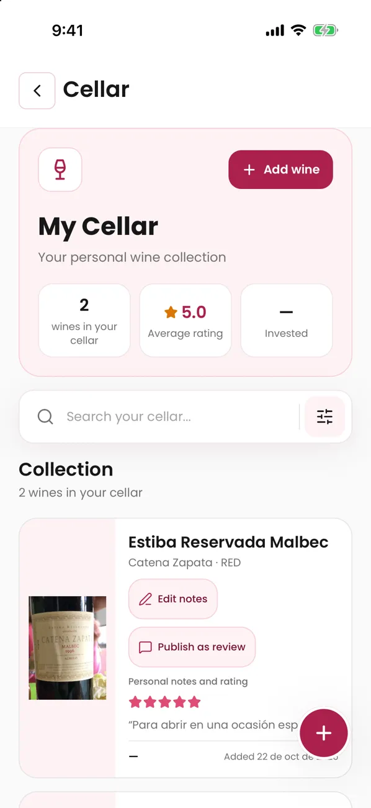

### Add, edit and remove wines

1. To add a wine, tap “Add to Cellar” on its page, or “Add wine” in the cellar and search for the wine. Wines already in your cellar appear with “Already in your cellar” and cannot be picked.
2. Optionally fill in “Rating”, “Vintage”, “Personal notes” and “Price paid”, then tap “Save”. The vintage shows on the wine row as “Vintage 2018”.
   - Type “Price paid” the way the app language writes numbers: in Spanish “1.500,50”, in English “1,500.50”. If the app cannot read the price, the field says so and nothing is saved.
3. Each wine has a “⋯” button on the right. It opens “Edit notes”, “View review” (or “Publish as review”), “Open wine” and “Delete”.
4. To change those details, choose “Edit notes” in that menu.
5. To remove a wine, choose “Delete” in the menu or swipe its row, then confirm “Remove from your cellar?”.

### Publish your note as a review

1. On a wine in your cellar, open the “⋯” menu and choose “Publish as review”.
2. Check the draft with your rating, vintage and notes, and confirm.

> - Your notes are private until you publish them as a review.
> - If you already reviewed that wine, the app offers “Open wine” so you can edit it; your note does not replace it automatically.
> - Removing a wine from your cellar does not delete it from the catalog or delete your review.
> - Amounts are shown in Argentine pesos. The app does not add up what you paid: the price shows on each wine.
> - Ratings are shown as glasses filled by the fraction, with the glass and the wine colour following the wine type. A 3.6 is three full glasses, 0.6 of the fourth and one empty glass.

Use cases: [UC-CEL-01](../modules/cellar/use-cases/uc-cel-01-view-cellar.md), [UC-CEL-02](../modules/cellar/use-cases/uc-cel-02-add-wine.md), [UC-CEL-03](../modules/cellar/use-cases/uc-cel-03-edit-entry.md), [UC-CEL-04](../modules/cellar/use-cases/uc-cel-04-remove-entry.md), [UC-CEL-05](../modules/cellar/use-cases/uc-cel-05-publish-note-as-review.md).

## AI profile and comparison

The AI profile is a sommelier analysis generated with artificial intelligence. The comparison puts two wines side by side and gives you a recommendation.

### View or generate the profile

1. Open the wine. On the “Exclusive Sommelier” card, tap “View Profile”.
2. You see the summary, visual analysis, aromas, palate, flavors, food pairings, serving, occasions and similar wines. The “Profile” tab on the wine page shows the same sections.
3. If the wine has no profile yet, the button says “Generate profile”: tap it and wait a few seconds.
4. If the profile cannot load, tap “Retry”. “Generate profile” only appears when the wine has no profile.

### Compare two wines

1. Tap “Compare” on a wine page.
2. Pick “Wine A” and “Wine B” with the search.
3. Tap “Compare”.
4. Read the summary, differences, similarities, attribute table, what each wine is best for and the recommendation.

> - Opening a profile never generates one: generating is always your choice.
> - The profile and the comparison are available in Spanish and English.
> - If the service does not respond, the app keeps your selection and lets you retry.
> - If generating a profile fails, a message explains why: the service took too long, you asked for too many in a row, or there is no connection.
> - You can generate up to 20 profiles and 20 comparisons per hour.
> - You must pick two different wines to compare.

Use cases: [UC-AI-01](../modules/ai/use-cases/uc-ai-01-view-ai-profile.md), [UC-AI-02](../modules/ai/use-cases/uc-ai-02-compare-wines.md).

## Taste quiz

The taste quiz is five illustrated questions that build a first taste profile while you have not rated wines yet.

1. The app offers it once after you sign in. You can also open it whenever you like from your public profile: “Take the taste quiz”, or “Retake the quiz” if you already took it.
2. Tap the option you like most in each question: a rainy day, your favorite fruit, a dessert, a special dinner and the scent you like most. The app moves on by itself; the arrow takes you back to the previous one with your answer still selected.
3. After the fifth answer you see “Defining your taste profile”: a pen draws your picks into a tasting journal, a glass fills with wine, and a brush shapes your taste wheel around a glass of wine. Then you reach your public profile with the result.

> - Tap “Skip” on any question if you would rather not take it: the app does not offer it again, and you can take it later from your profile.
> - If you leave while retaking the quiz, your previous answers are kept.
> - Your taste card says “Based on your taste quiz” while the profile relies on the quiz. The taste wheel appears once you rate 5 wines; until then, a locked wheel with a padlock holds its place.
> - The taste wheel is a flower of watercolor petals, one for each grape, style or region; the better you rated it, the longer the petal. It shows one thing at a time: “Grapes” (when it opens), “Styles” or “Regions”. Tap a petal, or its name below, to highlight it: the centre shows what it is, its average score and how many wines you rated. Tap it again to let go. Red grapes come in garnet and violet shades, white grapes in golds and greens, and rosé grapes in pinks.
> - If your answers cannot be saved, tap “Try again”: you do not need to answer again.

### Adjust your palate

You can fine-tune the structure of your palate (acidity, body, tannin and sweetness) by hand from your public profile.

1. On the “Your palate” card, tap “Adjust” next to “Structure”.
2. Drag each bar, or tap a point on the bar, to fill or empty it to your taste. The level word changes while you move it.
3. Tap “Save” to keep your changes, or “Cancel” to leave everything as it was.

> - Only the bars you changed are saved. A trait without data yet starts in the middle.
> - The traits you adjusted show an “Adjusted” tag and take priority over what Vinnot calculates from your ratings and your quiz.
> - “Reset to calculated”, in adjust mode, clears all your adjustments.
> - With a screen reader, swipe up or down on each bar to raise or lower it in steps of 5.
> - Only you see “Adjust”; visitors to your profile see the result.

## Events: register, pay and see your tickets

“Events” lists tastings, fairs, tours and other experiences. You can register, pay with Mercado Pago and check your tickets.

### Find an event

1. Open “Events”. If you shared your location, you see “Events nearby” first and then the rest.
2. Search by name or city, filter by type or country, or use “Search by area” to pick another place. The map centers on your location, or on the area you searched, zoomed to about 30 km.
3. Tap an event to see its image, description, date, venue, organizer, price and capacity.
4. From the event page you can “Open in Maps”, “Share” or report the event.

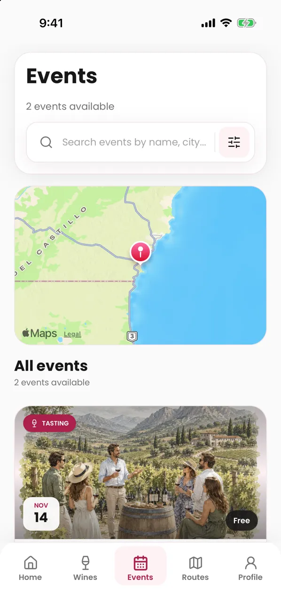

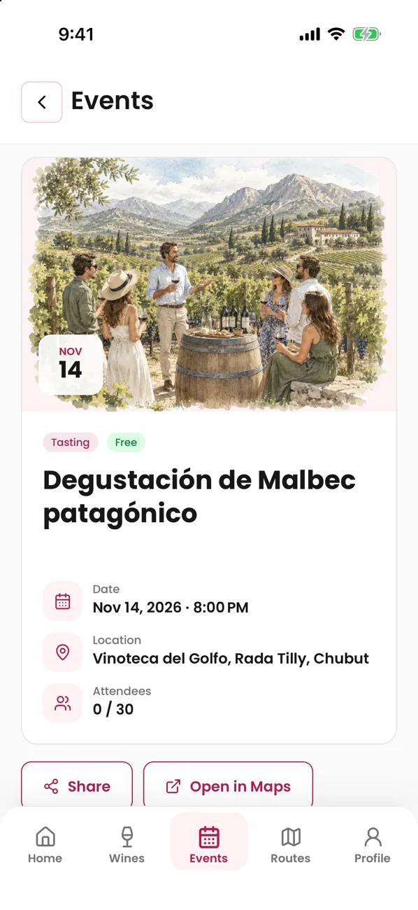

### Register

1. On the event page, tap “Register”. If you are not signed in, the app asks you to sign in and then returns to the event.
2. Choose the “Number of attendees” and enter your “Contact phone” with + and the country calling code.
3. Optionally tick “Save this phone for future reservations”.
4. Send the registration. The button says “Confirm registration”, “Send request” or “Continue to payment”, depending on the event.
5. Check the status under “Your registration”: “Confirmed”, “Requested”, “Waitlisted”, “Awaiting your confirmation” or “Awaiting payment”. If the organizer added contact details, you also see “Contact organizer” there.

### Pay with Mercado Pago

1. For a paid event, tap “Continue to payment” or, later, “Pay with Mercado Pago” on the event page.
2. Complete the payment in Mercado Pago.
3. When you finish, you return to the app, which shows the receipt with the payment status. While “Refresh status” checks it again, the button shows that it is working.

### Confirm or cancel

- If the event asks you to confirm attendance, tap “Confirm attendance” before the date shown in “Reservation valid until”.
- To cancel, tap “Cancel registration” and confirm.

### See your tickets

1. Open Profile → “My tickets”.
2. Tap “View ticket” to see the date, guests, venue, payment, organizer contact and the “Reference”.

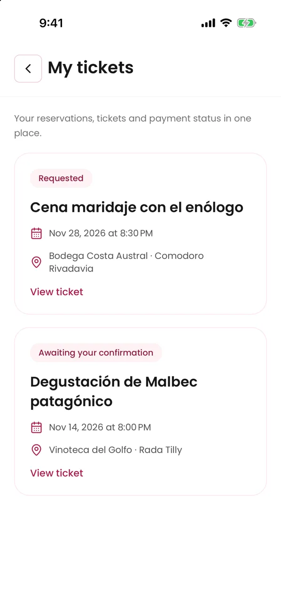

> - You can have one active registration per event, with 1 to 20 tickets within the event's maximum.
> - If there is no capacity, you join the waitlist; you are not moved up automatically when a place opens.
> - Returning from Mercado Pago does not confirm the payment: it is confirmed when Vinnot verifies it. If the receipt says it is pending, do not pay again.
> - A registration already paid online cannot be cancelled from the app: contact the organizer to cancel it and request the refund.
> - If the organizer cancels the event, your ticket says so and online payments are refunded.
> - The 12-character reference identifies your ticket; there is no QR code.

Use cases: [UC-EVT-01](../modules/events/use-cases/uc-evt-01-discover-events.md), [UC-EVT-02](../modules/events/use-cases/uc-evt-02-view-event.md), [UC-EVT-03](../modules/events/use-cases/uc-evt-03-register-for-event.md), [UC-EVT-04](../modules/events/use-cases/uc-evt-04-confirm-attendance.md), [UC-EVT-05](../modules/events/use-cases/uc-evt-05-cancel-registration.md), [UC-EVT-06](../modules/events/use-cases/uc-evt-06-my-tickets.md), [UC-PAY-01](../modules/payments/use-cases/uc-pay-01-pay-registration.md), [UC-PAY-02](../modules/payments/use-cases/uc-pay-02-checkout-return.md).

## Wine routes and maps

Wine routes are journeys with stops at wineries, restaurants, viewpoints and accommodation.

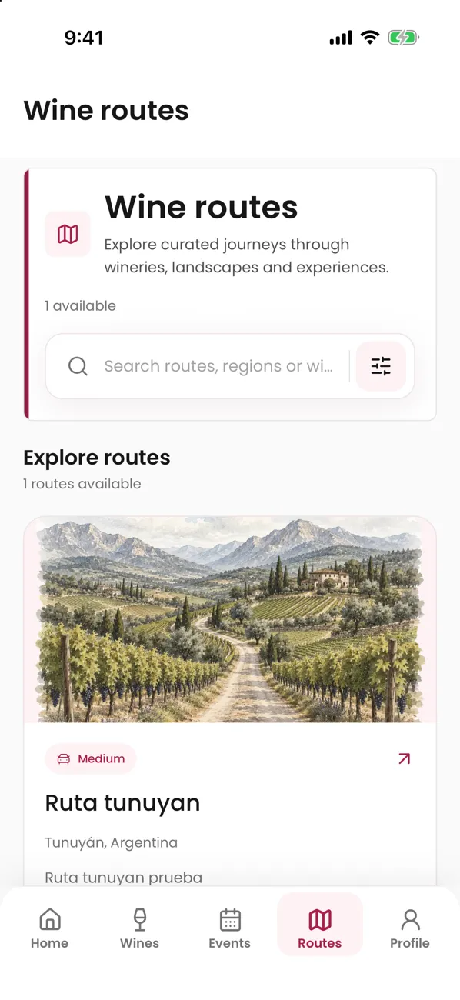

1. Open “Routes”. Each card shows country, region, length, stops, distance and duration.
2. Search with “Search routes, regions or wineries...” or filter by length, country or region. Scroll to the end to load more routes.
3. Tap a route to see its cover, “About this route”, “Quick info” and “Route stops”.
4. Tap a stop to see its description, address and contact details, or tap “Open in Maps” to get there.
5. On the “Route map”, tap “Start route” to open Google Maps with every stop in order.

> - The length (“Short”, “Medium”, “Long”) describes how long the journey is, not how physically demanding it is. If the route has none, it is not shown.
> - The journey time is shown in hours and minutes; when the route is only estimated in days, it is shown in days.
> - Vinnot does not track your location or record your journey.
> - From the route page you can also “Share” or report the route.

Use cases: [UC-RTE-01](../modules/wine-routes/use-cases/uc-rte-01-browse-routes.md), [UC-RTE-02](../modules/wine-routes/use-cases/uc-rte-02-view-route.md), [UC-RTE-03](../modules/wine-routes/use-cases/uc-rte-03-navigate-stops.md), [UC-RTE-04](../modules/wine-routes/use-cases/uc-rte-04-share-or-report-route.md).

## Share and open links

You can share a wine, an event or a route with a public Vinnot link.

1. On the page, tap “Share”.
2. Choose the app or contact in your phone's share sheet.

When someone opens the link:

1. If they have the app installed, the link opens the wine, event or route directly.
2. If not, they see a preview with “Already have the app? Open in Vinnot”, “Continue on the web” and the download buttons.

> - The link only carries the content, never your personal data.
> - If you install the app from the preview, open the link again after installing it.
> - If the content requires a session, the app asks you to sign in and then takes you to the content.
> - A link to something that is no longer public says it is not available.
> - “Share” only appears on content with a public page: an event already published that is not a draft, and a published route.

Use cases: [UC-SHR-01](../modules/sharing/use-cases/uc-shr-01-share-content.md), [UC-SHR-02](../modules/sharing/use-cases/uc-shr-02-open-shared-link.md), [UC-SHR-03](../modules/sharing/use-cases/uc-shr-03-open-in-app-or-web.md), [UC-USR-07](../modules/users/use-cases/uc-usr-07-resume-protected-destination.md).

## Choose your notifications

You decide which alerts you get by “Email” and by “App” in each category.

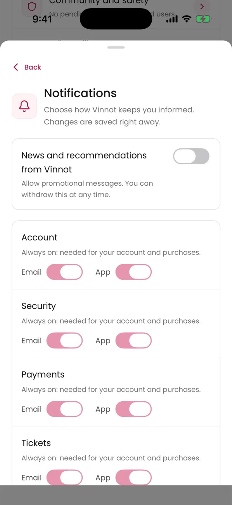

1. Open Profile → “Notifications”.
2. Turn each channel on or off. Changes are saved right away. Each category only shows the channels it uses.
3. If you turn off “News and recommendations from Vinnot”, you stop getting “Recommendations” and “Newsletter”. “Reminders” covers wines you viewed, your cellar and your events.
4. Under “Your area”, tap “Use my approximate location” or “Search for a region or city” to get “Events near you” alerts. Tap “Stop” to remove the area.

> - “Account”, “Security”, “Payments” and “Tickets” are always on.
> - The other categories start turned on.
> - The area is saved rounded; Vinnot never stores your exact location.
> - If the phone has no permission, the sheet offers “Allow notifications” or “Open Settings”.
> - Promotional emails include an unsubscribe link.

Use cases: [UC-NOT-01](../modules/notifications/use-cases/uc-not-01-manage-preferences.md), [UC-EVT-07](../modules/events/use-cases/uc-evt-07-event-area.md), [UC-NOT-06](../modules/notifications/use-cases/uc-not-06-receive-email.md).

## Report or block

If something breaks the community rules, you can report it. If you do not want to interact with someone, you can block them.

### Report

1. On a review or a comment, tap the three dots at its top right and choose “Report content” or “Report user”. On an event or a route, tap “Report content”.
2. Choose a “Reason”: “Spam”, “Harassment”, “Hate or discrimination”, “Sexual content”, “Violence or threats”, “Privacy”, “Misleading information” or “Other”.
3. Optionally add a description of up to 2000 characters. It is required with “Other”.
4. Tap “Submit report”. You see “Report received”.

### Block

1. On a review or a comment, tap the three dots at its top right and choose “Block user”.
2. Read the notice and confirm.

### Follow your reports and blocks

1. Open Profile → “Community and safety”.
2. Check “My reports” with their status (“Received”, “Under review”, “Resolved” or “Dismissed”) and “Blocked users”.
3. Each report shows a short report number. Tap the copy icon next to it to copy the full number and share it with support.
4. Tap “Unblock” to remove a block.

> - Only the moderation team sees your identity and the report details.
> - You cannot report your own content. You can send up to 10 reports per day. If something fails, the app tells you why: limit reached, too many attempts in a row or content that is no longer available.
> - Blocking hides reviews, comments and profiles between both accounts and prevents new likes and comments. Events and routes stay visible.
> - Closed reports disappear from the list after 90 days.
> - To ask for a decision to be reviewed, write through Contact with the report reference.

Use cases: [UC-COM-01](../modules/community/use-cases/uc-com-01-report-content.md), [UC-COM-02](../modules/community/use-cases/uc-com-02-block-user.md), [UC-COM-03](../modules/community/use-cases/uc-com-03-my-community.md).

## Your account

From “Profile” you see your stats and manage your details, security and session.

### Profile and details

1. Open “Profile”. Under the header you see your “Stats”, such as your reviews and the wines in your cellar. Then “Quick access” takes you to “My cellar”, “My tickets”, “My public profile”, “My submitted wines” and “Community and safety”. Further down, “Settings” gathers your photo, password, account, notifications and language.
   - The header shows your seal, your points and a bar toward the next seal. Tap the seal to open “Your points” ([Points and seals](points-and-seals.mdx)).
2. Tap “Edit profile” at the top to change your username, first name, last name or phone.
3. Tap “Change photo” and choose “Take photo” or “Choose from gallery”.
4. Tap “App language” and choose “Spanish” or “English”.

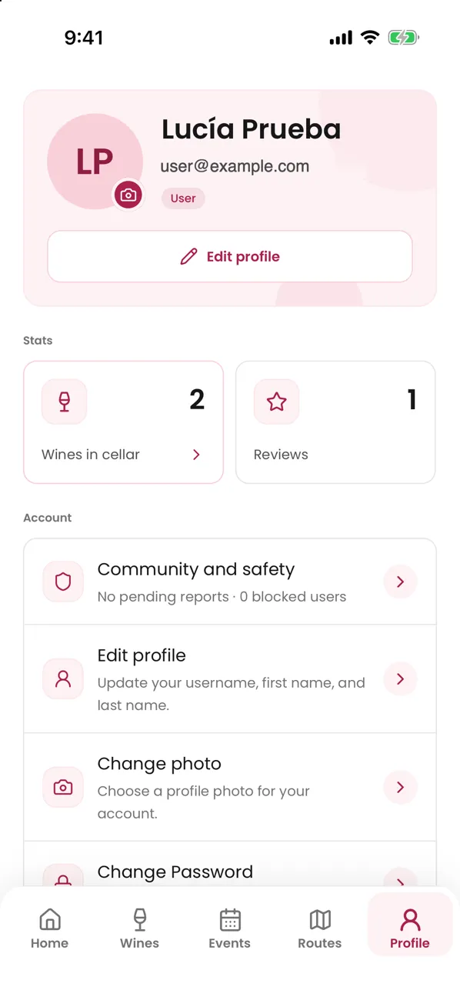

### Password and email

1. Tap “Change Password” and fill in the current password, the new one and its confirmation.
2. If you created the account with Google or Apple and have no password yet, you see “Create password” instead: you get an email link to set it. If your account already has a password, you can change it even if you also sign in with Google or Apple.
3. To change your email, open “Account and security”, enter the “New email” and tap “Send confirmation”. Confirm from the link sent to the new address.

### Deactivate, delete and sign out

1. In “Account and security”, tap “Deactivate account” and confirm. When you sign in again, the app offers “Reactivate account”.
2. To delete it, tap “Permanently delete account” and type exactly “I agree to delete my account”.
3. To leave, tap “Logout” at the bottom of the profile.

> - Some sensitive actions show “Confirm your identity”: confirm with your password or with Google or Apple.
> - The phone number is private and must include + and the country calling code.
> - Your current email stays active until you confirm the new one.
> - Deactivating is reversible and keeps your data. Deleting is permanent; if you use Apple, it asks for one last authorization.
> - The language also sets the language of your notifications.

Use cases: [UC-USR-13](../modules/users/use-cases/uc-usr-13-view-profile.md), [UC-USR-14](../modules/users/use-cases/uc-usr-14-edit-profile.md), [UC-USR-15](../modules/users/use-cases/uc-usr-15-change-avatar.md), [UC-USR-16](../modules/users/use-cases/uc-usr-16-change-password.md), [UC-USR-17](../modules/users/use-cases/uc-usr-17-request-email-change.md), [UC-USR-12](../modules/users/use-cases/uc-usr-12-reauthenticate.md), [UC-USR-18](../modules/users/use-cases/uc-usr-18-deactivate-account.md), [UC-USR-19](../modules/users/use-cases/uc-usr-19-delete-account.md), [UC-USR-20](../modules/users/use-cases/uc-usr-20-change-language.md), [UC-USR-08](../modules/users/use-cases/uc-usr-08-sign-out.md).

## Help and contact

The app includes help, a contact form and the legal documents.

### Help and legal documents

1. Open Profile → “Help and support” and search the frequently asked questions.
2. Open Profile → “Privacy” to see the legal centre: terms, privacy, community guidelines, moderation, payments and cancellations, and more.

### Write to the team

1. Open “Contact” from the help or the legal centre.
2. Fill in “Name”, “Email”, the “Topic” (“Support”, “Privacy”, “Report”, “Review a decision”, “Partnership” or “General”) and the “Message”.
3. Tap “Send enquiry”.
4. Keep the reference shown after “Request received. Reference:”. You also get an acknowledgement email with that reference.

> - Do not write passwords or card details in the message.
> - If sending fails, the form keeps what you wrote so you can retry.
> - When something fails, the app shows a screen with the reason (offline, timeout, service unavailable) and an action to retry or go back home.

Use cases: [UC-SUP-01](../modules/support/use-cases/uc-sup-01-read-public-information.md), [UC-SUP-02](../modules/support/use-cases/uc-sup-02-contact-support.md), [UC-SUP-03](../modules/support/use-cases/uc-sup-03-service-states.md), [UC-LEG-01](../modules/legal/use-cases/uc-leg-01-legal-centre.md).
