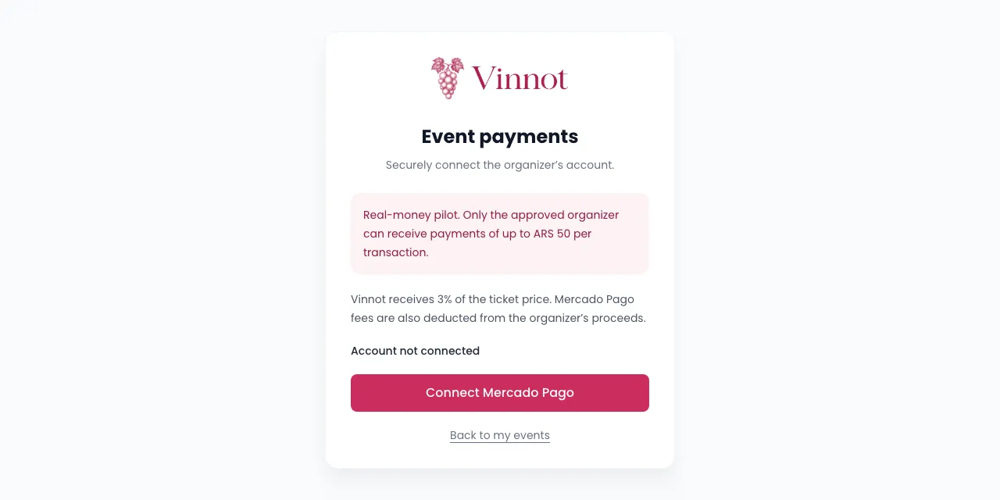
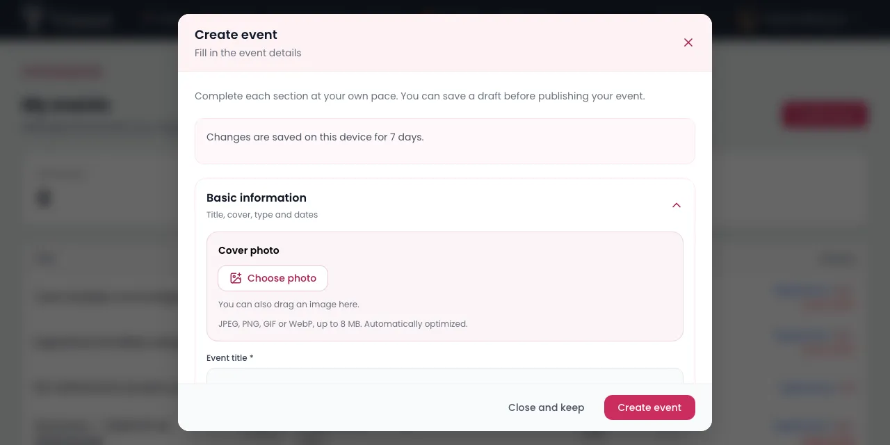
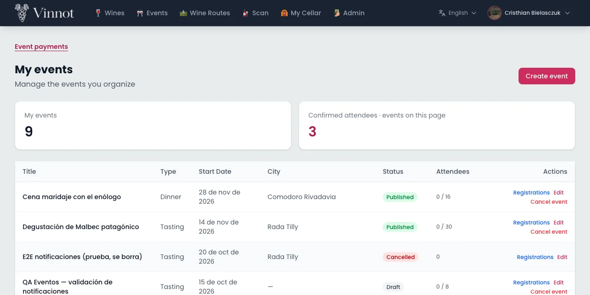
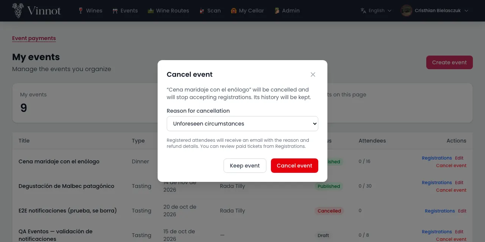
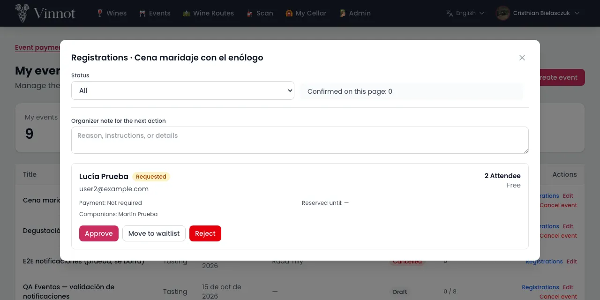

# Partner manual

This manual is for people who organize events on Vinnot with the partner role. It
explains how to publish and manage your own events, collect registration payments with
Mercado Pago, review the people who register and refund payments, on the web and in the
app. Button and screen names appear exactly as Vinnot shows them.

## Contents

- [How to get the partner role](#how-to-get-the-partner-role)
- [Connect your Mercado Pago account](#connect-your-mercado-pago-account)
- [Create an event](#create-an-event)
- [Edit an event and change its status](#edit-an-event-and-change-its-status)
- [Cancel an event](#cancel-an-event)
- [Review registrations](#review-registrations)
- [Refunds](#refunds)
- [Notices you receive](#notices-you-receive)

## How to get the partner role

The partner role gives you access to "My events", where you manage the events you
organize. There is no application form: an administrator grants the role.

1. Ask the Vinnot team for the role, giving the email address of your account.
2. Wait for an administrator to grant you the role.
3. Open "My events":
   - On the web, from your account menu in the header.
   - In the app, from your profile, under "Partner panel".

Notes:

- "My events" shows only the events you organize, with their date, status and registrations.
- If you do not have the role, the section does not appear.

Related use case: [View my events](../modules/partner/use-cases/uc-par-01-list-own-events.md).

## Connect your Mercado Pago account

To publish paid events you need to connect your Mercado Pago account. Ticket payments
are credited to that account.

1. Open the connection:
   - On the web, go to "My events" and choose "Event payments". You can also use the "Connect my Mercado Pago" link in the editor's "Registration" section, which opens that page in another tab.
   - In the app, open an event's editor, choose "Online payment with Mercado Pago" in the "Registration" section and tap "Connect my Mercado Pago".
2. On the web, choose "Connect Mercado Pago".
3. Sign in to Mercado Pago and authorize Vinnot.
4. When you come back to Vinnot, the connection finishes on its own:
   - On the web, the page shows "Account successfully connected".
   - If you started in the app, choose "Return to the Vinnot app"; the editor checks the connection again and shows the connected account.

Notes:

- Vinnot receives a percentage of the ticket price; today it is 3%. The "Event payments" page and the event editor show the current percentage. A sale keeps the fee it was made with. Mercado Pago fees are also deducted from your proceeds.
- You must connect your own organizer account, not the Vinnot platform account.
- The authorization expires after a few minutes. If you see that the connection expired or was already used, start again from Vinnot.
- You cannot disconnect an account, only connect it again with "Connect another account". If your account already has transactions, you can reconnect the same account; to switch to a different one, contact support.
- You can save a paid event as a draft without a connected account, but you cannot publish it.

Related use case: [Link the Mercado Pago account](../modules/payments/use-cases/uc-pay-03-link-payment-account.md).

## Create an event

The editor walks you through the event in sections. You can save it as a draft and
publish it later.

1. In "My events", choose "Create event".
2. Fill in "Basic information": title, cover, type, dates and status.
3. In "Location", search for the place or mark the point on the map.
4. In "Contact", say how people can reach you.
5. In "Registration", choose the registration type:
   - "Free": choose the approval, manual by you or automatic based on availability, and whether attendees must confirm their place.
   - "Online payment with Mercado Pago": enter the price in Argentine pesos (ARS). Attendees pay in Mercado Pago and their ticket is confirmed automatically once the payment is verified.
6. Fill in the capacity, the registration deadline, the maximum tickets per registration and the temporary hold time.
7. Choose "Create event". If any field is invalid, the editor opens the section with the error.

Notes:

- If you leave the capacity empty, the event has no attendee limit.
- Each registration can ask for 1 to 20 tickets.
- The registration deadline cannot be later than the event start.
- The temporary hold lasts between 5 minutes and 7 days: it is the time a person has to pay or confirm their place.
- Approval and attendee confirmation can only be set for free events.
- The editor keeps what you type on your device for 7 days. If you close it with "Close and keep", when you come back you can choose "Resume draft" or "Discard draft".
- A paid event can only be published with a connected Mercado Pago account.

Related use case: [Create an event](../modules/partner/use-cases/uc-par-02-create-event.md).

## Edit an event and change its status

You can correct your events' details and publish them, move them back to draft or mark
them as completed.

1. In "My events", find the event:
   - On the web, choose "Edit" in its row.
   - In the app, tap "Edit event" on its card.
2. Change the details you need.
3. To change the status, use the "Status" field in "Basic information":
   - "Draft": the event is not shown to the public.
   - "Published": the event appears on Vinnot and accepts registrations.
   - "Completed": the event is over.
4. Choose "Save changes".

Notes:

- The "Status" field does not offer "Cancelled". To cancel an event, use the "Cancel event" action (see the next section), which notifies registered people and refunds payments.
- "Sold out" is set by the system when the capacity fills up and removed when a place frees up; you do not choose it. On the web, a sold-out event shows as "Published" in the editor; saving other changes keeps it sold out.
- A cancelled event cannot change status again.
- A completed event can go back to "Published" or "Draft", but it cannot be cancelled.
- If you empty an optional field, such as the phone or the website, and save, that value is cleared; fields you do not touch keep their value.
- You can only edit your own events.

Related use case: [Edit an event and change its state](../modules/partner/use-cases/uc-par-03-edit-event.md).

## Cancel an event

Cancelling stops registrations, notifies registered people and refunds online payments.
The event is not deleted: it keeps its history with the "Cancelled" status.

1. In "My events", find the event and choose "Cancel event".
2. Check the reason for cancellation. "Unforeseen circumstances" is preselected; change it if another reason fits better.
3. If you choose "Other reason", you can add "Additional details (optional)", up to 280 characters.
4. Confirm with "Cancel event". If you change your mind, choose "Keep event".

Notes:

- Registered people receive an email with the reason and information about refunds.
- Credited online payments are refunded automatically; you do not need to request them one by one. You can follow their status in "Registrations".
- A completed event cannot be cancelled.
- Cancelling cannot be undone and the event cannot be published again; the dialog reminds you before you confirm.

Related use case: [Cancel an event](../modules/partner/use-cases/uc-par-04-cancel-event.md).

## Review registrations

From the registrations manager you decide who attends your event and follow the status
of each payment.

1. In "My events", find the event:
   - On the web, choose "Registrations" in its row.
   - In the app, tap "Manage registrations" on its card.
2. Filter by status, for example "Requested", "Waitlisted" or "Confirmed", or choose "All".
3. Choose the action for the registration. Vinnot asks you to confirm each one:
   - "Approve": for a free event it confirms the registration, or leaves it waiting for the attendee's confirmation if the event asks for it. For a paid event it leaves it "Awaiting payment". The confirmation has an optional note for that attendee.
   - "Move to waitlist": puts it on the waitlist.
   - "Reject": rejects it.
4. When you move to the waitlist or reject, choose the reason that attendee will see (on the web, "Reason for" and their name). "No reason" is preselected; the other options are, for example, "No spots are left" or "The event is full for now". If you choose "Other", you can write the note.

Notes:

- You only see the actions that are possible for each registration's status.
- A confirmed or finished registration cannot be rejected.
- The waitlist does not move forward on its own when a place frees up: you decide whom to approve.
- You do not credit payments by hand: only Mercado Pago confirms a payment.
- If a person does not pay or confirm before their hold expires, the registration expires and frees the place.
- The reason or note only goes to the attendee you are reviewing. With "No reason", none is sent. If the action fails, what you chose is kept so you can retry.

Related use case: [Review registrations](../modules/partner/use-cases/uc-par-05-review-registrations.md).

## Refunds

You can refund the payment of a registration for a paid event. A refund is always for
the full amount and cancels that registration.

1. Open the event's registrations (see the previous section).
2. Find the registration and choose "Refund payment".
3. Check the amount and confirm. The registration is cancelled and its place is freed.
4. Vinnot shows "Refund requested" while Mercado Pago processes it. In the app, tap "Refresh payments" to see the latest status.

Notes:

- Only credited payments that have no other refund and are not under review can be refunded.
- There are no partial refunds.
- If a person with a confirmed paid ticket wants to cancel, you do the cancellation with a refund.
- When you cancel an event, online payments are refunded automatically.
- If Mercado Pago rejects a refund (for example, because your account balance is not enough), no money moves: you get an email with the reason and the registration shows the rejection. Fix the cause and choose "Retry refund"; Vinnot does not send it again on its own. Until then, the person still sees it as pending.

Related use case: [Refund a registration payment](../modules/payments/use-cases/uc-pay-04-refund-registration.md).

## Notices you receive

Vinnot keeps you informed about activity on your events and your payment account.

- **One email for each new registration** in your events.
- **One summary push per event**, roughly every 15 minutes, with confirmed, requested and cancelled registrations. Tapping it opens your events.
- **A notice when you connect your Mercado Pago account.**
- **A notice if you need to reconnect Mercado Pago**, for example when the authorization expired. Connect the account again as explained in [Connect your Mercado Pago account](#connect-your-mercado-pago-account).

Notes:

- If you cancel an event, its pending summary is discarded.
- Push notifications follow your notification preferences and quiet hours.

Related use case: [Notify the organizer of registrations](../modules/partner/use-cases/uc-par-06-organizer-notices.md).
