# Web user manual

This manual explains how to use the Vinnot website ([vinnot.com](https://vinnot.com)) to discover wines, wineries, events and wine routes, keep your wines in your cellar, write reviews and manage your account. It runs from your first visit to account management. Event organizers and the Vinnot team have their own manuals.

## Contents

- First visit: what you can see without an account
- Create an account and sign in
- Recover your password
- Accept the terms
- Find your way around
- Search for wines
- View a wine and its winery
- Write a review
- Like, comment on and edit reviews
- Keep wines in your cellar
- AI profile and wine comparison
- Scan labels
- Discover events
- Register for an event and pay
- View your tickets
- Explore a wine route
- Share
- Choose your notifications
- Report or block
- Your account: details, password, language, deactivate or delete
- Help and contact
- Legal documents
- When something goes wrong

## First visit: what you can see without an account

Without signing in you can see the home page, "About Us", "Help", "Contact" and the legal documents. The wine catalog, events, routes, cellar and every other feature need an account.

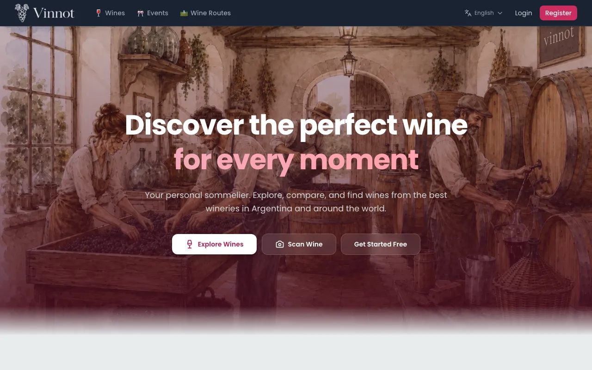

1. Open [vinnot.com](https://vinnot.com).
2. Explore the home page: wine types, popular grape varieties, events and routes.
3. If you choose a feature that needs a session, the site takes you to sign in and, once you are in, brings you back to the page you chose.

[UC-USR-22](../modules/users/use-cases/uc-usr-22-home.md) · [UC-USR-07](../modules/users/use-cases/uc-usr-07-resume-protected-destination.md) · [UC-SUP-01](../modules/support/use-cases/uc-sup-01-read-public-information.md)

## Create an account and sign in

You can register with your email and a password, or sign in with Google or Apple.

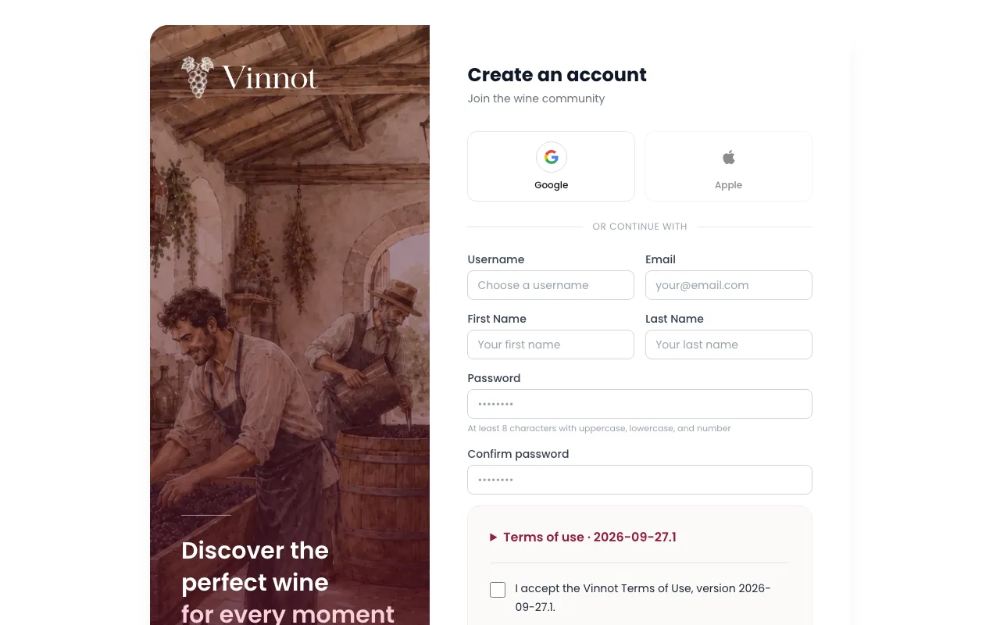

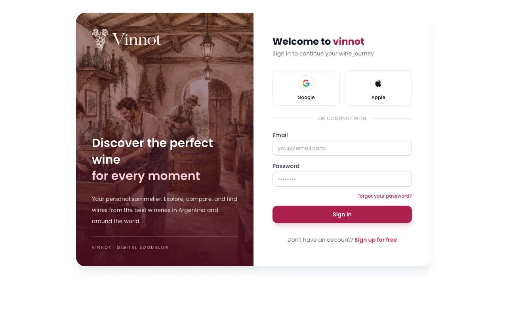

**Register with email**

1. Choose "Register" in the header.
2. Fill in username, email, first name, last name, password and its confirmation.
3. Expand and read the terms if you want, and tick the acceptance box.
4. Press "Create Account".
5. Open the link sent to your email to verify the account. If it did not arrive or has expired, choose "Resend verification email".

**Sign in**

1. Choose "Login".
2. Enter your email and password, or choose to continue with Google or Apple.
3. If it is your first time with Google or Apple, pick a username with "Use this username" or keep the temporary one with "Skip for now".

Notes:

- Usernames are 3 to 40 characters long: letters, numbers, dot, hyphen and underscore, starting and ending with a letter or number.
- Passwords have at least 8 characters, with an uppercase letter, a lowercase letter and a number.
- Registering does not sign you in: you must verify your email first. The verification link lasts 24 hours and works only once.
- If the account is deactivated, the site asks "Reactivate your account?" when you try to sign in. Choose "Reactivate account" to get your profile and data back, or "Cancel" to stay signed out.
- "Login" and "Register" in the header or the menu bring you back to the page you were on once you are signed in.
- To sign out, open your profile menu and choose "Logout".

[UC-USR-01](../modules/users/use-cases/uc-usr-01-sign-up.md) · [UC-USR-02](../modules/users/use-cases/uc-usr-02-verify-email.md) · [UC-USR-03](../modules/users/use-cases/uc-usr-03-sign-in.md) · [UC-USR-04](../modules/users/use-cases/uc-usr-04-social-sign-in.md) · [UC-USR-05](../modules/users/use-cases/uc-usr-05-complete-profile.md) · [UC-USR-06](../modules/users/use-cases/uc-usr-06-restore-session.md) · [UC-USR-08](../modules/users/use-cases/uc-usr-08-sign-out.md)

## Recover your password

If you forgot your password, you can ask for a link to choose a new one.

1. On the sign-in page, choose "Forgot your password?".
2. Enter your email and press "Send recovery link".
3. Open the link sent to your email.
4. Type the new password, confirm it and press "Change password".

Notes:

- The site shows the same confirmation whether or not an account exists for that email.
- The link lasts 60 minutes and works only once. If it has expired, choose "Request a new link".
- Changing the password signs out your sessions on other devices.

[UC-USR-09](../modules/users/use-cases/uc-usr-09-request-password-recovery.md) · [UC-USR-10](../modules/users/use-cases/uc-usr-10-reset-password.md)

## Accept the terms

To use the private parts of the site you must accept the current version of the terms. Registering with email already accepts them; if you signed in with Google or Apple, or if the terms changed, the site asks you when you sign in.

1. On the "Before we continue" screen, expand the text if you want to read it.
2. Tick the box.
3. Press "Accept and continue".

Notes:

- If you would rather not accept now, choose "Not now · sign out". No decision is stored and you will be asked again next time.
- When a new version is published, you have a 30-day notice period to keep using the site before you must accept it.
- The legal centre and "Contact" stay available without accepting.

[UC-LEG-02](../modules/legal/use-cases/uc-leg-02-accept-at-sign-up.md) · [UC-LEG-03](../modules/legal/use-cases/uc-leg-03-check-acceptance.md) · [UC-LEG-04](../modules/legal/use-cases/uc-leg-04-accept-current-version.md) · [UC-LEG-05](../modules/legal/use-cases/uc-leg-05-decline-and-sign-out.md)

## Find your way around

The header, the menu and the footer give access to every section.

1. Use the header to go to "Wines", "Events", "Wine Routes" and "Scan".
2. Open your profile menu to go to "My Profile", "My tickets" and "My Cellar", or to "Logout".
3. Use the footer for "About Us", "Contact", "Help", "Legal" and the other legal documents.
4. On a phone, open the menu button at the top left. The menu opens over the page; close it with its close button or the Escape key, and the focus goes back to the menu button.

[UC-USR-23](../modules/users/use-cases/uc-usr-23-navigate.md)

## Search for wines

The catalog brings together the wines published on Vinnot. You can search them by text and filter them.

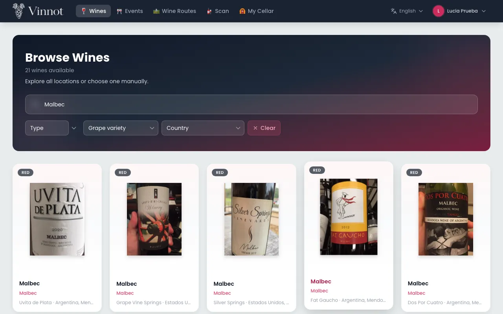

1. Choose "Wines".
2. The first time, if you allow it, the site suggests the country of your location. You can change or remove it.
3. Type the name of a wine or a winery.
4. Filter by type, grape variety, country or region.
5. Move through the results with "Previous" and "Next".

Notes:

- Search starts at 2 characters and matches wine and winery names.
- Changing the country clears the chosen region. "Clear" removes every filter.
- Each page shows 20 wines and only the first 500 results can be browsed; if you cannot find what you want, refine the search.

[UC-WIN-01](../modules/wines/use-cases/uc-win-01-search-catalog.md) · [UC-WIN-02](../modules/wines/use-cases/uc-win-02-page-catalog.md) · [UC-WRY-03](../modules/wineries/use-cases/uc-wry-03-countries-and-regions.md)

## View a wine and its winery

A wine's page shows its details, its taste profile and its reviews, and from there you reach the winery.

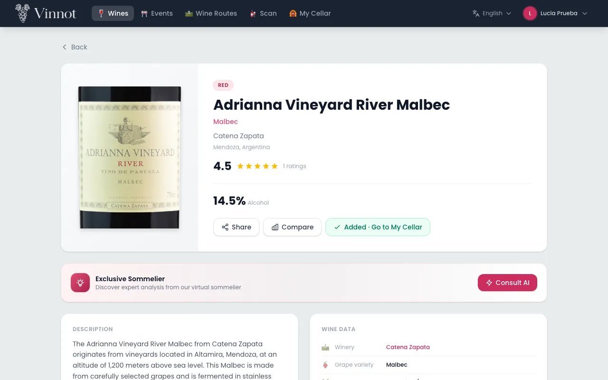

1. Open a wine from the catalog, the home page or another section.
2. Check the description, the winery and origin, the grapes, the alcohol, the rating and the "Taste profile".
3. From the page you can go to the winery, "Compare", "Share" or "Add to Cellar".
4. The winery page shows its logo, location on a map, founding year, description, contact details and "Wines from this winery".

Notes:

- When a detail is missing, that block is not shown.
- The winery page lists its active wines 20 at a time.
- If the wine or winery cannot load, for example without a connection, the page explains it and offers "Retry". A wine or winery that no longer exists shows that it was not found, with a link to the wine catalogue.
- "Back" returns to the previous page. If you opened the page directly, for example from a shared link, it takes you to the list instead: the catalogue for wines and wineries, events for an event and wine routes for a route.

[UC-WIN-03](../modules/wines/use-cases/uc-win-03-view-wine-detail.md) · [UC-WRY-01](../modules/wineries/use-cases/uc-wry-01-view-winery.md)

## Write a review

A review shares your opinion of a wine with the community.

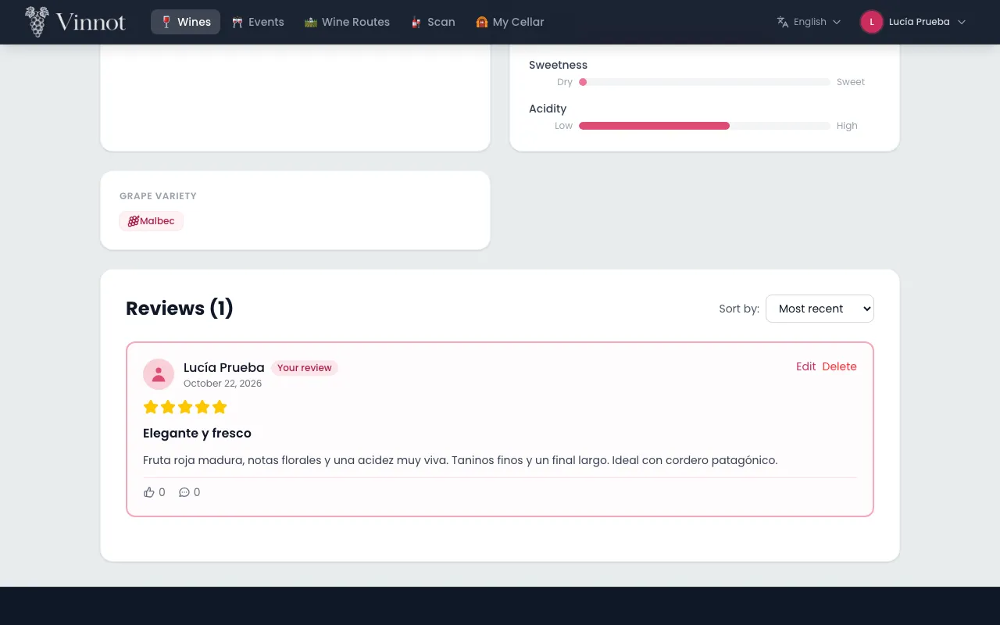

1. On the wine's page, choose "Write Review".
2. Choose a rating from 0.1 to 5.0, the only required field (*): when the form opens the bottle next to the glasses uncorks itself, with a bar with a small glass, the score and “Drag the bottle or the bar to rate” underneath, and in your first three reviews, after the uncorking, a see-through bottle shows the gesture; drag it towards the glasses, slide the bar or click a glass, and it pours. Each whole number sits under its glass. At 5.0 it goes back to its place, empty. With the keyboard, the arrows change 0.1, Page Up and Page Down change 0.5, and Home and End go to the minimum and the maximum.
3. If you want, choose the vintage you tasted in "Vintage". The wine's label vintage appears first; typing the year jumps to it.
4. Add a title and a comment if you want.
5. Press "Submit review".

Notes:

- You can write one review per wine. If you already have one, you will see "Your review" instead of the form.
- The review is published immediately. Moderation acts afterwards, based on reports.
- The title accepts up to 255 characters.
- The vintage you choose shows on your review as a pill, for example "Vintage 2018". It is the vintage you tasted and can differ from the wine's label vintage.
- When you publish it, the wine is added to your cellar with your rating. If you wrote a comment, it becomes the cellar notes; without a comment, your private notes are kept. If you chose a vintage, your cellar note takes it too; without one, the cellar vintage is kept.
- Reviews can be sorted by "Most recent" or "Most popular" and are shown 20 at a time.
- Without an account you can read reviews; choose "Log in to write a review" and you come back to the same wine after signing in.
- If the reviews cannot load, the section offers "Retry" instead of saying there are no reviews.

[UC-REV-01](../modules/reviews/use-cases/uc-rev-01-read-reviews.md) · [UC-REV-02](../modules/reviews/use-cases/uc-rev-02-publish-review.md)

## Like, comment on and edit reviews

You can react to other people's reviews and keep your own up to date.

1. Tap a review's like to give it; tap it again to remove it.
2. Open a review's comments, write your comment and press "Send".
3. To change your review, choose "Edit", change the rating, vintage, title or comment and press "Save Changes". Choosing "No vintage" removes the vintage.
4. To remove your review or your comment, choose "Delete" and confirm.

Notes:

- You can give one like per review, including your own. The review's author receives likes in a summary.
- Comments accept up to 2000 characters, are published immediately and cannot be edited.
- Editing your review also updates your cellar. Deleting it removes its comments and likes, but does not remove the wine from your cellar.

[UC-REV-03](../modules/reviews/use-cases/uc-rev-03-edit-review.md) · [UC-REV-04](../modules/reviews/use-cases/uc-rev-04-delete-review.md) · [UC-REV-05](../modules/reviews/use-cases/uc-rev-05-like-review.md) · [UC-REV-06](../modules/reviews/use-cases/uc-rev-06-review-comments.md)

## Keep wines in your cellar

Your cellar ("My Cellar") is your personal collection: it keeps each wine once, with your rating, your private notes and the price you paid.

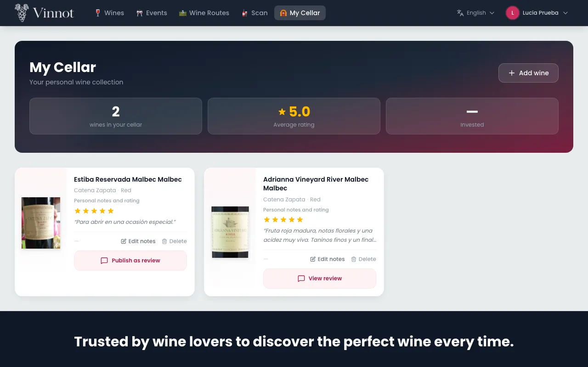

1. On the wine's page, choose "Add to Cellar".
2. Add, if you want, a rating from 0.1 to 5.0, the vintage you tasted, notes and the purchase price.
3. Confirm with "Add wine". You see "Wine added to your cellar".
4. Open "My Cellar" from the menu to see your wines and the summary: "Wines", "Average", "Regions" and the mix of types. The purchase price shows on each wine.
5. To change your details, choose "Edit notes" on a wine. "No vintage" removes the vintage.
6. To remove a wine, choose "Delete" and confirm. You see "Wine removed from your cellar".
7. To share your note, choose "Publish as review", check the draft and confirm. The draft starts with your rating, vintage and notes.

Notes:

- If the wine is already in your cellar, its page shows "Added · Go to My Cellar".
- Cellar notes are private until you publish them as a review. If you already have a review of that wine, that review opens instead of a new one being created.
- Removing a wine from the cellar does not delete your review.
- The vintage you tasted shows on the wine as a pill, for example "Vintage 2018".
- Amounts are shown in Argentine pesos. Notes accept up to 10000 characters.
- The "Edit notes" and "Publish as review" dialogs do not close when you click outside them. If you close them with changes you have not saved, the site asks whether to discard them; while saving they cannot be closed. On short screens the edit dialog scrolls inside, so "Save" stays reachable.

[UC-CEL-01](../modules/cellar/use-cases/uc-cel-01-view-cellar.md) · [UC-CEL-02](../modules/cellar/use-cases/uc-cel-02-add-wine.md) · [UC-CEL-03](../modules/cellar/use-cases/uc-cel-03-edit-entry.md) · [UC-CEL-04](../modules/cellar/use-cases/uc-cel-04-remove-entry.md) · [UC-CEL-05](../modules/cellar/use-cases/uc-cel-05-publish-note-as-review.md)

## AI profile and wine comparison

The sommelier profile describes a wine in depth and the comparison puts two wines side by side. Both are generated with artificial intelligence.

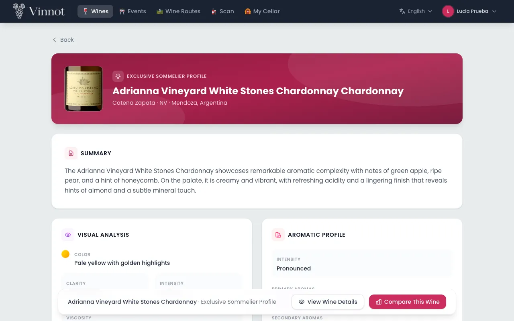

**View or generate the AI profile**

1. On the wine's page, find the "Exclusive Sommelier" card.
2. Choose "View Profile" if it already exists, or "Generate profile" if it does not yet.
3. Read the summary, visual analysis, aromas, palate, flavors, food pairings, serving, occasions and similar wines.

**Compare two wines**

1. Choose "Compare" on a wine's page, or "Compare This Wine" on its AI profile.
2. Search for and choose the second wine. You can use "Swap" or "Clear All".
3. Once two wines are chosen, the site shows the summary, key differences, similarities, the attribute table, what each one suits best and the recommendation.

Notes:

- Reading a profile never generates a new one; generating is an explicit action.
- While a profile or a comparison is being written, a watercolor scene shows each step: the bottle is opened, the wine poured, the aromas rise and the notes are written.
- Profiles and comparisons exist in Spanish and English.
- You can generate up to 20 profiles and run up to 20 comparisons per hour. If the AI is unavailable, your selection is kept and you can retry later.
- Choose two different wines to compare.

[UC-AI-01](../modules/ai/use-cases/uc-ai-01-view-ai-profile.md) · [UC-AI-02](../modules/ai/use-cases/uc-ai-02-compare-wines.md)

## Scan labels

Label scanning is available in the Vinnot app, not on the web.

1. Choose "Scan" in the header.
2. The site shows how to download the app to scan with your phone's camera.

[UC-WIN-04](../modules/wines/use-cases/uc-win-04-scan-invitation.md)

## Discover events

The events section shows tastings, fairs, dinners and other current activities.

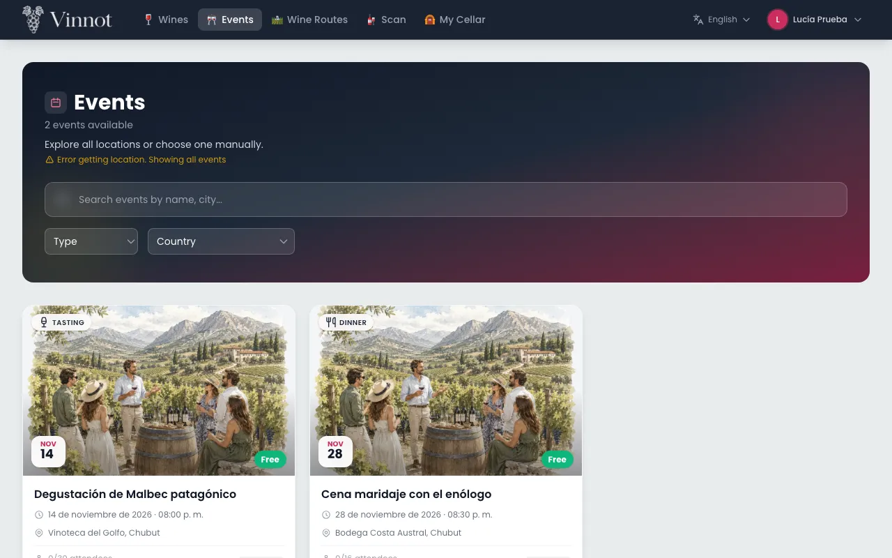

1. Choose "Events".
2. If you share your location, you first see events within 100 km and then the rest.
3. Filter by text, type, country or region.
4. Open an event to see its image, description, date, venue, organizer, price and places.
5. From the event you can choose "Open in Maps", contact the organizer, "Share" or report the event.

Notes:

- Only published or sold-out events that have not ended are listed.
- The search, filters and page are kept in the page address, so going back from an event returns to the same list.
- A cancelled or finished event stays visible from its links, with its status and without registration.

[UC-EVT-01](../modules/events/use-cases/uc-evt-01-discover-events.md) · [UC-EVT-02](../modules/events/use-cases/uc-evt-02-view-event.md)

## Register for an event and pay

You can book a place at an event and, if it is paid, pay with Mercado Pago.

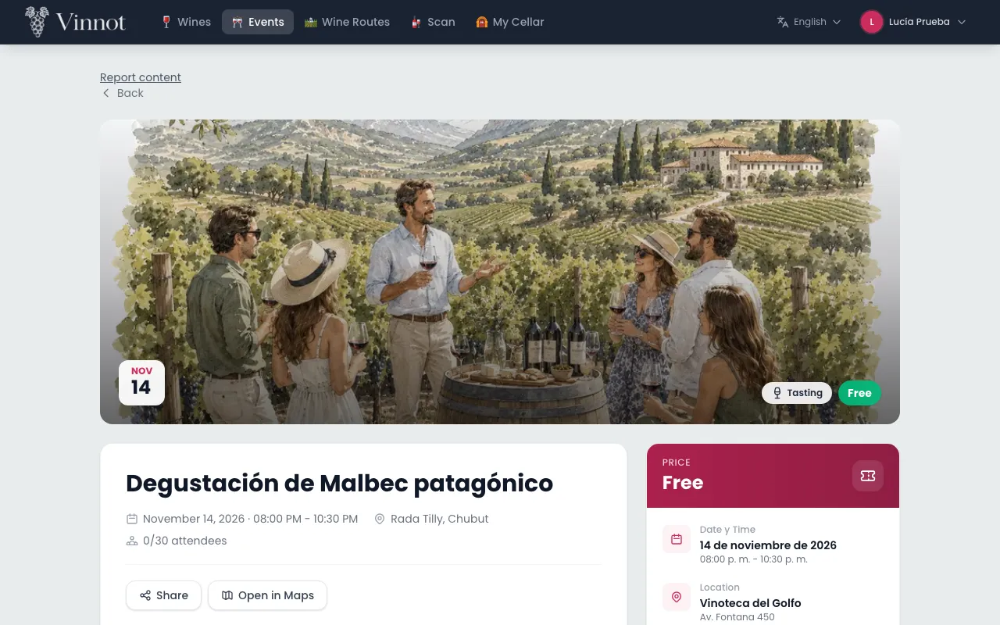

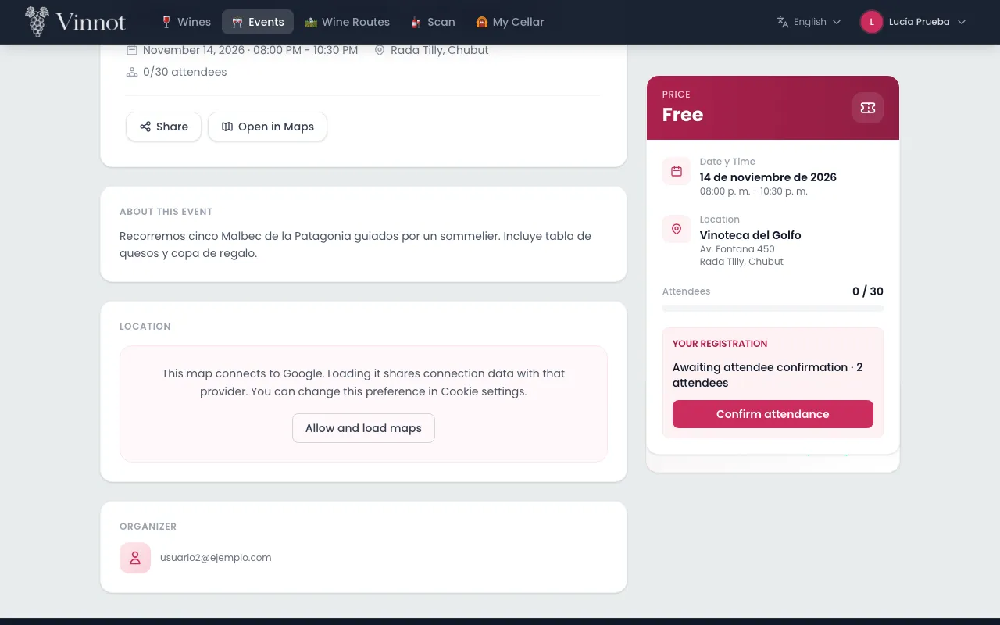

1. On the event page, choose "Register".
2. Enter the "Number of attendees" and your contact phone. Your name and email come from your account.
3. If you want, tick "Save this phone for future reservations".
4. Check the total and the conditions, and confirm:
   - "Confirm registration" for a free event with automatic approval.
   - "Send request" if the organizer approves each registration.
   - "Continue to payment" for a paid event.
5. For a paid event, complete the payment in Mercado Pago. When you come back, the site shows the payment status and a link to "My tickets".
6. If the event asks you to confirm attendance, go back to the event and choose "Confirm attendance" before the date shown.

Notes:

- Your registration status can be "Requested", "Awaiting payment", "Awaiting your confirmation", "Confirmed", "Waitlisted", "Rejected", "Cancelled" or "Expired".
- You can have one active registration per event. Each request accepts up to the event's maximum (6 tickets by default, never more than 20).
- Your place is held for a limited time while you pay or confirm; if the hold expires, the place is released.
- If there are no places left, you are waitlisted; you are not confirmed automatically when a place frees up.
- Coming back from Mercado Pago does not confirm the payment: Vinnot verifies it with Mercado Pago, and the page refreshes on its own while it is pending. If the payment was left pending, you can resume it with "Pay with Mercado Pago" on the event.
- Payments are in Argentine pesos. Refunds are full and are issued by the organizer; if the event is cancelled, online payments are refunded without you having to ask.
- To cancel your registration, choose "Cancel registration" in "Your registration" and confirm. A registration already paid online cannot be cancelled here: ask the organizer.
- If you close the registration dialog after changing the number of attendees or the phone, the site asks before discarding the changes. It does not close while the registration is being sent.

[UC-EVT-03](../modules/events/use-cases/uc-evt-03-register-for-event.md) · [UC-EVT-04](../modules/events/use-cases/uc-evt-04-confirm-attendance.md) · [UC-EVT-05](../modules/events/use-cases/uc-evt-05-cancel-registration.md) · [UC-PAY-01](../modules/payments/use-cases/uc-pay-01-pay-registration.md) · [UC-PAY-02](../modules/payments/use-cases/uc-pay-02-checkout-return.md) · [UC-PAY-04](../modules/payments/use-cases/uc-pay-04-refund-registration.md)

## View your tickets

"My tickets" gathers all your registrations, their statuses and their payments.

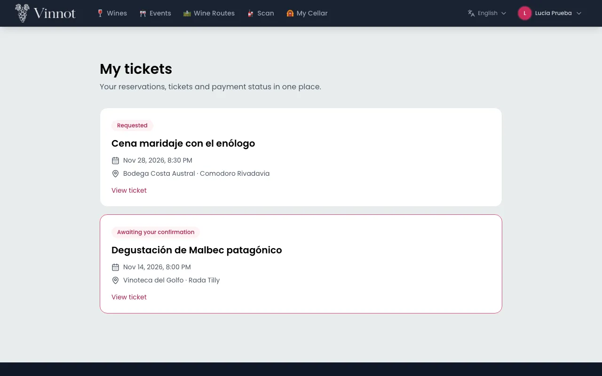

1. Open your profile menu and choose "My tickets".
2. Check the list, from newest to oldest.
3. Choose "View ticket" to see the date and time, guests, location, payment, organizer contact and the "Reference".
4. Use "Refresh status" to see the latest status.

Notes:

- The 12-character reference identifies your ticket. There is no QR code.
- If the event was cancelled, the ticket says so.
- The list page is kept in the page address, so going back from a ticket returns to the same page.

[UC-EVT-06](../modules/events/use-cases/uc-evt-06-my-tickets.md)

## Explore a wine route

Wine routes suggest a trip through wineries and other stops.

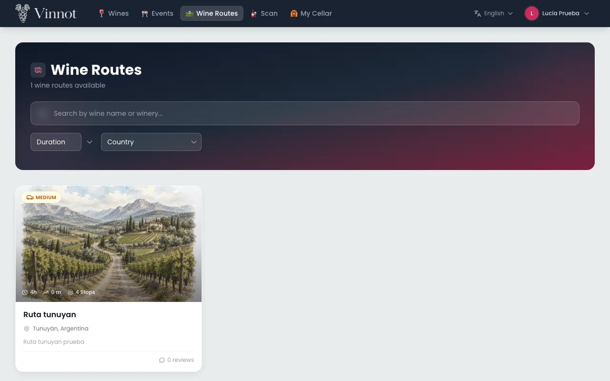

1. Choose "Wine Routes".
2. Filter by text, length (short, medium or long), country or region.
3. Open a route to see its cover, description, distance, duration and recommended wine types.
4. Check the "Route Stops" and expand each one to see its description, address and contact details.
5. Open a stop in Google Maps, or choose "Start Route" to navigate the whole trip by car.

Notes:

- Filters apply to every published route, so the count and the pages match the results. The search, filters and page are kept in the page address, so going back from a route returns to the same list.
- Short, medium or long describes the length of the trip, not its difficulty. If the route has none, it is not shown.
- The trip time is shown in hours and minutes; when the route is only estimated in days, it is shown in days.
- Vinnot does not follow your location or record your trip.

[UC-RTE-01](../modules/wine-routes/use-cases/uc-rte-01-browse-routes.md) · [UC-RTE-02](../modules/wine-routes/use-cases/uc-rte-02-view-route.md) · [UC-RTE-03](../modules/wine-routes/use-cases/uc-rte-03-navigate-stops.md) · [UC-RTE-04](../modules/wine-routes/use-cases/uc-rte-04-share-or-report-route.md)

## Share

You can share a wine, an event or a route with a public link.

1. On its page, choose "Share".
2. Pick where to share it in your browser's share sheet. If the browser cannot share, the link is copied.
3. Whoever receives the link sees a preview without signing in, with "Open in Vinnot", "Continue on the web" and the app downloads.

Notes:

- The link contains none of your data.
- Seeing the full content requires signing in; afterwards the shared content opens.
- If the content is no longer public, the preview says the link is no longer available.
- "Share" only appears on content with a public page: an event already published that is not a draft, and a published route.

[UC-SHR-01](../modules/sharing/use-cases/uc-shr-01-share-content.md) · [UC-SHR-02](../modules/sharing/use-cases/uc-shr-02-open-shared-link.md) · [UC-SHR-03](../modules/sharing/use-cases/uc-shr-03-open-in-app-or-web.md)

## Choose your notifications

You can choose which notices you get by email and in the app, and the area where you want to hear about new events.

1. Open "My Profile" and choose the "Notifications" tab.
2. For each category, switch "Email" and "App" on or off. If a category does not use a channel, you see "—" instead.
3. If you turn off "News and recommendations from Vinnot", you stop getting recommendations and news.
4. In "Your area", choose a region to hear about new events there. Choose "Stop receiving" to remove it.

**Unsubscribe from an email**

1. In a promotional email, choose the unsubscribe link.
2. On the page that opens, press "Unsubscribe".
3. To review the rest, choose "Manage notification preferences".

Notes:

- "Account", "Security", "Payments" and "Tickets" are mandatory and always sent.
- Every category starts switched on. If you turn off "News and recommendations from Vinnot", you stop getting "Recommendations" and "Newsletter".
- "Reminders" covers wines you viewed, your cellar and your events.
- Suggestions and reminders in the app arrive at most twice a week and never between 22:00 and 09:00 in your time zone.
- Emails arrive in your account's language.
- The approximate location for nearby events is set from the app.

[UC-NOT-01](../modules/notifications/use-cases/uc-not-01-manage-preferences.md) · [UC-NOT-02](../modules/notifications/use-cases/uc-not-02-unsubscribe.md) · [UC-NOT-06](../modules/notifications/use-cases/uc-not-06-receive-email.md) · [UC-EVT-07](../modules/events/use-cases/uc-evt-07-event-area.md)

## Report or block

If something breaks the community rules, you can report it. If you do not want to interact with someone, you can block them.

**Report**

1. On a review or a comment, open the three-dots menu at its top right and choose "Report content" or "Report user". On an event or a route, choose "Report content". The report form opens in a dialog from the menu.
2. Choose a reason: "Spam", "Harassment", "Hate or discrimination", "Sexual content", "Violence or threats", "Privacy", "Misleading information" or "Other".
3. Add a description if you want. With "Other" it is required.
4. Press "Submit report". You will see the report receipt.

**Block and unblock**

1. On a review or a comment, open the three-dots menu at its top right, choose "Block user" and confirm.
2. To see your reports and blocks, open "Your community activity" from "My Profile".
3. In "Blocked users", choose "Unblock" to remove a block.

Notes:

- You cannot report your own content. If you already have an open report on the same content, you get the same receipt.
- You can send up to 10 reports in 24 hours. The description accepts up to 2000 characters. If a report or a block fails, the site tells you why: daily limit, too many requests in a row, your own content or content that is no longer available.
- The Vinnot team reviews every report; there are no automatic sanctions based on the number of reports.
- A block works both ways: it hides reviews, comments and profiles, and prevents likes and comments between the two accounts. Events and routes stay visible.
- Closed reports disappear from your activity 90 days after closing. To ask for a decision to be reviewed, write through "Contact" with the case reference.

[UC-COM-01](../modules/community/use-cases/uc-com-01-report-content.md) · [UC-COM-02](../modules/community/use-cases/uc-com-02-block-user.md) · [UC-COM-03](../modules/community/use-cases/uc-com-03-my-community.md)

## Your account: details, password, language, deactivate or delete

From "My Profile" you manage your details, your security and your account.

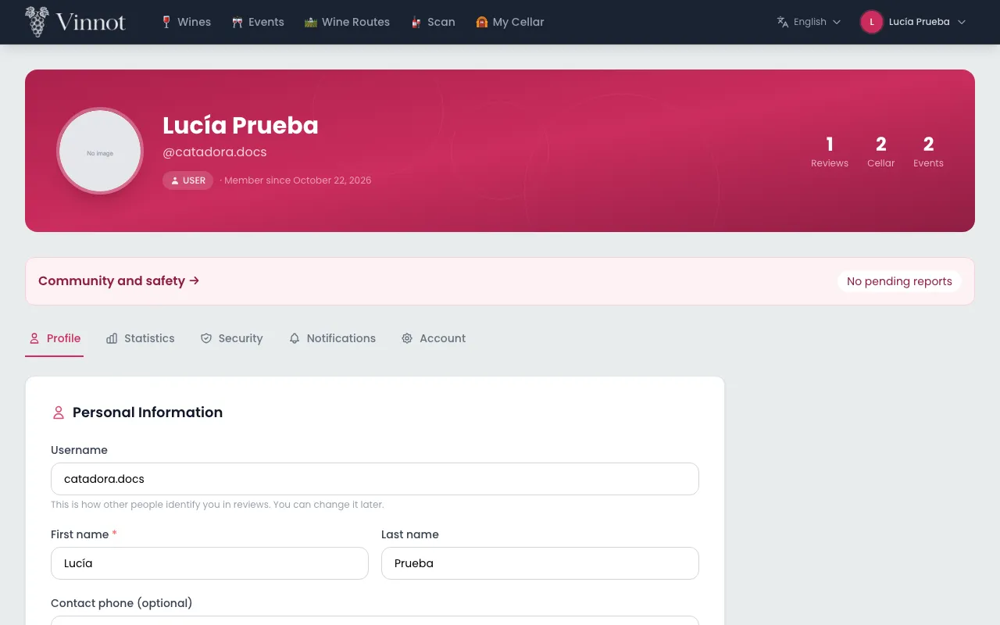

**Details and avatar**

1. Open "My Profile" from the menu.
2. In the "Profile" tab, change your username, first name, last name or phone and press "Save Changes".
3. To change your picture, choose "Change" on the avatar and upload an image of up to 5 MB.
4. In "Statistics" you see your reviews, your average rating, the wines in your cellar and your event registrations.
5. At the top of the profile you see your seal, your points and a bar toward the next seal. Click the seal to open "Your points" ([Points and seals](points-and-seals.mdx)).

**Password**

1. In the "Security" tab, enter the current password, the new one and its confirmation.
2. Press "Change Password".
3. If you created the account with Google or Apple and have no password yet, the tab shows "Send password setup link": you get an email link to set one. If your account already has a password, you can change it even if you also sign in with Google or Apple.

**Email**

1. In the "Account" tab, choose "Change email" and enter the new one.
2. Press "Send confirmation" and confirm your identity.
3. Open the link sent to the new email. Until then, the old one stays in use.

**Language**

1. Use the language selector in the header and choose "Español" or "English".

**Deactivate or delete the account**

1. In the "Account" tab, go to "Danger Zone".
2. Choose "Deactivate account" and confirm, or "Permanently delete account".
3. To delete it, type the exact phrase "I agree to delete my account" and confirm your identity.

Notes:

- The phone must include `+` and the country code. It is private: it does not appear on your public profile.
- Changing the password or the email signs out your other sessions and you get an email notice. The email change link lasts 60 minutes.
- For sensitive actions, such as changing the email or deleting the account, "Confirm your identity" appears: use your password or your Google account and press "Confirm and perform action".
- The chosen language is saved in your account and used for your notifications. Text written by users is not translated.
- Deactivating is reversible and does not delete your data; to reactivate the account, sign in again and choose "Reactivate account". Deleting is permanent and removes your account and your data.

[UC-USR-13](../modules/users/use-cases/uc-usr-13-view-profile.md) · [UC-USR-14](../modules/users/use-cases/uc-usr-14-edit-profile.md) · [UC-USR-15](../modules/users/use-cases/uc-usr-15-change-avatar.md) · [UC-USR-16](../modules/users/use-cases/uc-usr-16-change-password.md) · [UC-USR-17](../modules/users/use-cases/uc-usr-17-request-email-change.md) · [UC-USR-11](../modules/users/use-cases/uc-usr-11-confirm-email-change.md) · [UC-USR-12](../modules/users/use-cases/uc-usr-12-reauthenticate.md) · [UC-USR-20](../modules/users/use-cases/uc-usr-20-change-language.md) · [UC-USR-18](../modules/users/use-cases/uc-usr-18-deactivate-account.md) · [UC-USR-19](../modules/users/use-cases/uc-usr-19-delete-account.md)

## Help and contact

Help answers frequent questions and "Contact" lets you write to the Vinnot team.

1. Choose "Help" in the footer, or "Browse frequently asked questions" on "Contact".
2. Type in the search box to filter the questions.
3. If you cannot find the answer, open "Contact".
4. Fill in name, email, topic and message. The topics are "Support", "Privacy", "Report content", "Review a decision", "Partnership" and "General enquiry".
5. Press "Send enquiry". You will see a reference starting with `VIN-`; you can copy it with "Copy reference".

Notes:

- You do not need to sign in. When signed in, your account email is used.
- Never include passwords, payment card details or verification codes.
- The message accepts up to 4000 characters. You get an acknowledgement email with the reference, at most one per day.
- If sending fails, the form keeps what you wrote so you can retry.

[UC-SUP-01](../modules/support/use-cases/uc-sup-01-read-public-information.md) · [UC-SUP-02](../modules/support/use-cases/uc-sup-02-contact-support.md)

## Legal documents

The legal centre gathers the documents that govern the use of Vinnot.

1. Choose "Legal" in the footer.
2. Open the document you need: terms, privacy, community rules, moderation, trust and safety, how information is ranked, payments and cancellations, and storage and permissions.
3. To review cookies, choose "Cookie settings" in the footer.

Notes:

- The legal centre does not need a session. Reading a document does not record any acceptance.

[UC-LEG-01](../modules/legal/use-cases/uc-leg-01-legal-centre.md)

## When something goes wrong

If a page cannot show its content, the site explains what happened and what you can do.

1. Read the message: session expired, no permission, not found, too many requests, service unavailable, slow response, offline or server error.
2. Use the action offered, such as "Retry" or going back to the home page.

Notes:

- An error is never shown as an empty list: if you see "no results", the request worked.
- Error messages are written in your language and never show technical text from the server.

[UC-SUP-03](../modules/support/use-cases/uc-sup-03-service-states.md)
