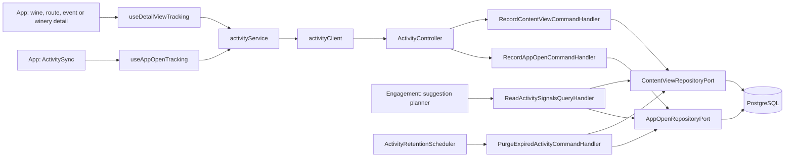

# Architecture

How the module is built in each layer. The backend follows the hexagonal flow
`controller → input port → handler → domain → output port → adapter`; the app follows
`screen → hook → service → API client → HTTP transport`. The web sends no signals.

## Flow of a signal

[View the full “Flow of a signal” diagram](https://images.vinnot.com/docs/diagrams/v1/en/modules-activity-architecture-77d4ee0df68e.svg)

## Backend

### Scope

The [`activity`](../../../../backend/src/main/java/com/vinnot/activity/) package stores
usage signals, hands them in batches to the suggestion planner and deletes them after 180
days. It does not decide what to suggest: that belongs to the engagement module,
described in [`UC-NOT-07`](../notifications/use-cases/uc-not-07-receive-suggestions.md).
Opened pushes are stored by [Notifications](../notifications/README.md).

### Layers

| Responsibility | Implementation |
|---|---|
| HTTP | [`ActivityController`](../../../../backend/src/main/java/com/vinnot/activity/infrastructure/web/ActivityController.java) under `/users/me/activity`; validates `kind` with a pattern and `id` as a UUID |
| Writes | [`RecordContentViewCommandHandler`](../../../../backend/src/main/java/com/vinnot/activity/application/command/handler/RecordContentViewCommandHandler.java) and [`RecordAppOpenCommandHandler`](../../../../backend/src/main/java/com/vinnot/activity/application/command/handler/RecordAppOpenCommandHandler.java) |
| Reads | [`ReadActivitySignalsQueryHandler`](../../../../backend/src/main/java/com/vinnot/activity/application/query/handler/ReadActivitySignalsQueryHandler.java): rhythms, views per user and the most viewed, with a fixed number of queries per page |
| Retention | [`PurgeExpiredActivityCommandHandler`](../../../../backend/src/main/java/com/vinnot/activity/application/command/handler/PurgeExpiredActivityCommandHandler.java) and [`ActivityRetentionScheduler`](../../../../backend/src/main/java/com/vinnot/activity/infrastructure/scheduling/ActivityRetentionScheduler.java) |
| Domain | [`ContentKind`](../../../../backend/src/main/java/com/vinnot/activity/domain/model/ContentKind.java), [`OpenHourHistogram`](../../../../backend/src/main/java/com/vinnot/activity/domain/model/OpenHourHistogram.java), [`ActivityRhythm`](../../../../backend/src/main/java/com/vinnot/activity/domain/model/ActivityRhythm.java) and [`ViewedContent`](../../../../backend/src/main/java/com/vinnot/activity/domain/model/ViewedContent.java), with no framework dependencies |
| Output ports | [`ContentViewRepositoryPort`](../../../../backend/src/main/java/com/vinnot/activity/application/port/out/ContentViewRepositoryPort.java) and [`AppOpenRepositoryPort`](../../../../backend/src/main/java/com/vinnot/activity/application/port/out/AppOpenRepositoryPort.java) |
| Persistence | [`JdbcContentViewRepository`](../../../../backend/src/main/java/com/vinnot/activity/infrastructure/persistence/JdbcContentViewRepository.java) and [`JdbcAppOpenRepository`](../../../../backend/src/main/java/com/vinnot/activity/infrastructure/persistence/JdbcAppOpenRepository.java), with native SQL |
| Consumers | The engagement module uses `ReadActivitySignalsUseCase` in [`EngagementPageService`](../../../../backend/src/main/java/com/vinnot/engagement/application/service/EngagementPageService.java), [`EngagementAdmissionService`](../../../../backend/src/main/java/com/vinnot/engagement/application/service/EngagementAdmissionService.java), [`ViewedNotRatedSource`](../../../../backend/src/main/java/com/vinnot/engagement/infrastructure/candidate/ViewedNotRatedSource.java) and [`WinbackSource`](../../../../backend/src/main/java/com/vinnot/engagement/infrastructure/candidate/WinbackSource.java) |

### Data

[`V66__engagement_signals.sql`](../../../../backend/src/main/resources/db/migration/V66__engagement_signals.sql)
creates the tables. All of them have `user_id` with cascading delete.

| Table | Content |
|---|---|
| `content_views` | One row per (`user_id`, `kind`, `entity_id`, `view_day`) with the view count |
| `app_opens` | One row per recorded open (`user_id`, `opened_at`) |
| `user_activity` | Each person's last activity |
| `push_opens` | One opened push per (`user_id`, `ref`); Notifications writes and purges it |

### Configuration

Each key has a default in the code and in
[`application.yml`](../../../../backend/src/main/resources/application.yml).

| Key | Default | Use |
|---|---|---|
| `app.activity.app-open-gap` | `30m` | Minimum gap between recorded opens |
| `app.activity.usual-hour-window` | `30d` | Window for the usual hour |
| `app.activity.retention` | `180d` | Age after which views, opens and last activity are deleted |
| `app.activity.push-open-retention` | `180d` | Retention of opened pushes |
| `app.activity.purge-batch-size` | `5000` | Rows per delete batch |
| `app.activity.retention-delay-ms` | `86400000` | Interval between purges (one day) |
| `app.activity.retention-enabled` | `true` | Turns the purge job off when `false` |

A non-positive gap, window, retention or batch makes startup fail.

### Expected errors

A `kind` outside `WINE|ROUTE|EVENT|WINERY` or an `id` that is not a UUID answers `400`
before reaching the use case. Without a session, the endpoints answer `401`
([`SecurityConfig`](../../../../backend/src/main/java/com/vinnot/shared/infrastructure/config/SecurityConfig.java)).
An open throttled by the minimum gap still answers `204`.

## App

| Piece | What it does |
|---|---|
| [`useDetailViewTracking.ts`](../../../../frontend-mobile/src/presentation/hooks/useDetailViewTracking.ts) | Records one view per detail mount with a session and an id; used by the wine detail and the [route](../../../../frontend-mobile/src/presentation/features/wineRoute/useWineRouteDetailViewModel.ts), [event](../../../../frontend-mobile/src/presentation/features/event/useEventDetailViewModel.ts) and [winery](../../../../frontend-mobile/src/presentation/features/winery/useWineryDetailViewModel.ts) view models |
| [`ActivitySync.tsx`](../../../../frontend-mobile/src/presentation/navigation/ActivitySync.tsx) and [`useAppOpenTracking.ts`](../../../../frontend-mobile/src/presentation/hooks/useAppOpenTracking.ts) | Report the cold start and every return to the foreground; on sign-out they forget the last open |
| [`activity.service.ts`](../../../../frontend-mobile/src/application/services/activity.service.ts) | Does not wait for the answer, applies the 30 minutes between opens, retries a failed open and only logs failures in development |
| [`activity.ts`](../../../../frontend-mobile/src/domain/activity/activity.ts) | Detail kinds and the 30-minute rule, with no React dependencies |
| [`activity.client.ts`](../../../../frontend-mobile/src/infrastructure/api/clients/activity.client.ts) | `POST /users/me/activity/views` and `POST /users/me/activity/app-open` |

## References

- [Module README](README.md), with the endpoints and business rules.
- [`UC-NOT-07` · Receive personalised suggestions](../notifications/use-cases/uc-not-07-receive-suggestions.md).
- [Data model](../../backend/data/database-model.md).
