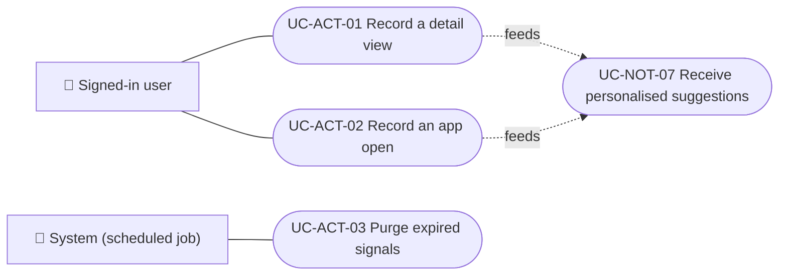

# Use cases

Use cases of the activity module: record detail views and app opens, and purge expired signals. Reading the signals to choose suggestions belongs to [`UC-NOT-07`](../../notifications/use-cases/uc-not-07-receive-suggestions.md), in the notifications module. Each case applies to the platforms shown.

| ID | Use case | Platforms | Actors |
|---|---|---|---|
| `UC-ACT-01` | [Record a detail view](uc-act-01-record-detail-view.md) | APK | Signed-in user |
| `UC-ACT-02` | [Record an app open](uc-act-02-record-app-open.md) | APK | Signed-in user |
| `UC-ACT-03` | [Purge expired signals](uc-act-03-purge-expired-signals.md) | Backend only | System (scheduled job) |

## Actors and use cases

[View the full “Actors and use cases” diagram](https://images.vinnot.com/docs/diagrams/v1/en/modules-activity-use-cases-readme-bf1e4a9072ab.svg)

## Lucidchart mapping

| ID | Lucidchart IDs |
|---|---|
| `UC-ACT-01` | None |
| `UC-ACT-02` | None |
| `UC-ACT-03` | None |
