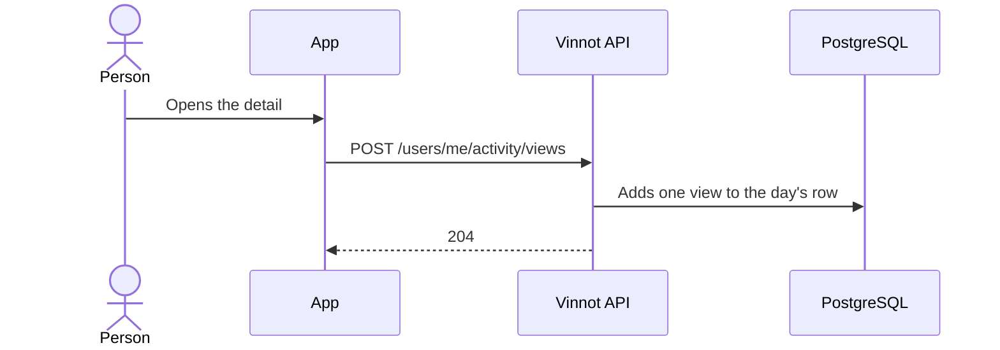

# UC-ACT-01 · Record a detail view

| Field | Value |
|---|---|
| ID | `UC-ACT-01` |
| Module | [Activity](../README.md) |
| Platforms | APK |
| Actors | Signed-in user |
| Lucidchart IDs | None |
| Requirements | [`RF-APK-ACT-01`](../requirements.md), [`RF-APK-ACT-02`](../requirements.md) |
| Test cases | [`CP-ACT-01`](../testing.md), [`CP-ACT-02`](../testing.md), [`CP-ACT-03`](../testing.md), [`CP-ACT-04`](../testing.md), [`CP-ACT-05`](../testing.md), [`CP-ACT-06`](../testing.md) |

## Preconditions

- The person is signed in to the app.

## Postconditions

- The view is added to the row of that person, that content and that UTC day.

## Main flow

1. The person opens a wine, route, event or winery detail.
2. The screen calls `useDetailViewTracking` with the content kind and id.
3. `activityService.recordView` sends `POST /users/me/activity/views` with `{kind, id}` without waiting for the answer.
4. The API validates the kind and the UUID and `RecordContentViewCommandHandler` adds one view to that UTC day's row.
5. The API answers 204.

## Alternative flows

- 1a. There is no session or the content id is missing: the app sends nothing.
- 3a. The request fails: the app drops it and only logs it in development; the screen stays the same.
- 4a. The kind is not `WINE`, `ROUTE`, `EVENT` or `WINERY`, or the id is not a UUID: the API answers 400 without reaching the use case.
- 4b. The request arrives without a session: the API answers 401 and stores nothing.
- 4c. The account no longer exists: the signal is ignored without an error.

## Business rules

- One row per user, content and UTC day; repeated views add to `views`, so growth stays bounded.
- The content is not looked up on each view: an id that does not exist is stored and never matches real content.
- The web sends no signals.
- Signals are never shown to other people or shared with third parties.

## Sequence of a view

[View the full “Sequence of a view” diagram](https://images.vinnot.com/docs/diagrams/v1/en/modules-activity-use-cases-uc-act-01-record-detail-view-26f5d619a377.svg)

## Code

| Layer | Location |
|---|---|
| Endpoints | `POST /users/me/activity/views` |
| Backend | [`ActivityController.java`](../../../../../backend/src/main/java/com/vinnot/activity/infrastructure/web/ActivityController.java), [`RecordContentViewCommandHandler.java`](../../../../../backend/src/main/java/com/vinnot/activity/application/command/handler/RecordContentViewCommandHandler.java), [`ContentKind.java`](../../../../../backend/src/main/java/com/vinnot/activity/domain/model/ContentKind.java), [`JdbcContentViewRepository.java`](../../../../../backend/src/main/java/com/vinnot/activity/infrastructure/persistence/JdbcContentViewRepository.java) |
| App | [`useDetailViewTracking.ts`](../../../../../frontend-mobile/src/presentation/hooks/useDetailViewTracking.ts), [`activity.service.ts`](../../../../../frontend-mobile/src/application/services/activity.service.ts), [`activity.client.ts`](../../../../../frontend-mobile/src/infrastructure/api/clients/activity.client.ts), [`activity.ts`](../../../../../frontend-mobile/src/domain/activity/activity.ts) |

## Automated tests

- Backend:
  - [`ActivityControllerTest.java`](../../../../../backend/src/test/java/com/vinnot/activity/infrastructure/web/ActivityControllerTest.java): `recordsAViewOfEachKindOfDetailForTheSignedInUser`, `rejectsAnUnknownKindOrAMissingOrMalformedIdBeforeReachingTheUseCase`
  - [`EngagementSignalEndpointsSecurityTest.java`](../../../../../backend/src/test/java/com/vinnot/activity/infrastructure/web/EngagementSignalEndpointsSecurityTest.java): `rejectsAnonymousRequestsWithoutRecordingAnything`, `acceptsASignedInUser`
  - [`RecordContentViewCommandHandlerTest.java`](../../../../../backend/src/test/java/com/vinnot/activity/application/command/handler/RecordContentViewCommandHandlerTest.java): `recordsOneViewOfTheContentAtTheCurrentTime`, `aViewNeedsItsUserKindAndContent`
  - [`JdbcActivityPostgresIntegrationTest.java`](../../../../../backend/src/test/java/com/vinnot/activity/infrastructure/persistence/JdbcActivityPostgresIntegrationTest.java): `repeatedViewsOfOneDetailOnOneDayShareARowAndAnotherDayAddsOne`, `signalsOfAnAccountThatNoLongerExistsAreIgnored`
- App:
  - [`useDetailViewTracking.test.ts`](../../../../../frontend-mobile/src/presentation/hooks/useDetailViewTracking.test.ts): `records one view per detail screen mount of a signed-in member`, `records nothing without an id or while signed out`
  - [`activity.service.test.ts`](../../../../../frontend-mobile/src/application/services/activity.service.test.ts): `records a detail view without waiting for the server`, `never records a view without an id`, `swallows a failed view and only logs it in development`
  - [`activity.client.test.ts`](../../../../../frontend-mobile/src/infrastructure/api/clients/activity.client.test.ts): `records a detail view`
  - [`activity.test.ts`](../../../../../frontend-mobile/src/domain/activity/activity.test.ts): `knows the detail screens whose views are signals`
