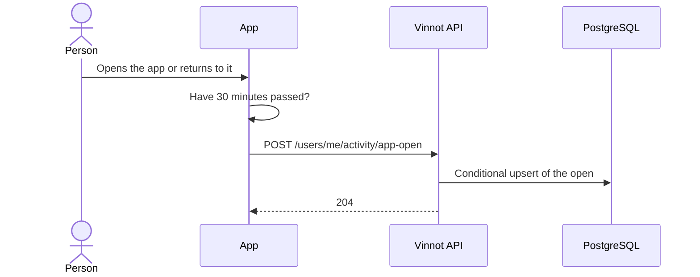

# UC-ACT-02 · Record an app open

| Field | Value |
|---|---|
| ID | `UC-ACT-02` |
| Module | [Activity](../README.md) |
| Platforms | APK |
| Actors | Signed-in user |
| Lucidchart IDs | None |
| Requirements | [`RF-APK-ACT-03`](../requirements.md), [`RF-APK-ACT-04`](../requirements.md) |
| Test cases | [`CP-ACT-07`](../testing.md), [`CP-ACT-08`](../testing.md), [`CP-ACT-09`](../testing.md), [`CP-ACT-10`](../testing.md), [`CP-ACT-11`](../testing.md) |

## Preconditions

- The person is signed in to the app.

## Postconditions

- The open is stored and the person's last activity is updated.

## Main flow

1. The person opens the app or brings it back to the foreground.
2. `ActivitySync`, mounted in `RootNavigator`, uses `useAppOpenTracking`, which reports the cold start and every return to the foreground.
3. `activityService.recordAppOpen` sends `POST /users/me/activity/app-open` if it reported no other open in the last 30 minutes.
4. `RecordAppOpenCommandHandler` stores the open and moves the last activity with a conditional upsert that keeps at most one open every 30 minutes (`app.activity.app-open-gap`).
5. The API answers 204.

## Alternative flows

- 3a. The app reported an open less than 30 minutes ago: the app sends nothing.
- 4a. Another open arrives within the 30 minutes, even at the same time: the API answers 204 without storing another open.
- 3b. The request fails: the next open is reported again without waiting 30 minutes.
- 1a. The person signs out: the app stops listening and forgets the last open, so the next sign-in counts at once.

## Business rules

- At most one recorded open every 30 minutes, in the app and in the backend.
- The usual hour is the hour of the day, in `users.timezone`, with the most opens in the last 30 days; a tie picks the earliest ([`OpenHourHistogram`](../../../../../backend/src/main/java/com/vinnot/activity/domain/model/OpenHourHistogram.java)). [`UC-NOT-07`](../../notifications/use-cases/uc-not-07-receive-suggestions.md) uses it.
- Opening a push also counts as an app open; that record lives in [Notifications](../../notifications/README.md).

## Sequence of an open

[View the full “Sequence of an open” diagram](https://images.vinnot.com/docs/diagrams/v1/en/modules-activity-use-cases-uc-act-02-record-app-open-702ad3c2cec0.svg)

## Code

| Layer | Location |
|---|---|
| Endpoints | `POST /users/me/activity/app-open` |
| Backend | [`ActivityController.java`](../../../../../backend/src/main/java/com/vinnot/activity/infrastructure/web/ActivityController.java), [`RecordAppOpenCommandHandler.java`](../../../../../backend/src/main/java/com/vinnot/activity/application/command/handler/RecordAppOpenCommandHandler.java), [`JdbcAppOpenRepository.java`](../../../../../backend/src/main/java/com/vinnot/activity/infrastructure/persistence/JdbcAppOpenRepository.java) |
| App | [`ActivitySync.tsx`](../../../../../frontend-mobile/src/presentation/navigation/ActivitySync.tsx), [`useAppOpenTracking.ts`](../../../../../frontend-mobile/src/presentation/hooks/useAppOpenTracking.ts), [`activity.service.ts`](../../../../../frontend-mobile/src/application/services/activity.service.ts), [`activity.client.ts`](../../../../../frontend-mobile/src/infrastructure/api/clients/activity.client.ts) |

## Automated tests

- Backend:
  - [`ActivityControllerTest.java`](../../../../../backend/src/test/java/com/vinnot/activity/infrastructure/web/ActivityControllerTest.java): `anAppOpenIsAcceptedWhetherItWasRecordedOrThrottled`
  - [`EngagementSignalEndpointsSecurityTest.java`](../../../../../backend/src/test/java/com/vinnot/activity/infrastructure/web/EngagementSignalEndpointsSecurityTest.java): `rejectsAnonymousRequestsWithoutRecordingAnything`
  - [`RecordAppOpenCommandHandlerTest.java`](../../../../../backend/src/test/java/com/vinnot/activity/application/command/handler/RecordAppOpenCommandHandlerTest.java): `recordsTheOpenUnlessOneWasRecordedWithinTheGap`, `theGapMustBePositive`
  - [`JdbcActivityPostgresIntegrationTest.java`](../../../../../backend/src/test/java/com/vinnot/activity/infrastructure/persistence/JdbcActivityPostgresIntegrationTest.java): `anOpenIsRecordedAtMostOncePerGapAndMovesLastActive`, `openHoursAreCountedInTheUsersTimeZoneSinceAnInstant`
- App:
  - [`useAppOpenTracking.test.ts`](../../../../../frontend-mobile/src/presentation/hooks/useAppOpenTracking.test.ts): `records nothing while signed out`, `records the cold start of a signed-in member and every return to the foreground (the service throttles)`, `stops listening and forgets the last open on sign-out`
  - [`activity.service.test.ts`](../../../../../frontend-mobile/src/application/services/activity.service.test.ts): `records an app open at most once every 30 minutes`, `a failed app open is retried on the next open instead of waiting 30 minutes`, `forgets the last app open on sign-out, so the next sign-in counts at once`
  - [`activity.client.test.ts`](../../../../../frontend-mobile/src/infrastructure/api/clients/activity.client.test.ts): `records an app open with an empty body`
  - [`activity.test.ts`](../../../../../frontend-mobile/src/domain/activity/activity.test.ts): `records an app open at most once every 30 minutes`
