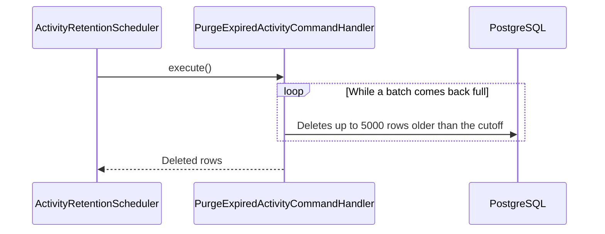

# UC-ACT-03 · Purge expired signals

| Field | Value |
|---|---|
| ID | `UC-ACT-03` |
| Module | [Activity](../README.md) |
| Platforms | Backend only |
| Actors | System (scheduled job) |
| Lucidchart IDs | None |
| Requirements | — |
| Test cases | [`CP-ACT-12`](../testing.md), [`CP-ACT-13`](../testing.md), [`CP-ACT-14`](../testing.md), [`CP-ACT-15`](../testing.md) |

## Preconditions

- The purge is enabled (`app.activity.retention-enabled`, on by default).

## Postconditions

- No views, opens or last activity older than 180 days remain.

## Main flow

1. Once a day (`app.activity.retention-delay-ms`; the first run 10 minutes after startup), `ActivityRetentionScheduler` calls `PurgeExpiredActivityUseCase`.
2. `PurgeExpiredActivityCommandHandler` computes the cutoff: now minus 180 days (`app.activity.retention`).
3. It deletes views, opens and last activity older than the cutoff in batches of 5000 (`app.activity.purge-batch-size`) until a batch comes back short.
4. If it deleted rows, it logs the count.

## Alternative flows

- 3a. There are no expired signals: it deletes nothing and writes no log.
- 2a. The retention or the batch size is not positive: the backend does not start: the configuration is rejected when the handler is created.
- 1a. An account is deleted: its signals are deleted by cascade without waiting for the purge.

## Business rules

- Retention is 180 days for views, opens and last activity.
- Opened pushes have their own 180-day retention (`app.activity.push-open-retention`), purged by [Notifications](../../notifications/README.md).
- Deletes run in batches so large tables are not locked.

## Sequence of the purge

[View the full “Sequence of the purge” diagram](https://images.vinnot.com/docs/diagrams/v1/en/modules-activity-use-cases-uc-act-03-purge-expired-signals-df80cef7e535.svg)

## Code

| Layer | Location |
|---|---|
| Backend | [`ActivityRetentionScheduler.java`](../../../../../backend/src/main/java/com/vinnot/activity/infrastructure/scheduling/ActivityRetentionScheduler.java), [`PurgeExpiredActivityCommandHandler.java`](../../../../../backend/src/main/java/com/vinnot/activity/application/command/handler/PurgeExpiredActivityCommandHandler.java), [`JdbcContentViewRepository.java`](../../../../../backend/src/main/java/com/vinnot/activity/infrastructure/persistence/JdbcContentViewRepository.java), [`JdbcAppOpenRepository.java`](../../../../../backend/src/main/java/com/vinnot/activity/infrastructure/persistence/JdbcAppOpenRepository.java) |
| Data | [`V66__engagement_signals.sql`](../../../../../backend/src/main/resources/db/migration/V66__engagement_signals.sql) |

## Automated tests

- Backend:
  - [`PurgeExpiredActivityCommandHandlerTest.java`](../../../../../backend/src/test/java/com/vinnot/activity/application/command/handler/PurgeExpiredActivityCommandHandlerTest.java): `deletesSignalsOlderThanTheRetentionInBatchesUntilNoneAreLeft`, `theRetentionAndBatchMustBePositive`
  - [`ActivityRetentionSchedulerTest.java`](../../../../../backend/src/test/java/com/vinnot/activity/infrastructure/scheduling/ActivityRetentionSchedulerTest.java): `runsThePurgeOnEveryTick`
  - [`JdbcActivityPostgresIntegrationTest.java`](../../../../../backend/src/test/java/com/vinnot/activity/infrastructure/persistence/JdbcActivityPostgresIntegrationTest.java): `purgesSignalsOlderThanTheCutoffInBatches`, `deletingTheAccountDeletesItsSignals`
