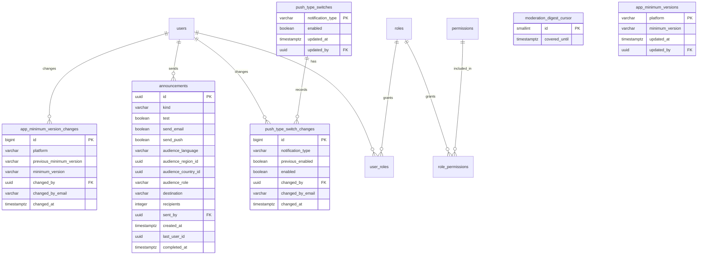

# Administration and moderation

The Vinnot team's panel. Administrators and moderators manage the catalog (wines,
wineries, events and routes), review proposed wines, reports, pending publications and
reviews, and get a digest of new work. Only administrators manage users and roles,
suspend accounts, send announcements, control pushes, set the minimum app version and delete catalog content.

- Module code: `ADM`.
- Backend: package [`admin`](../../../../backend/src/main/java/com/vinnot/admin/), which composes the team's views and delegates each change to the module that owns the data.
- [Use cases](use-cases/README.md) · [Requirements](requirements.md) ·
  [Architecture](architecture.md) · [Testing](testing.md)

## Actors

| Actor | What they do in this module |
|---|---|
| Moderator | Uses the panel, manages the catalog without deleting and reviews proposed wines, reports, publications and reviews |
| Administrator | All of the above, plus deleting from the catalog, managing users, sending announcements, controlling pushes and setting the minimum app version |
| Visitor or signed-in user | Their app reads the minimum version and, if it is outdated, only shows the screen to update it |
| System (scheduled jobs) | Sends the new-work digest to the team and delivers announcements in batches |

## Business rules

| Rule | Details | Where |
|---|---|---|
| Access | `/admin/**` accepts administrators and moderators; users, notifications and app versions, administrators only | [`SecurityConfig.java`](../../../../backend/src/main/java/com/vinnot/shared/infrastructure/config/SecurityConfig.java) |
| Confirm identity | An administrator confirms their identity (password, or Google or Apple) to delete, change users, touch notifications or change the minimum app version; the confirmation lasts 5 minutes | [`AdminSensitiveActionInterceptor.java`](../../../../backend/src/main/java/com/vinnot/admin/infrastructure/web/AdminSensitiveActionInterceptor.java) |
| Last administrator | Nobody removes their own admin access and one active, unsuspended administrator always remains | [`AdminUserSafety.java`](../../../../backend/src/main/java/com/vinnot/user/application/service/AdminUserSafety.java) |
| One role | Changing the role leaves the account with user plus the chosen role and closes its sessions | [`AssignRoleCommandHandler.java`](../../../../backend/src/main/java/com/vinnot/user/application/command/handler/AssignRoleCommandHandler.java) |
| Suspension | Preset reason; the detail only with “Other” and up to 255 characters; forgets push phones and sends the notice with the reason | [`BanUserCommandHandler.java`](../../../../backend/src/main/java/com/vinnot/user/application/command/handler/BanUserCommandHandler.java) |
| Catalog deletion | Wines, wineries and routes are deleted; events are only cancelled | [`EventAdminController.java`](../../../../backend/src/main/java/com/vinnot/admin/infrastructure/web/controller/EventAdminController.java) |
| Clearing fields | An emptied optional field is cleared explicitly; a field that is not sent keeps its value | [`FieldUpdates.java`](../../../../backend/src/main/java/com/vinnot/shared/application/command/FieldUpdates.java) |
| Reports | Reviewers never see their own reports or those about their content; closing requires text and never reopens | [`CommunityReport.java`](../../../../backend/src/main/java/com/vinnot/community/domain/model/CommunityReport.java) |
| Publications | Rejecting asks for a preset reason; the decision applies to the revision that was seen | [`ReviewPublication.java`](../../../../backend/src/main/java/com/vinnot/review/domain/model/ReviewPublication.java) |
| Announcements | Only to active, unsuspended accounts; news skips anyone who withdrew marketing consent or turned it off; a retry never sends twice | [`JdbcAnnouncementAudience.java`](../../../../backend/src/main/java/com/vinnot/notification/infrastructure/persistence/JdbcAnnouncementAudience.java) |
| Push by type | A type that is off drops its pushes; turning off a transactional one asks for confirmation | [`PushAdministrationService.java`](../../../../backend/src/main/java/com/vinnot/notification/application/service/PushAdministrationService.java) |
| Minimum app version | One per platform (iOS and Android), `major.minor.patch` compared number by number; an older version only sees the update screen; with no minimum or if the request fails, the app works as usual | [`AppVersionAdministrationService.java`](../../../../backend/src/main/java/com/vinnot/admin/application/service/AppVersionAdministrationService.java) |
| Team digest | Every 15 minutes, if there are new proposed wines or reports, an email to each active, unsuspended administrator and moderator | [`SendModerationDigestService.java`](../../../../backend/src/main/java/com/vinnot/admin/application/service/SendModerationDigestService.java) |

## Where it lives

| Part | Location |
|---|---|
| API | `/admin` controllers in [`admin/infrastructure/web/controller`](../../../../backend/src/main/java/com/vinnot/admin/infrastructure/web/controller/), reports and publications in `community` and `review`, announcements and push in `notification` |
| Web | `/admin`, `/admin/wines`, `/admin/wineries`, `/admin/events`, `/admin/routes`, `/admin/wine-submissions`, `/admin/publications`, `/admin/community`, `/admin/reviews`, `/admin/users`, `/admin/notifications` and `/admin/app-versions` in [`pages/admin`](../../../../frontend-react/src/presentation/pages/admin/) and [`pages/community`](../../../../frontend-react/src/presentation/pages/community/) |
| App | `frontend-mobile/app/(app)/admin/`, with the screens in [`features/admin`](../../../../frontend-mobile/src/presentation/features/admin/) and [`features/community`](../../../../frontend-mobile/src/presentation/features/community/); the minimum version check in [`features/appUpdate`](../../../../frontend-mobile/src/presentation/features/appUpdate/) |

## Data

The catalog, reports, publications and proposed wines live in their modules' tables. This
module uses roles and account state (`users.active`, `users.locked` and
`users.lock_reason`, widened in `V57`), and has its own tables: `V54` creates the team
digest mark, `V59` the push switches and their outcomes, `V60` the announcements and `V69` the minimum app versions and their changes.

[View the full “Administration and moderation · Data” diagram](https://images.vinnot.com/docs/diagrams/v1/en/modules-admin-readme-e08ddff96cbf.svg)

`moderation_digest_cursor` has a single row and its mark never moves back. Announcements,
switch changes and minimum version changes keep the email of who made them, so the record survives a deleted
account. `push_delivery_outcomes` counts push outcomes per type and day for the metrics.
