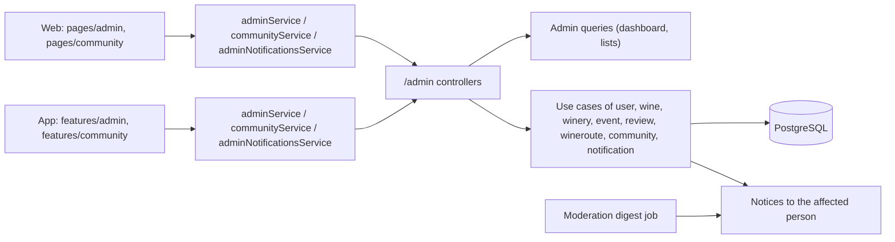
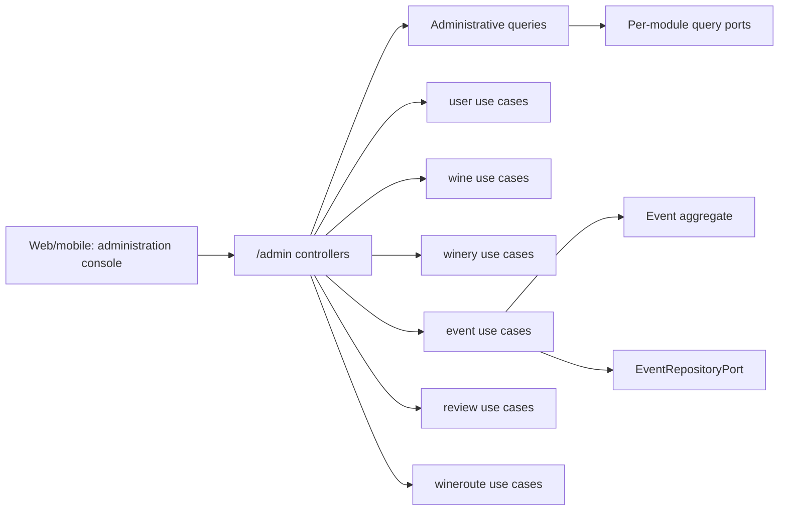
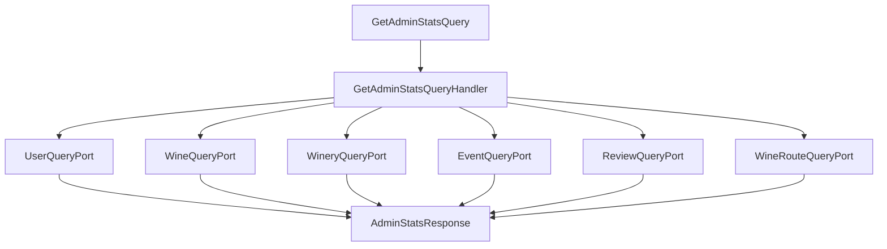
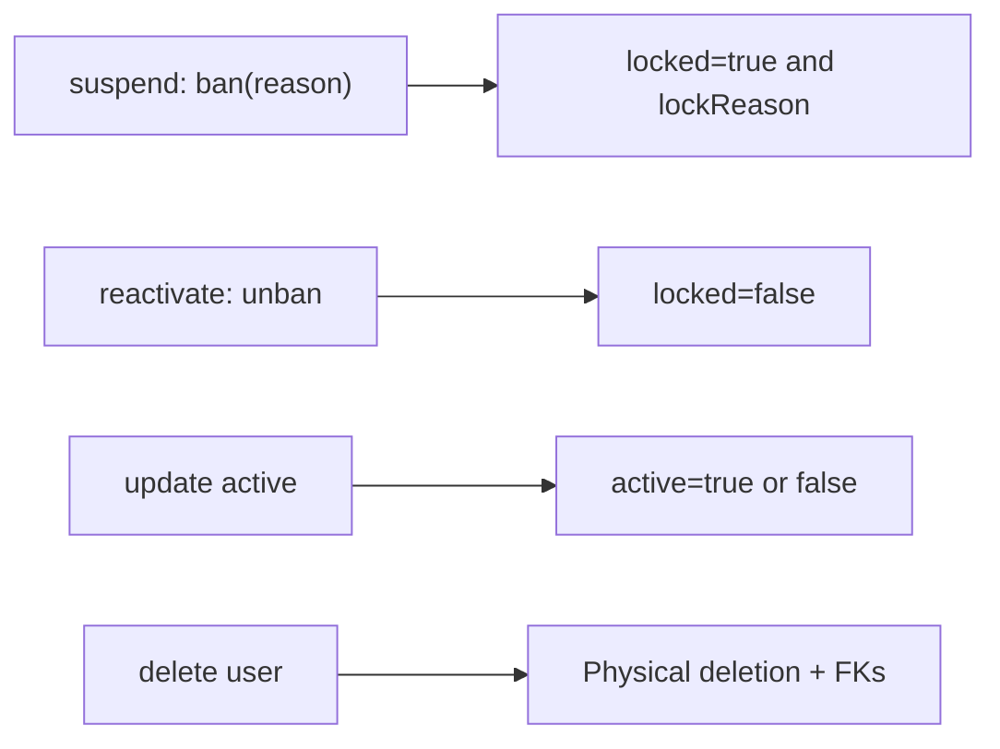
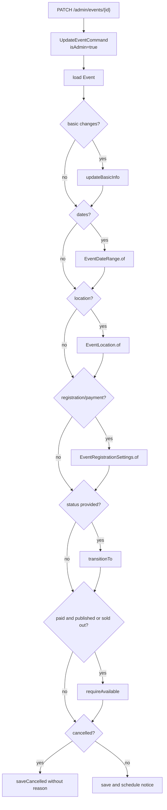
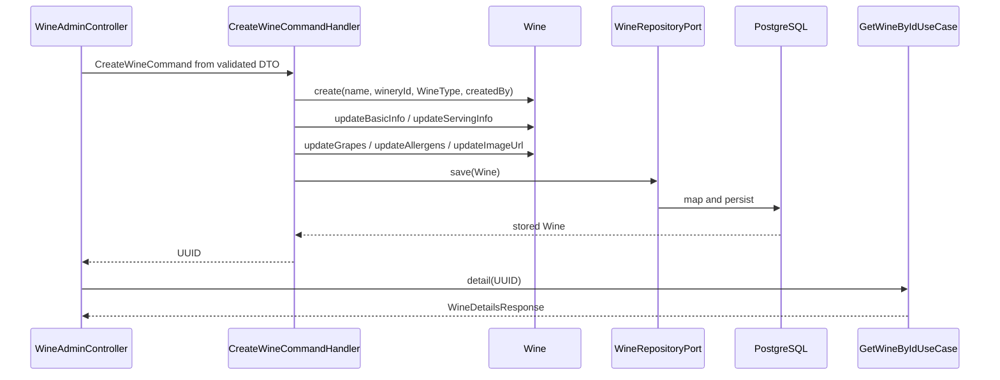
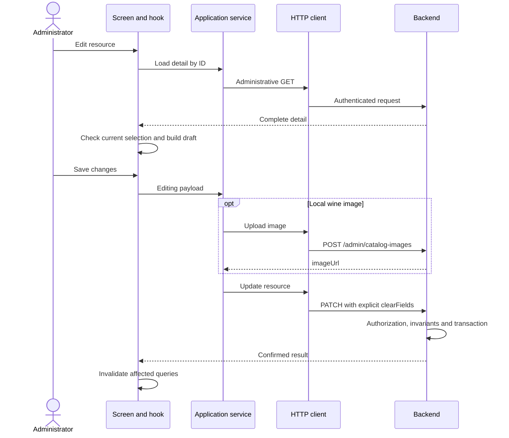

# Architecture

How the module is built in each layer. The `admin` package is not a separate domain: it
reads and composes the team's views, and each change runs through the use cases of the
module that owns the data. The web and the app follow `screen → hook → service → API
client → HTTP transport`. Community moderation is in [Community](../community/architecture.md#backend),
proposed wines in [Proposed wines](../wines/submissions.md) and announcements in
[Notifications](../notifications/architecture.md#backend).

[View the full “Architecture” diagram](https://images.vinnot.com/docs/diagrams/v1/en/modules-admin-architecture-c07a7006328e.svg)

## Backend

Winery list and detail queries return `winesCount` calculated from active wines related by `winery_id`, rather than the winery’s historical imported counter. Lists aggregate counts for the current page IDs in one additional query, without loading wines or querying per row; wineries without active wines return zero. List rows also carry `establishedYear` (null when unknown), which the admin table shows as the founding year. The admin winery forms on web and mobile accept a website with or without `https://`, add the scheme when it is missing, and reject text that is not a web address. The phone accepts only digits, spaces, `+`, parentheses and hyphens, so imported local formats such as `(0261) 412-3456` stay valid.

### Purpose and boundaries

Vinnot administration is not a parallel business domain. The `admin` package is
a **read and composition facade** for operational views, while mutations are
executed by the use cases of the module that owns each aggregate:

- users and roles belong to `user`;
- wines belong to `wine`;
- wineries belong to `winery`;
- events and registrations belong to `event`;
- reviews belong to `review`;
- wine routes belong to `wineroute`;
- wine submissions belong to the submissions subdomain inside `wine`.

The one setting `admin` owns itself is the minimum supported mobile app version
per platform; see [Minimum app versions](#minimum-app-versions).

[View the full “Purpose and boundaries” diagram](https://images.vinnot.com/docs/diagrams/v1/en/modules-admin-architecture-4e93073161f1.svg)

This separation prevents two common mistakes:

1. duplicating business rules inside administrative controllers;
2. allowing an operational view to write through JPA directly.

### Effective authorization

Catalog and moderation controllers under `/admin/**` accept
`ADMIN` and `MODERATOR`. Catalog deletion methods, `/admin/users/**`,
`/admin/notifications/**` and `/admin/app-versions/**` require `ADMIN`. `SecurityConfig` protects the prefix and restricts user
management before the general rule as defense in depth. The authenticated principal is the user's UUID and
authorities are derived from roles and permissions.

#### Reauthentication for sensitive actions

`AdminSensitiveActionInterceptor` requires a recent identity confirmation when the
principal has `ROLE_ADMIN` and the request is:

- any method other than `GET`, `HEAD` or `OPTIONS` on `/admin/users/**`;
- any method other than `GET`, `HEAD` or `OPTIONS` on `/admin/notifications/**`
  (push switches, announcement tests and sends), except
  `POST /admin/notifications/announcements/preview`;
- any method other than `GET`, `HEAD` or `OPTIONS` on `/admin/app-versions/**`
  (setting or clearing a minimum app version);
- any `DELETE` on `/admin/**`;
- `DELETE` on `/wines/{id}`, `/events/{id}`, `/wine-routes/{id}` or `/wineries/{id}`.

The client first calls `POST /auth/reauthenticate` (ADMIN only) with
`{password}` (at most 128 characters) or, if the account uses Google or Apple, that
provider's token. `ReauthenticateCommandHandler`
rejects inactive, locked, unverified or non-ADMIN accounts and wrong passwords
with `AUTH_FAILED` (HTTP 401). On success it returns `{proof}` with
`Cache-Control: no-store`. `SignedReauthenticationProofAdapter` signs the proof
with a purpose-separated key; it is valid for 5 minutes and bound to the user and
to the current `Authorization` header, so it cannot be replayed with another
session. The client sends it in the `X-Admin-Reauthentication` header. A missing,
expired or mismatched proof produces `REAUTHENTICATION_REQUIRED`, which
`GlobalExceptionHandler` maps to HTTP 403.

#### Administrative role scope

| Capability | ADMIN | MODERATOR |
|---|---|---|
| Dashboard and catalog reads | Yes | Yes |
| Create/edit wines, wineries, events and routes, including their states | Yes | Yes |
| Images and AI profiles (WINE_UPDATE authority) | Yes | Yes |
| Moderate reviews, including deletion, and decide submissions | Yes | Yes |
| Delete wines, wineries, events or routes through DELETE | Yes | No |
| Manage users, roles, suspensions and reactivations | Yes | No |
| See and change the minimum app versions | Yes | No |

A visible link does not grant permissions: effective authorization is enforced
by the backend. USER and PARTNER cannot access the administration console.

### Administrative dashboard

`GET /admin/stats` runs `GetAdminStatsQueryHandler` in a read-only transaction.
The handler composes six specific output ports and returns:

- total users;
- total wines;
- total wineries;
- total events;
- total reviews;
- total routes;
- active users;
- published events;
- published routes.

The query is a fan-in of count operations and does not load complete aggregates.
Each adapter owns the knowledge required to count its module. The response combines counts from those ports within a read-only transaction.

[View the full “Administrative dashboard” diagram](https://images.vinnot.com/docs/diagrams/v1/en/modules-admin-architecture-5b15f51c1603.svg)

### Users

#### Queries

The administrative list accepts `search`, `page`, and `size`. It returns
`PageResult<UserAdminResponse>` with operational data, roles, status, and dates,
plus `avatarUrl`: the profile photo as an absolute URL, or `null` without one
(#541, the same resolution as the rest of the API, see
[Stored value and the URL clients receive](../users/architecture.md#stored-value-and-the-url-clients-receive)).
`GET /admin/reviews` also returns the reviewer's photo as an absolute URL.
The detail use case validates existence before projection. The list forwards `page` and `size` to its query; it does not use the public wine-catalog policy.

#### Update

`PATCH /admin/users/{id}` delegates to `UpdateUserAdminUseCase`. Mutable fields
are first name, last name, and active state. Aggregate invariants continue to
apply; the controller never mutates persistence entities or knows JPA.

#### Roles

`POST /admin/users/{id}/assign-role` uppercases the input and converts it through
`Role.valueOf`. It then invokes `user.addRole`, preserving additive semantics:
the complete role set is not silently replaced.

The input is converted with `Role.valueOf`; admitted roles are exactly the Java enum values:
`USER`, `ADMIN`, `MODERATOR`, and `PARTNER`.

The administrative selector uses `PUT /admin/users/{id}/role` to replace roles,
retaining `USER` plus the selected role. Both endpoints accept domain names or
their `ROLE_*` form; invalid values produce a controlled error.

`AdminUserSafety` prevents actors from removing their own access by demotion
(both endpoints pass the authenticated actor; `POST assign-role` only adds roles,
so it never removes `ADMIN`), suspension, deactivation or deletion, and protects the last active, unlocked
administrator. The adapter locks the ADMIN role row before reading active
administrator IDs, serializing these decisions within the transaction rather
than relying on an unlocked count.

#### Suspension and reactivation

Suspending an account ([UC-ADM-11](use-cases/uc-adm-11-suspend-user.md)) uses
`POST /admin/users/{id}/ban` (`BanUserCommandHandler`), which suspends the user
with `User.lock` and forgets the account's push
devices (`ManagePushDevicesUseCase.forgetUser`, as an administrative deactivation
and a self-deactivation do), so a suspended account gets no more pushes. The body carries a preset
`reasonCode` (`SPAM`, `HARASSMENT`, `FRAUD`, `IMPERSONATION`, `TERMS_VIOLATION`,
`OTHER`) and an optional `reason` detail (at most 255 characters); an unknown code
fails with `INVALID_SUSPENSION_REASON`, and a request without a code is treated as
`OTHER` with its detail kept internal. `lockReason` stores `CODE` or
`CODE: detail`. Web and mobile offer the reasons as one-tap chips with spam
preselected, and show the detail field only under Other; the action is called
Suspend. Reactivating uses `POST /admin/users/{id}/unban`
(`UnbanUserCommandHandler`), which lifts the suspension with `User.unlock`. The
person is emailed when suspended (with the reason, and the detail only for
`OTHER`), when a suspended account is reactivated, on a role change and on a
deletion ([notifications](../notifications/architecture.md)). Suspension
is evaluated during subsequent authentication and each JWT-authenticated request through `AccountAccessPort`.

[View the full “Suspension and reactivation” diagram](https://images.vinnot.com/docs/diagrams/v1/en/modules-admin-architecture-26b39b39399f.svg)

`active` and `locked` are independent flags, not enum states.

#### Administrative deletion

`DELETE /admin/users/{id}` loads the user, applies actor/last-administrator safeguards and deletes through the repository.
Unlike self-deletion, this handler does not include the Apple revocation flow or
the same deactivation semantics. Flyway foreign keys define cascading deletion and nullable references.

### Wines and wineries

Administrative controllers adapt the use cases described in:

- [Wine management](#wine-management);
- [Wineries and regions](../wineries/architecture.md).

Wine administration supports list, detail, create, update, delete, feature
toggle, and active toggle. Winery administration supports list, detail, create,
update, and delete. In both cases:

- the HTTP request is mapped to a command or query;
- the handler resolves relationships through ports;
- the domain validates invariants;
- the persistence adapter maps domain and JPA;
- the controller returns an application DTO or `MutationResponse`.

An `AdminWineRepository` must not be introduced for writes: rule ownership
remains in `wine`.

### Events

An administrator can list and filter by text, type, and city; read details;
create; partially update; publish; cancel; and invoke the endpoint presented as
delete. The latter cancels the aggregate instead of deleting its row: it cancels active
registrations, notifies attendees and the organizer, and keeps the rows for
traceability.

During creation the organizer is resolved in this order:

1. use the explicit request `organizerId` when present;
2. otherwise use the administrator principal;
3. let the use case reject an invalid absence.

Dates use the centralized flexible parser in `DateTimeUtils`. Updates combine
submitted fields with stored values, rebuild value objects (`EventDateRange`,
`EventLocation`, and `EventRegistrationSettings`), and apply status transitions
through the aggregate.

[View the full “Events” diagram](https://images.vinnot.com/docs/diagrams/v1/en/modules-admin-architecture-558e314c5c10.svg)

The complete discovery, capacity, approval, payment, and attendance lifecycle
is documented in [Events and registrations](../events/architecture.md#backend).

### Reviews

Administration lists, searches, reads details, and deletes reviews. Deletion
reuses `DeleteReviewUseCase` with `isAdmin=true`, bypassing authorship without
duplicating lookup and removal logic. That endpoint deletes; prior approval or rejection uses the separate
`/admin/review-publications` queue. Reports are handled through
`/admin/community/reports`. States and permissions are documented in
[community](../community/architecture.md).

Administrative search projects author, wine, rating, content, and operational
metadata through a query port. Creation, editing, likes, and aggregates are
covered in [Reviews and engagement](../reviews/architecture.md).

### Wine routes

Administration lists, reads details, creates, updates, publishes, archives, and
deletes. Stops are added, edited, removed and reordered by sending the full list in
`PATCH /admin/routes/{id}`: every stop is recreated and duration and distance are
recomputed. As with every other module, the controller delegates to
`wineroute` input ports and never writes stop collections directly.

Transitions and stop ordering are documented in [Wine routes](../wine-routes/architecture.md).

### Minimum app versions

The administrator sets, per store platform, the oldest mobile app version that
can still be used. The mobile app reads it on launch and on returning to the
foreground; an older build shows a blocking update-required screen. Raise a
minimum only after the store has approved and published that build.

| Rule | Behavior |
|---|---|
| Platforms | `IOS` and `ANDROID`, always listed in that order |
| Format | `major.minor.patch`, three integers from 0 to 9999, such as `0.3.0`; anything else answers 400 `INVALID_APP_VERSION` |
| No minimum | `null` (or a platform never set) blocks no build |
| Order | numeric, part by part: `0.10.0` is newer than `0.9.9` |
| Audit | each real change stores the platform, previous and new value, the administrator's email and the time; saving the same value records nothing |
| Concurrency | changes of one platform are serialized on its row |

| Endpoint | Access | Use case |
|---|---|---|
| `GET /admin/app-versions` | `ADMIN` | `ManageAppVersionsUseCase.settings()`: both platforms with `minimumVersion`, `updatedAt` and `updatedBy` (email), plus the 20 latest changes, newest first |
| `PUT /admin/app-versions/{platform}` `{minimumVersion}` | `ADMIN` and `X-Admin-Reauthentication` | `ManageAppVersionsUseCase.setMinimumVersion(...)`; an unknown platform answers 400 `NOT_AN_APP_PLATFORM` |
| `GET /app-versions/minimum` | Public, not blocked by pending terms | `GetMinimumAppVersionsUseCase`: `{ios, android}`, each a version or `null` |

Dependency flow:

`AppVersionAdminController` / `AppVersionPolicyController` → `ManageAppVersionsUseCase` / `GetMinimumAppVersionsUseCase` → `AppVersionAdministrationService` / `MinimumAppVersionsService` → `AppVersion`, `AppPlatform` (domain) → `AppMinimumVersionPort` → `JdbcAppMinimumVersions` → `app_minimum_versions` and `app_minimum_version_changes` (V69).

`AppVersionAdministrationService` resolves the administrator's email through
`UserQueryPort` (`ADMIN_NOT_FOUND` when the account is gone) and takes the time
from an injected `Clock`. The public policy is read from the database on every
request, so a change applies without a deploy. The tables are described in the
[data model](../../backend/data/database-model.md).

### Consistency and transactions

- mutation handlers are transactional;
- `SearchAdminEventsQueryHandler`, `GetAdminStatsQueryHandler`,
  `SearchAdminReviewsQueryHandler`, `GetAdminReviewByIdQueryHandler`,
  `GetAdminUserByIdQueryHandler`, and `SearchAdminUsersQueryHandler` declare
  `@Transactional(readOnly = true)`; no other handler is covered by this claim
  without its own annotation;
- ownership is checked after loading and before mutating the aggregate;
- publication, cancellation, and update use domain methods;
- controllers do not open transactions;
- dashboard reads are consistent per query but are not one materialized snapshot
  across every table under heavy concurrency.

### Testing strategy

#### Domain

- valid and invalid event transitions;
- date, location, capacity, and settings updates;
- user suspension/reactivation and roles;
- route publication/archive;
- review authorship and deletion.

#### Application

- every administrative query handler with mocked ports;
- dashboard with every count in the correct position;
- not-found detail;
- normalized filters and pagination;
- admin mutations with `isAdmin=true`;
- cancellation semantics instead of physical deletion.

#### Web and security

- `/admin/**` without a token: `401`;
- USER/PARTNER: `403` in administration; MODERATOR: catalog/moderation access,
  `403` for users and ADMIN-only deletions;
- valid admin: expected status and contract;
- request validation and invalid dates;
- stable serialization for `PageResult`, responses, and errors.

#### Persistence

- text search with real PostgreSQL data;
- dashboard counts;
- combined event filters;
- referential integrity on user deletion;
- concurrency on sensitive transitions.

#### Source references

- `admin/infrastructure/web/controller/*AdminController.java`;
- `admin/application/query/handler/*QueryHandler.java`;
- `admin/application/port/out/*QueryPort.java`;
- `event/application/command/handler/UpdateEventCommandHandler.java`;
- `event/application/command/handler/CancelEventCommandHandler.java`;
- `user/application/command/handler/*User*CommandHandler.java`;
- `admin/application/service/AppVersionAdministrationService.java` and `MinimumAppVersionsService.java`;
- `admin/infrastructure/persistence/adapter/JdbcAppMinimumVersions.java`;
- `shared/infrastructure/config/SecurityConfig.java`.

### Wine management

#### Scope and access

WineAdminController under /admin/wines is an admin-module adapter. It reuses wine input ports and owns neither a second aggregate nor a second table. The surface accepts ROLE_ADMIN and ROLE_MODERATOR for reads, creation and editing; DELETE requires ROLE_ADMIN. WineWriteController exposes corresponding /wines operations through WINE_CREATE, WINE_UPDATE and WINE_DELETE authorities.

| Operation | Administrative contract |
|---|---|
| GET /admin/wines | paginated administrative query; includes inactive wines |
| GET /admin/wines/{id} | UUID detail |
| POST /admin/wines | creates then reads detail; HTTP 201 |
| PATCH /admin/wines/{id} | applies UpdateWineCommand then reads detail |
| DELETE /admin/wines/{id} | physical deletion and MutationResponse |
| POST /admin/wines/{id}/toggle-featured | toggle featured |
| POST /admin/wines/{id}/toggle-active | toggle active |

WineWriteController under /wines exposes POST /wines (WINE_CREATE), PATCH /wines/{id} (WINE_UPDATE), DELETE /wines/{id} (WINE_DELETE) and PATCH /wines/{id}/toggle-featured (WINE_UPDATE). The latter applies ToggleWineFeaturedCommand and returns HTTP 204 without a body, unlike the administrative POST, which returns the detail.

An ADMIN must send the `X-Admin-Reauthentication` header on DELETE /admin/wines/{id} and DELETE /wines/{id}; see [Reauthentication for sensitive actions](architecture.md#reauthentication-for-sensitive-actions).

#### Creation: sequence and validation

[View the full “Creation: sequence and validation” diagram](https://images.vinnot.com/docs/diagrams/v1/en/modules-admin-architecture-e0eef1838ce6.svg)

CreateWineCommandHandler has one WineRepositoryPort. It converts wineType through WineType.valueOf, creates the aggregate, applies ServingTemperature and PriceRange, fills fields and toggles featured when requested. Invariants come from those models and the validated request; persistent references are resolved in the adapter and PostgreSQL constraints.

This path does not run label recognition or moderation. Commercial-identity deduplication and its lock belong to submissions, not an implicit administrative CRUD call. createdBy is a command field: the administrative controller obtains it from the authenticated principal instead of trusting an actor in the body. Creation accepts ES/EN descriptions, flags and optional sensory scores from 0 to 100.

#### Editing and field semantics

UpdateWineCommandHandler loads by UUID or throws EntityNotFoundException. It applies domain methods, saves and returns void; the controller obtains a separate detail projection. Semantics do not follow from PATCH alone: they depend on the invoked method and the DTO's null representation.

| Group | Handler treatment |
|---|---|
| name, vintage, style, descriptionEs, descriptionEn | `updateBasicInfo` and `replaceDescriptions`, preserving omitted values |
| alcohol, serving temperature, price range | `updateServingInfo` with value objects combining changes and existing values |
| grapes, allergens, imageUrl | updates supplied fields; empty arrays clear collections |
| wineryId, wineType | applies only when nonnull |
| isFeatured, isActive | changes flags when included in the command |
| taste scores | when any is supplied, combines provided and existing values |

`FieldUpdates` defines the contract: omitted or null fields without a marker preserve the current value; `clearFields` removes only allowed optional fields. Sending a nonnull value together with its clear marker produces `CONFLICTING_FIELD_UPDATE`; clearing required/unknown fields produces `INVALID_CLEAR_FIELDS`. Zeros are preserved. `grapes: []` and `allergens: []` clear collections. Active/featured flags also have dedicated operations.

#### Images and persistence

`POST /admin/catalog-images` accepts a JPEG/PNG `{dataUrl}` authenticated as ADMIN or MODERATOR. The adapter validates base64, signature/MIME, size and dimensions before decoding; it re-encodes a metadata-free JPEG up to 1600 px and delegates to `StoreCatalogImageUseCase` and `FileStoragePort`. It returns `{imageUrl}`. Catalog upload does not require the OCR legibility checks used by scanning. The frontend service uploads first, then submits the URL in CRUD. Wine persistence and upload are separate operations, not a distributed transaction.

Write handlers are transactional. WinePersistenceAdapter maps domain/JPA and resolves references. DeleteWineCommandHandler loads the wine and calls delete; the adapter executes deleteById. Flyway FKs determine CASCADE, SET NULL or reference rejection. DeleteWineCommand contains wineId; it is not an actor/reason audit event.

#### Visibility, errors and observation

Activation affects queries filtering is_active. The admin listing sends `includeInactive=true` through `SearchWinesQuery` to `searchAdvanced`, so browse, filter-only and every text tier (prefix, containment, fuzzy) also return inactive wines and wines of inactive wineries; that is how a deactivated wine is found and reactivated. Without text or filters, that page merges two name-ordered reads: active wines through `idx_wines_active_name_page` and inactive wines through the partial index `idx_wines_inactive_name_page` (V61), and cuts the requested window from the merged result. The public catalog always passes `false`. UUID detail uses findById and does not repeat that filter. Featured controls promotional selection, not authorization. Domain/validation errors map to 400, missing entities to 404 and integrity errors to 409 through GlobalExceptionHandler. An enum error must not be described as domain validation when produced by valueOf. HTTP correlation belongs to the shared filter.

#### Tests and references

Cover value-object construction, present/null field semantics, flags, DTO-command mapping, administrative authority and response shapes. Persistence requires reference/FK and deletion tests; a submission-deduplication test is not a CRUD test.

Sources under `backend/src/main/java/com/vinnot/`:

- `admin/infrastructure/web/controller/WineAdminController.java`.
- `wine/infrastructure/web/controller/WineWriteController.java`.
- `wine/application/command/handler/CreateWineCommandHandler.java`, `UpdateWineCommandHandler.java`, `DeleteWineCommandHandler.java`.
- `wine/domain/model/Wine.java`, `wine/infrastructure/persistence/adapter/WinePersistenceAdapter.java`.

[API](../../backend/architecture/api.md) · [Submissions](../wines/submissions.md) · [Uploads](../../backend/use-cases/uploads-and-reference-data.md) · [Data](../../backend/data/database-model.md).

## Web

Wineries display the active wine count calculated by the backend. Submission moderation shows “Submitted by” with `@username` in both list and detail; unavailable accounts display “User unavailable”, without substituting a UUID or email.

### Surface and authorization

| Area | Presentation access | Responsibility |
|---|---|---|
| General administration | ADMIN or MODERATOR | Dashboard and catalog, event, route and review management |
| Users | ADMIN | Roles, suspension/reactivation and deletion |
| Notifications | ADMIN | Announcements, push switches and push metrics |
| Catalog deletion | ADMIN | DELETE of wines, wineries, events and routes |
| Submission moderation | ADMIN or MODERATOR | Decisions on submissions |
| My submissions | User tracking available in mobile | Own submission status |

Guards filter navigation. Backend endpoints revalidate roles and ownership;
layout access does not grant every operation. 
### Resource management

Each list owns search, page, selection and form state. Wines relate winery,
type, grapes and geographic references; wineries expose identity/location;
routes manage ordered stops; events include registration settings.
Administrative AI-profile editing is separate from user generation.

Reviews are moderated by ID. User management has specific role, suspension and deletion
actions, not a generic update of the current user's profile.
Forms provide early validation; backend resolves persistent relationships and
conflicts.

`useAdmin*ViewModel` modules coordinate listing, modal/draft and mutations.
Admin hooks use separate administrative and public keys. Mutations invalidate
both affected families and statistics for creation and deletion.

### Safe editing and view updates

Before editing a wine, winery, event or route, the client loads detail by ID.
A paginated summary does not replace a failed detail request. Responses from
an earlier selection are ignored when the editor closes or changes.

Adapters convert explicitly empty optional fields into `clearFields`; omitted
fields remain unchanged in the backend. Zero, `false` and empty arrays are
intentional values. Coordinates are cleared as a pair. Sensory scores are
integers from 0 to 100; missing is not equivalent to 50. An empty route can be
saved as a draft but cannot be published.

Geocoding only changes the stop draft. It does not update the selected winery
or persist changes on cancellation. A late response cannot update a different
stop that subsequently occupies the same position.

Wine images selected as data URLs are uploaded through
`POST /admin/catalog-images` before saving the catalog entry. The service receives
a URL, and only that reference enters the CRUD payload. Upload failure prevents
the save. Storage and wine persistence are separate operations.

[View the full “Safe editing and view updates” diagram](https://images.vinnot.com/docs/diagrams/v1/en/modules-admin-architecture-28fbe3a95d3f.svg)

Mutations refresh admin and the affected public families: wines, wineries,
routes, events, cellar or user, depending on the operation. Query failures
offer retry and are distinct from legitimately empty lists.

### Users

The role selector uses `PUT /admin/users/{id}/role`, replacing roles with
`USER` and the selected role. It does not use the historical additive operation.
The server rejects changes removing access from the acting administrator or
the last active, unlocked administrator. Suspensions, deletion and role changes affect
validation of subsequent authenticated requests.

### Notifications

`/admin/notifications` (ADMIN only, also a dashboard quick action) has three tabs
(#490), all kept mounted, so the draft survives switching tabs. **Send
announcement**: the administrator picks news or a service notice with one tap,
writes the title and body per language (a dot marks the written ones) with a
toolbar that inserts the format (heading, bold, link, button), and chooses the
channel ("Email", "Push notification" or both), language, country and region, role
and, for push, the screen it opens.
The preview renders the current language through the backend: the email inside a
sandboxed `iframe` (no scripts, no access to the page) and the push as a phone shows
it. The reach updates as the segment changes. "Send me a test" and "Send" stay
disabled with the first missing item shown; with zero reach, the reason that no
account matches is shown next to the button. Sending asks for confirmation with the
total of accounts and how many get it by email and by push, and the identity
confirmation lasts 5 minutes and covers the test and the send. A country alone
narrows the audience to members whose "events nearby" region is in it; a region
narrows it further. Each confirmed send carries a request id that a retry of the
same draft reuses, so a repeated request never sends twice. If the reach cannot be
read, the box says so with a retry and sending stays disabled. **History and
metrics**: the history (the latest 20 sends and tests) lists who sent what, when, to
how many accounts, whether batches are still going out and each one's results per
channel (`stats`: emails sent and failed, accounts reached by push, failed push
messages and opens), and refreshes on its own while a send is being delivered.
"See results" opens `AnnouncementDetailDialog`, which reads
`GET /admin/notifications/announcements/{id}`, reads it again every 10 seconds
while the send is still going out and, on a 404, says the send is no longer
available. The details show only the channels the send used, with a hint per
number that says what it counts (accounts or messages, opens as the app reports
them, a later bounce is not subtracted, a bilingual test counts one send per
language). Below are the push outcomes per type for today, 7 or 30 days and
**Engagement** (#405, read-only): per engagement push type, sent, opened, open rate
(empty with no sends), opt-outs and whether it is paused, with its own period
(`GET /admin/notifications/push/engagement`). **Push settings**: the server
provider (read-only) and a switch per push type (turning a transactional one off
asks first) with the latest changes. One `usePushControlsViewModel` instance feeds
both tabs that show push data, so a switch never looks different on each.

Layers: `AdminNotificationsPage` → `useAnnouncementComposerViewModel` /
`useAdminNotificationsHistoryViewModel` / `usePushControlsViewModel` →
`useAdminNotifications` query hooks → `adminNotificationsService` (DTO ↔ domain,
only written languages are sent) → `adminNotificationsClient`. The draft rules,
the toolbar edits, the outcomes per type and the results per announcement live in
`domain/admin/announcement.ts`, `announcementFormat.ts`, `pushAdministration.ts`
and `announcementStats.ts`.

### Web administrative review

The panel starts at `NEEDS_REVIEW`, uses twenty-item pages and applies search
when the filter is submitted. Selecting a submission resets decision, reason,
target wine and catalog overrides. Detail is queried by ID.

| Decision | UI input |
|---|---|
| APPROVE_NEW | Reason and optional catalog corrections |
| MERGE_EXISTING | Reason and target wine ID |
| REJECT | Reason |
| REQUEST_CORRECTIONS | Reason |

The detail lists the winery, country, region and each grape as an existing
catalog entry or a proposed new value (`submissionCatalogValues`, the same
contract on web and mobile).

UI requires a nonempty reason and a target for merge. It does not perform
definitive local deduplication. When an image is available, the service downloads
an authorized blob and the view creates an object URL; effect cleanup revokes
it on selection change/closure.

The preview distinguishes loading, absent images and recoverable failures.
Download or browser decode failure shows an error and retry without losing the
form's reason, decision or corrections. Retry downloads a fresh blob and releases
the previous URL. Late responses from a different selection cannot publish an
image or error into the current selection; closing/reopening does not reuse a
revoked URL. `useAdminSubmissionImage` owns this recovery.

Success closes detail and invalidates submissions, admin wines, stats and the public wine/winery catalog.
Backend records decision timestamps and administrator; these are not editable
values declared by the browser.

### Failures and tests

A permission rejection or a conflict leaves the operation unconfirmed; closing
the modal manually does not imply persistence.

Service tests validate payloads and mapping; hooks/ViewModels test invalidation
and decision preconditions in covered cases. See
[processes](../../frontend-web/diagrams/product-processes.md) and the persistent
[backend submission contract](../wines/submissions.md).

### Evidence

- [frontend-react/src/application/services/admin.service.ts ](../../../../frontend-react/src/application/services/admin.service.ts)
- [frontend-react/src/presentation/pages/admin/useAdminWineSubmissionsViewModel.ts ](../../../../frontend-react/src/presentation/pages/admin/useAdminWineSubmissionsViewModel.ts)

## App

Wineries display the active wine count calculated by the backend. Submission moderation shows “Submitted by” with `@username` in both list and detail; unavailable accounts display “User unavailable”, without substituting a UUID or email.

### Surface and authorization

| Area | Presentation access | Responsibility |
|---|---|---|
| General administration | ADMIN or MODERATOR | Dashboard and catalog, event, route and review management |
| Users | ADMIN | Roles, suspension/reactivation and deletion |
| Notifications | ADMIN | Announcements, push switches and push metrics |
| Catalog deletion | ADMIN | DELETE of wines, wineries, events and routes |
| Submission moderation | ADMIN or MODERATOR | Decisions on submissions |
| My submissions | Mobile user workflow | Own submission status |

Guards filter navigation. Backend endpoints revalidate roles and ownership;
layout access does not grant every operation. 
### Resource management

Each list owns search, page, selection and form state. Wines relate winery,
type, grapes and geographic references; wineries expose identity/location;
routes manage ordered stops; events include registration settings.
Administrative AI-profile editing is separate from user generation.

Reviews are moderated by ID. User management has specific role, suspension and deletion
actions, not a generic update of the current user's profile.
Forms provide early validation; backend resolves persistent relationships and
conflicts.

Route shells and `presentation/features/admin` components call `queries/admin`
hooks, which dispatch `admin.*` operations to services. Mutations invalidate
`Admin` and the related public families.

### Safe editing and view updates

Before editing a wine, winery, event or route, the client loads detail by ID.
A paginated summary does not replace a failed detail request. Responses from
an earlier selection are ignored when the editor closes or changes.

Adapters convert explicitly empty optional fields into `clearFields`; omitted
fields remain unchanged in the backend. Zero, `false` and empty arrays are
intentional values. Coordinates are cleared as a pair. Sensory scores are
integers from 0 to 100; missing is not equivalent to 50. An empty route can be
saved as a draft but cannot be published.

Geocoding only changes the stop draft. It does not update the selected winery
or persist changes on cancellation. A late response cannot update a different
stop that subsequently occupies the same position.

Wine images selected as data URLs are uploaded through
`POST /admin/catalog-images` before saving the catalog entry. The service receives
a URL, and only that reference enters the CRUD payload. Upload failure prevents
the save. Storage and wine persistence are separate operations.

[View the full “Safe editing and view updates” diagram](https://images.vinnot.com/docs/diagrams/v1/en/modules-admin-architecture-28fbe3a95d3f.svg)

Mutations refresh admin and the affected public families: wines, wineries,
routes, events, cellar or user, depending on the operation. Query failures
offer retry and are distinct from legitimately empty lists.

### Users

The role selector uses `PUT /admin/users/{id}/role`, replacing roles with
`USER` and the selected role. It does not use the historical additive operation.
The server rejects changes removing access from the acting administrator or
the last active, unlocked administrator. Suspensions, deletion and role changes affect
validation of subsequent authenticated requests.

### Native administrative review

The panel starts at `NEEDS_REVIEW`, uses twenty-item pages and applies search
when the filter is submitted. Selecting a submission resets decision, reason,
target wine and catalog overrides. Detail is queried by ID.

| Decision | UI input |
|---|---|
| APPROVE_NEW | Reason and optional catalog corrections |
| MERGE_EXISTING | Reason and target wine ID |
| REJECT | Reason |
| REQUEST_CORRECTIONS | Reason |

The detail lists the winery, country, region and each grape as an existing
catalog entry or a proposed new value (`submissionCatalogValues`, the same
contract on web and mobile).

UI requires a nonempty reason and a target for merge. It does not perform
definitive local deduplication. When an image is available, the client downloads
bytes through authenticated HTTP and provides a data URI to the native view,
without exposing the token in an image URL.

Success closes detail and invalidates submissions, admin wines, stats and the public wine/winery catalog.
Backend records decision timestamps and administrator; these are not editable
values declared by the browser.

### Notifications

`/(app)/admin/notifications` (#327) brings the web section of #310 to the app. It
is the "Notifications" quick action of the dashboard, shown only to
administrators, and the screen sits behind an ADMIN `RoleGuard`. It has the same
three tabs as the web (#490): "Send announcement", "History and metrics" and "Push
settings". All three stay mounted, so switching tabs never discards the draft.

**Send announcement.** The kind (news or service notice) is one tap. The title (one
line, up to 120 characters) and the body (up to 5000) are written per language; a
dot marks the written languages and only those are sent. A toolbar inserts the
same text format as the web (`## heading`, `**bold**`, `[text](https://…)` and a
`[[Button]](https://…)` line) at the body selection. Channel ("Email", "Push
notification" or both), language, role, country, region and, for push, the screen
it opens are chips or a picker; the reach updates as the segment changes. Sending
stays disabled while the reach is being counted, when it failed or when it is
zero, and the text above the buttons says which of the three it is. The preview
comes from `POST /admin/notifications/announcements/preview`: the push as a phone
shows it, the email subject and the email drawn with native views
(`AnnouncementEmailPreview`). The app has no web view and adding one would need a
native build, so it does not show the backend HTML: `domain/admin/announcementBody.ts`
is a TypeScript port of `AnnouncementBody.java` that reads the body as the backend
does (`## heading`, `**bold**`, `[text](https://…)`, `[[Button]](https://…)`), and the view lays
the email out like `branded-message.html`: brand, banner, the subject as title, the
greeting the backend put in the plain text, the blocks and the footer of its kind,
with its copy in the previewed language rather than the app's. Links are shown but
never followed. "View plain-text version" expands the plain-text email (`text`),
which is also shown on its own when the body cannot be read. "Send me a test" and
"Send" stay disabled with the first missing item shown; "Send" asks for
confirmation with the total of accounts and how many get it by email and by push,
and retrying the same draft reuses its `requestId`, so a repeated request never
sends twice.

**History and metrics.** The history lists the latest 20 sends and tests with
their summary per channel (emails sent and failed; push accounts reached, opens and
failed messages), and refreshes every 10 seconds while a send is still being
delivered. Tapping a send opens `AnnouncementDetailSheet`, which reads
`GET /admin/notifications/announcements/{id}` again on every opening, shows only the
numbers of the channels used with a hint per number and, on a 404, says the
announcement is no longer in the history. Below, one period (today, 7 or 30 days)
drives the outcomes per type of every push, one card per type, and the engagement
per type (`GET /admin/notifications/push/engagement`, new on the app with #490):
sent, opened, open rate, opt-outs and whether it is paused.

**Push settings.** The server provider (read-only) and one switch per push type
(turning a transactional one off asks first) with the latest changes.

Switches, tests and sends need a recent identity confirmation: the shared HTTP
transport handles `REAUTHENTICATION_REQUIRED` and retries once, and the
confirmation dialogs host the prompt inside their own modal. Every refusal of
`/admin/notifications/**` (for example `ANNOUNCEMENT_TEST_UNREACHABLE`,
`ANNOUNCEMENT_AUDIENCE_EMPTY`, `INVALID_ANNOUNCEMENT_LINK` or `NOT_A_PUSH_TYPE`)
shows its own es-AR/en-US message; anything else gets a generic one.

Layers: `AdminNotificationsScreen` → `useAnnouncementComposerViewModel` /
`useNotificationHistoryViewModel` / `usePushControlsViewModel` →
`useAdminNotifications` query hooks →
`admin.notifications.*` operations → `adminNotificationsService` (DTO ↔ domain,
only written languages are sent, the HTML preview is dropped) →
`adminNotificationsClient`. Draft rules, toolbar edits, reading the body for the
preview, outcomes per type and per announcement, and the known error codes live in
`domain/admin/announcement.ts`, `announcementFormat.ts`, `announcementBody.ts`,
`pushAdministration.ts`, `announcementStats.ts` and `adminNotificationErrors.ts`. No
dependency or native module was added, so the section ships over the air.

### Failures and tests

A permission rejection or a conflict leaves the operation unconfirmed; closing
the modal manually does not imply persistence.

Service tests validate payloads and mapping; hooks/ViewModels test invalidation
and decision preconditions in covered cases. See
[processes](../../frontend-mobile/diagrams/product-processes.md) and the persistent
[backend submission contract](../wines/submissions.md).

### Evidence

- [frontend-mobile/src/application/services/admin.service.ts ](../../../../frontend-mobile/src/application/services/admin.service.ts)
- [frontend-mobile/src/presentation/features/admin/useAdminSubmissionsViewModel.ts ](../../../../frontend-mobile/src/presentation/features/admin/useAdminSubmissionsViewModel.ts)
- [frontend-mobile/src/presentation/features/admin/AdminNotificationsScreen.tsx ](../../../../frontend-mobile/src/presentation/features/admin/AdminNotificationsScreen.tsx)
- [frontend-mobile/src/application/services/adminNotifications.service.ts ](../../../../frontend-mobile/src/application/services/adminNotifications.service.ts)

### Community panels and decisions

Admin dashboard and review routes are shells delegating to screens in
`presentation/features/admin`. Reports and publications offer tab navigation,
compact lists and details in `AdminDetailSheet`. Empty queues show a useful state
without pagination. Report status changes start at page zero; private evidence
opens in details. Submissions use the same detail shell, grouping the decision,
reason and optional wine corrections.

Community ViewModels preserve reasons after failures, prevent duplicate sends
and close only after confirmed success. Reloading a conflict clears selection
so the current revision can be reopened; it never silently changes the expected
revision. The last decision on a page returns to the previous page when needed.
Hooks use `currentData` to avoid displaying another filter's cases while loading.
Resolving/dismissing requires a reason; content removal asks for destructive
confirmation. Cases assigned to another reviewer disable decisions. New reviews
and comments do not need this panel; only legacy pending items do. Showing or hiding
a button does not grant authorization.

Pending publications and reports appear first on the dashboard, before catalog statistics.

User suspensions also use `AdminDetailSheet`: the scroll view adjusts its keyboard insets on iOS and the container avoids the keyboard on Android. The reason survives a failed submission; controls and dismissal are disabled during the mutation. Suspending asks for a preset reason with spam preselected; rejecting a publication also requires a reason.

Deleting a review from its detail uses confirmation inside the same
`AdminDetailSheet`, without presenting a native `Alert` over the modal. Cancel
sends no request. While DELETE is pending, duplicate submissions and closing
are blocked. Success closes the detail and refreshes affected queries; failure
preserves the selection and permits retry. The list icon retains its native
confirmation. Both entry points use the same `admin.review.delete` mutation.
