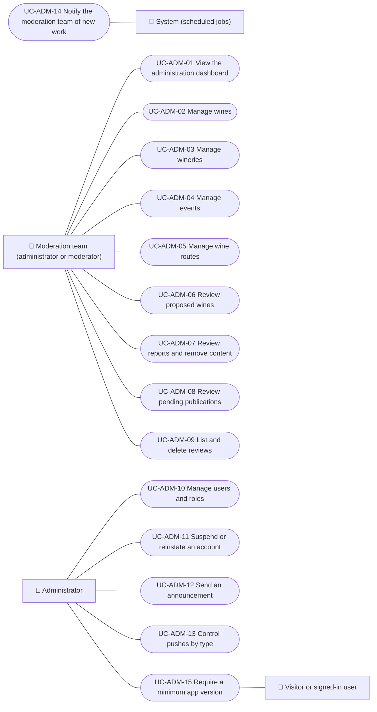

# Use cases

Vinnot team use cases: the dashboard, catalog management (wines, wineries, events and routes), review of proposed wines, reports, publications and reviews, user management, announcements, push control, the work digest for the moderation team and the minimum app version. Each case applies to the platforms listed.

| ID | Use case | Platforms | Actors |
|---|---|---|---|
| `UC-ADM-01` | [View the administration dashboard](uc-adm-01-dashboard.md) | Web, APK | Moderation team (administrator or moderator) |
| `UC-ADM-02` | [Manage wines](uc-adm-02-manage-wines.md) | Web, APK | Moderation team (administrator or moderator) |
| `UC-ADM-03` | [Manage wineries](uc-adm-03-manage-wineries.md) | Web, APK | Moderation team (administrator or moderator) |
| `UC-ADM-04` | [Manage events](uc-adm-04-manage-events.md) | Web, APK | Moderation team (administrator or moderator) |
| `UC-ADM-05` | [Manage wine routes](uc-adm-05-manage-routes.md) | Web, APK | Moderation team (administrator or moderator) |
| `UC-ADM-06` | [Review proposed wines](uc-adm-06-review-wine-submissions.md) | Web, APK | Moderation team (administrator or moderator) |
| `UC-ADM-07` | [Review reports and remove content](uc-adm-07-moderate-reports.md) | Web, APK | Moderation team (administrator or moderator) |
| `UC-ADM-08` | [Review pending publications](uc-adm-08-review-publications.md) | Web, APK | Moderation team (administrator or moderator) |
| `UC-ADM-09` | [List and delete reviews](uc-adm-09-manage-reviews.md) | Web, APK | Moderation team (administrator or moderator) |
| `UC-ADM-10` | [Manage users and roles](uc-adm-10-manage-users.md) | Web, APK | Administrator |
| `UC-ADM-11` | [Suspend or reinstate an account](uc-adm-11-suspend-user.md) | Web, APK | Administrator |
| `UC-ADM-12` | [Send an announcement](uc-adm-12-send-announcements.md) | Web, APK | Administrator |
| `UC-ADM-13` | [Control pushes by type](uc-adm-13-control-push.md) | Web, APK | Administrator |
| `UC-ADM-14` | [Notify the moderation team of new work](uc-adm-14-moderation-digest.md) | Backend only | System (scheduled jobs) |
| `UC-ADM-15` | [Require a minimum app version](uc-adm-15-minimum-app-version.md) | Web, APK | Administrator, Visitor or signed-in user |

## Use case diagram

[View the full “Use cases · Use case diagram” diagram](https://images.vinnot.com/docs/diagrams/v1/en/modules-admin-use-cases-readme-696c8db77d3f.svg)

## Lucidchart mapping

| ID | Lucidchart IDs |
|---|---|
| `UC-ADM-01` | [WEB UC-ADM-01](https://lucid.app/lucidchart/9f11a16b-bb5a-42fc-a9e8-0852b17bd241/edit), [APK UC-ADM-01](https://lucid.app/lucidchart/e095dd25-e8ac-41ba-bf5b-396e1055f217/edit) |
| `UC-ADM-02` | [WEB UC-ADM-02](https://lucid.app/lucidchart/9f11a16b-bb5a-42fc-a9e8-0852b17bd241/edit), [APK UC-ADM-02](https://lucid.app/lucidchart/e095dd25-e8ac-41ba-bf5b-396e1055f217/edit) |
| `UC-ADM-03` | [WEB UC-ADM-03](https://lucid.app/lucidchart/9f11a16b-bb5a-42fc-a9e8-0852b17bd241/edit), [APK UC-ADM-03](https://lucid.app/lucidchart/e095dd25-e8ac-41ba-bf5b-396e1055f217/edit) |
| `UC-ADM-04` | [WEB UC-ADM-04](https://lucid.app/lucidchart/9f11a16b-bb5a-42fc-a9e8-0852b17bd241/edit), [APK UC-ADM-04](https://lucid.app/lucidchart/e095dd25-e8ac-41ba-bf5b-396e1055f217/edit) |
| `UC-ADM-05` | [WEB UC-ADM-05](https://lucid.app/lucidchart/9f11a16b-bb5a-42fc-a9e8-0852b17bd241/edit), [APK UC-ADM-05](https://lucid.app/lucidchart/e095dd25-e8ac-41ba-bf5b-396e1055f217/edit) |
| `UC-ADM-06` | [WEB UC-MOD-05](https://lucid.app/lucidchart/9f11a16b-bb5a-42fc-a9e8-0852b17bd241/edit), [APK UC-MOD-04](https://lucid.app/lucidchart/e095dd25-e8ac-41ba-bf5b-396e1055f217/edit) |
| `UC-ADM-07` | [WEB UC-MOD-02](https://lucid.app/lucidchart/9f11a16b-bb5a-42fc-a9e8-0852b17bd241/edit), [WEB UC-MOD-03](https://lucid.app/lucidchart/9f11a16b-bb5a-42fc-a9e8-0852b17bd241/edit), [APK UC-MOD-01](https://lucid.app/lucidchart/e095dd25-e8ac-41ba-bf5b-396e1055f217/edit) |
| `UC-ADM-08` | [WEB UC-MOD-01](https://lucid.app/lucidchart/9f11a16b-bb5a-42fc-a9e8-0852b17bd241/edit), [APK UC-MOD-02](https://lucid.app/lucidchart/e095dd25-e8ac-41ba-bf5b-396e1055f217/edit) |
| `UC-ADM-09` | [WEB UC-MOD-04](https://lucid.app/lucidchart/9f11a16b-bb5a-42fc-a9e8-0852b17bd241/edit), [APK UC-MOD-03](https://lucid.app/lucidchart/e095dd25-e8ac-41ba-bf5b-396e1055f217/edit) |
| `UC-ADM-10` | [WEB UC-USR-01](https://lucid.app/lucidchart/9f11a16b-bb5a-42fc-a9e8-0852b17bd241/edit), [WEB UC-USR-02](https://lucid.app/lucidchart/9f11a16b-bb5a-42fc-a9e8-0852b17bd241/edit), [WEB UC-USR-04](https://lucid.app/lucidchart/9f11a16b-bb5a-42fc-a9e8-0852b17bd241/edit), [WEB UC-AUTH-12](https://lucid.app/lucidchart/9f11a16b-bb5a-42fc-a9e8-0852b17bd241/edit), [APK UC-ADM-06](https://lucid.app/lucidchart/e095dd25-e8ac-41ba-bf5b-396e1055f217/edit) |
| `UC-ADM-11` | [WEB UC-USR-03](https://lucid.app/lucidchart/9f11a16b-bb5a-42fc-a9e8-0852b17bd241/edit), [APK UC-ADM-06](https://lucid.app/lucidchart/e095dd25-e8ac-41ba-bf5b-396e1055f217/edit) |
| `UC-ADM-12` | [APK UC-ADM-07](https://lucid.app/lucidchart/e095dd25-e8ac-41ba-bf5b-396e1055f217/edit) |
| `UC-ADM-13` | [APK UC-ADM-08](https://lucid.app/lucidchart/e095dd25-e8ac-41ba-bf5b-396e1055f217/edit) |
| `UC-ADM-14` | None |
| `UC-ADM-15` | None |
