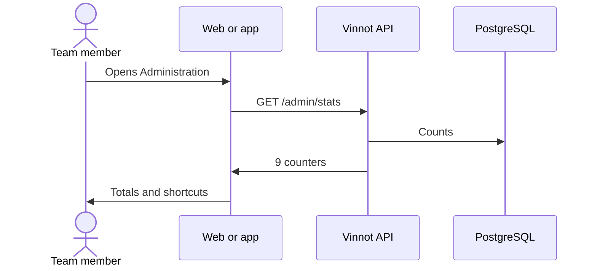

# UC-ADM-01 · View the administration dashboard

| Field | Value |
|---|---|
| ID | `UC-ADM-01` |
| Module | [Administration and moderation](../README.md) |
| Platforms | Web, APK |
| Actors | Moderation team (administrator or moderator) |
| Lucidchart IDs | [WEB UC-ADM-01](https://lucid.app/lucidchart/9f11a16b-bb5a-42fc-a9e8-0852b17bd241/edit), [APK UC-ADM-01](https://lucid.app/lucidchart/e095dd25-e8ac-41ba-bf5b-396e1055f217/edit) |
| Requirements | [`RF-WEB-ADM-01`](../requirements.md), [`RF-WEB-ADM-02`](../requirements.md), [`RF-APK-ADM-01`](../requirements.md), [`RF-APK-ADM-02`](../requirements.md) |
| Test cases | [`CP-ADM-01`](../testing.md), [`CP-ADM-02`](../testing.md), [`CP-ADM-03`](../testing.md) |

## Preconditions

- The person is an administrator or moderator.

## Postconditions

- The person sees the system state and opens each management area.

## Main flow

1. The person opens “Administration”.
2. The client calls `GET /admin/stats`.
3. It shows the totals of wines, wineries, events, routes, reviews and users, with active users, published events and published routes, then the quick actions. The first quick action, "Moderation workload", opens `/admin/community` with the pending reports and publications.
4. The person opens a management area from the shortcuts.

## Alternative flows

- 3a. The person is a moderator: they do not see the users total or the users and notifications shortcuts.
- 2a. A request fails: the error with retry is shown, never zero pending items.

## Business rules

- Counters come from backend queries, not from the client.
- The dashboard is an entry point: each management area validates the role again in the backend.

## Diagram

[View the full “UC-ADM-01 · View the administration dashboard” diagram](https://images.vinnot.com/docs/diagrams/v1/en/modules-admin-use-cases-uc-adm-01-dashboard-8ec7ac14edc4.svg)

Component diagram in Lucidchart: [WEB UC-ADM-01](https://lucid.app/lucidchart/9f11a16b-bb5a-42fc-a9e8-0852b17bd241/edit), [APK UC-ADM-01](https://lucid.app/lucidchart/e095dd25-e8ac-41ba-bf5b-396e1055f217/edit).

## Code

| Layer | Location |
|---|---|
| Endpoints | `GET /admin/stats` |
| Backend | [`AdminDashboardController.java`](../../../../../backend/src/main/java/com/vinnot/admin/infrastructure/web/controller/AdminDashboardController.java), [`GetAdminStatsQueryHandler.java`](../../../../../backend/src/main/java/com/vinnot/admin/application/query/handler/GetAdminStatsQueryHandler.java) |
| Web | [`AdminDashboardPage.tsx`](../../../../../frontend-react/src/presentation/pages/admin/AdminDashboardPage.tsx), [`useAdminStats.ts`](../../../../../frontend-react/src/presentation/hooks/queries/admin/useAdminStats.ts), [`admin.service.ts`](../../../../../frontend-react/src/application/services/admin.service.ts) |
| App | `frontend-mobile/app/(app)/admin/index.tsx`, [`AdminDashboardScreen.tsx`](../../../../../frontend-mobile/src/presentation/features/admin/AdminDashboardScreen.tsx), [`admin.service.ts`](../../../../../frontend-mobile/src/application/services/admin.service.ts) |

## Automated tests

- Backend: [`AdminRoleAccessTest.java`](../../../../../backend/src/test/java/com/vinnot/admin/infrastructure/web/controller/AdminRoleAccessTest.java)
- Web: None
- App: [`AdminDashboardScreen.test.tsx`](../../../../../frontend-mobile/src/presentation/features/admin/AdminDashboardScreen.test.tsx), [`admin.service.test.ts`](../../../../../frontend-mobile/src/application/services/admin.service.test.ts)
