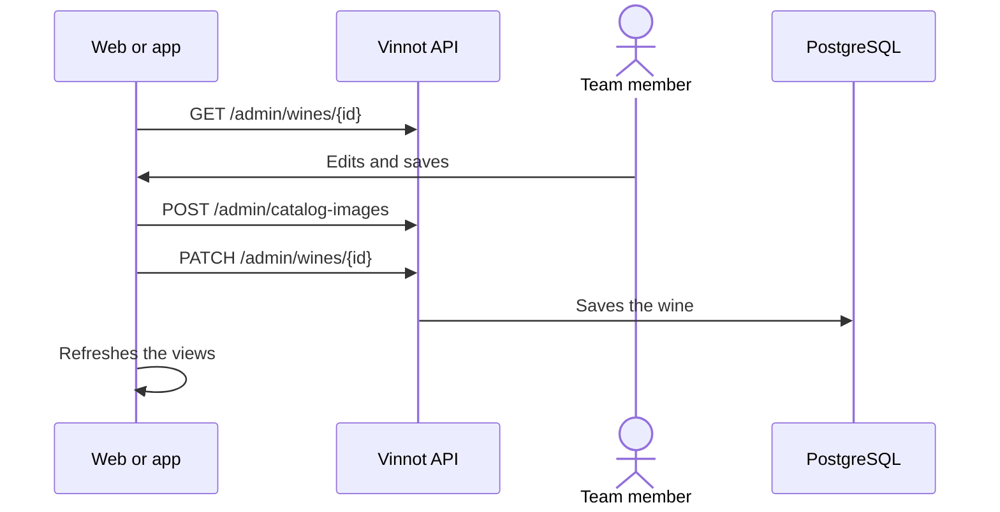

# UC-ADM-02 · Manage wines

| Field | Value |
|---|---|
| ID | `UC-ADM-02` |
| Module | [Administration and moderation](../README.md) |
| Platforms | Web, APK |
| Actors | Moderation team (administrator or moderator) |
| Lucidchart IDs | [WEB UC-ADM-02](https://lucid.app/lucidchart/9f11a16b-bb5a-42fc-a9e8-0852b17bd241/edit), [APK UC-ADM-02](https://lucid.app/lucidchart/e095dd25-e8ac-41ba-bf5b-396e1055f217/edit) |
| Requirements | [`RF-WEB-ADM-03`](../requirements.md), [`RF-WEB-ADM-04`](../requirements.md), [`RF-WEB-ADM-05`](../requirements.md), [`RF-WEB-ADM-06`](../requirements.md), [`RF-WEB-ADM-07`](../requirements.md), [`RF-WEB-ADM-08`](../requirements.md), [`RF-APK-ADM-03`](../requirements.md), [`RF-APK-ADM-04`](../requirements.md), [`RF-APK-ADM-05`](../requirements.md), [`RF-APK-ADM-06`](../requirements.md), [`RF-APK-ADM-07`](../requirements.md), [`RF-APK-ADM-08`](../requirements.md) |
| Test cases | [`CP-ADM-04`](../testing.md), [`CP-ADM-05`](../testing.md), [`CP-ADM-06`](../testing.md), [`CP-ADM-07`](../testing.md) |

## Preconditions

- The person is an administrator or moderator.

## Postconditions

- The wine was created, edited or deleted, and the affected views were refreshed.

## Main flow

1. The person opens “Wines”; the list includes inactive ones and allows searching and paging.
2. They choose create or edit; to edit, the client loads the details by ID.
3. They fill in winery, name, type, vintage, grapes, Spanish and English descriptions, alcohol, prices, temperature, image and sensory scores, and mark whether it is active or featured.
4. If they picked a new image, the client uploads it with `POST /admin/catalog-images` and uses the returned URL.
5. The client sends `POST /admin/wines` or `PATCH /admin/wines/{id}` and, on success, refreshes lists, details and statistics.

## Alternative flows

- 2a. The person chooses delete and confirms a notice explaining that the deletion is permanent and includes its reviews, its AI profile and every cellar entry: the client sends `DELETE /admin/wines/{id}` and the wine is deleted with its reviews, cellar entries and AI profile.
- 4a. The image upload fails: the wine is not saved.
- 5a. Some data is invalid, such as a score above 100 or a negative price: the API answers 400.

## Business rules

- Winery, name and type are required when creating.
- An inactive wine does not appear in the public catalog.
- An emptied optional field is sent as an explicit clear; a field that is not sent keeps its value.
- Only an administrator deletes, with confirmation and with identity confirmed in the last 5 minutes ([UC-USR-12](../../users/use-cases/uc-usr-12-reauthenticate.md)).
- AI profile editing is in [AI profiles and comparisons](../../ai/README.md).

## Diagram

[View the full “UC-ADM-02 · Manage wines” diagram](https://images.vinnot.com/docs/diagrams/v1/en/modules-admin-use-cases-uc-adm-02-manage-wines-30ed427d9d45.svg)

Component diagram in Lucidchart: [WEB UC-ADM-02](https://lucid.app/lucidchart/9f11a16b-bb5a-42fc-a9e8-0852b17bd241/edit), [APK UC-ADM-02](https://lucid.app/lucidchart/e095dd25-e8ac-41ba-bf5b-396e1055f217/edit).

## Code

| Layer | Location |
|---|---|
| Endpoints | `GET /admin/wines`, `GET /admin/wines/{id}`, `POST /admin/wines`, `PATCH /admin/wines/{id}`, `DELETE /admin/wines/{id}`, `POST /admin/catalog-images` |
| Backend | [`WineAdminController.java`](../../../../../backend/src/main/java/com/vinnot/admin/infrastructure/web/controller/WineAdminController.java), [`UpdateWineCommandHandler.java`](../../../../../backend/src/main/java/com/vinnot/wine/application/command/handler/UpdateWineCommandHandler.java), [`CatalogImageAdminController.java`](../../../../../backend/src/main/java/com/vinnot/admin/infrastructure/web/controller/CatalogImageAdminController.java), [`FieldUpdates.java`](../../../../../backend/src/main/java/com/vinnot/shared/application/command/FieldUpdates.java) |
| Web | [`AdminWinesPage.tsx`](../../../../../frontend-react/src/presentation/pages/admin/AdminWinesPage.tsx), [`useAdminWinesViewModel.ts`](../../../../../frontend-react/src/presentation/pages/admin/useAdminWinesViewModel.ts), [`useAdminWineMutations.ts`](../../../../../frontend-react/src/presentation/hooks/queries/admin/useAdminWineMutations.ts), [`patchRequest.ts`](../../../../../frontend-react/src/infrastructure/api/clients/patchRequest.ts), [`admin.service.ts`](../../../../../frontend-react/src/application/services/admin.service.ts), [`admin.client.ts`](../../../../../frontend-react/src/infrastructure/api/clients/admin.client.ts) |
| App | `frontend-mobile/app/(app)/admin/wines.tsx`, [`AdminWinesScreen.tsx`](../../../../../frontend-mobile/src/presentation/features/admin/AdminWinesScreen.tsx), [`AdminWineSheet.tsx`](../../../../../frontend-mobile/src/presentation/features/admin/AdminWineSheet.tsx), [`useAdminDetailEditor.ts`](../../../../../frontend-mobile/src/presentation/hooks/queries/admin/useAdminDetailEditor.ts), [`admin.service.ts`](../../../../../frontend-mobile/src/application/services/admin.service.ts), [`admin.client.ts`](../../../../../frontend-mobile/src/infrastructure/api/clients/admin.client.ts) |

## Automated tests

- Backend: [`WineCatalogMutationHandlersTest.java`](../../../../../backend/src/test/java/com/vinnot/wine/application/command/handler/WineCatalogMutationHandlersTest.java), [`AdminWineUpdateRegressionTest.java`](../../../../../backend/src/test/java/com/vinnot/wine/application/command/handler/AdminWineUpdateRegressionTest.java), [`AdminCatalogQueryHandlersTest.java`](../../../../../backend/src/test/java/com/vinnot/admin/application/query/handler/AdminCatalogQueryHandlersTest.java), [`FieldUpdatesTest.java`](../../../../../backend/src/test/java/com/vinnot/shared/application/command/FieldUpdatesTest.java), [`AdminSensitiveActionInterceptorTest.java`](../../../../../backend/src/test/java/com/vinnot/admin/infrastructure/web/AdminSensitiveActionInterceptorTest.java)
- Web: [`useAdminWinesViewModel.test.tsx`](../../../../../frontend-react/src/presentation/pages/admin/useAdminWinesViewModel.test.tsx), [`AdminDeleteConfirm.test.tsx`](../../../../../frontend-react/src/presentation/components/features/admin/AdminDeleteConfirm.test.tsx), [`AdminDeleteConfirm.copy.test.tsx`](../../../../../frontend-react/src/presentation/components/features/admin/AdminDeleteConfirm.copy.test.tsx), [`admin.service.test.ts`](../../../../../frontend-react/src/application/services/admin.service.test.ts), [`admin.client.test.ts`](../../../../../frontend-react/src/infrastructure/api/clients/admin.client.test.ts)
- App: [`adminWinesRoute.test.tsx`](../../../../../frontend-mobile/src/presentation/features/admin/__tests__/adminWinesRoute.test.tsx), [`useAdminDetailEditor.test.ts`](../../../../../frontend-mobile/src/presentation/hooks/queries/admin/useAdminDetailEditor.test.ts), [`admin.client.test.ts`](../../../../../frontend-mobile/src/infrastructure/api/clients/admin.client.test.ts), [`catalogAdminCopy.test.ts`](../../../../../frontend-mobile/src/shared/i18n/catalogAdminCopy.test.ts)
