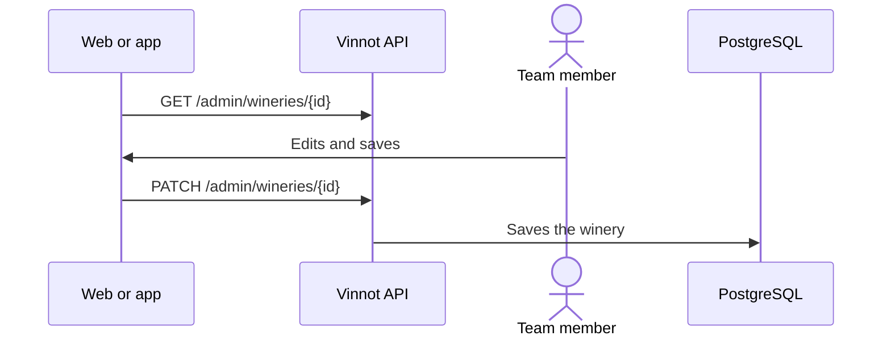

# UC-ADM-03 · Manage wineries

| Field | Value |
|---|---|
| ID | `UC-ADM-03` |
| Module | [Administration and moderation](../README.md) |
| Platforms | Web, APK |
| Actors | Moderation team (administrator or moderator) |
| Lucidchart IDs | [WEB UC-ADM-03](https://lucid.app/lucidchart/9f11a16b-bb5a-42fc-a9e8-0852b17bd241/edit), [APK UC-ADM-03](https://lucid.app/lucidchart/e095dd25-e8ac-41ba-bf5b-396e1055f217/edit) |
| Requirements | [`RF-WEB-ADM-09`](../requirements.md), [`RF-APK-ADM-09`](../requirements.md) |
| Test cases | [`CP-ADM-08`](../testing.md), [`CP-ADM-09`](../testing.md), [`CP-ADM-10`](../testing.md) |

## Preconditions

- The person is an administrator or moderator.

## Postconditions

- The winery was created, edited or deleted.

## Main flow

1. The person opens “Wineries” and searches.
2. They choose create or edit; to edit, the client loads the details by ID.
3. They fill in name, country, region, description, image, contact, address and coordinates.
4. The client sends `POST /admin/wineries` or `PATCH /admin/wineries/{id}`.

## Alternative flows

- 2a. The person chooses delete and confirms a notice explaining that its wines stay in the catalog with no winery: the winery is deleted, its wines remain without a winery and it is removed from routes.
- 4a. Only latitude or longitude is sent: the API answers 400.

## Business rules

- Name and country are required.
- Coordinates are saved or cleared together.
- An emptied optional field is sent as an explicit clear; a field that is not sent keeps its value.
- Only an administrator deletes, with confirmation and with identity confirmed in the last 5 minutes ([UC-USR-12](../../users/use-cases/uc-usr-12-reauthenticate.md)).

## Diagram

[View the full “UC-ADM-03 · Manage wineries” diagram](https://images.vinnot.com/docs/diagrams/v1/en/modules-admin-use-cases-uc-adm-03-manage-wineries-674826ced959.svg)

Component diagram in Lucidchart: [WEB UC-ADM-03](https://lucid.app/lucidchart/9f11a16b-bb5a-42fc-a9e8-0852b17bd241/edit), [APK UC-ADM-03](https://lucid.app/lucidchart/e095dd25-e8ac-41ba-bf5b-396e1055f217/edit).

## Code

| Layer | Location |
|---|---|
| Endpoints | `GET /admin/wineries`, `GET /admin/wineries/{id}`, `POST /admin/wineries`, `PATCH /admin/wineries/{id}`, `DELETE /admin/wineries/{id}` |
| Backend | [`WineryAdminController.java`](../../../../../backend/src/main/java/com/vinnot/admin/infrastructure/web/controller/WineryAdminController.java), [`CreateWineryCommandHandler.java`](../../../../../backend/src/main/java/com/vinnot/winery/application/command/handler/CreateWineryCommandHandler.java), [`UpdateWineryCommandHandler.java`](../../../../../backend/src/main/java/com/vinnot/winery/application/command/handler/UpdateWineryCommandHandler.java) |
| Web | [`AdminWineriesPage.tsx`](../../../../../frontend-react/src/presentation/pages/admin/AdminWineriesPage.tsx), [`useAdminWineriesViewModel.ts`](../../../../../frontend-react/src/presentation/pages/admin/useAdminWineriesViewModel.ts), [`useAdminWineryMutations.ts`](../../../../../frontend-react/src/presentation/hooks/queries/admin/useAdminWineryMutations.ts), [`admin.service.ts`](../../../../../frontend-react/src/application/services/admin.service.ts), [`admin.client.ts`](../../../../../frontend-react/src/infrastructure/api/clients/admin.client.ts) |
| App | `frontend-mobile/app/(app)/admin/wineries.tsx`, [`AdminWineriesScreen.tsx`](../../../../../frontend-mobile/src/presentation/features/admin/AdminWineriesScreen.tsx), [`AdminWinerySheet.tsx`](../../../../../frontend-mobile/src/presentation/features/admin/AdminWinerySheet.tsx), [`admin.service.ts`](../../../../../frontend-mobile/src/application/services/admin.service.ts), [`admin.client.ts`](../../../../../frontend-mobile/src/infrastructure/api/clients/admin.client.ts) |

## Automated tests

- Backend: [`CreateWineryAdminRequestTest.java`](../../../../../backend/src/test/java/com/vinnot/admin/infrastructure/web/request/CreateWineryAdminRequestTest.java), [`UpdateWineryCommandHandlerTest.java`](../../../../../backend/src/test/java/com/vinnot/winery/application/command/handler/UpdateWineryCommandHandlerTest.java), [`DeleteWineryCommandHandlerTest.java`](../../../../../backend/src/test/java/com/vinnot/winery/application/command/handler/DeleteWineryCommandHandlerTest.java)
- Web: [`AdminWineriesPage.form.test.tsx`](../../../../../frontend-react/src/presentation/pages/admin/__tests__/AdminWineriesPage.form.test.tsx), [`adminWineryForm.test.ts`](../../../../../frontend-react/src/domain/admin/adminWineryForm.test.ts), [`AdminDeleteConfirm.copy.test.tsx`](../../../../../frontend-react/src/presentation/components/features/admin/AdminDeleteConfirm.copy.test.tsx)
- App: [`adminListRoutes.test.tsx`](../../../../../frontend-mobile/src/presentation/features/admin/__tests__/adminListRoutes.test.tsx), [`catalogAdminCopy.test.ts`](../../../../../frontend-mobile/src/shared/i18n/catalogAdminCopy.test.ts)
