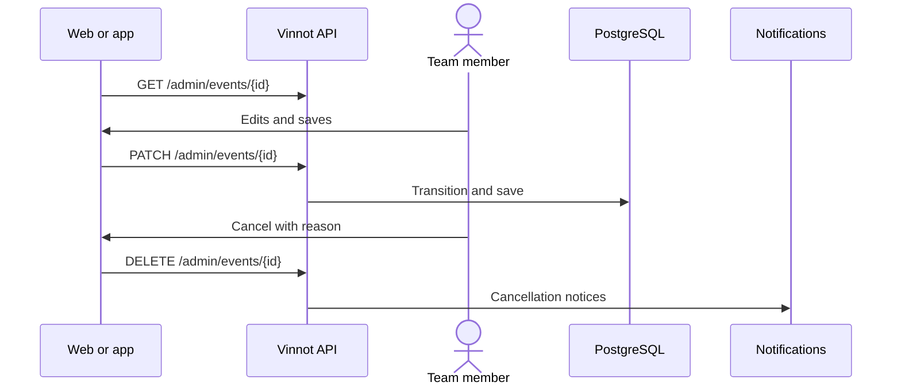

# UC-ADM-04 · Manage events

| Field | Value |
|---|---|
| ID | `UC-ADM-04` |
| Module | [Administration and moderation](../README.md) |
| Platforms | Web, APK |
| Actors | Moderation team (administrator or moderator) |
| Lucidchart IDs | [WEB UC-ADM-04](https://lucid.app/lucidchart/9f11a16b-bb5a-42fc-a9e8-0852b17bd241/edit), [APK UC-ADM-04](https://lucid.app/lucidchart/e095dd25-e8ac-41ba-bf5b-396e1055f217/edit) |
| Requirements | [`RF-WEB-ADM-10`](../requirements.md), [`RF-WEB-ADM-11`](../requirements.md), [`RF-WEB-ADM-12`](../requirements.md), [`RF-APK-ADM-10`](../requirements.md), [`RF-APK-ADM-11`](../requirements.md), [`RF-APK-ADM-12`](../requirements.md) |
| Test cases | [`CP-ADM-11`](../testing.md), [`CP-ADM-12`](../testing.md), [`CP-ADM-13`](../testing.md), [`CP-ADM-14`](../testing.md), [`CP-ADM-56`](../testing.md) |

## Preconditions

- The person is an administrator or moderator.

## Postconditions

- The event was created, edited or cancelled.

## Main flow

1. The person opens “Events” and searches by text, type or city.
2. They choose create or edit; to edit, the client loads the details by ID.
3. They fill in the same editor organizers use, with dates, location, price, capacity, contact, cover and registration, and the state: draft, published or completed. The editor does not offer “Cancelled”.
4. The client sends `POST /admin/events` or `PATCH /admin/events/{id}`, with the state only when it changed, and the API applies the state transition.

## Alternative flows

- 2a. An administrator chooses to cancel the event: the dialog warns that cancelling is final and that online payments are refunded automatically through Mercado Pago; they confirm the reason (“Unforeseen circumstances” is preselected) and the client sends `DELETE /admin/events/{id}` with the reason.
- 2b. When cancelling, the event is not deleted: active registrations are cancelled, attendees and the organizer are notified, and online payments are refunded.
- 4a. The transition is not allowed: the API answers 400.
- 4b. The request asks to move the event to cancelled: the API answers 400 `USE_CANCEL_ENDPOINT`.

## Business rules

- If no organizer is chosen, the event belongs to whoever creates it.
- Event rules, states and online payment are those in [Events](../../events/README.md) and [Partners](../../partner/README.md).
- Cancellation reasons: unforeseen circumstances, scheduling conflict, venue unavailable, low attendance, weather, health and safety, and other.
- An emptied optional field is sent as an explicit clear; a field that is not sent keeps its value.
- A sold-out event is edited as published; sending the current state back is not a state change.

## Diagram

[View the full “UC-ADM-04 · Manage events” diagram](https://images.vinnot.com/docs/diagrams/v1/en/modules-admin-use-cases-uc-adm-04-manage-events-c63594834e09.svg)

Component diagram in Lucidchart: [WEB UC-ADM-04](https://lucid.app/lucidchart/9f11a16b-bb5a-42fc-a9e8-0852b17bd241/edit), [APK UC-ADM-04](https://lucid.app/lucidchart/e095dd25-e8ac-41ba-bf5b-396e1055f217/edit).

## Code

| Layer | Location |
|---|---|
| Endpoints | `GET /admin/events`, `GET /admin/events/{id}`, `POST /admin/events`, `PATCH /admin/events/{id}`, `DELETE /admin/events/{id}` |
| Backend | [`EventAdminController.java`](../../../../../backend/src/main/java/com/vinnot/admin/infrastructure/web/controller/EventAdminController.java), [`UpdateEventCommandHandler.java`](../../../../../backend/src/main/java/com/vinnot/event/application/command/handler/UpdateEventCommandHandler.java), [`EventCancellationService.java`](../../../../../backend/src/main/java/com/vinnot/event/application/service/EventCancellationService.java) |
| Web | [`AdminEventsPage.tsx`](../../../../../frontend-react/src/presentation/pages/admin/AdminEventsPage.tsx), [`useAdminEventsViewModel.ts`](../../../../../frontend-react/src/presentation/pages/admin/useAdminEventsViewModel.ts), [`useAdminEventMutations.ts`](../../../../../frontend-react/src/presentation/hooks/queries/admin/useAdminEventMutations.ts), [`EventFormModal.tsx`](../../../../../frontend-react/src/presentation/components/features/event/EventFormModal.tsx), [`CancelEventDialog.tsx`](../../../../../frontend-react/src/presentation/components/features/event/CancelEventDialog.tsx), [`admin.service.ts`](../../../../../frontend-react/src/application/services/admin.service.ts), [`admin.client.ts`](../../../../../frontend-react/src/infrastructure/api/clients/admin.client.ts) |
| App | `frontend-mobile/app/(app)/admin/events.tsx`, [`AdminEventsScreen.tsx`](../../../../../frontend-mobile/src/presentation/features/admin/AdminEventsScreen.tsx), [`AdminEventSheet.tsx`](../../../../../frontend-mobile/src/presentation/features/admin/AdminEventSheet.tsx), [`CancelEventSheet.tsx`](../../../../../frontend-mobile/src/presentation/features/event/CancelEventSheet.tsx), [`admin.service.ts`](../../../../../frontend-mobile/src/application/services/admin.service.ts), [`admin.client.ts`](../../../../../frontend-mobile/src/infrastructure/api/clients/admin.client.ts) |

## Automated tests

- Backend: [`UpdateEventCommandHandlerTest.java`](../../../../../backend/src/test/java/com/vinnot/event/application/command/handler/UpdateEventCommandHandlerTest.java), [`EventStatusTransitionTest.java`](../../../../../backend/src/test/java/com/vinnot/event/domain/model/EventStatusTransitionTest.java), [`CancelEventRequestTest.java`](../../../../../backend/src/test/java/com/vinnot/event/infrastructure/web/request/CancelEventRequestTest.java)
- Web: [`useAdminEventsViewModel.test.tsx`](../../../../../frontend-react/src/presentation/pages/admin/useAdminEventsViewModel.test.tsx), [`eventEditor.test.ts`](../../../../../frontend-react/src/domain/event/eventEditor.test.ts), [`useAdminEventMutations.test.tsx`](../../../../../frontend-react/src/presentation/hooks/queries/admin/useAdminEventMutations.test.tsx)
- App: [`CancelEventSheet.test.tsx`](../../../../../frontend-mobile/src/presentation/features/event/CancelEventSheet.test.tsx), [`useEventEditor.test.ts`](../../../../../frontend-mobile/src/presentation/features/event/useEventEditor.test.ts)
