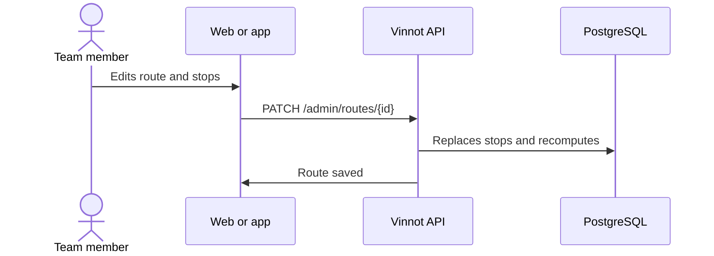

# UC-ADM-05 · Manage wine routes

| Field | Value |
|---|---|
| ID | `UC-ADM-05` |
| Module | [Administration and moderation](../README.md) |
| Platforms | Web, APK |
| Actors | Moderation team (administrator or moderator) |
| Lucidchart IDs | [WEB UC-ADM-05](https://lucid.app/lucidchart/9f11a16b-bb5a-42fc-a9e8-0852b17bd241/edit), [APK UC-ADM-05](https://lucid.app/lucidchart/e095dd25-e8ac-41ba-bf5b-396e1055f217/edit) |
| Requirements | [`RF-WEB-ADM-13`](../requirements.md), [`RF-WEB-ADM-14`](../requirements.md), [`RF-WEB-ADM-15`](../requirements.md), [`RF-APK-ADM-13`](../requirements.md), [`RF-APK-ADM-14`](../requirements.md), [`RF-APK-ADM-15`](../requirements.md) |
| Test cases | [`CP-ADM-15`](../testing.md), [`CP-ADM-16`](../testing.md), [`CP-ADM-17`](../testing.md), [`CP-ADM-18`](../testing.md) |

## Preconditions

- The person is an administrator or moderator.

## Postconditions

- The route was saved as a draft, published or archived, with its stops in order.

## Main flow

1. The person opens “Routes” and chooses create or edit.
2. They fill in name, region, subregion, description, duration, distance, cover and wine types.
3. They add, edit, remove and reorder stops, linked to a winery or with their own coordinates.
4. They choose the state: draft, published or archived.
5. The client sends `POST /admin/routes` or `PATCH /admin/routes/{id}` with the full list of stops, and the API recomputes duration and distance.

## Alternative flows

- 4a. Publishing without stops is requested: the API answers 400; as a draft it is saved.
- 3a. Looking up a stop's coordinates only changes the stop draft, never the linked winery.
- 1a. An administrator chooses delete and confirms: the route is deleted with its stops.

## Business rules

- A route has up to 100 stops.
- Saving the stops replaces the whole list.
- Only published routes are shown in [Wine routes](../../wine-routes/README.md).
- An emptied optional field is sent as an explicit clear; a field that is not sent keeps its value.
- Only an administrator deletes, with confirmation and with identity confirmed in the last 5 minutes ([UC-USR-12](../../users/use-cases/uc-usr-12-reauthenticate.md)).

## Diagram

[View the full “UC-ADM-05 · Manage wine routes” diagram](https://images.vinnot.com/docs/diagrams/v1/en/modules-admin-use-cases-uc-adm-05-manage-routes-07e2fc528d42.svg)

Component diagram in Lucidchart: [WEB UC-ADM-05](https://lucid.app/lucidchart/9f11a16b-bb5a-42fc-a9e8-0852b17bd241/edit), [APK UC-ADM-05](https://lucid.app/lucidchart/e095dd25-e8ac-41ba-bf5b-396e1055f217/edit).

## Code

| Layer | Location |
|---|---|
| Endpoints | `GET /admin/routes`, `GET /admin/routes/{id}`, `POST /admin/routes`, `PATCH /admin/routes/{id}`, `DELETE /admin/routes/{id}` |
| Backend | [`WineRouteAdminController.java`](../../../../../backend/src/main/java/com/vinnot/admin/infrastructure/web/controller/WineRouteAdminController.java), [`UpdateWineRouteCommandHandler.java`](../../../../../backend/src/main/java/com/vinnot/wineroute/application/command/handler/UpdateWineRouteCommandHandler.java), [`WineRoute.java`](../../../../../backend/src/main/java/com/vinnot/wineroute/domain/model/WineRoute.java) |
| Web | [`AdminRoutesPage.tsx`](../../../../../frontend-react/src/presentation/pages/admin/AdminRoutesPage.tsx), [`useAdminRoutesViewModel.ts`](../../../../../frontend-react/src/presentation/pages/admin/useAdminRoutesViewModel.ts), [`useAdminRouteMutations.ts`](../../../../../frontend-react/src/presentation/hooks/queries/admin/useAdminRouteMutations.ts), [`admin.service.ts`](../../../../../frontend-react/src/application/services/admin.service.ts), [`admin.client.ts`](../../../../../frontend-react/src/infrastructure/api/clients/admin.client.ts) |
| App | `frontend-mobile/app/(app)/admin/routes.tsx`, [`AdminRoutesScreen.tsx`](../../../../../frontend-mobile/src/presentation/features/admin/AdminRoutesScreen.tsx), [`AdminRouteSheet.tsx`](../../../../../frontend-mobile/src/presentation/features/admin/AdminRouteSheet.tsx), [`AdminRouteSheetStopsSection.tsx`](../../../../../frontend-mobile/src/presentation/features/admin/AdminRouteSheetStopsSection.tsx), [`admin.service.ts`](../../../../../frontend-mobile/src/application/services/admin.service.ts), [`admin.client.ts`](../../../../../frontend-mobile/src/infrastructure/api/clients/admin.client.ts) |

## Automated tests

- Backend: [`WineRouteMutationHandlersTest.java`](../../../../../backend/src/test/java/com/vinnot/wineroute/application/command/handler/WineRouteMutationHandlersTest.java), [`WineRouteTest.java`](../../../../../backend/src/test/java/com/vinnot/wineroute/domain/model/WineRouteTest.java)
- Web: [`useAdminRoutesViewModel.test.tsx`](../../../../../frontend-react/src/presentation/pages/admin/useAdminRoutesViewModel.test.tsx)
- App: [`routeShells.test.ts`](../../../../../frontend-mobile/src/presentation/features/admin/__tests__/routeShells.test.ts)
