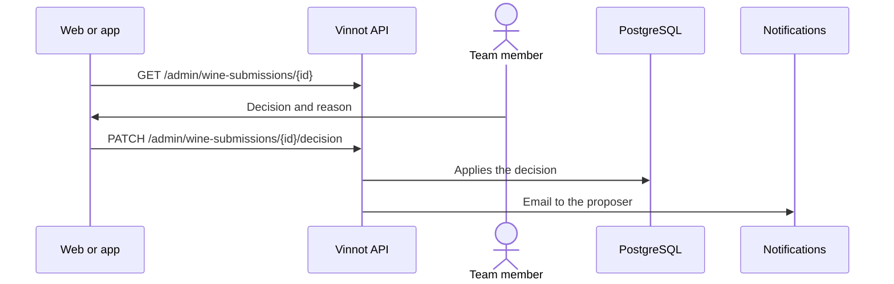

# UC-ADM-06 · Review proposed wines

| Field | Value |
|---|---|
| ID | `UC-ADM-06` |
| Module | [Administration and moderation](../README.md) |
| Platforms | Web, APK |
| Actors | Moderation team (administrator or moderator) |
| Lucidchart IDs | [WEB UC-MOD-05](https://lucid.app/lucidchart/9f11a16b-bb5a-42fc-a9e8-0852b17bd241/edit), [APK UC-MOD-04](https://lucid.app/lucidchart/e095dd25-e8ac-41ba-bf5b-396e1055f217/edit) |
| Requirements | [`RF-WEB-ADM-16`](../requirements.md), [`RF-WEB-ADM-17`](../requirements.md), [`RF-WEB-ADM-18`](../requirements.md), [`RF-WEB-ADM-19`](../requirements.md), [`RF-WEB-ADM-20`](../requirements.md), [`RF-APK-ADM-16`](../requirements.md), [`RF-APK-ADM-17`](../requirements.md), [`RF-APK-ADM-18`](../requirements.md), [`RF-APK-ADM-19`](../requirements.md), [`RF-APK-ADM-20`](../requirements.md) |
| Test cases | [`CP-ADM-19`](../testing.md), [`CP-ADM-20`](../testing.md), [`CP-ADM-21`](../testing.md), [`CP-ADM-22`](../testing.md), [`CP-ADM-23`](../testing.md), [`CP-ADM-24`](../testing.md) |

## Preconditions

- There are proposed wines waiting for review.

## Postconditions

- The proposed wine was approved as new, merged into an existing one, rejected or sent back for corrections.

## Main flow

1. The person opens “Proposed wines”; the list starts with those waiting for review, 20 at a time.
2. They pick one; the client loads the details and, when there is one, the photo with the session.
3. The details show each winery, country, region and grape as an existing catalog entry or as a proposed new value.
4. The person chooses approve as new, merge into an existing wine, reject or request corrections, and writes the reason.
5. The client sends `PATCH /admin/wine-submissions/{id}/decision` and the API applies the decision.

## Alternative flows

- 4a. When approving as new, the person can correct the catalog data before deciding.
- 4b. Merging asks for the target wine.
- 5a. The submission was already decided: the API answers 409.
- 5b. Catalog data needed to create the wine is missing: the API answers 400.
- 2a. The photo does not load: an error with retry is shown, without losing what was typed.

## Business rules

- Only submissions under review can be decided.
- A submission without a photo (reason `LABEL_PHOTO_MISSING`) can be approved as new, and the wine is published without an image.
- The reason is required, up to 500 characters.
- The person who proposed it gets an email with the outcome.
- The full proposed-wine flow is in [Proposed wines](../../wines/submissions.md).

## Diagram

[View the full “UC-ADM-06 · Review proposed wines” diagram](https://images.vinnot.com/docs/diagrams/v1/en/modules-admin-use-cases-uc-adm-06-review-wine-submissions-1d254bc0030a.svg)

Component diagram in Lucidchart: [WEB UC-MOD-05](https://lucid.app/lucidchart/9f11a16b-bb5a-42fc-a9e8-0852b17bd241/edit), [APK UC-MOD-04](https://lucid.app/lucidchart/e095dd25-e8ac-41ba-bf5b-396e1055f217/edit).

## Code

| Layer | Location |
|---|---|
| Endpoints | `GET /admin/wine-submissions`, `GET /admin/wine-submissions/{id}`, `GET /admin/wine-submissions/{id}/image`, `PATCH /admin/wine-submissions/{id}/decision` |
| Backend | [`WineSubmissionAdminController.java`](../../../../../backend/src/main/java/com/vinnot/wine/infrastructure/web/controller/WineSubmissionAdminController.java), [`ReviewWineSubmissionCommandHandler.java`](../../../../../backend/src/main/java/com/vinnot/wine/application/command/handler/ReviewWineSubmissionCommandHandler.java) |
| Web | [`AdminWineSubmissionsPage.tsx`](../../../../../frontend-react/src/presentation/pages/admin/AdminWineSubmissionsPage.tsx), [`useAdminWineSubmissionsViewModel.ts`](../../../../../frontend-react/src/presentation/pages/admin/useAdminWineSubmissionsViewModel.ts), [`useAdminWineSubmissionMutations.ts`](../../../../../frontend-react/src/presentation/hooks/queries/admin/useAdminWineSubmissionMutations.ts), [`useAdminSubmissionImage.ts`](../../../../../frontend-react/src/presentation/hooks/queries/admin/useAdminSubmissionImage.ts), [`admin.service.ts`](../../../../../frontend-react/src/application/services/admin.service.ts), [`admin.client.ts`](../../../../../frontend-react/src/infrastructure/api/clients/admin.client.ts) |
| App | `frontend-mobile/app/(app)/admin/submissions.tsx`, [`AdminSubmissionsScreen.tsx`](../../../../../frontend-mobile/src/presentation/features/admin/AdminSubmissionsScreen.tsx), [`useAdminSubmissionsViewModel.ts`](../../../../../frontend-mobile/src/presentation/features/admin/useAdminSubmissionsViewModel.ts), [`admin.service.ts`](../../../../../frontend-mobile/src/application/services/admin.service.ts), [`admin.client.ts`](../../../../../frontend-mobile/src/infrastructure/api/clients/admin.client.ts) |

## Automated tests

- Backend: [`ReviewWineSubmissionCommandHandlerTest.java`](../../../../../backend/src/test/java/com/vinnot/wine/application/command/handler/ReviewWineSubmissionCommandHandlerTest.java)
- Web: [`AdminWineSubmissionsPage.test.tsx`](../../../../../frontend-react/src/presentation/pages/admin/AdminWineSubmissionsPage.test.tsx), [`useAdminSubmissionImage.test.tsx`](../../../../../frontend-react/src/presentation/hooks/queries/admin/useAdminSubmissionImage.test.tsx)
- App: [`AdminSubmissionsScreen.test.tsx`](../../../../../frontend-mobile/src/presentation/features/admin/AdminSubmissionsScreen.test.tsx), [`useAdminSubmissionsViewModel.test.ts`](../../../../../frontend-mobile/src/presentation/features/admin/useAdminSubmissionsViewModel.test.ts)
