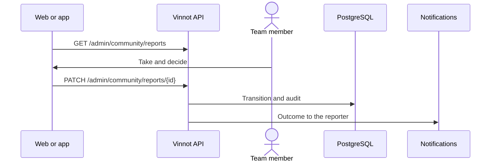

# UC-ADM-07 · Review reports and remove content

| Field | Value |
|---|---|
| ID | `UC-ADM-07` |
| Module | [Administration and moderation](../README.md) |
| Platforms | Web, APK |
| Actors | Moderation team (administrator or moderator) |
| Lucidchart IDs | [WEB UC-MOD-02](https://lucid.app/lucidchart/9f11a16b-bb5a-42fc-a9e8-0852b17bd241/edit), [WEB UC-MOD-03](https://lucid.app/lucidchart/9f11a16b-bb5a-42fc-a9e8-0852b17bd241/edit), [APK UC-MOD-01](https://lucid.app/lucidchart/e095dd25-e8ac-41ba-bf5b-396e1055f217/edit) |
| Requirements | [`RF-WEB-ADM-21`](../requirements.md), [`RF-WEB-ADM-22`](../requirements.md), [`RF-APK-ADM-21`](../requirements.md), [`RF-APK-ADM-22`](../requirements.md) |
| Test cases | [`CP-ADM-25`](../testing.md), [`CP-ADM-26`](../testing.md), [`CP-ADM-27`](../testing.md), [`CP-ADM-28`](../testing.md), [`CP-ADM-29`](../testing.md) |

## Preconditions

- There are community reports.

## Postconditions

- The report was taken into review, resolved or dismissed, and the content was removed when needed.

## Main flow

1. The person opens “Community”; the list shows open reports.
2. They filter by state and open a report with its evidence, its author, what it is about (the type and the wine, event, route or username) and who reviews it.
3. They take it for review: it moves to in review and is assigned to them.
4. They resolve or dismiss it, writing the decision.
5. The client sends `PATCH /admin/community/reports/{id}` and the API applies the transition.

## Alternative flows

- 2a. The author, the content or the reviewer was deleted: that field is hidden; ids are never shown instead.
- 4a. The report is about a review or a comment: the person can remove the content with confirmation; the report is resolved and the author gets the notice with the reason.
- 5a. Resolving or dismissing without text: the API answers 422.
- 5b. Someone else already took the report: the API answers 422.
- 5c. The person filed the report or wrote the content: the API answers 422.

## Business rules

- Reviewers never see the reports they filed or those about their own content.
- A closed report is never reopened.
- Only reviews and comments can be removed.
- The reporter gets the outcome; closed reports are deleted after 90 days ([Community](../../community/README.md)).

## Diagram

[View the full “UC-ADM-07 · Review reports and remove content” diagram](https://images.vinnot.com/docs/diagrams/v1/en/modules-admin-use-cases-uc-adm-07-moderate-reports-5a23d83e89f9.svg)

Component diagram in Lucidchart: [WEB UC-MOD-02](https://lucid.app/lucidchart/9f11a16b-bb5a-42fc-a9e8-0852b17bd241/edit), [WEB UC-MOD-03](https://lucid.app/lucidchart/9f11a16b-bb5a-42fc-a9e8-0852b17bd241/edit), [APK UC-MOD-01](https://lucid.app/lucidchart/e095dd25-e8ac-41ba-bf5b-396e1055f217/edit).

## Code

| Layer | Location |
|---|---|
| Endpoints | `GET /admin/community/reports`, `PATCH /admin/community/reports/{id}`, `POST /admin/community/reports/{id}/remove-content` |
| Backend | [`CommunityModerationController.java`](../../../../../backend/src/main/java/com/vinnot/community/infrastructure/web/CommunityModerationController.java), [`CommunityReport.java`](../../../../../backend/src/main/java/com/vinnot/community/domain/model/CommunityReport.java), [`RemoveReportedContentCommandHandler.java`](../../../../../backend/src/main/java/com/vinnot/community/application/command/handler/RemoveReportedContentCommandHandler.java) |
| Web | [`CommunityModerationPage.tsx`](../../../../../frontend-react/src/presentation/pages/community/CommunityModerationPage.tsx), [`useCommunity.ts`](../../../../../frontend-react/src/presentation/hooks/queries/community/useCommunity.ts), [`community.service.ts`](../../../../../frontend-react/src/application/services/community.service.ts), [`community.client.ts`](../../../../../frontend-react/src/infrastructure/api/clients/community.client.ts) |
| App | `frontend-mobile/app/(app)/admin/community.tsx`, [`CommunityScreens.tsx`](../../../../../frontend-mobile/src/presentation/features/community/CommunityScreens.tsx), [`useAdminCommunityViewModels.ts`](../../../../../frontend-mobile/src/presentation/features/community/useAdminCommunityViewModels.ts), [`AdminCommunityParts.tsx`](../../../../../frontend-mobile/src/presentation/features/community/AdminCommunityParts.tsx), [`community.service.ts`](../../../../../frontend-mobile/src/application/services/community.service.ts), [`community.client.ts`](../../../../../frontend-mobile/src/infrastructure/api/clients/community.client.ts) |

## Automated tests

- Backend: [`CommunityReportTest.java`](../../../../../backend/src/test/java/com/vinnot/community/domain/model/CommunityReportTest.java), [`RemoveReportedContentCommandHandlerTest.java`](../../../../../backend/src/test/java/com/vinnot/community/application/command/handler/RemoveReportedContentCommandHandlerTest.java), [`CommunityCommandHandlersTest.java`](../../../../../backend/src/test/java/com/vinnot/community/application/command/handler/CommunityCommandHandlersTest.java), [`CommunityHttpPostgresIntegrationTest.java`](../../../../../backend/src/test/java/com/vinnot/community/infrastructure/CommunityHttpPostgresIntegrationTest.java)
- Web: [`useCommunity.test.tsx`](../../../../../frontend-react/src/presentation/hooks/queries/community/useCommunity.test.tsx), [`community.service.test.ts`](../../../../../frontend-react/src/application/services/community.service.test.ts), [`community.client.test.ts`](../../../../../frontend-react/src/infrastructure/api/clients/community.client.test.ts)
- App: [`CommunityModerationScreen.test.tsx`](../../../../../frontend-mobile/src/presentation/features/community/CommunityModerationScreen.test.tsx)
