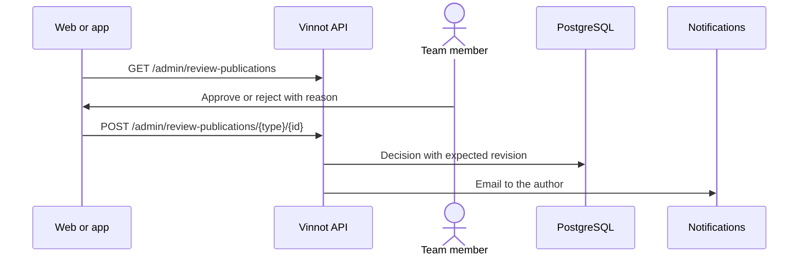

# UC-ADM-08 · Review pending publications

| Field | Value |
|---|---|
| ID | `UC-ADM-08` |
| Module | [Administration and moderation](../README.md) |
| Platforms | Web, APK |
| Actors | Moderation team (administrator or moderator) |
| Lucidchart IDs | [WEB UC-MOD-01](https://lucid.app/lucidchart/9f11a16b-bb5a-42fc-a9e8-0852b17bd241/edit), [APK UC-MOD-02](https://lucid.app/lucidchart/e095dd25-e8ac-41ba-bf5b-396e1055f217/edit) |
| Requirements | [`RF-WEB-ADM-23`](../requirements.md), [`RF-APK-ADM-23`](../requirements.md) |
| Test cases | [`CP-ADM-30`](../testing.md), [`CP-ADM-31`](../testing.md), [`CP-ADM-32`](../testing.md), [`CP-ADM-33`](../testing.md) |

## Preconditions

- There are reviews or comments pending from an earlier version, or edited and not approved.

## Postconditions

- The publication was approved or rejected with a reason.

## Main flow

1. The person opens “Publications”.
2. The client calls `GET /admin/review-publications` and shows the queue with each item's author and wine.
3. The person approves, or rejects choosing a preset reason; “Offensive” is preselected.
4. The client sends the decision with the revision that was seen.
5. The API applies the decision and emails the author.

## Alternative flows

- 2a. The author or the wine was deleted: that field is hidden; ids are never shown instead.
- 3a. The reason is “Other”: an optional note appears.
- 4a. The content changed since it was opened: the API rejects it and the current revision is reloaded.
- 4b. The person wrote the content: the API rejects it.

## Business rules

- New reviews and comments are published instantly; the queue only has earlier pending items and unapproved edits.
- Rejection reasons: offensive, spam, off-topic, personal data and other.
- Approving recomputes the wine's statistics.

## Diagram

[View the full “UC-ADM-08 · Review pending publications” diagram](https://images.vinnot.com/docs/diagrams/v1/en/modules-admin-use-cases-uc-adm-08-review-publications-81d2424fb13a.svg)

Component diagram in Lucidchart: [WEB UC-MOD-01](https://lucid.app/lucidchart/9f11a16b-bb5a-42fc-a9e8-0852b17bd241/edit), [APK UC-MOD-02](https://lucid.app/lucidchart/e095dd25-e8ac-41ba-bf5b-396e1055f217/edit).

## Code

| Layer | Location |
|---|---|
| Endpoints | `GET /admin/review-publications`, `POST /admin/review-publications/{type}/{id}` |
| Backend | [`ReviewPublicationController.java`](../../../../../backend/src/main/java/com/vinnot/review/infrastructure/web/controller/ReviewPublicationController.java), [`ReviewPublication.java`](../../../../../backend/src/main/java/com/vinnot/review/domain/model/ReviewPublication.java), [`DecideReviewPublicationCommandHandler.java`](../../../../../backend/src/main/java/com/vinnot/review/application/command/handler/DecideReviewPublicationCommandHandler.java) |
| Web | [`ReviewPublicationsPage.tsx`](../../../../../frontend-react/src/presentation/pages/community/ReviewPublicationsPage.tsx), [`publicationDecision.ts`](../../../../../frontend-react/src/domain/community/publicationDecision.ts), [`useCommunity.ts`](../../../../../frontend-react/src/presentation/hooks/queries/community/useCommunity.ts), [`community.client.ts`](../../../../../frontend-react/src/infrastructure/api/clients/community.client.ts) |
| App | `frontend-mobile/app/(app)/admin/publications.tsx`, [`ReviewPublicationsScreen.tsx`](../../../../../frontend-mobile/src/presentation/features/community/ReviewPublicationsScreen.tsx), [`useAdminCommunityViewModels.ts`](../../../../../frontend-mobile/src/presentation/features/community/useAdminCommunityViewModels.ts), [`community.client.ts`](../../../../../frontend-mobile/src/infrastructure/api/clients/community.client.ts) |

## Automated tests

- Backend: [`ReviewPublicationTest.java`](../../../../../backend/src/test/java/com/vinnot/review/domain/model/ReviewPublicationTest.java), [`DecideReviewPublicationCommandHandlerTest.java`](../../../../../backend/src/test/java/com/vinnot/review/application/command/handler/DecideReviewPublicationCommandHandlerTest.java), [`GetReviewPublicationQueueQueryHandlerTest.java`](../../../../../backend/src/test/java/com/vinnot/review/application/query/handler/GetReviewPublicationQueueQueryHandlerTest.java)
- Web: [`ReviewPublicationsPage.test.tsx`](../../../../../frontend-react/src/presentation/pages/community/ReviewPublicationsPage.test.tsx), [`publicationDecision.test.ts`](../../../../../frontend-react/src/domain/community/publicationDecision.test.ts)
- App: [`ReviewPublicationsScreen.test.tsx`](../../../../../frontend-mobile/src/presentation/features/community/ReviewPublicationsScreen.test.tsx)
