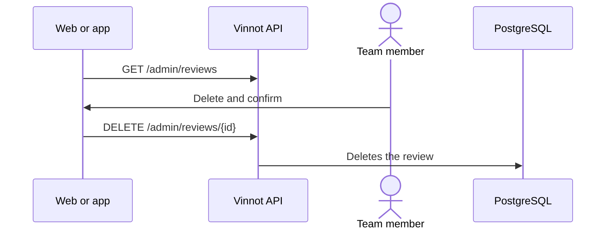

# UC-ADM-09 · List and delete reviews

| Field | Value |
|---|---|
| ID | `UC-ADM-09` |
| Module | [Administration and moderation](../README.md) |
| Platforms | Web, APK |
| Actors | Moderation team (administrator or moderator) |
| Lucidchart IDs | [WEB UC-MOD-04](https://lucid.app/lucidchart/9f11a16b-bb5a-42fc-a9e8-0852b17bd241/edit), [APK UC-MOD-03](https://lucid.app/lucidchart/e095dd25-e8ac-41ba-bf5b-396e1055f217/edit) |
| Requirements | [`RF-WEB-ADM-24`](../requirements.md), [`RF-APK-ADM-24`](../requirements.md) |
| Test cases | [`CP-ADM-34`](../testing.md), [`CP-ADM-35`](../testing.md), [`CP-ADM-36`](../testing.md) |

## Preconditions

- The person is an administrator or moderator.

## Postconditions

- The review was deleted and its author got the notice.

## Main flow

1. The person opens “Reviews” in administration.
2. The client lists the reviews, lets the person search them by title, comment, author username or wine name, and open the details.
3. The person chooses delete and confirms.
4. The client sends `DELETE /admin/reviews/{id}` and the API deletes the review.

## Alternative flows

- 3a. The person cancels: nothing is sent.
- 4a. Deleting fails: the details stay open and it can be retried.

## Business rules

- Removing reported content goes through report review, which records the reason.
- The author gets the content-removed notice.

## Diagram

[View the full “UC-ADM-09 · List and delete reviews” diagram](https://images.vinnot.com/docs/diagrams/v1/en/modules-admin-use-cases-uc-adm-09-manage-reviews-ea1d8a34e8e7.svg)

Component diagram in Lucidchart: [WEB UC-MOD-04](https://lucid.app/lucidchart/9f11a16b-bb5a-42fc-a9e8-0852b17bd241/edit), [APK UC-MOD-03](https://lucid.app/lucidchart/e095dd25-e8ac-41ba-bf5b-396e1055f217/edit).

## Code

| Layer | Location |
|---|---|
| Endpoints | `GET /admin/reviews`, `GET /admin/reviews/{id}`, `DELETE /admin/reviews/{id}` |
| Backend | [`ReviewAdminController.java`](../../../../../backend/src/main/java/com/vinnot/admin/infrastructure/web/controller/ReviewAdminController.java) |
| Web | [`AdminReviewsPage.tsx`](../../../../../frontend-react/src/presentation/pages/admin/AdminReviewsPage.tsx), [`useAdminReviewsViewModel.ts`](../../../../../frontend-react/src/presentation/pages/admin/useAdminReviewsViewModel.ts), [`useAdminReviewMutations.ts`](../../../../../frontend-react/src/presentation/hooks/queries/admin/useAdminReviewMutations.ts), [`admin.service.ts`](../../../../../frontend-react/src/application/services/admin.service.ts) |
| App | `frontend-mobile/app/(app)/admin/reviews.tsx`, [`AdminReviewsScreen.tsx`](../../../../../frontend-mobile/src/presentation/features/admin/AdminReviewsScreen.tsx), [`admin.service.ts`](../../../../../frontend-mobile/src/application/services/admin.service.ts) |

## Automated tests

- Backend: [`AdminReviewQueryHandlersTest.java`](../../../../../backend/src/test/java/com/vinnot/admin/application/query/handler/AdminReviewQueryHandlersTest.java)
- Web: [`useAdminReviewMutations.test.tsx`](../../../../../frontend-react/src/presentation/hooks/queries/admin/useAdminReviewMutations.test.tsx)
- App: [`AdminReviewsScreen.test.tsx`](../../../../../frontend-mobile/src/presentation/features/admin/AdminReviewsScreen.test.tsx)
