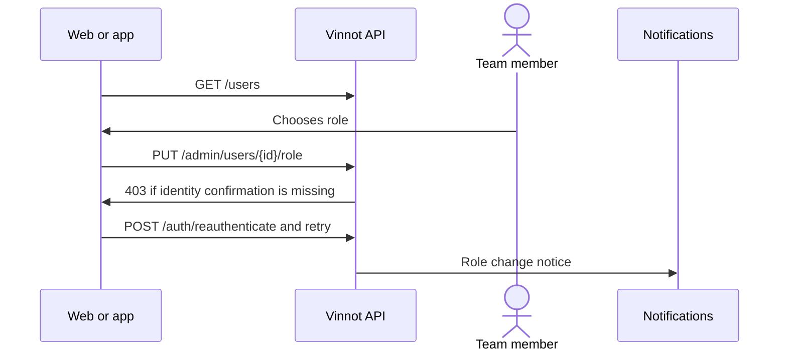

# UC-ADM-10 · Manage users and roles

| Field | Value |
|---|---|
| ID | `UC-ADM-10` |
| Module | [Administration and moderation](../README.md) |
| Platforms | Web, APK |
| Actors | Administrator |
| Lucidchart IDs | [WEB UC-USR-01](https://lucid.app/lucidchart/9f11a16b-bb5a-42fc-a9e8-0852b17bd241/edit), [WEB UC-USR-02](https://lucid.app/lucidchart/9f11a16b-bb5a-42fc-a9e8-0852b17bd241/edit), [WEB UC-USR-04](https://lucid.app/lucidchart/9f11a16b-bb5a-42fc-a9e8-0852b17bd241/edit), [WEB UC-AUTH-12](https://lucid.app/lucidchart/9f11a16b-bb5a-42fc-a9e8-0852b17bd241/edit), [APK UC-ADM-06](https://lucid.app/lucidchart/e095dd25-e8ac-41ba-bf5b-396e1055f217/edit) |
| Requirements | [`RF-WEB-ADM-25`](../requirements.md), [`RF-WEB-ADM-26`](../requirements.md), [`RF-WEB-ADM-27`](../requirements.md), [`RF-WEB-ADM-28`](../requirements.md), [`RF-WEB-ADM-29`](../requirements.md), [`RF-APK-ADM-25`](../requirements.md), [`RF-APK-ADM-26`](../requirements.md), [`RF-APK-ADM-27`](../requirements.md), [`RF-APK-ADM-28`](../requirements.md), [`RF-APK-ADM-29`](../requirements.md) |
| Test cases | [`CP-ADM-37`](../testing.md), [`CP-ADM-38`](../testing.md), [`CP-ADM-39`](../testing.md), [`CP-ADM-40`](../testing.md) |

## Preconditions

- The person is an administrator.

## Postconditions

- The role was changed or the account deleted, and the affected person got the notice.

## Main flow

1. The person opens “Users” and searches by name or email.
2. The client lists the accounts with roles, verification and state.
3. The person chooses a role (user, moderator, partner or administrator) and saves.
4. The client sends `PUT /admin/users/{id}/role`; the account keeps user plus the chosen role.
5. The API asks to confirm identity if there was no confirmation in the last 5 minutes.
6. The person confirms with their password, or with Google or Apple if their account uses them, and the client retries once.

## Alternative flows

- 3a. The person chooses to delete the account and confirms: the client sends `DELETE /admin/users/{id}` and the account is deleted.
- 4a. The change removes the person's own admin access or leaves no active administrator: the API answers 422.
- 6a. The person cancels the confirmation: the action is not run.

## Business rules

- At least one active, unlocked administrator always remains.
- Changing the role closes that account's open sessions.
- Identity confirmation is [UC-USR-12](../../users/use-cases/uc-usr-12-reauthenticate.md).
- Moderators do not see user management.

## Diagram

[View the full “UC-ADM-10 · Manage users and roles” diagram](https://images.vinnot.com/docs/diagrams/v1/en/modules-admin-use-cases-uc-adm-10-manage-users-68a1747a626a.svg)

Component diagram in Lucidchart: [WEB UC-USR-01](https://lucid.app/lucidchart/9f11a16b-bb5a-42fc-a9e8-0852b17bd241/edit), [WEB UC-USR-02](https://lucid.app/lucidchart/9f11a16b-bb5a-42fc-a9e8-0852b17bd241/edit), [WEB UC-USR-04](https://lucid.app/lucidchart/9f11a16b-bb5a-42fc-a9e8-0852b17bd241/edit), [WEB UC-AUTH-12](https://lucid.app/lucidchart/9f11a16b-bb5a-42fc-a9e8-0852b17bd241/edit), [APK UC-ADM-06](https://lucid.app/lucidchart/e095dd25-e8ac-41ba-bf5b-396e1055f217/edit).

## Code

| Layer | Location |
|---|---|
| Endpoints | `GET /users`, `GET /admin/users/{id}`, `PUT /admin/users/{id}/role`, `DELETE /admin/users/{id}`, `POST /auth/reauthenticate` |
| Backend | [`UserAdminController.java`](../../../../../backend/src/main/java/com/vinnot/admin/infrastructure/web/controller/UserAdminController.java), [`AssignRoleCommandHandler.java`](../../../../../backend/src/main/java/com/vinnot/user/application/command/handler/AssignRoleCommandHandler.java), [`DeleteUserAdminCommandHandler.java`](../../../../../backend/src/main/java/com/vinnot/user/application/command/handler/DeleteUserAdminCommandHandler.java), [`AdminUserSafety.java`](../../../../../backend/src/main/java/com/vinnot/user/application/service/AdminUserSafety.java), [`AdminSensitiveActionInterceptor.java`](../../../../../backend/src/main/java/com/vinnot/admin/infrastructure/web/AdminSensitiveActionInterceptor.java) |
| Web | [`AdminUsersPage.tsx`](../../../../../frontend-react/src/presentation/pages/admin/AdminUsersPage.tsx), [`useAdminUsersViewModel.ts`](../../../../../frontend-react/src/presentation/pages/admin/useAdminUsersViewModel.ts), [`useAdminUserMutations.ts`](../../../../../frontend-react/src/presentation/hooks/queries/admin/useAdminUserMutations.ts), [`ReauthenticationDialog.tsx`](../../../../../frontend-react/src/presentation/components/auth/ReauthenticationDialog.tsx), [`admin.service.ts`](../../../../../frontend-react/src/application/services/admin.service.ts), [`admin.client.ts`](../../../../../frontend-react/src/infrastructure/api/clients/admin.client.ts) |
| App | `frontend-mobile/app/(app)/admin/users.tsx`, [`AdminUsersScreen.tsx`](../../../../../frontend-mobile/src/presentation/features/admin/AdminUsersScreen.tsx), [`AdminUserActionSheet.tsx`](../../../../../frontend-mobile/src/presentation/features/admin/AdminUserActionSheet.tsx), [`ReauthenticationDialog.tsx`](../../../../../frontend-mobile/src/presentation/features/auth/ReauthenticationDialog.tsx), [`admin.service.ts`](../../../../../frontend-mobile/src/application/services/admin.service.ts), [`admin.client.ts`](../../../../../frontend-mobile/src/infrastructure/api/clients/admin.client.ts) |

## Automated tests

- Backend: [`AdminUserCommandHandlersTest.java`](../../../../../backend/src/test/java/com/vinnot/user/application/command/handler/AdminUserCommandHandlersTest.java), [`AdminUserSafetyTest.java`](../../../../../backend/src/test/java/com/vinnot/user/application/service/AdminUserSafetyTest.java), [`AdminRoleAccessTest.java`](../../../../../backend/src/test/java/com/vinnot/admin/infrastructure/web/controller/AdminRoleAccessTest.java), [`AdminSensitiveActionInterceptorTest.java`](../../../../../backend/src/test/java/com/vinnot/admin/infrastructure/web/AdminSensitiveActionInterceptorTest.java), [`AccountAdministrationNoticeServiceTest.java`](../../../../../backend/src/test/java/com/vinnot/user/application/service/AccountAdministrationNoticeServiceTest.java)
- Web: [`AdminUsersPage.test.tsx`](../../../../../frontend-react/src/presentation/pages/admin/AdminUsersPage.test.tsx), [`useAdminUsersViewModel.test.tsx`](../../../../../frontend-react/src/presentation/pages/admin/useAdminUsersViewModel.test.tsx)
- App: [`AdminUserActionSheet.test.tsx`](../../../../../frontend-mobile/src/presentation/features/admin/AdminUserActionSheet.test.tsx), [`AdminUserRow.test.tsx`](../../../../../frontend-mobile/src/presentation/features/admin/AdminUserRow.test.tsx)
