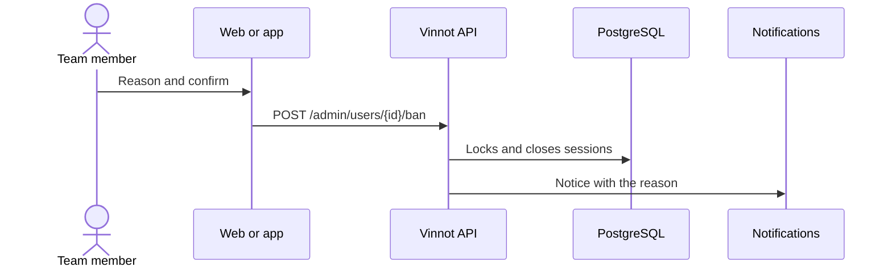

# UC-ADM-11 · Suspend or reinstate an account

| Field | Value |
|---|---|
| ID | `UC-ADM-11` |
| Module | [Administration and moderation](../README.md) |
| Platforms | Web, APK |
| Actors | Administrator |
| Lucidchart IDs | [WEB UC-USR-03](https://lucid.app/lucidchart/9f11a16b-bb5a-42fc-a9e8-0852b17bd241/edit), [APK UC-ADM-06](https://lucid.app/lucidchart/e095dd25-e8ac-41ba-bf5b-396e1055f217/edit) |
| Requirements | [`RF-WEB-ADM-30`](../requirements.md), [`RF-APK-ADM-30`](../requirements.md) |
| Test cases | [`CP-ADM-41`](../testing.md), [`CP-ADM-42`](../testing.md), [`CP-ADM-43`](../testing.md), [`CP-ADM-44`](../testing.md) |

## Preconditions

- The person is an administrator.

## Postconditions

- The account was suspended or reinstated and its holder got the notice.

## Main flow

1. The person chooses to suspend an account.
2. They choose the reason with one tap; “Spam” is preselected.
3. They confirm and the client sends `POST /admin/users/{id}/ban` with the reason.
4. The API locks the account, closes its sessions, forgets its push phones and sends the notice with the reason.

## Alternative flows

- 2a. The reason is “Other”: an optional detail of up to 255 characters appears, which is shared with the person.
- 1a. The account is suspended: the person chooses to reinstate it, the client sends `POST /admin/users/{id}/unban` and the holder gets the notice.
- 4a. It is the person's own account or the last active administrator: the API answers 422.

## Business rules

- Reasons: spam, harassment, fraud, impersonation, terms violation and other.
- Suspending is different from one user blocking another ([Community](../../community/README.md)).
- Identity confirmation is asked the same way as when changing a role.

## Diagram

[View the full “UC-ADM-11 · Suspend or reinstate an account” diagram](https://images.vinnot.com/docs/diagrams/v1/en/modules-admin-use-cases-uc-adm-11-suspend-user-5b0754c4ce2f.svg)

Component diagram in Lucidchart: [WEB UC-USR-03](https://lucid.app/lucidchart/9f11a16b-bb5a-42fc-a9e8-0852b17bd241/edit), [APK UC-ADM-06](https://lucid.app/lucidchart/e095dd25-e8ac-41ba-bf5b-396e1055f217/edit).

## Code

| Layer | Location |
|---|---|
| Endpoints | `POST /admin/users/{id}/ban`, `POST /admin/users/{id}/unban` |
| Backend | [`UserAdminController.java`](../../../../../backend/src/main/java/com/vinnot/admin/infrastructure/web/controller/UserAdminController.java), [`BanUserCommandHandler.java`](../../../../../backend/src/main/java/com/vinnot/user/application/command/handler/BanUserCommandHandler.java), [`AccountAdministrationNoticeService.java`](../../../../../backend/src/main/java/com/vinnot/user/application/service/AccountAdministrationNoticeService.java) |
| Web | [`AdminUsersPage.tsx`](../../../../../frontend-react/src/presentation/pages/admin/AdminUsersPage.tsx), [`useAdminUsersViewModel.ts`](../../../../../frontend-react/src/presentation/pages/admin/useAdminUsersViewModel.ts), [`suspensionReason.ts`](../../../../../frontend-react/src/domain/admin/suspensionReason.ts), [`useAdminUserMutations.ts`](../../../../../frontend-react/src/presentation/hooks/queries/admin/useAdminUserMutations.ts) |
| App | [`AdminUserActionSheet.tsx`](../../../../../frontend-mobile/src/presentation/features/admin/AdminUserActionSheet.tsx), [`suspensionReason.ts`](../../../../../frontend-mobile/src/domain/admin/suspensionReason.ts), [`admin.service.ts`](../../../../../frontend-mobile/src/application/services/admin.service.ts) |

## Automated tests

- Backend: [`AdminUserCommandHandlersTest.java`](../../../../../backend/src/test/java/com/vinnot/user/application/command/handler/AdminUserCommandHandlersTest.java), [`AccountAdministrationNoticeServiceTest.java`](../../../../../backend/src/test/java/com/vinnot/user/application/service/AccountAdministrationNoticeServiceTest.java)
- Web: [`suspensionReason.test.ts`](../../../../../frontend-react/src/domain/admin/suspensionReason.test.ts), [`useAdminUsersViewModel.test.tsx`](../../../../../frontend-react/src/presentation/pages/admin/useAdminUsersViewModel.test.tsx), [`adminSuspensionCopy.test.ts`](../../../../../frontend-react/src/shared/i18n/adminSuspensionCopy.test.ts)
- App: [`suspensionReason.test.ts`](../../../../../frontend-mobile/src/domain/admin/suspensionReason.test.ts), [`AdminUserActionSheet.test.tsx`](../../../../../frontend-mobile/src/presentation/features/admin/AdminUserActionSheet.test.tsx)
