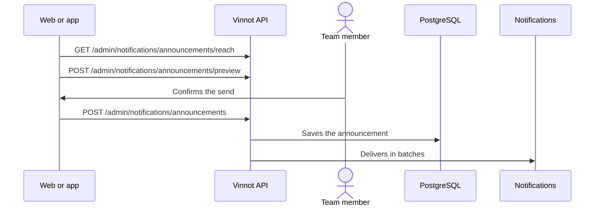

# UC-ADM-12 · Send an announcement

| Field | Value |
|---|---|
| ID | `UC-ADM-12` |
| Module | [Administration and moderation](../README.md) |
| Platforms | Web, APK |
| Actors | Administrator |
| Lucidchart IDs | [APK UC-ADM-07](https://lucid.app/lucidchart/e095dd25-e8ac-41ba-bf5b-396e1055f217/edit) |
| Requirements | [`RF-WEB-ADM-31`](../requirements.md), [`RF-APK-ADM-31`](../requirements.md) |
| Test cases | [`CP-ADM-45`](../testing.md), [`CP-ADM-46`](../testing.md), [`CP-ADM-47`](../testing.md), [`CP-ADM-48`](../testing.md) |

## Preconditions

- The person is an administrator.

## Postconditions

- The announcement was queued and is delivered in batches to the accounts in the segment.

## Main flow

1. The person opens “Notifications” and chooses news or service notice.
2. They write title and body in Spanish, English or both, with the formatting bar.
3. They choose channels (email, push or both), language, country or region, role and, for push, the screen it opens; the reach updates live.
4. They ask for the preview: the backend renders the email and the push with the real templates.
5. They send a test to themselves and then choose “Send”.
6. They confirm the number of accounts and their identity; the client sends `POST /admin/notifications/announcements` and the API answers 202.
7. A job delivers to 500 accounts every 30 seconds, each in its language if written, and the history shows the progress.

## Alternative flows

- 6a. The segment has no accounts: the API answers 400.
- 6b. The same draft is retried: the request ID is reused and it is not sent twice.
- 3a. The reach cannot be read: the box says so with retry and sending is disabled.

## Business rules

- Title up to 120 characters on one line; body up to 5000, with heading, bold, link and button, and only absolute http(s) links.
- It only reaches active, unsuspended accounts; email goes to verified, unsuppressed addresses; push, to accounts with a registered phone.
- News is promotional: it does not reach anyone who withdrew marketing consent or turned it off; a service notice does.
- Sends cannot be scheduled or cancelled.
- Delivery follows the [Notifications](../../notifications/README.md) rules.

## Diagram

[View the full “UC-ADM-12 · Send an announcement” diagram](https://images.vinnot.com/docs/diagrams/v1/en/modules-admin-use-cases-uc-adm-12-send-announcements-d9bd99d78e75.svg)

Component diagram in Lucidchart: [APK UC-ADM-07](https://lucid.app/lucidchart/e095dd25-e8ac-41ba-bf5b-396e1055f217/edit).

## Code

| Layer | Location |
|---|---|
| Endpoints | `POST /admin/notifications/announcements/preview`, `GET /admin/notifications/announcements/reach`, `POST /admin/notifications/announcements/test`, `POST /admin/notifications/announcements`, `GET /admin/notifications/announcements` |
| Backend | [`AnnouncementController.java`](../../../../../backend/src/main/java/com/vinnot/notification/infrastructure/web/AnnouncementController.java), [`AnnouncementService.java`](../../../../../backend/src/main/java/com/vinnot/notification/application/service/AnnouncementService.java), [`AnnouncementCampaignService.java`](../../../../../backend/src/main/java/com/vinnot/notification/application/service/AnnouncementCampaignService.java), [`DeliverAnnouncementsService.java`](../../../../../backend/src/main/java/com/vinnot/notification/application/service/DeliverAnnouncementsService.java), [`JdbcAnnouncementAudience.java`](../../../../../backend/src/main/java/com/vinnot/notification/infrastructure/persistence/JdbcAnnouncementAudience.java) |
| Web | [`AdminNotificationsPage.tsx`](../../../../../frontend-react/src/presentation/pages/admin/AdminNotificationsPage.tsx), [`useAnnouncementComposerViewModel.ts`](../../../../../frontend-react/src/presentation/pages/admin/useAnnouncementComposerViewModel.ts), [`AnnouncementEditor.tsx`](../../../../../frontend-react/src/presentation/components/features/admin/notifications/AnnouncementEditor.tsx), [`AnnouncementAudienceForm.tsx`](../../../../../frontend-react/src/presentation/components/features/admin/notifications/AnnouncementAudienceForm.tsx), [`AnnouncementPreviewPane.tsx`](../../../../../frontend-react/src/presentation/components/features/admin/notifications/AnnouncementPreviewPane.tsx), [`useAdminNotifications.ts`](../../../../../frontend-react/src/presentation/hooks/queries/admin/useAdminNotifications.ts), [`adminNotifications.service.ts`](../../../../../frontend-react/src/application/services/adminNotifications.service.ts), [`adminNotifications.client.ts`](../../../../../frontend-react/src/infrastructure/api/clients/adminNotifications.client.ts), [`announcement.ts`](../../../../../frontend-react/src/domain/admin/announcement.ts) |
| App | `frontend-mobile/app/(app)/admin/notifications.tsx`, [`AdminNotificationsScreen.tsx`](../../../../../frontend-mobile/src/presentation/features/admin/AdminNotificationsScreen.tsx), [`AnnouncementsTab.tsx`](../../../../../frontend-mobile/src/presentation/features/admin/notifications/AnnouncementsTab.tsx), [`useAnnouncementComposerViewModel.ts`](../../../../../frontend-mobile/src/presentation/features/admin/notifications/useAnnouncementComposerViewModel.ts), [`adminNotifications.service.ts`](../../../../../frontend-mobile/src/application/services/adminNotifications.service.ts), [`adminNotifications.client.ts`](../../../../../frontend-mobile/src/infrastructure/api/clients/adminNotifications.client.ts), [`announcement.ts`](../../../../../frontend-mobile/src/domain/admin/announcement.ts) |

## Automated tests

- Backend: [`AnnouncementControllerTest.java`](../../../../../backend/src/test/java/com/vinnot/notification/infrastructure/web/AnnouncementControllerTest.java), [`AnnouncementServiceTest.java`](../../../../../backend/src/test/java/com/vinnot/notification/application/service/AnnouncementServiceTest.java), [`AnnouncementCampaignServiceTest.java`](../../../../../backend/src/test/java/com/vinnot/notification/application/service/AnnouncementCampaignServiceTest.java), [`DeliverAnnouncementsServiceTest.java`](../../../../../backend/src/test/java/com/vinnot/notification/application/service/DeliverAnnouncementsServiceTest.java), [`JdbcAnnouncementPostgresIntegrationTest.java`](../../../../../backend/src/test/java/com/vinnot/notification/infrastructure/persistence/JdbcAnnouncementPostgresIntegrationTest.java), [`AnnouncementTest.java`](../../../../../backend/src/test/java/com/vinnot/notification/domain/model/AnnouncementTest.java), [`AnnouncementBodyTest.java`](../../../../../backend/src/test/java/com/vinnot/notification/domain/model/AnnouncementBodyTest.java), [`AnnouncementDeliverySchedulerTest.java`](../../../../../backend/src/test/java/com/vinnot/notification/infrastructure/scheduling/AnnouncementDeliverySchedulerTest.java), [`AnnouncementPushTemplatesTest.java`](../../../../../backend/src/test/java/com/vinnot/notification/infrastructure/push/AnnouncementPushTemplatesTest.java), [`AnnouncementTestTemplateTest.java`](../../../../../backend/src/test/java/com/vinnot/notification/infrastructure/template/AnnouncementTestTemplateTest.java)
- Web: [`AdminNotificationsPage.test.tsx`](../../../../../frontend-react/src/presentation/pages/admin/AdminNotificationsPage.test.tsx), [`adminNotifications.service.test.ts`](../../../../../frontend-react/src/application/services/adminNotifications.service.test.ts), [`announcement.test.ts`](../../../../../frontend-react/src/domain/admin/announcement.test.ts), [`announcementFormat.test.ts`](../../../../../frontend-react/src/domain/admin/announcementFormat.test.ts), [`useAnnouncementComposerViewModel.test.tsx`](../../../../../frontend-react/src/presentation/pages/admin/useAnnouncementComposerViewModel.test.tsx)
- App: [`AdminNotificationsScreen.test.tsx`](../../../../../frontend-mobile/src/presentation/features/admin/AdminNotificationsScreen.test.tsx), [`adminNotifications.service.test.ts`](../../../../../frontend-mobile/src/application/services/adminNotifications.service.test.ts), [`announcement.test.ts`](../../../../../frontend-mobile/src/domain/admin/announcement.test.ts), [`announcementFormat.test.ts`](../../../../../frontend-mobile/src/domain/admin/announcementFormat.test.ts), [`useAnnouncementComposerViewModel.test.ts`](../../../../../frontend-mobile/src/presentation/features/admin/notifications/useAnnouncementComposerViewModel.test.ts)
