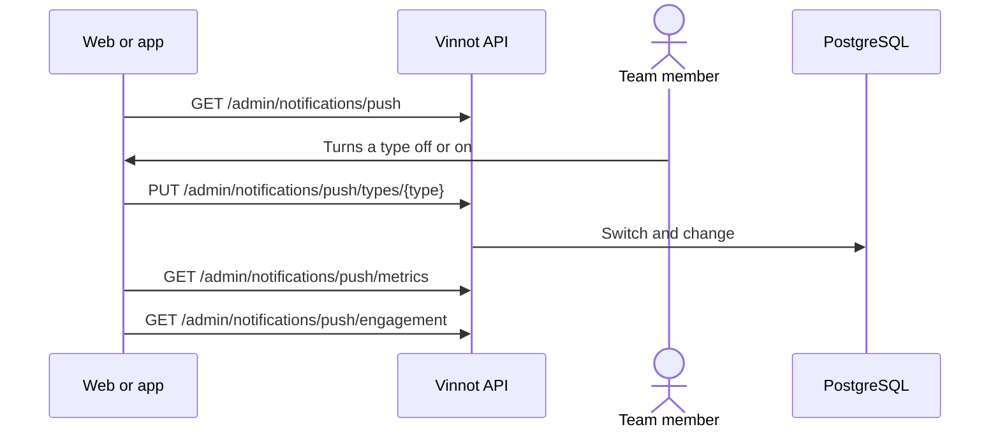

# UC-ADM-13 · Control pushes by type

| Field | Value |
|---|---|
| ID | `UC-ADM-13` |
| Module | [Administration and moderation](../README.md) |
| Platforms | Web, APK |
| Actors | Administrator |
| Lucidchart IDs | [APK UC-ADM-08](https://lucid.app/lucidchart/e095dd25-e8ac-41ba-bf5b-396e1055f217/edit) |
| Requirements | [`RF-WEB-ADM-32`](../requirements.md), [`RF-APK-ADM-32`](../requirements.md) |
| Test cases | [`CP-ADM-49`](../testing.md), [`CP-ADM-50`](../testing.md), [`CP-ADM-51`](../testing.md) |

## Preconditions

- The person is an administrator.

## Postconditions

- A push type was turned on or off, and the change was recorded.

## Main flow

1. The person opens the “Push settings” tab in Notifications; the results per type are under “History and metrics”.
2. The client calls `GET /admin/notifications/push` and shows the provider, each type with its state and the latest 20 changes.
3. The person turns a type off or on.
4. They confirm their identity and the client sends `PUT /admin/notifications/push/types/{type}`.
5. The person checks the results per type for today, 7 or 30 days.
6. On the web, they check “Engagement” (`GET /admin/notifications/push/engagement`): per engagement push type, sent, opened, open rate, opt-outs and whether it is paused, for today, 7 or 30 days.

## Alternative flows

- 3a. The type is transactional: turning it off asks for confirmation.
- 4a. The value did not change: nothing is saved.

## Business rules

- Pushes of a type that is off are dropped, not deferred, and counted as switched off.
- The provider is set on the server and shown read-only.
- “Engagement” is read-only. A type shows as paused while it is switched off, by an administrator or on its own because its opt-outs went over the limit; its switch turns it on again. With no sends, the open rate shows “—”.

## Diagram

[View the full “UC-ADM-13 · Control pushes by type” diagram](https://images.vinnot.com/docs/diagrams/v1/en/modules-admin-use-cases-uc-adm-13-control-push-fa04e50002bd.svg)

Component diagram in Lucidchart: [APK UC-ADM-08](https://lucid.app/lucidchart/e095dd25-e8ac-41ba-bf5b-396e1055f217/edit).

## Code

| Layer | Location |
|---|---|
| Endpoints | `GET /admin/notifications/push`, `PUT /admin/notifications/push/types/{type}`, `GET /admin/notifications/push/metrics`, `GET /admin/notifications/push/engagement` |
| Backend | [`PushAdministrationController.java`](../../../../../backend/src/main/java/com/vinnot/notification/infrastructure/web/PushAdministrationController.java), [`PushAdministrationService.java`](../../../../../backend/src/main/java/com/vinnot/notification/application/service/PushAdministrationService.java), [`JdbcPushTypeSwitches.java`](../../../../../backend/src/main/java/com/vinnot/notification/infrastructure/persistence/JdbcPushTypeSwitches.java), [`DeliverPushService.java`](../../../../../backend/src/main/java/com/vinnot/notification/application/service/DeliverPushService.java), [`EngagementAdministrationController.java`](../../../../../backend/src/main/java/com/vinnot/engagement/infrastructure/web/EngagementAdministrationController.java), [`EngagementMetricsService.java`](../../../../../backend/src/main/java/com/vinnot/engagement/application/service/EngagementMetricsService.java) |
| Web | [`AdminNotificationsPage.tsx`](../../../../../frontend-react/src/presentation/pages/admin/AdminNotificationsPage.tsx), [`usePushControlsViewModel.ts`](../../../../../frontend-react/src/presentation/pages/admin/usePushControlsViewModel.ts), [`PushTypeSwitches.tsx`](../../../../../frontend-react/src/presentation/components/features/admin/notifications/PushTypeSwitches.tsx), [`PushMetricsTable.tsx`](../../../../../frontend-react/src/presentation/components/features/admin/notifications/PushMetricsTable.tsx), [`PushEngagementTable.tsx`](../../../../../frontend-react/src/presentation/components/features/admin/notifications/PushEngagementTable.tsx), [`adminNotifications.service.ts`](../../../../../frontend-react/src/application/services/adminNotifications.service.ts), [`pushAdministration.ts`](../../../../../frontend-react/src/domain/admin/pushAdministration.ts) |
| App | [`AdminNotificationsScreen.tsx`](../../../../../frontend-mobile/src/presentation/features/admin/AdminNotificationsScreen.tsx), [`PushTab.tsx`](../../../../../frontend-mobile/src/presentation/features/admin/notifications/PushTab.tsx), [`usePushControlsViewModel.ts`](../../../../../frontend-mobile/src/presentation/features/admin/notifications/usePushControlsViewModel.ts), [`adminNotifications.service.ts`](../../../../../frontend-mobile/src/application/services/adminNotifications.service.ts), [`pushAdministration.ts`](../../../../../frontend-mobile/src/domain/admin/pushAdministration.ts) |

## Automated tests

- Backend: [`PushAdministrationControllerTest.java`](../../../../../backend/src/test/java/com/vinnot/notification/infrastructure/web/PushAdministrationControllerTest.java), [`PushAdministrationServiceTest.java`](../../../../../backend/src/test/java/com/vinnot/notification/application/service/PushAdministrationServiceTest.java), [`EngagementAdministrationControllerTest.java`](../../../../../backend/src/test/java/com/vinnot/engagement/infrastructure/web/EngagementAdministrationControllerTest.java), [`EngagementMetricsServiceTest.java`](../../../../../backend/src/test/java/com/vinnot/engagement/application/service/EngagementMetricsServiceTest.java), [`JdbcPushAdministrationPostgresIntegrationTest.java`](../../../../../backend/src/test/java/com/vinnot/notification/infrastructure/persistence/JdbcPushAdministrationPostgresIntegrationTest.java)
- Web: [`AdminNotificationsPage.test.tsx`](../../../../../frontend-react/src/presentation/pages/admin/AdminNotificationsPage.test.tsx), [`PushEngagementTable.test.tsx`](../../../../../frontend-react/src/presentation/components/features/admin/notifications/PushEngagementTable.test.tsx), [`pushAdministration.test.ts`](../../../../../frontend-react/src/domain/admin/pushAdministration.test.ts), [`usePushControlsViewModel.test.tsx`](../../../../../frontend-react/src/presentation/pages/admin/usePushControlsViewModel.test.tsx), [`adminPushCopy.test.ts`](../../../../../frontend-react/src/shared/i18n/adminPushCopy.test.ts)
- App: [`AdminNotificationsScreen.test.tsx`](../../../../../frontend-mobile/src/presentation/features/admin/AdminNotificationsScreen.test.tsx), [`pushAdministration.test.ts`](../../../../../frontend-mobile/src/domain/admin/pushAdministration.test.ts), [`usePushControlsViewModel.test.ts`](../../../../../frontend-mobile/src/presentation/features/admin/notifications/usePushControlsViewModel.test.ts)
