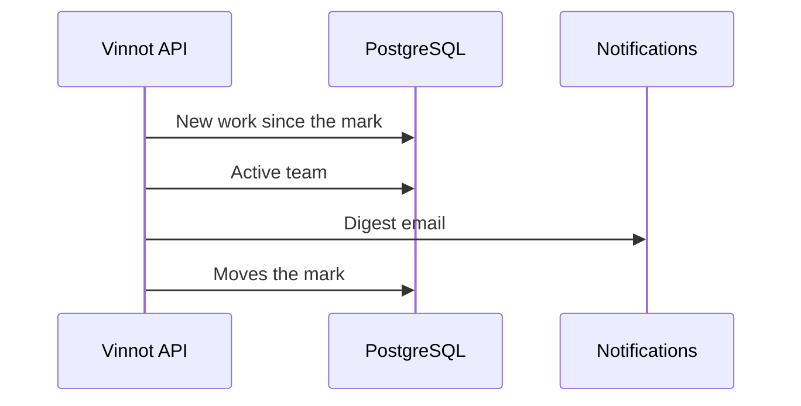

# UC-ADM-14 · Notify the moderation team of new work

| Field | Value |
|---|---|
| ID | `UC-ADM-14` |
| Module | [Administration and moderation](../README.md) |
| Platforms | Backend only |
| Actors | System (scheduled jobs) |
| Lucidchart IDs | None |
| Requirements | None |
| Test cases | [`CP-ADM-52`](../testing.md), [`CP-ADM-53`](../testing.md), [`CP-ADM-54`](../testing.md), [`CP-ADM-55`](../testing.md) |

## Preconditions

- The team digest is enabled.

## Postconditions

- Each team member got an email with the new work.

## Main flow

1. Every 15 minutes, a job checks the work that arrived since the last digest, leaving out the last 5 minutes.
2. It counts proposed wines waiting for review and new open reports.
3. If there is work, it sends a Spanish email to each active, unsuspended administrator and moderator, with links to each queue.
4. It moves the last-digest mark forward in the same transaction.

## Alternative flows

- 3a. There is no new work: nothing is sent.
- 3b. There is a single wine or report: the email names the wine or the reason.
- 3c. A team account is deactivated or suspended: it does not receive the email.

## Business rules

- Each digest is sent only once per person and window.
- The last-digest mark never moves back.

## Diagram

[View the full “UC-ADM-14 · Notify the moderation team of new work” diagram](https://images.vinnot.com/docs/diagrams/v1/en/modules-admin-use-cases-uc-adm-14-moderation-digest-14a12ac99f95.svg)

## Code

| Layer | Location |
|---|---|
| Backend | [`ModerationDigestScheduler.java`](../../../../../backend/src/main/java/com/vinnot/admin/infrastructure/scheduling/ModerationDigestScheduler.java), [`SendModerationDigestService.java`](../../../../../backend/src/main/java/com/vinnot/admin/application/service/SendModerationDigestService.java), [`JdbcModerationQueueDigest.java`](../../../../../backend/src/main/java/com/vinnot/admin/infrastructure/persistence/adapter/JdbcModerationQueueDigest.java) |

## Automated tests

- Backend: [`SendModerationDigestServiceTest.java`](../../../../../backend/src/test/java/com/vinnot/admin/application/service/SendModerationDigestServiceTest.java), [`ModerationDigestSchedulerTest.java`](../../../../../backend/src/test/java/com/vinnot/admin/infrastructure/scheduling/ModerationDigestSchedulerTest.java), [`JdbcModerationQueueDigestPostgresIntegrationTest.java`](../../../../../backend/src/test/java/com/vinnot/admin/infrastructure/persistence/adapter/JdbcModerationQueueDigestPostgresIntegrationTest.java), [`ModerationQueueDigestTemplateTest.java`](../../../../../backend/src/test/java/com/vinnot/notification/infrastructure/template/ModerationQueueDigestTemplateTest.java)
- Web: None
- App: None
