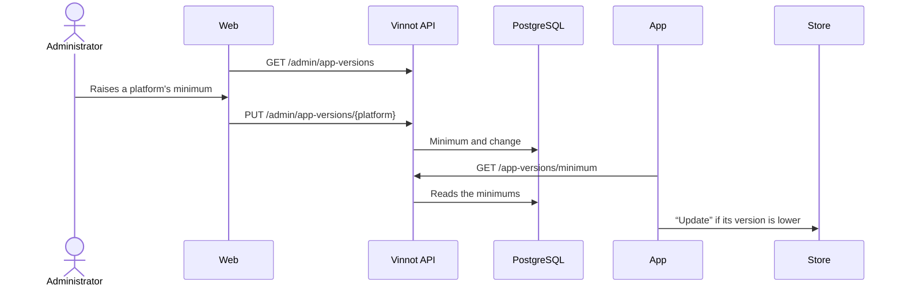

# UC-ADM-15 · Require a minimum app version

| Field | Value |
|---|---|
| ID | `UC-ADM-15` |
| Module | [Administration and moderation](../README.md) |
| Platforms | Web, APK |
| Actors | Administrator, Visitor or signed-in user |
| Lucidchart IDs | None |
| Requirements | [`RF-WEB-ADM-33`](../requirements.md), [`RF-APK-ADM-33`](../requirements.md) |
| Test cases | [`CP-ADM-57`](../testing.md), [`CP-ADM-58`](../testing.md), [`CP-ADM-59`](../testing.md), [`CP-ADM-60`](../testing.md), [`CP-ADM-61`](../testing.md), [`CP-ADM-62`](../testing.md), [`CP-ADM-63`](../testing.md) |

## Preconditions

- The person changing the minimum is an administrator and uses the web.
- The version to require is already approved and published in that platform's store.

## Postconditions

- The platform has its new minimum version, or no minimum, and the change was recorded.
- App versions older than the minimum show the update screen instead of the app.

## Main flow

1. The person opens Administration › “App versions” on the web.
2. The client calls `GET /admin/app-versions` and shows, for iOS and for Android, the current minimum, who changed it and when, the “Recent changes” (the latest 20) and the warning to raise it only after the store has published that build.
3. The person types a `major.minor.patch` version higher than the current one and chooses “Save”.
4. They confirm “Raise minimum” in the dialog warning that every older build is blocked.
5. They confirm their identity and the client sends `PUT /admin/app-versions/{platform}` with `minimumVersion`.
6. The API stores the minimum and records the change with the previous value, the new one, who made it and when.
7. When it opens and every time it returns to the foreground, the app calls `GET /app-versions/minimum`, without a session.
8. The app compares its version with the minimum for its platform; it is equal or higher, and the app works as usual.

## Alternative flows

- 3a. The value is not in `major.minor.patch` format (three numbers from 0 to 9999, without leading zeros): the field shows the error and nothing is sent. The API also rejects an invalid format with 400 `INVALID_APP_VERSION`.
- 3b. The value equals the current one: nothing is sent, and the API records no change either.
- 3c. The person chooses “Remove minimum” or types a lower version: the change applies without the raise dialog. With no minimum, no build of that platform is blocked.
- 5a. The person has not confirmed their identity in the last 5 minutes: the API responds 403 `REAUTHENTICATION_REQUIRED` and the confirmation opens. If they cancel it, nothing changes.
- 7a. The request fails, does not answer in time or returns something unreadable: the app works as usual.
- 8a. The installed version is lower than the minimum: the “Update Vinnot to continue” screen replaces the whole app and cannot be closed; on Android, the back button does not close it either. “Update” opens the Vinnot listing in the App Store or Google Play.

## Business rules

- The minimum is raised only after the store has approved and published that build. If it is raised earlier, nobody can update and the app stays blocked. The procedure is in the [distribution guide](../../../frontend-mobile/guides/distribution.md#forcing-the-update).
- Each platform (`IOS`, `ANDROID`) has its own minimum. An unknown platform responds 400 `NOT_AN_APP_PLATFORM`.
- Versions compare number by number: `0.10.0` is higher than `0.9.9`. The API accepts leading zeros and stores the version without them.
- The app fails open: while the first request has not answered, if it fails or if the platform has no minimum, the app is not blocked.
- The API reads the minimum on every request, so a change applies without a deploy, the next time the app opens or returns to the foreground. `GET /app-versions/minimum` is public and pending terms do not block it.
- The check is JavaScript code: it reaches installed apps with the same runtime by OTA. OTA updates do not change the app version, so the minimum does not need to change when they are published.
- Each change keeps the email of who made it, which survives the deletion of the account. Two simultaneous changes to the same platform apply one at a time.

## Diagram

[View the full “UC-ADM-15 · Require a minimum app version” diagram](https://images.vinnot.com/docs/diagrams/v1/en/modules-admin-use-cases-uc-adm-15-minimum-app-version-bc243f682a1b.svg)

## Code

| Layer | Location |
|---|---|
| Endpoints | `GET /admin/app-versions`, `PUT /admin/app-versions/{platform}`, `GET /app-versions/minimum` |
| Backend | [`AppVersionAdminController.java`](../../../../../backend/src/main/java/com/vinnot/admin/infrastructure/web/controller/AppVersionAdminController.java), [`AppVersionPolicyController.java`](../../../../../backend/src/main/java/com/vinnot/admin/infrastructure/web/controller/AppVersionPolicyController.java), [`AppVersionAdministrationService.java`](../../../../../backend/src/main/java/com/vinnot/admin/application/service/AppVersionAdministrationService.java), [`MinimumAppVersionsService.java`](../../../../../backend/src/main/java/com/vinnot/admin/application/service/MinimumAppVersionsService.java), [`AppVersion.java`](../../../../../backend/src/main/java/com/vinnot/admin/domain/model/AppVersion.java), [`JdbcAppMinimumVersions.java`](../../../../../backend/src/main/java/com/vinnot/admin/infrastructure/persistence/adapter/JdbcAppMinimumVersions.java), [`V69__app_minimum_versions.sql`](../../../../../backend/src/main/resources/db/migration/V69__app_minimum_versions.sql) |
| Web | [`AdminAppVersionsPage.tsx`](../../../../../frontend-react/src/presentation/pages/admin/AdminAppVersionsPage.tsx), [`useAdminAppVersionsViewModel.ts`](../../../../../frontend-react/src/presentation/pages/admin/useAdminAppVersionsViewModel.ts), [`AppVersionPlatformCard.tsx`](../../../../../frontend-react/src/presentation/components/features/admin/appVersions/AppVersionPlatformCard.tsx), [`adminAppVersions.service.ts`](../../../../../frontend-react/src/application/services/adminAppVersions.service.ts), [`appVersion.validators.ts`](../../../../../frontend-react/src/domain/admin/appVersion.validators.ts) |
| App | [`AppUpdateGate.tsx`](../../../../../frontend-mobile/src/presentation/features/appUpdate/AppUpdateGate.tsx), [`UpdateRequiredScreen.tsx`](../../../../../frontend-mobile/src/presentation/features/appUpdate/UpdateRequiredScreen.tsx), [`useAppUpdateRequirement.ts`](../../../../../frontend-mobile/src/presentation/hooks/useAppUpdateRequirement.ts), [`appVersion.service.ts`](../../../../../frontend-mobile/src/application/services/appVersion.service.ts), [`appVersion.ts`](../../../../../frontend-mobile/src/domain/app/appVersion.ts) |

## Automated tests

- Backend: [`AppVersionTest.java`](../../../../../backend/src/test/java/com/vinnot/admin/domain/model/AppVersionTest.java), [`AppPlatformTest.java`](../../../../../backend/src/test/java/com/vinnot/admin/domain/model/AppPlatformTest.java), [`AppVersionAdministrationServiceTest.java`](../../../../../backend/src/test/java/com/vinnot/admin/application/service/AppVersionAdministrationServiceTest.java), [`MinimumAppVersionsServiceTest.java`](../../../../../backend/src/test/java/com/vinnot/admin/application/service/MinimumAppVersionsServiceTest.java), [`AppVersionAdminControllerTest.java`](../../../../../backend/src/test/java/com/vinnot/admin/infrastructure/web/controller/AppVersionAdminControllerTest.java), [`AppVersionPolicyControllerTest.java`](../../../../../backend/src/test/java/com/vinnot/admin/infrastructure/web/controller/AppVersionPolicyControllerTest.java), [`JdbcAppMinimumVersionsPostgresIntegrationTest.java`](../../../../../backend/src/test/java/com/vinnot/admin/infrastructure/persistence/adapter/JdbcAppMinimumVersionsPostgresIntegrationTest.java)
- Web: [`AdminAppVersionsPage.test.tsx`](../../../../../frontend-react/src/presentation/pages/admin/AdminAppVersionsPage.test.tsx), [`useAdminAppVersionsViewModel.test.tsx`](../../../../../frontend-react/src/presentation/pages/admin/useAdminAppVersionsViewModel.test.tsx), [`adminAppVersions.service.test.ts`](../../../../../frontend-react/src/application/services/adminAppVersions.service.test.ts), [`adminAppVersions.client.test.ts`](../../../../../frontend-react/src/infrastructure/api/clients/adminAppVersions.client.test.ts), [`appVersion.validators.test.ts`](../../../../../frontend-react/src/domain/admin/appVersion.validators.test.ts)
- App: [`AppUpdateGate.test.tsx`](../../../../../frontend-mobile/src/presentation/features/appUpdate/AppUpdateGate.test.tsx), [`useAppUpdateRequirement.test.ts`](../../../../../frontend-mobile/src/presentation/hooks/useAppUpdateRequirement.test.ts), [`appVersion.service.test.ts`](../../../../../frontend-mobile/src/application/services/appVersion.service.test.ts), [`appVersions.client.test.ts`](../../../../../frontend-mobile/src/infrastructure/api/clients/appVersions.client.test.ts), [`appBuild.gateway.test.ts`](../../../../../frontend-mobile/src/infrastructure/device/appBuild.gateway.test.ts), [`appVersion.test.ts`](../../../../../frontend-mobile/src/domain/app/appVersion.test.ts)
