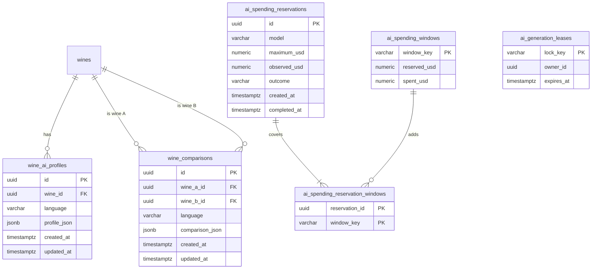

# AI profiles and comparisons

Each wine's sommelier profile and the comparison between two wines, generated with AI in
Spanish and English. Signed-in people read the saved profile or ask to generate it, and
compare two catalog wines; the team edits or regenerates profiles. The module makes
sure every paid AI call respects capacity and budget.

- Module code: `AI`.
- Backend: package [`ai`](../../../../backend/src/main/java/com/vinnot/ai/).
- [Use cases](use-cases/README.md) · [Requirements](requirements.md) ·
  [Architecture](architecture.md) · [Testing](testing.md)

## Actors

| Actor | What they do in this module |
|---|---|
| Signed-in user | Reads or generates a wine's profile and compares two wines |
| Administrator or moderator | Edits the profile by hand or regenerates it |
| OpenAI | Generates profiles and comparisons |
| System | Reserves capacity and budget before each paid call |

## Business rules

| Rule | Detail | Where |
|---|---|---|
| Languages | Only Spanish and English; any other uses Spanish; both are generated and saved together | [`AiContentLanguage.java`](../../../../backend/src/main/java/com/vinnot/ai/domain/valueobject/AiContentLanguage.java) |
| Reading never generates | `GET` returns what is saved; generating is an explicit `POST` | [`AiProfileService.java`](../../../../backend/src/main/java/com/vinnot/ai/application/service/AiProfileService.java) |
| Reuse | A profile is reused if it exists in both languages and the wine and model did not change | [`AiProfileService.java`](../../../../backend/src/main/java/com/vinnot/ai/application/service/AiProfileService.java) |
| Manual edits | Kept by a normal generation; regenerating replaces them | [`AiProfilePublicationService.java`](../../../../backend/src/main/java/com/vinnot/ai/application/service/AiProfilePublicationService.java) |
| Valid manual content | Summary required, sections in the expected shape and scores from 0 to 100 | [`ManualProfileContent.java`](../../../../backend/src/main/java/com/vinnot/ai/domain/model/ManualProfileContent.java) |
| Comparison | Two different wines the person can see; order does not matter | [`WineComparisonService.java`](../../../../backend/src/main/java/com/vinnot/ai/application/service/WineComparisonService.java) |
| Comparison validation | Up to 6 items per list, 8 attributes and 2000 characters, no placeholder text; tasting notes, choose-if, pairings, serving and aging are required | [`WineComparisonContentValidator.java`](../../../../backend/src/main/java/com/vinnot/ai/application/service/WineComparisonContentValidator.java) |
| One generation at a time | The same profile or comparison is never generated twice in parallel | [`AiGenerationCoordinator.java`](../../../../backend/src/main/java/com/vinnot/ai/application/service/AiGenerationCoordinator.java) |
| Cost | 3 concurrent calls and 10 USD a month by default; without room, 503 | [`AiProviderAdmissionService.java`](../../../../backend/src/main/java/com/vinnot/ai/application/service/AiProviderAdmissionService.java) |
| Per-person limit | 20 generations or comparisons an hour | [`RateLimitPolicyResolver.java`](../../../../backend/src/main/java/com/vinnot/shared/infrastructure/security/RateLimitPolicyResolver.java) |
| Edit permissions | Editing and regenerating require `WINE_UPDATE` (administrators and moderators) | [`AiProfileController.java`](../../../../backend/src/main/java/com/vinnot/ai/infrastructure/web/controller/AiProfileController.java) |

## Where it lives

| Part | Location |
|---|---|
| API | [`AiProfileController`](../../../../backend/src/main/java/com/vinnot/ai/infrastructure/web/controller/AiProfileController.java) under `/wines/{wineId}/ai-profile` and [`WineComparisonController`](../../../../backend/src/main/java/com/vinnot/ai/infrastructure/web/controller/WineComparisonController.java) at `/wines/compare` |
| Web | [`AiProfilePage`](../../../../frontend-react/src/presentation/pages/wines/AiProfilePage.tsx), [`WineComparePage`](../../../../frontend-react/src/presentation/pages/wines/WineComparePage.tsx) and [`AdminWineAiProfilePage`](../../../../frontend-react/src/presentation/pages/admin/AdminWineAiProfilePage.tsx) |
| App | The wine's AI tab, `frontend-mobile/app/(app)/(tabs)/wines/[id]/ai-profile.tsx`, [`WineCompareScreen`](../../../../frontend-mobile/src/presentation/screens/wines/WineCompareScreen.tsx) and [`AdminWineAiProfileScreen`](../../../../frontend-mobile/src/presentation/features/admin/AdminWineAiProfileScreen.tsx) |

## Data

[View the full “AI profiles and comparisons · Data” diagram](https://images.vinnot.com/docs/diagrams/v1/en/modules-ai-readme-32366e4e42bb.svg)

Each wine has one profile per language and each wine pair one comparison per language;
they are deleted in cascade with the wine. `ai_generation_leases` keeps two servers
from generating the same thing at once, and the `ai_spending_*` tables track reserved
and real spending.
