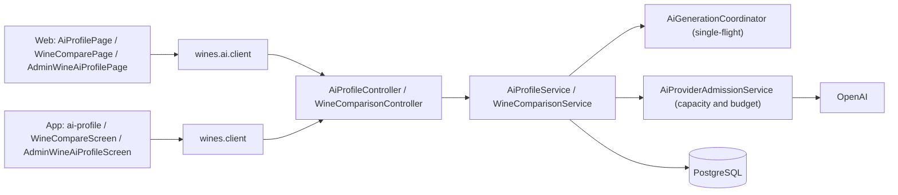
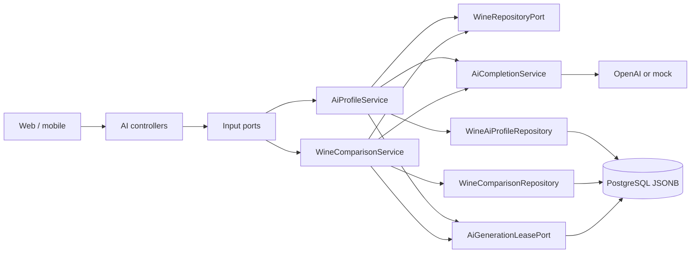
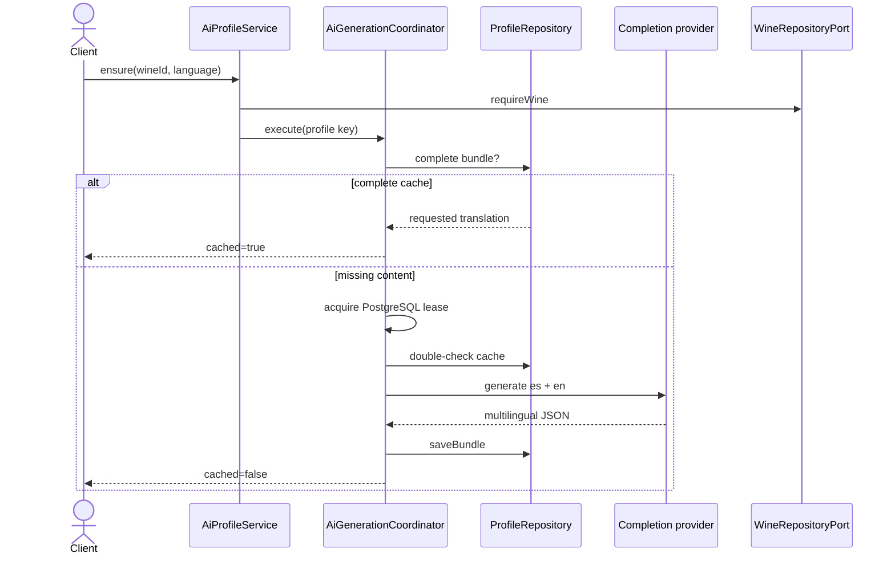
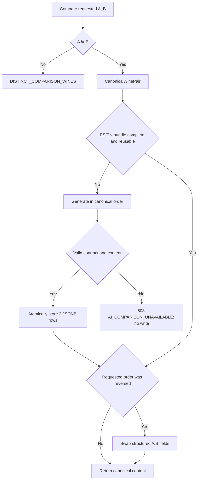
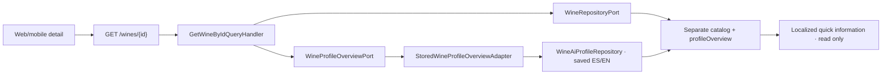
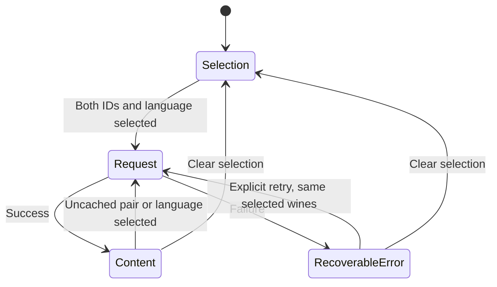

# Architecture

How the module is built in each layer. The backend follows the hexagonal flow
`controller → application service → domain → output port → adapter`; the web and the app
follow `screen → hook → service → API client → HTTP transport`. The short profile shown on
a wine's details comes from this module ([Wines](../wines/README.md)).



[View the full “Architecture” diagram](https://images.vinnot.com/docs/diagrams/v1/en/modules-ai-architecture-0775ee160e43.svg)

## Backend

### Scope

The `ai` module generates, persists, and reuses bilingual sensory content for
two use cases:

1. an individual wine profile;
2. a structured comparison between two wines.

AI is a replaceable adapter. Use cases depend on `AiCompletionService`, domain
repositories, and `AiGenerationLeasePort`; they do not depend on OpenAI, HTTP,
or JPA. Individual profiles allow simulation only with AI_PROVIDER=mock; real failure returns 503 without a mock fallback.
Comparisons without reusable cache query the provider and require validated content: an unavailable provider or invalid
response produces a recoverable error without persisting substitute content.

### Module boundaries



[View the full “Module boundaries” diagram](https://images.vinnot.com/docs/diagrams/v1/en/modules-ai-architecture-912ce0eabb25.svg)

The module queries the wine catalog through a `wine` port and wineries through
a `winery` port. It does not import external JPA entities.

### Aroma families

`ClassifySensoryFamiliesUseCase` (implemented by
`SensoryFamilyClassificationService`) groups free-text aroma and flavor
descriptors, in Spanish or English, into aroma families without calling the AI.
Each descriptor is classified with `SensoryNote.fromDescriptor` and each note
with `SensoryFamily.of`; the result is the family keys, in enum order, that at
least one descriptor belongs to. Blank, missing or unknown descriptors are
ignored. The community social profile uses it for a member's taste traits (see
[Community](../community/architecture.md)).

| Family | Notes |
|---|---|
| `FRUIT` | Every fruit note except `DRIED_FRUIT` and `JAM` |
| `FLORAL` | `HONEYSUCKLE`, `WHITE_FLOWERS`, `CHAMOMILE`, `ROSE`, `VIOLET` |
| `HERBAL` | `ROASTED_PEPPER`, `RED_PEPPER`, `GREEN_PEPPER`, `DRIED_HERBS`, `TOMATO_LEAF`, `DRIED_LEAF`, `BAY_LEAF`, `FRESH_HERBS`, `TEA`, `BLACK_OLIVE` |
| `SPICE` | `SWEET_SPICE`, `GINGER`, `ANISE`, `WHITE_PEPPER`, `BLACK_PEPPER` |
| `OAK` | `VANILLA`, `COFFEE`, `CHOCOLATE`, `OAK`, `SMOKE`, `TOBACCO`, `NUTS`, `BUTTER`, `CARAMEL` |
| `MINERAL` | `MINERAL`, `SALINE`, `WET_EARTH`, `LEATHER` |

`DRIED_FRUIT`, `JAM`, `HONEY`, `MOLASSES` and `BREAD` belong to no family.
`SensoryFamily.of` names every note in an exhaustive `switch`, so a new note does
not compile until it is given a family (or none).

### Languages as an atomic bundle

`AiContentLanguage` currently supports `es` and `en`. Regional tags are
normalized: any value beginning with `en` selects English; all other values
select Spanish. The requested language controls the returned translation, not
the generated languages.

Every new provider call requests both languages in the same JSON:

```json
{
  "translations": {
    "es": { "...": "perfil en español" },
    "en": { "...": "English profile" }
  }
}
```

`MultilingualAiContent` accepts a response only when it contains an object for
every configured language. Partial bundles are not persisted. A complete cached bundle supports language
selection without another ensure-generation call. If a translation is absent,
ensure generates the complete bundle again.

### Individual profile

#### Read and status

- `GET /wines/{wineId}/ai-profile?language=...` only reads the requested
  version and returns `404` when it does not exist.
- `GET /wines/{wineId}/ai-profile/status?language=...` returns `GENERATED` only
  when the requested language **and** the complete language bundle exist.
- these endpoints and `POST /wines/{wineId}/ai-profile` first check that the person
  can see the wine (`CheckWineReadAccessUseCase`, the same rule as comparisons): a
  missing wine, or an inactive one the person neither created nor moderates, answers
  `404` `NOT_FOUND` before any profile is read or generated.

The response `cached` flag identifies a persisted result. `generatedAt` comes
from the localized profile's `updatedAt`.

#### Ensure versus forced regeneration

| Operation | Authorization | Semantics |
|---|---|---|
| `POST /wines/{id}/ai-profile` | authenticated | return complete cache or generate bundle |
| `POST /wines/{id}/ai-profile/generate` | `WINE_UPDATE` | generate again even when cached |
| `PATCH /wines/{id}/ai-profile` | `WINE_UPDATE` | replace one translation manually |

Normal UI flows should use ensure. Forced regeneration is administrative and
consumes the provider even when content exists.



[View the full “Ensure versus forced regeneration” diagram](https://images.vinnot.com/docs/diagrams/v1/en/modules-ai-architecture-751ad165682f.svg)

#### Prompt context

The prompt includes only known aggregate and winery data:

- name, type, vintage, and style;
- winery, region, and country (the wine's own region and country first, the
  winery's as fallback), winery subregion, founding year and a profile excerpt
  of at most 400 characters;
- existing descriptions;
- grapes, alcohol, food pairing, catalog price range, catalog serving
  temperature and the natural-wine flag;
- acidity, tannin, body, and sweetness scores.

The Vinnot user rating and its count are not sent (#496): a rating from a
handful of users must not become the source of truth about a wine.

It requests wine-specific sensory analysis, rejects generic filler, and defines
a schema for each language. A specificity section asks the model to identify
what separates the wine from a typical bottle of its grape (producer, place,
vintage, price tier, style, blend, scores) and to let that shape every section.
The `summary` is the profile's main description: a complete description of the
wine (style, grape, origin, and winemaking and structure when known) with one or
two facts about the winery. It never names a dish, ingredient or food; food
belongs only in `foodPairings`, and the fictional summary examples carry no food.
It gives typical intensity ranges per grape and style for scores missing from
the catalog instead of habitual midpoints, discourages stock pairings that fit
any wine of the type, and ties serving temperature, decanting and aging to the
wine's structure. The context fingerprint carries the prompt version
(`profile-v13`), so stored profiles from earlier prompts count as stale: they are
regenerated on the next non-forced generation request and by the
[background refresh](#background-refresh-of-stale-profiles); reads keep serving
the stored profile until then. The profile uses
`gpt-6-luna`, a reasoning model: the adapter sends `reasoning_effort=none` and
`max_completion_tokens=5200` instead of temperature and `max_tokens`, on the
fast (priority) tier. In a 2026-10-22 comparison on 18 Argentine wines it kept
the JSON shape in every response, answered a bilingual profile in about 10 s
(p50 10.4 s) and varied aromas, scores and pairings per wine far more than
`gpt-4o-mini`. Single-language requests were not faster: output length, not
the number of languages, sets the latency. These are adapter parameters, not domain rules. The empty
JSON skeleton defines structure, not a default response: the prompt requests
complete narrative fields, lists and all four scores. Catalog data is the primary
context, but analysis also uses model knowledge of the wine, grapes, style and
origin. Actual uncertainty is expressed locally in natural language, without
repeated prefixes such as “Estimated:” or “Indicative analysis:”. The prompt does not request a
missing-fields report or fill sections with “Not documented”.
The visual analysis color line is a free, complete description of the color
that bottle shows in the glass: the hue of the core, its depth, the change toward
the rim, the reflections, the brightness and the tears. Since `profile-v12` the
prompt carries a `<color_evidence>` block after the catalog with the color cues
this wine's own facts support, derived in the domain by `WineColorEvidence`:

- the pigment of each grape (`GrapeColor`: Pinot Noir has no acylated
  anthocyanins, Nebbiolo little pigment, Tannat and Petit Verdot are inky) and,
  for a blend, that a small share of a dark grape darkens it;
- the climate and altitude of the place (`WineGrowingArea`: Argentina by
  subregion with its elevation, such as the Calchaquí Valleys of Salta at about
  1,700-3,100 m, the Uco Valley, Luján de Cuyo or Patagonia, and the main world
  regions coarser): altitude and UV-B build skin pigment, heat breaks it down, a
  cool climate keeps color lighter and brighter;
- the age from the vintage;
- what the name or style states: legal aging terms (Rioja Crianza, Reserva and
  Gran Reserva; Argentine Reserva and Gran Reserva under INV resolutions), oak or
  no oak, carbonic or young releases, dried grapes, late harvest, skin-contact
  whites, saignée or gris rosés, sparkling methods, and Port, sherry and Madeira
  styles; and a catalog sweetness of 60/100 or more on whites.

Only catalog facts produce a cue: an unmapped place adds no terroir and a missing
vintage no age. The prompt gives a general color scale and example hue and
depth words without limiting them, asks to vary the sentence and its opening
(core, depth, rim, light, or brightness and tears) and names stock wording to
avoid (“de intensidad media”, “hacia el borde”, “núcleo”, “brillo limpio”,
openings such as “Amarillo pajizo de”). The provider is a reasoning model with no
sampling temperature, so variety comes from these per-wine facts, not from
randomness. Since `profile-v13` the line says only what the eye sees: the cues
shape the color, but the text names no place, altitude, climate, grape, age,
oak or winemaking and gives no reason for the color. The Cabernet Franc cue
reads medium ruby with violet only while young, so a young wine can still read
violet and an aged one garnet. The brushstroke follows the line, never the line
the brushstroke.

Before publication, `AiProfileScoreNormalizer` copies non-null catalog acidity,
tannin, body and sweetness scores into both translations, including zero. When
a catalog score is missing, the generated estimate is retained without changing
the narrative or promoting it into a catalog measurement. Scores describe
intensity, not overall quality or laboratory analysis. Generation is advisory,
not an independent verification of bottle characteristics.

#### Functional profile structure

The localized schema includes concepts such as:

- summary and sensory description;
- visual, nose, and palate analysis;
- descriptors and quantitative scores;
- flavor profile;
- pairings;
- service and cellaring;
- professional recommendation.

The backend stores JSONB because this content is rich and evolves faster than
the `Wine` aggregate. UI code maps the contract into presentation models; it
must not localize it by translating isolated values.

The response adds fields derived from the visual analysis color line, computed
on read and never stored: `visualColorTone`, the main hue,
`visualColorIntensity`, the depth of the core (`PALE`, `MEDIUM` or `DEEP`),
`visualRimTone`, the rim tone, `visualReflectionTones`, every reflection tone in order, and
`visualHighlights`, whether it names a play of light. `WineColorTone` classifies them in the domain and
the UI uses them to paint the color brushstroke (see
[Imagery](../../shared/design/imagery.md)). They are `null` when the line names
no hue.

`profileArt` groups each section's illustration codes, also computed on read:
`aromas` and `flavors` (descriptor and note code), `pairings` (dish and code)
and `serving` (glass, whether to decant, and the minimum and maximum temperature
in °C). The classifiers live in the domain (`SensoryNote`, `PairingDish`,
`ServingGlass`, `DecantingAdvice`, `ServingTemperatureRange`), read Spanish and
English regardless of accents, and drop what they do not recognize. Each list
keeps the profile's order and the first descriptor per code. Generic words
("citrus", "floral", "red fruits", "fruits") and a dish's sides ("mushrooms",
"olives", "meat") count only when the text names nothing more specific:
"Porcini mushroom risotto" is risotto and "Fruits" is mixed fruit. A qualified
note has its own code when it changes what is seen: "roasted red pepper" is not
"green pepper", "apricot" is not "peach", "cassis" is not "red currant". For
dishes, the form (pâté, pizza, empanada, seafood rice, risotto, curry, savory
tart, chocolate dessert, fruit tart, pasta) wins over the filling in either
language, so "lamb empanada" is an empanada and "pumpkin risotto" a risotto;
dishes with no faithful illustration ("cheesecake", "couscous", "fruit salad")
get no code. The glass
comes from the family the line names (red, white, rosé, sparkling, fortified) and
the shape it names first (broad bowl, narrow opening, tulip, Bordeaux); a line
that names no family takes it from the wine's color.

### Read-only catalog during generation

Generating a profile publishes analysis, not fields of the `Wine` aggregate.
Neither the real provider nor simulation automatically fills catalog fields.
A prompt, a well-formed URL or valid JSON does not establish factual evidence.

| Information | Handling |
|---|---|
| Allergens, alcohol, images and origin | Never imported from generative output |
| Catalog grapes, descriptions, serving temperature and pairings | Preserved; edited through catalog use cases |
| Profile sensory scores | Copied from existing measurements; unknown values remain null |
| Serving and pairing advice within profiles | Explicitly tentative narrative; does not modify the wine |
| `enrichment` returned by an older provider | Ignored at both root and translation levels |

`AiProfilePublicationService` checks the revision under lock and saves only the
ES/EN bundle. It does not call `WineRepositoryPort.save`. The HTTP
`enrichedFields` field remains for compatibility and is null.
Existing catalog data and historical profiles are not retroactively modified or purged.

### Wine comparison

#### Input rules

- both UUIDs must exist;
- they must differ (`DISTINCT_COMPARISON_WINES`);
- language uses the profile normalization policy;
- one comparison generation persists both languages.

#### Canonical pair

Comparing A with B and B with A represents the same expensive content.
`CanonicalWinePair` orders UUIDs lexicographically and establishes a single
`(wine_a_id, wine_b_id, language)` key.



[View the full “Canonical pair” diagram](https://images.vinnot.com/docs/diagrams/v1/en/modules-ai-architecture-05e9e6611c82.svg)

Reverse orientation does not regenerate prose.
`WineComparisonContentOrienter` structurally swaps every per-wine field:

- `recommendationWineA` / `recommendationWineB`;
- `bestFor`, `tastingNotes`, `pairings`, `serving` and `aging` (`wineA` / `wineB`);
- `wineAValue` / `wineBValue` and `wineAScore` / `wineBScore` for every attribute;
- each `chooseIf[].pick` (`A` ↔ `B`).

`pairings.shared` and `value` describe both wines and stay as they are. Legacy
content without the new sections is oriented exactly as before.

The response always exposes IDs and display names in the order requested by the
client.

#### Visual comparison contract

The contract is additive: every existing field keeps its name and type, so
installed clients keep working. JSON per language includes:

- `summary` (two or three sentences, 45-80 words, on the core contrast),
  `keyDifferences[]` (structural contrasts), `similarities[]` (shared traits);
- `recommendationWineA` / `recommendationWineB` (60-90 words each: who should
  pick that wine and why, from its style and structure) and the final
  `recommendation` verdict (60-100 words);
- `bestFor{wineA[], wineB[]}`: 2-3 drinker-profile descriptors per side, the
  "for whom" (for example "Someone after a silky red with fresh acidity");
- `attributeComparison.attributes[{key, name, wineAValue, wineBValue, wineAScore, wineBScore}]`;
- `tastingNotes{wineA, wineB}`, each `{identity, appearance, nose, palate, finish}`,
  where `identity` names the anchor that sets the wine apart;
- `chooseIf[{pick: "A"|"B", situation, why}]`, a taste-preference guide of 3-4
  items with at least one per wine: `situation` reads "If you like…" / "Si te
  gustan…" followed by style traits (body, texture, acidity, weight, fruit,
  floral or herbal notes, oak or spice, sweetness) and `why` explains it from the
  wine's structure;
- `pairings{wineA[{dish, why}], wineB[{dish, why}], shared: {dish, why} | null}`,
  2-3 food categories with refined examples per wine, the only section that
  names food;
- `serving{wineA, wineB}`, each `{temperature, decanting | null}`;
- `aging{wineA, wineB}` drinking windows tied to vintage and structure;
- `value`: a price-to-quality note, or `null` when neither wine has a catalog price.

A blank `value`, a blank `pairings.shared` or a blank `decanting` in the provider
reply becomes `null` before validation, so an optional field left empty never
discards a paid comparison.

`WineComparisonResponse` keeps the flat legacy fields, adds the new sections as
typed records (`TastingNotes`, `ChooseIf`, `Pairings`, `ServingAdvice`, `Aging`,
`value`) that are `null` for legacy cached content, and still returns the raw
localized document as `comparisonContent`.

Scores let web/mobile render comparison bars without deriving a scale from
words. Attribute labels and values are localized by the backend.

The ES/EN prompt defines eight separate objects in this order, each with a stable
`key` and a localized `name`: `body`, `tannin`, `acidity`, `sweetness`,
`alcohol`, `fruitIntensity`, `complexity` and `finish`. Each score expresses
that attribute's intensity rather than overall quality; both languages are
asked to use identical scores.

`WineComparisonAttributeNormalizer` projects both new and persisted results after
A/B orientation. A historical row with `/`-separated names and values is split
only when all three sets contain the same number of nonempty entries. The
aggregate score is omitted because it does not represent individual scores.
Ambiguous rows retain compound text without scores. Individual rows retain
their values and scores. This projection does not modify stored JSON or trigger
bundle regeneration; web and mobile receive the same normalized contract.

#### Specific context and generation budget

`WineComparisonContextBuilder` uses the already loaded aggregates and winery
port. Each wine gets the same catalog facts the profile sends, through the shared
`WineCatalogFacts` helper: name, type, vintage, winery, wine region and country
first (winery location only as fallback), winery subregion, founding year,
winery profile excerpt (400 characters), style, ES and EN descriptions, grapes,
alcohol, catalog price range, catalog serving temperature, natural flag, known
pairings, and explicit acidity, tannin, body and sweetness scores. The Vinnot
user rating and its count are left out (`WineCatalogFacts` sends it to neither
prompt): a rating from a handful of users must not outweigh a wine nobody has
rated yet, and the prompt forbids citing ratings, reviews or popularity. Unknown facts are omitted; each value is limited to 500 characters and delimited as data,
separate from instructions and the empty JSON output skeleton.

The prompt carries a `# Specificity` section adapted from the profile: decide
what distinguishes each wine (producer, subregion, vintage, price tier, style,
blend, scores, natural winemaking), name at least one anchor per wine,
and never let the two read as interchangeable. It shares with the profile
(`WineSpecificityGuidance`) the per-grape score ranges instead of habitual
midpoints, the ban on stock pairings (pasta with tomato sauce, blue cheese,
plain roast lamb, salmon, ceviche) and default empanadas or asado, serving
and aging that follow structure, tier and vintage, and the production-facts rule
(`# Production facts`). That rule treats fermentation or aging vessels, yeasts,
malolactic fermentation, barrel times and vineyard farming (organic,
biodynamic, natural) as verifiable facts. They are written only when a catalog
fact states them; otherwise they are neither mentioned nor flagged as missing,
and the text describes the sensory result. This avoids attributing to a winery
a method it does not use. Price may appear only in
`value`, and only when a catalog price exists; otherwise the prompt asks for
`value: null` and the generator forces it to `null`.

Since #496 the prompt keeps the comparison on the wines themselves. A
`# Focus on the wine` section asks every field to talk about style and structure
(body, tannin, acidity, alcohol, fruit, aromatics, texture, finish, evolution),
forbids meta-talk about the catalog ("catalogado como", "cuvée no confirmada",
"listed as") and allows at most one sentence about missing data (an unknown
vintage or ageing), only in `summary`. A `# One job per section` section gives
each field its own job and forbids repeating another field's sentences or ideas.
Every field except `pairings` carries "Never name a dish, ingredient or food
here", serving advice appears only in `serving`, and pairings name refined food
categories, never street or fast food (pizza, burgers, empanadas, choripán, hot
dogs). Spanish keeps the app's voseo and English stays natural. The response
JSON shape does not change.

No individual profiles are generated, no other provider is queried, and no
extra AI calls evaluate the response. Generation keeps one multilingual request
and an `8000` output-token limit, sent to `gpt-6-luna` as `max_completion_tokens`
with `reasoning_effort=none` (the requested temperature `0.2` applies only to
non-reasoning models). The limit fits the bilingual wine-specific document and
stays under the pricing policy cap (`maximum-output-tokens`, 16384). The
coordinator retains canonical-pair mutual exclusion.

Context and model knowledge are used together; inferred sensory contrasts are
identified as estimates. When styles are effectively equivalent, the analysis
explains that proximity and what to assess in the glass, without inventing
differences or a winner. Missing information is not a sensory difference or a
reason to discourage a wine. A single listed grape does not establish a 100%
varietal composition.

Before persisting new content, `WineComparisonAttributeNormalizer` copies
non-null catalog body, tannin, acidity and sweetness scores, matching each row
by `key` first and by ES/EN name only for legacy rows, independently of row
order. Without a recorded score it preserves the generated estimate; alcohol,
fruit, complexity and finish estimates are preserved as well. It does not
replace `keyDifferences`, similarities or recommendations with fixed text.

#### Validation, cache, and errors

`WineComparisonContentValidator` locally checks narrative fields, list types,
nonempty text, size bounds, finite numeric scores between 0 and 100 or null,
and historical template literals. Both languages must include the required
sections, including `tastingNotes`, `chooseIf` (pick `A` or `B`), `pairings`,
`serving` and `aging`; `pairings.shared` and `value` may be `null`. Content
missing them is not reusable and regenerates for that pair. Shortened names,
repeated wording, more than the editorial target of three observations, and
varying attribute counts/order (up to eight) do not cause rejection.
Personalization is requested through the prompt rather than exact
text matching as an availability condition. Structural validation does not
certify the semantic truth of every generated sentence.

Cache reads fetch up to two rows, one per language, and evaluate both even when
only one is requested. Useful historical comparisons and compound-attribute
normalization are preserved. Incomplete bundles, placeholder text, and the old
fabricated fallback signature are rejected. Rejection causes a cache miss for
the requested pair, not a bulk deletion or a paid-generation migration. Only
valid generation replaces both rows through `saveBundle`; existing rows remain
untouched when generation fails.

An unavailable provider, partial bundle, or invalid response maps to
`503 AI_COMPARISON_UNAVAILABLE`. The application does not report success with
fabricated content or add a second corrective provider call. Adapter transport
retries retain their existing policy.

`cached=true` means persistence retrieval, not quality certification. Switching
language or reversing A/B reuses the same valid bundle. The individual profile
simulation (MockAiProfileGenerator) requires explicit mock configuration, does not enrich the catalog and does not participate in comparisons.

### Distributed single-flight

`AiGenerationCoordinator` avoids duplicate paid calls when concurrent requests
target the same entity:

1. check cache before locking;
2. attempt to insert a lease key in PostgreSQL;
3. `ON CONFLICT` only replaces an expired lease;
4. the winner checks cache again before generation;
5. other callers poll and accept the persisted result;
6. the owner releases by `(key, ownerId)` in `finally`;
7. an abandoned lease becomes recoverable after expiration.

Defaults:

| Parameter | Value |
|---|---:|
| lease duration | 5 min |
| maximum wait | 95 s |
| polling interval | 200 ms |

Keys are `wine-profile:<wineId>` and
`wine-comparison:<canonicalA>:<canonicalB>`. No database transaction remains
open during the provider call.

Wait exhaustion returns `AI_GENERATION_BUSY`; interruption returns
`AI_GENERATION_INTERRUPTED` and restores the thread interruption flag.

### Capacity and cost of new calls

Global admission complements single-flight: before each chat/vision attempt
it acquires a capacity lease and a durable monetary reservation. Defaults are
three simultaneous attempts and USD 10 per calendar month per DB/environment,
without an additional daily limit. With three or more slots the last one is kept
for label scans, which wait up to 4 s for a slot; profiles and comparisons fail
fast when the other slots are busy. Valid cached reads bypass this admission.
Billing, capacity, or ledger failure returns an operational error; it does not
replace stored results or generate simulated content. Deadlines, prices, error
codes, and settlement are described in
[resource protection](../../backend/architecture/resource-protection.md).

### Background refresh of stale profiles

Every change to the profile prompt bumps the fingerprint version in
`AiProfilePromptBuilder.contextFingerprint` (currently `profile-v13`). Stored
profiles with an older version, or generated from catalog facts that have since
changed, become stale. `AiProfileRefreshScheduler` calls
`AiProfileRefreshService` at a fixed delay; each run walks the profiled wines in
ID order with an in-memory cursor and makes at most `profiles-per-run`
generation attempts, successful or not, through the normal non-forced generation path,
so single-flight, admission and the spending ledger still apply and manual
profiles are never overwritten. The cursor wraps after the last wine; once a
full pass finds nothing left to regenerate the job stays idle until the next
restart, when current profiles are skipped cheaply.

Guards:

- it never runs with the mock provider or without an available provider, so
  simulated content never replaces stored profiles;
- before each regeneration it reads the current month's spending (spent plus
  reserved) and stops for that run when it reaches `budget-share` of
  `AI_MONTHLY_LIMIT_USD`, leaving the rest for user requests;
- paused calls, an exhausted budget, saturated capacity, unavailable admission
  or a missing pricing policy end the run with a single log line, before any
  provider call;
- any other failure, such as an incomplete provider response, logs one warning
  and skips that wine until the next restart, so a failing wine is never
  retried in a loop and does not keep the job from going idle.

| Key | Variable | Default |
|---|---|---|
| `ai.profile-refresh.enabled` | `AI_PROFILE_REFRESH_ENABLED` | `true` |
| `ai.profile-refresh.interval` | `AI_PROFILE_REFRESH_INTERVAL` | `2m` |
| `ai.profile-refresh.profiles-per-run` | `AI_PROFILE_REFRESH_PROFILES_PER_RUN` | `1` (1–20) |
| `ai.profile-refresh.budget-share` | `AI_PROFILE_REFRESH_BUDGET_SHARE` | `0.5` (above 0, at most 1) |

The cursor lives in memory: production runs one backend instance, and extra
replicas would only repeat cheap staleness checks because the generation lease
serializes each wine. The job also runs in the development environment, which
has its own OpenAI project and budget (see
[OpenAI: service identity and permissions](../../infra/architecture/environments-and-secrets.md#openai-service-identity-and-permissions)).
Tests disable the job through `src/test/resources/config/application.yml`.

### Persistence

| Table | Uniqueness | Content |
|---|---|---|
| `wine_ai_profiles` | `(wine_id, language)` | `profile_json` JSONB + timestamps |
| `wine_comparisons` | `(wine_a_id, wine_b_id, language)` | `comparison_json` JSONB + timestamps |
| `ai_generation_leases` | `lock_key` | single-flight owner and expiration |
| `ai_spending_windows` | `window_key` | amount reserved and spent per month or day |
| `ai_spending_reservations` | `id` | maximum cost, observed cost and outcome of each call |
| `ai_spending_reservation_windows` | `(reservation_id, window_key)` | windows each reservation covers |

Bundles are stored through explicit repository operations. Database uniqueness
is the final defense against races.

### Configuration, cost, and resilience

- `AI_ENABLED` and `AI_PROVIDER` select provider or mock.
- `OPENAI_API_KEY`, URL, and models are infrastructure configuration.
- client connect/read timeouts and retries are environment-configured.
- generation/comparison uses the `ai` rate policy, default 20/h.
- cache reads should not consume a paid provider call.
- the provider adapter may retry transient failures, while use cases must not
  multiply retries above that layer.

Logs record IDs, cache/generation decisions, and failure type; never full
prompts, raw responses, tokens, or secrets.

### Tests

#### Domain and application

- regional language normalization;
- same-wine rejection;
- stable canonical pair;
- complete, non-mutating reorientation;
- cache hit only for a complete bundle;
- both languages generated in one call;
- error 503 without persisting mock content for unavailable real provider or partial payload;
- copied-template rejection and explicit comparison errors without persistence;
- selective regeneration of defective bundles, including the unrequested language;
- bounded context, valid-cache preservation, and documented equivalent ES/EN scores;
- no catalog writes during generation, even with unsolicited enrichment;
- forced regeneration ignores cache;
- manual update creates or updates the requested language.

#### Concurrency and integration

- two concurrent requests produce one provider call;
- expired lease recovery;
- a different owner cannot release a lease;
- a waiter observes the winner's result;
- real PostgreSQL uniqueness;
- JSONB round-trip and transactional bundle;
- cached endpoint does not invoke the provider again.

#### Contract

- ES and EN profile structure;
- score semantic equivalence across languages;
- A/B and B/A preserve content while changing orientation;
- force/PATCH permissions;
- correct `cached`, `language`, IDs, and timestamps.

### Code references

- `backend/src/main/java/com/vinnot/ai`
- `backend/src/main/java/com/vinnot/shared/application/port/AiCompletionService.java`
- `backend/src/main/java/com/vinnot/shared/infrastructure/ai`
- `backend/src/main/resources/db/migration/V12__canonicalize_ai_content_languages.sql`
- [API catalog](../../backend/architecture/api.md)
- [Security and authorization](../../backend/architecture/security-and-authorization.md)

### Provenance and atomic publication

The backend stamps _generation.source and a context/model fingerprint.
Comparisons require a current fingerprint and reusable structure in both
languages. Historical rows without metadata cause a cache miss only when that
pair is requested. There is no bulk regeneration.

AiProfilePublicationService locks the wine and checks its revision after the
remote call. Bundle translations commit or roll back together without changing
catalog fields. Concurrent
catalog changes return 409 CONCURRENT_UPDATE. Normal generation preserves manual
translations; forceRegenerate allows replacing them. Profile GET and status
retain historical access without invoking AI.

See the [contract and sequence](../../backend/architecture/session-and-data-integrity.md).

#### Advisory analysis and reuse

Context provides known data; the model completes sensory dimensions using
wine knowledge or style-based estimates. The prompt requests explicit
natural expressions of uncertainty, unchanged commercial names and no inference of
country, varietal percentages, awards or production methods from association
alone. Summaries use direct editorial prose without a fixed introductory
formula and do not claim a physical tasting or external verification.

For similar pairs, the analysis explains stylistic proximity and provides
selection or tasting criteria. Less information does not make a wine lighter,
simpler or inferior. Accuracy instructions do not gate responses by exact text
matching: structural validation remains and no automatic corrective calls
are added.

Profile generation reuses cache only when both translations have a current
fingerprint or manual provenance. Switching language with that complete bundle
does not invoke AI. A stale translation triggers bundle regeneration while
preserving manual edits unless forceRegenerate is explicit. GET and status
neither generate content nor delete historical profiles. Opening an old profile
therefore does not automatically update it: the new policy applies when
generation is requested with the current fingerprint.

#### Complete generation and preservation of analysis

Every pair without reusable cache follows the same generation path through
`AiCompletionService`, even with sparse catalog data. No deterministic template
replaces the provider call for sparse pairs. The bundle is validated, stamped
with `provider` provenance and saved through the same use case. A provider
failure returns the existing recoverable error; an empty report is not stored
as if generation had succeeded.

The normalizer preserves provider narrative and intensity estimates. Only
known catalog scores take precedence over generated numbers. Zero is displayed
as 0/100; an unknown descriptor with a known score is replaced with that /100
value. This does not modify the catalog or add corrective calls.

Fingerprints include prompt policy: `profile-v13:wine-description:`
and `comparison-v10:wine-focused:`, plus context and provider
configuration. Comparisons generated under earlier policies are refreshed on
demand per pair, not through mass regeneration or a migration; stale profiles
are also regenerated by the background refresh. Endpoints and
web/mobile language selection remain unchanged; the comparison JSON only gains
additive sections.

Completeness is requested from the model; JSON validation does not certify the
truth of each claim. Functional evaluation must distinguish complete fields,
cross-language consistency, semantic accuracy and latency. Inferences stay in
the advisory report and are never promoted into verified catalog facts.

#### Editorial depth and quick information

Profile summaries are the main description and target 80–120 words per language:
identity and style, grape, origin, winemaking and structure when known, aromas,
finish and evolution, plus one or two winery facts, with no food. Bouquet, texture, balance and finish
explain sensory relationships; pairings include specific dishes and their
rationale. The prompt includes fictional examples of narrative rhythm and specificity,
separate from the wine context; they are not data sources or text to copy.
Length is an editorial guide, not a validation that rejects useful content
or triggers retries. The summary must agree with the full analysis, without
adding invented history, numeric scores or generic praise as padding.
Comparative recommendations connect each wine's style and structure to the
drinker who would enjoy it, without dishes, not merely dividing occasions into
“formal” or “relaxed”.
Token limits are output ceilings, not consumption targets or timing guarantees.
Generation retains one bilingual call and the configured model.

Detail GET includes `profileOverview`, an optional ES/EN map with the saved
profile's summary, four scores and pairings. `GetWineByIdQueryHandler` uses
`WineProfileOverviewPort`; `StoredWineProfileOverviewAdapter` reads existing
profiles without invoking the provider or writing to the catalog. This map
keeps AI provenance separate from original editable fields. Quick information
selects the language and supplements missing fields with saved summary/scores;
manual values, including zero, take precedence. Estimates are not published
as alcohol, allergens or other verified aggregate information.



[View the full “Editorial depth and quick information” diagram](https://images.vinnot.com/docs/diagrams/v1/en/modules-ai-architecture-adfa5842a1cb.svg)

## Web

### Responsibility and contract

Frontend selects wines and language and presents structured content.
Backend decides whether to reuse persisted content or invoke the provider.
A screen making an HTTP request does not by itself imply another paid generation.
Comparison exposes `fromCache` to indicate reuse.

| Intent | Client contract |
|---|---|
| Availability | GET `/wines/{id}/ai-profile/status` with `language` |
| Profile read | GET `/wines/{id}/ai-profile` with `language` |
| Initial generation | Client method `generateAiProfile` |
| Explicit regeneration | Client method `regenerateAiProfile`, separate from reads |
| Comparison | POST `/wines/compare`: `wineAId`, `wineBId`, `language` |

UI callback names do not determine forced regeneration: the selected
service/client method and backend contract do.
See the [Backend](#backend) section.

### Profile reading and generation

The ViewModel queries the profile by ID and exposes loading/error.
`generate=1` invokes generation once, removes that parameter through replace
and lets the hook invalidate profile/availability. The screen callback named
`handleRegenerate` uses `useGenerateAiProfile`; it is not an administrative
forced regeneration.

The intent-consumption marker is associated with the wine ID. Navigating to a
different wine with `generate=1` without unmounting starts its own generation;
rerenders and read-only navigation without that parameter do not generate content.
Consuming the intent preserves the other search parameters.

Wine detail queries availability to choose reading or generation. Returning
from the profile invalidates wine detail and navigates back.

### Comparison selection and execution

Wine A is represented in the route and B in `compareWith`. A modal identifies
the slot being replaced, searches by text and accumulates twenty-item pages.
Selection replaces the URL while preserving origin state.

With both IDs present, the comparison query is automatically enabled. This is
different from the explicit mobile Compare action. `clearAll` returns to empty
selection. `fromCache`, differences and scores come from the mapped model.

### Language and cache

UI locale normalizes to `es` or `en` for AI. Language participates in
TanStack query keys.
Switching language selects another representation rather than translating AI
sentences in the screen. Backend stores content versions and controls generation.

Wine mappers normalize DTOs, optional sections and sensory values. UI renders
visual, aroma, palate, flavor, pairing and conclusion sections from the model;
it does not compute a winner independently of the backend response.

### States and timing

Selection, request, content and transport failure are distinct concepts.
Client timeout is a technical limit, not a promised AI duration.
Comparison disables automatic retries and focus, reconnect and remount refreshes.
Its independent `compare` key prevents catalog edits from triggering AI.
Failure displays a message and retry button without clearing selected wines.
Retry displays a loading state without offering another concurrent trigger.
A comparison query uses POST; frontend cache does not replace backend reuse/concurrency policy.



[View the full “States and timing” diagram](https://images.vinnot.com/docs/diagrams/v1/en/modules-ai-architecture-d8b85a807e05.svg)

See [product processes](../../frontend-web/diagrams/product-processes.md) for sequences.
Tests separate mapping, language selection, orchestration and rendering;
these responsibilities can be verified without consuming the provider.

### Evidence

- [src/presentation/pages/wines/useAiProfileViewModel.ts](../../../../frontend-react/src/presentation/pages/wines/useAiProfileViewModel.ts)
- [src/presentation/pages/wines/useWineCompareViewModel.ts](../../../../frontend-react/src/presentation/pages/wines/useWineCompareViewModel.ts)
- [src/presentation/hooks/queries/wine/useAiProfile.ts](../../../../frontend-react/src/presentation/hooks/queries/wine/useAiProfile.ts)
- [src/domain/wine/wine.mappers.ai.ts](../../../../frontend-react/src/domain/wine/wine.mappers.ai.ts)

### Comparison visual focus

Starting or retrying a comparison scrolls the page to its loading container,
respecting the browser's reduced-motion preference. Scrolling follows the start
of loading, not every progress render, and neither changes selections nor
executes the use case again.

### Editing from administration

`/admin/wines/:id/ai-profile` shows `AdminWineAiProfilePage` →
`useAdminWineAiProfileViewModel`. The structured editor keeps the active language and
saves with `PATCH /wines/{id}/ai-profile` without calling AI. “Regenerate” asks for
confirmation and uses `POST /wines/{id}/ai-profile/generate`, which replaces the manual
edits. Only ADMIN and MODERATOR reach this screen.

## App

### Responsibility and contract

Frontend selects wines and language and presents structured content.
Backend decides whether to reuse persisted content or invoke the provider.
A screen making an HTTP request does not by itself imply another paid generation.
Comparison exposes `fromCache` to indicate reuse.

| Intent | Client contract |
|---|---|
| Availability | GET `/wines/{id}/ai-profile/status` with `language` |
| Profile read | GET `/wines/{id}/ai-profile` with `language` |
| Initial generation | Client method `generateAiProfile` |
| Explicit regeneration | Client method `regenerateAiProfile`, separate from reads |
| Comparison | POST `/wines/compare`: `wineAId`, `wineBId`, `language` |

UI callback names do not determine forced regeneration: the selected
service/client method and backend contract do.
See the [Backend](#backend) section.

### Profile reading and generation

The screen queries availability. Only `GENERATED` enables profile reading.
`generate=1` requests automatic generation once per mount if no profile exists,
after availability resolves.

Generation starts the visual journey. Success refreshes availability; visual
completion waits for a loaded profile and its fetch to finish. Failure cancels
the journey. `useProcessJourneyVisibility` coordinates minimum duration and
completion. Stages are presentation, not OpenAI progress telemetry.

### Comparison selection and execution

The screen owns A/B selections and a separate `requestedComparison` pair.
Selecting wines does not itself execute comparison. Compare requires distinct
IDs and no active operation/journey.

Selection search uses a 300 ms debounce and renders results from two characters.
Selecting hides that slot's form. Removing a wine reopens its selector and clears
the requested pair. Results use `currentData` for the requested pair.
Retrying the same pair invokes `refetch`; failures cancel animation and expose
recovery.

### Attribute presentation

`WineComparisonAttributeTable` places the attribute name above both wines' values,
without a narrow central column. Names and descriptions can wrap across multiple
lines. Below an effective window width of 380 points (width divided by font scale),
value texts stack vertically; wider layouts use two columns. Bars stay mirrored
on a shared axis: A grows from the center to the left and B to the right, without
individual cards or a central column squeezing descriptions.

Each bar stays within its track and represents only a finite numeric score
received for that wine/attribute, visually clamped to 0–100. Zero keeps zero width;
missing or non-finite values do not produce a bar. Screen readers receive the wine
name, attribute, description, and value. Scores are not inferred from words, and
higher intensity is not interpreted as higher quality.

Historical compound rows are normalized by the backend. When individual scores
are unavailable, mobile retains descriptions without inventing bars.

### Language and cache

UI locale normalizes to `es` or `en` for AI. Language participates in
RTK operation arguments.
Switching language selects another representation rather than translating AI
sentences in the screen. Backend stores content versions and controls generation.

Wine mappers normalize DTOs, optional sections and sensory values. UI renders
visual, aroma, palate, flavor, pairing and conclusion sections from the model;
it does not compute a winner independently of the backend response.

### States and timing

Selection, request, content and transport failure are distinct concepts.
Client timeout is a technical limit, not a promised AI duration.
`aiGeneration` allows 120000 ms in `WINE_OPERATION_TIMEOUTS`.
A journey may remain visible for a minimum duration after the response to finish
its transition; this does not mean the provider is still running.

See [product processes](../../frontend-mobile/diagrams/product-processes.md) for sequences.
Tests separate mapping, language selection, orchestration and rendering;
these responsibilities can be verified without consuming the provider.

The screen distinguishes transport errors from service errors: `TIMEOUT`
reports a delay; `NETWORK_ERROR` suggests checking connectivity; an HTTP response
such as `503 AI_COMPARISON_UNAVAILABLE` reports a generation failure and allows
retrying without claiming that the device is offline.

### Manual full-profile editing

ADMIN and MODERATOR can open “Edit full profile” from the public wine profile
or its administration entry. Both use the same visual editor: cards for summary,
visual analysis, aromas, palate, flavors, pairings, serving, occasions and similar
wines. The UI does not expose a raw JSON field. Lists are edited item by item;
optional scores accept decimal commas and validate the 0–100 range. Zero does
not represent a missing score.

The form keeps a local draft. Restore resets that draft; leaving with changes
requires confirmation. Scrolling and the action bar accommodate the keyboard on
iOS; Android uses the configured window resize. Saving blocks duplicate writes
and leaving. Errors preserve the draft and allow an explicit retry, with ES/EN
feedback.

`useWineProfileEditor` coordinates the screen and application operations;
`wine-profile.validators` validates and builds content without transport metadata.
Save calls PATCH `/wines/{id}/ai-profile` with the active language normalized to
`es` or `en`, preserves untouched sections and uses the confirmed response.
RTK invalidates related queries without an additional duplicate `refetch`.
Editing does not invoke AI. Regeneration remains a separate, confirmed action.
Backend authorization still requires `WINE_UPDATE`.

### Evidence

- [src/presentation/hooks/queries/wine/useWines.ts](../../../../frontend-mobile/src/presentation/hooks/queries/wine/useWines.ts)
- [src/presentation/screens/wines/WineCompareScreen.tsx](../../../../frontend-mobile/src/presentation/screens/wines/WineCompareScreen.tsx)
- [src/presentation/hooks/useProcessJourneyVisibility.ts](../../../../frontend-mobile/src/presentation/hooks/useProcessJourneyVisibility.ts)
- [src/domain/wine/wine.mappers.ai.ts](../../../../frontend-mobile/src/domain/wine/wine.mappers.ai.ts)

### Visible start and recommendations

Pressing Compare records a scroll intent. When the animation container finishes
layout, the ScrollView moves to that position with the top inset respected.
It scrolls once per request, not on every animation update. Recovery preserves
selected wines. Recommendations show each wine's individual advice and the
comparative conclusion received from the backend, without fixed replacement text.
