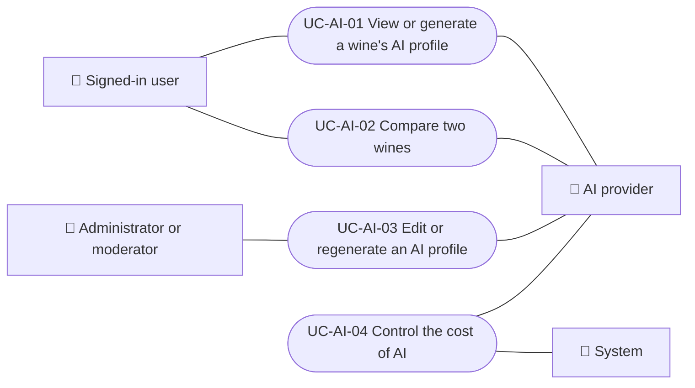

# Use cases

AI use cases: viewing or generating a wine's sommelier profile, comparing two wines, editing or regenerating a profile as staff, and controlling the cost of AI calls. Each case applies to the platforms listed.

| ID | Use case | Platforms | Actors |
|---|---|---|---|
| `UC-AI-01` | [View or generate a wine's AI profile](uc-ai-01-view-ai-profile.md) | Web, APK | Signed-in user, AI provider |
| `UC-AI-02` | [Compare two wines](uc-ai-02-compare-wines.md) | Web, APK | Signed-in user, AI provider |
| `UC-AI-03` | [Edit or regenerate an AI profile](uc-ai-03-edit-ai-profile.md) | Web, APK | Administrator or moderator, AI provider |
| `UC-AI-04` | [Control the cost of AI](uc-ai-04-control-ai-cost.md) | Backend only | System, AI provider |

## Use case diagram

[View the full “Use cases · Use case diagram” diagram](https://images.vinnot.com/docs/diagrams/v1/en/modules-ai-use-cases-readme-ddcfd275a651.svg)

## Lucidchart mapping

| ID | Lucidchart IDs |
|---|---|
| `UC-AI-01` | [WEB UC-AI-01](https://lucid.app/lucidchart/9f11a16b-bb5a-42fc-a9e8-0852b17bd241/edit), [APK UC-AI-01](https://lucid.app/lucidchart/e095dd25-e8ac-41ba-bf5b-396e1055f217/edit) |
| `UC-AI-02` | [WEB UC-AI-02](https://lucid.app/lucidchart/9f11a16b-bb5a-42fc-a9e8-0852b17bd241/edit), [APK UC-AI-02](https://lucid.app/lucidchart/e095dd25-e8ac-41ba-bf5b-396e1055f217/edit) |
| `UC-AI-03` | [WEB UC-AI-03](https://lucid.app/lucidchart/9f11a16b-bb5a-42fc-a9e8-0852b17bd241/edit), [APK UC-AI-03](https://lucid.app/lucidchart/e095dd25-e8ac-41ba-bf5b-396e1055f217/edit) |
| `UC-AI-04` | None |
