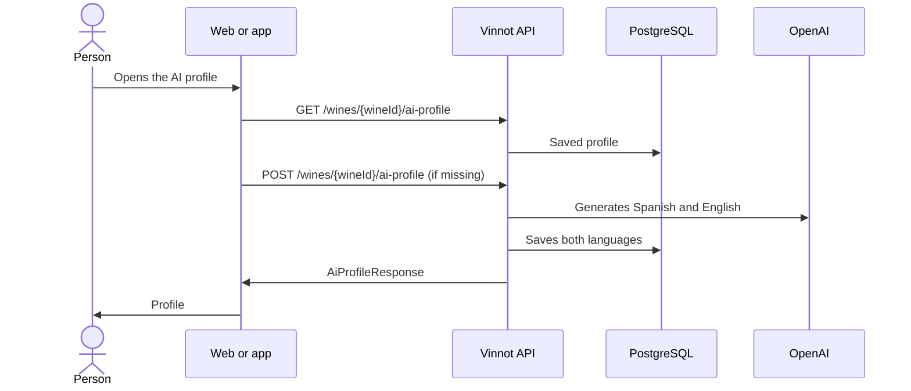

# UC-AI-01 · View or generate a wine's AI profile

| Field | Value |
|---|---|
| ID | `UC-AI-01` |
| Module | [AI profiles and comparisons](../README.md) |
| Platforms | Web, APK |
| Actors | Signed-in user, AI provider |
| Lucidchart IDs | [WEB UC-AI-01](https://lucid.app/lucidchart/9f11a16b-bb5a-42fc-a9e8-0852b17bd241/edit), [APK UC-AI-01](https://lucid.app/lucidchart/e095dd25-e8ac-41ba-bf5b-396e1055f217/edit) |
| Requirements | [`RF-WEB-AI-01`](../requirements.md), [`RF-WEB-AI-02`](../requirements.md), [`RF-WEB-AI-03`](../requirements.md), [`RF-WEB-AI-04`](../requirements.md), [`RF-APK-AI-01`](../requirements.md), [`RF-APK-AI-02`](../requirements.md), [`RF-APK-AI-03`](../requirements.md), [`RF-APK-AI-04`](../requirements.md) |
| Test cases | [`CP-AI-01`](../testing.md), [`CP-AI-20`](../testing.md), [`CP-AI-02`](../testing.md), [`CP-AI-03`](../testing.md), [`CP-AI-04`](../testing.md), [`CP-AI-05`](../testing.md) |

## Preconditions

- The person is signed in and is on a wine's details.

## Postconditions

- The person sees the wine's sommelier profile in their language.

## Main flow

1. The person opens the AI profile: on the web, from the sommelier card; on the app, from the wine's “Exclusive Sommelier” card with “View Profile” or “Generate profile”, or from the “Profile” tab, which shows the saved profile.
2. The client calls `GET /wines/{wineId}/ai-profile` in the interface language.
3. The API returns the saved profile without generating anything.
4. The client shows summary, visual analysis, aromas, palate, flavors, pairings, serving, occasions and similar wines, only the sections that exist.

## Alternative flows

- 2a. The wine does not exist, or it is inactive and the person neither created it nor moderates the catalog: the API answers 404 `NOT_FOUND` without reading or generating any profile.
- 3a. There is no profile: the API answers 404 and the client treats it as a profile still to generate. The web shows “This wine has no AI profile yet” and the app “Profile unavailable”, both with “Generate profile”; it also requests it on arrival with “generate”. The client sends `POST /wines/{wineId}/ai-profile`.
- 3b. The API reuses the profile if it exists in both languages and the wine and model did not change; otherwise it generates it in Spanish and English and saves both together.
- 3c. Someone else is already generating the same profile: the API waits for that result instead of calling AI again.
- 3d. AI is unavailable or the budget is exhausted: the API answers 503 and the client allows retrying.

## Business rules

- Reading a profile never generates one; generating is an explicit action.
- The profile follows the wine's visibility: reading, generating and checking the status require being able to see the wine.
- Only Spanish and English exist; any other language uses Spanish.
- Staff manual edits are kept by a normal generation.
- Generating is limited to 20 requests an hour per person.

## Diagram

[View the full “UC-AI-01 · View or generate a wine's AI profile” diagram](https://images.vinnot.com/docs/diagrams/v1/en/modules-ai-use-cases-uc-ai-01-view-ai-profile-75b764ca2f4d.svg)

Component diagram in Lucidchart: [WEB UC-AI-01](https://lucid.app/lucidchart/9f11a16b-bb5a-42fc-a9e8-0852b17bd241/edit), [APK UC-AI-01](https://lucid.app/lucidchart/e095dd25-e8ac-41ba-bf5b-396e1055f217/edit).

## Code

| Layer | Location |
|---|---|
| Endpoints | `GET /wines/{wineId}/ai-profile`, `POST /wines/{wineId}/ai-profile`, `GET /wines/{wineId}/ai-profile/status` |
| Backend | [`AiProfileController.java`](../../../../../backend/src/main/java/com/vinnot/ai/infrastructure/web/controller/AiProfileController.java), [`AiProfileService.java`](../../../../../backend/src/main/java/com/vinnot/ai/application/service/AiProfileService.java), [`AiProfilePublicationService.java`](../../../../../backend/src/main/java/com/vinnot/ai/application/service/AiProfilePublicationService.java), [`AiProfilePromptBuilder.java`](../../../../../backend/src/main/java/com/vinnot/ai/application/service/AiProfilePromptBuilder.java), [`AiContentLanguage.java`](../../../../../backend/src/main/java/com/vinnot/ai/domain/valueobject/AiContentLanguage.java) |
| Web | [`AiProfilePage.tsx`](../../../../../frontend-react/src/presentation/pages/wines/AiProfilePage.tsx), [`useAiProfileViewModel.ts`](../../../../../frontend-react/src/presentation/pages/wines/useAiProfileViewModel.ts), [`useAiProfile.ts`](../../../../../frontend-react/src/presentation/hooks/queries/wine/useAiProfile.ts), [`useGenerateAiProfile.ts`](../../../../../frontend-react/src/presentation/hooks/queries/wine/useGenerateAiProfile.ts), [`wines.ai.client.ts`](../../../../../frontend-react/src/infrastructure/api/clients/wines.ai.client.ts), [`wine.mappers.ai.ts`](../../../../../frontend-react/src/domain/wine/wine.mappers.ai.ts) |
| App | `frontend-mobile/app/(app)/(tabs)/wines/[id]/ai-profile.tsx`, [`AiProfileSections.tsx`](../../../../../frontend-mobile/src/presentation/features/wine/AiProfileSections.tsx), [`useWines.ts`](../../../../../frontend-mobile/src/presentation/hooks/queries/wine/useWines.ts), [`wines.client.ts`](../../../../../frontend-mobile/src/infrastructure/api/clients/wines.client.ts) |

## Automated tests

- Backend: [`AiProfileControllerTest.java`](../../../../../backend/src/test/java/com/vinnot/ai/infrastructure/web/controller/AiProfileControllerTest.java), [`AiWineReadAccessTest.java`](../../../../../backend/src/test/java/com/vinnot/ai/infrastructure/web/controller/AiWineReadAccessTest.java), [`AiProfileServiceTest.java`](../../../../../backend/src/test/java/com/vinnot/ai/application/service/AiProfileServiceTest.java), [`AiProfilePublicationServiceTest.java`](../../../../../backend/src/test/java/com/vinnot/ai/application/service/AiProfilePublicationServiceTest.java), [`AiProfilePromptBuilderTest.java`](../../../../../backend/src/test/java/com/vinnot/ai/application/service/AiProfilePromptBuilderTest.java), [`AiContentLanguageTest.java`](../../../../../backend/src/test/java/com/vinnot/ai/domain/valueobject/AiContentLanguageTest.java), [`WineAiProfileTest.java`](../../../../../backend/src/test/java/com/vinnot/ai/domain/model/WineAiProfileTest.java), [`StoredWineProfileOverviewAdapterTest.java`](../../../../../backend/src/test/java/com/vinnot/ai/infrastructure/query/StoredWineProfileOverviewAdapterTest.java)
- Web: [`useAiProfileViewModel.test.tsx`](../../../../../frontend-react/src/presentation/pages/wines/useAiProfileViewModel.test.tsx), [`AiProfilePage.test.tsx`](../../../../../frontend-react/src/presentation/pages/wines/AiProfilePage.test.tsx), [`wines.ai.client.test.ts`](../../../../../frontend-react/src/infrastructure/api/clients/wines.ai.client.test.ts)
- App: [`AiProfileSections.test.tsx`](../../../../../frontend-mobile/src/presentation/features/wine/AiProfileSections.test.tsx), [`aiProfileRoute.test.tsx`](../../../../../frontend-mobile/src/presentation/features/wine/__tests__/aiProfileRoute.test.tsx)
