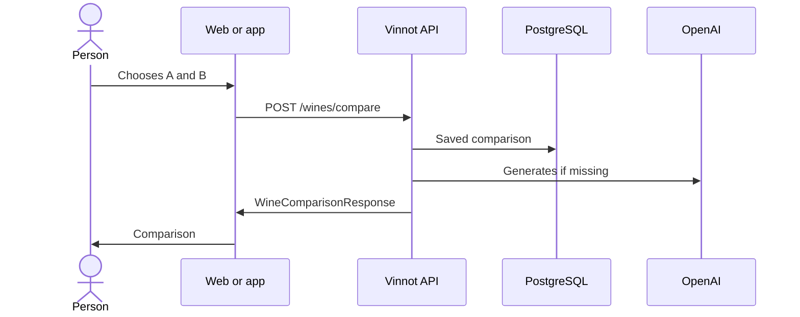

# UC-AI-02 · Compare two wines

| Field | Value |
|---|---|
| ID | `UC-AI-02` |
| Module | [AI profiles and comparisons](../README.md) |
| Platforms | Web, APK |
| Actors | Signed-in user, AI provider |
| Lucidchart IDs | [WEB UC-AI-02](https://lucid.app/lucidchart/9f11a16b-bb5a-42fc-a9e8-0852b17bd241/edit), [APK UC-AI-02](https://lucid.app/lucidchart/e095dd25-e8ac-41ba-bf5b-396e1055f217/edit) |
| Requirements | [`RF-WEB-AI-05`](../requirements.md), [`RF-WEB-AI-06`](../requirements.md), [`RF-APK-AI-05`](../requirements.md), [`RF-APK-AI-06`](../requirements.md) |
| Test cases | [`CP-AI-06`](../testing.md), [`CP-AI-07`](../testing.md), [`CP-AI-08`](../testing.md), [`CP-AI-09`](../testing.md) |

## Preconditions

- The person is signed in.

## Postconditions

- The person sees the comparison of the two wines with attributes and a recommendation.

## Main flow

1. The person opens Compare, from a wine or from the catalog.
2. They choose wine A and wine B with the search.
3. The client sends `POST /wines/compare`: on the web as soon as there are two wines; on the app, when tapping “Compare”.
4. The API checks that the person can see both wines and reuses the saved comparison for that pair and language, or generates it in Spanish and English.
5. The client shows summary, differences, similarities, attribute table, what each one suits and the recommendation.

## Alternative flows

- 3a. A and B are the same wine: the web search does not offer the wine already in the other slot and the app does not allow comparing; the API answers 422.
- 4a. AI is unavailable or the budget is exhausted: the API answers 503 and the client keeps the selection and allows retrying.
- 4b. The network fails or the time runs out: the client tells it apart from a server error and shows no recommendation.

## Business rules

- The order of A and B does not change the saved comparison.
- A comparison is only saved if it passes validation: up to 6 items per list, up to 2000 characters and no placeholder text.
- Without an AI provider there is no comparison: no mock content is used.
- Comparing is limited to 20 requests an hour per person.

## Diagram

[View the full “UC-AI-02 · Compare two wines” diagram](https://images.vinnot.com/docs/diagrams/v1/en/modules-ai-use-cases-uc-ai-02-compare-wines-f85d28b41598.svg)

Component diagram in Lucidchart: [WEB UC-AI-02](https://lucid.app/lucidchart/9f11a16b-bb5a-42fc-a9e8-0852b17bd241/edit), [APK UC-AI-02](https://lucid.app/lucidchart/e095dd25-e8ac-41ba-bf5b-396e1055f217/edit).

## Code

| Layer | Location |
|---|---|
| Endpoints | `POST /wines/compare` |
| Backend | [`WineComparisonController.java`](../../../../../backend/src/main/java/com/vinnot/ai/infrastructure/web/controller/WineComparisonController.java), [`WineComparisonService.java`](../../../../../backend/src/main/java/com/vinnot/ai/application/service/WineComparisonService.java), [`WineComparisonContentValidator.java`](../../../../../backend/src/main/java/com/vinnot/ai/application/service/WineComparisonContentValidator.java), [`CanonicalWinePair.java`](../../../../../backend/src/main/java/com/vinnot/ai/domain/valueobject/CanonicalWinePair.java) |
| Web | [`WineComparePage.tsx`](../../../../../frontend-react/src/presentation/pages/wines/WineComparePage.tsx), [`useWineCompareViewModel.ts`](../../../../../frontend-react/src/presentation/pages/wines/useWineCompareViewModel.ts), [`useWineComparison.ts`](../../../../../frontend-react/src/presentation/hooks/queries/wine/useWineComparison.ts), [`wines.ai.client.ts`](../../../../../frontend-react/src/infrastructure/api/clients/wines.ai.client.ts), [`wine.mappers.compare.ts`](../../../../../frontend-react/src/domain/wine/wine.mappers.compare.ts) |
| App | [`WineCompareScreen.tsx`](../../../../../frontend-mobile/src/presentation/screens/wines/WineCompareScreen.tsx), [`CompareLoadingSteps.tsx`](../../../../../frontend-mobile/src/presentation/features/wine/CompareLoadingSteps.tsx), [`WineComparisonAttributeTable.tsx`](../../../../../frontend-mobile/src/presentation/features/wine/WineComparisonAttributeTable.tsx), [`WineComparisonErrorState.tsx`](../../../../../frontend-mobile/src/presentation/features/wine/WineComparisonErrorState.tsx), [`useWines.ts`](../../../../../frontend-mobile/src/presentation/hooks/queries/wine/useWines.ts), [`wines.client.ts`](../../../../../frontend-mobile/src/infrastructure/api/clients/wines.client.ts) |

## Automated tests

- Backend: [`WineComparisonServiceTest.java`](../../../../../backend/src/test/java/com/vinnot/ai/application/service/WineComparisonServiceTest.java), [`WineComparisonContentValidatorTest.java`](../../../../../backend/src/test/java/com/vinnot/ai/application/service/WineComparisonContentValidatorTest.java), [`CanonicalWinePairTest.java`](../../../../../backend/src/test/java/com/vinnot/ai/domain/valueobject/CanonicalWinePairTest.java), [`WineComparisonTest.java`](../../../../../backend/src/test/java/com/vinnot/ai/domain/model/WineComparisonTest.java), [`WineComparisonContentGeneratorTest.java`](../../../../../backend/src/test/java/com/vinnot/ai/application/service/WineComparisonContentGeneratorTest.java)
- Web: [`WineComparePage.test.tsx`](../../../../../frontend-react/src/presentation/pages/wines/WineComparePage.test.tsx), [`useWineCompareViewModel.test.tsx`](../../../../../frontend-react/src/presentation/pages/wines/useWineCompareViewModel.test.tsx)
- App: [`compareRoute.test.tsx`](../../../../../frontend-mobile/src/presentation/features/wine/__tests__/compareRoute.test.tsx), [`CompareLoadingSteps.test.tsx`](../../../../../frontend-mobile/src/presentation/features/wine/CompareLoadingSteps.test.tsx), [`WineComparisonAttributeTable.test.tsx`](../../../../../frontend-mobile/src/presentation/features/wine/WineComparisonAttributeTable.test.tsx), [`WineComparisonErrorState.test.tsx`](../../../../../frontend-mobile/src/presentation/features/wine/WineComparisonErrorState.test.tsx)
