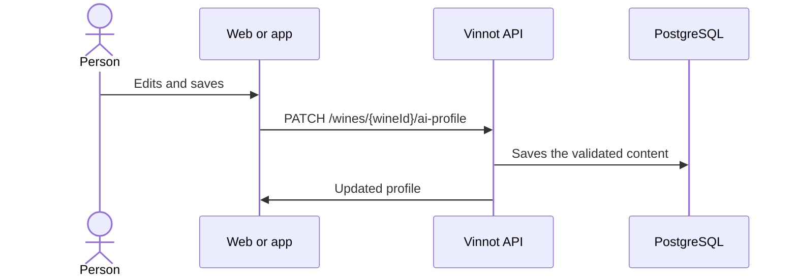

# UC-AI-03 · Edit or regenerate an AI profile

| Field | Value |
|---|---|
| ID | `UC-AI-03` |
| Module | [AI profiles and comparisons](../README.md) |
| Platforms | Web, APK |
| Actors | Administrator or moderator, AI provider |
| Lucidchart IDs | [WEB UC-AI-03](https://lucid.app/lucidchart/9f11a16b-bb5a-42fc-a9e8-0852b17bd241/edit), [APK UC-AI-03](https://lucid.app/lucidchart/e095dd25-e8ac-41ba-bf5b-396e1055f217/edit) |
| Requirements | [`RF-WEB-AI-07`](../requirements.md), [`RF-WEB-AI-08`](../requirements.md), [`RF-APK-AI-07`](../requirements.md), [`RF-APK-AI-08`](../requirements.md), [`RF-APK-AI-09`](../requirements.md), [`RF-APK-AI-10`](../requirements.md) |
| Test cases | [`CP-AI-10`](../testing.md), [`CP-AI-11`](../testing.md), [`CP-AI-12`](../testing.md), [`CP-AI-13`](../testing.md), [`CP-AI-14`](../testing.md) |

## Preconditions

- The person is an administrator or moderator and opens a wine's AI profile editor.

## Postconditions

- The profile in the active language was edited or regenerated.

## Main flow

1. The editor shows the profile sections in the active language as texts, lists and scores.
2. The person edits and saves.
3. The client sends `PATCH /wines/{wineId}/ai-profile` without calling AI.
4. The API validates the content and saves it.

## Alternative flows

- 2a. The person chooses “Regenerate” and confirms: the client sends `POST /wines/{wineId}/ai-profile/generate` and the API generates both languages again, replacing the manual edits.
- 4a. The summary is missing, a section does not have the expected shape or a score is outside 0 to 100: the API answers 400.
- 4b. The profile changed while it was being generated: the API answers 409.
- 2b. On the app the person leaves with unsaved changes: confirmation is asked; “Restore” goes back to the saved content.

## Business rules

- Editing and regenerating require the `WINE_UPDATE` permission (administrators and moderators).
- Editing does not call AI; regenerating does and replaces the edits.
- On the app the editor opens from the panel or from the full profile.

## Diagram

[View the full “UC-AI-03 · Edit or regenerate an AI profile” diagram](https://images.vinnot.com/docs/diagrams/v1/en/modules-ai-use-cases-uc-ai-03-edit-ai-profile-cd02bb6dba73.svg)

Component diagram in Lucidchart: [WEB UC-AI-03](https://lucid.app/lucidchart/9f11a16b-bb5a-42fc-a9e8-0852b17bd241/edit), [APK UC-AI-03](https://lucid.app/lucidchart/e095dd25-e8ac-41ba-bf5b-396e1055f217/edit).

## Code

| Layer | Location |
|---|---|
| Endpoints | `PATCH /wines/{wineId}/ai-profile`, `POST /wines/{wineId}/ai-profile/generate` |
| Backend | [`AiProfileController.java`](../../../../../backend/src/main/java/com/vinnot/ai/infrastructure/web/controller/AiProfileController.java), [`AiProfileService.java`](../../../../../backend/src/main/java/com/vinnot/ai/application/service/AiProfileService.java), [`ManualProfileContent.java`](../../../../../backend/src/main/java/com/vinnot/ai/domain/model/ManualProfileContent.java) |
| Web | [`AdminWineAiProfilePage.tsx`](../../../../../frontend-react/src/presentation/pages/admin/AdminWineAiProfilePage.tsx), [`useAdminWineAiProfileViewModel.ts`](../../../../../frontend-react/src/presentation/pages/admin/useAdminWineAiProfileViewModel.ts), [`useRegenerateAiProfile.ts`](../../../../../frontend-react/src/presentation/hooks/queries/wine/useRegenerateAiProfile.ts) |
| App | [`AdminWineAiProfileScreen.tsx`](../../../../../frontend-mobile/src/presentation/features/admin/AdminWineAiProfileScreen.tsx), [`WineProfileEditor.tsx`](../../../../../frontend-mobile/src/presentation/features/wine/WineProfileEditor.tsx), [`useWineProfileEditor.ts`](../../../../../frontend-mobile/src/presentation/hooks/queries/admin/useWineProfileEditor.ts) |

## Automated tests

- Backend: [`AiProfileControllerTest.java`](../../../../../backend/src/test/java/com/vinnot/ai/infrastructure/web/controller/AiProfileControllerTest.java), [`ManualProfileContentTest.java`](../../../../../backend/src/test/java/com/vinnot/ai/domain/model/ManualProfileContentTest.java), [`AiProfileServiceTest.java`](../../../../../backend/src/test/java/com/vinnot/ai/application/service/AiProfileServiceTest.java)
- Web: None
- App: [`WineProfileEditor.test.tsx`](../../../../../frontend-mobile/src/presentation/features/wine/WineProfileEditor.test.tsx), [`wine-profile-editor.test.tsx`](../../../../../frontend-mobile/src/test/integration/wine-profile-editor.test.tsx)
