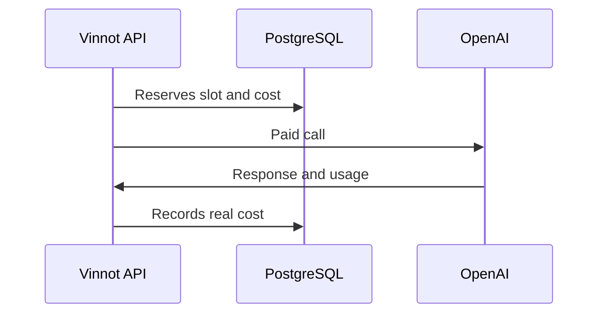

# UC-AI-04 · Control the cost of AI

| Field | Value |
|---|---|
| ID | `UC-AI-04` |
| Module | [AI profiles and comparisons](../README.md) |
| Platforms | Backend only |
| Actors | System, AI provider |
| Lucidchart IDs | None |
| Requirements | None |
| Test cases | [`CP-AI-15`](../testing.md), [`CP-AI-16`](../testing.md), [`CP-AI-17`](../testing.md), [`CP-AI-18`](../testing.md), [`CP-AI-19`](../testing.md) |

## Preconditions

- A feature asks for a paid AI call: profile, comparison, label reading or moderation.

## Postconditions

- The call was made within budget or rejected at no cost.

## Main flow

1. The system checks that paid calls are enabled.
2. It reserves a slot among the allowed concurrent calls.
3. It reserves the call's maximum cost against the monthly budget and, if set, the daily one.
4. It makes the call to the provider.
5. It records the real cost and releases the slot.

## Alternative flows

- 1a. Paid calls are paused: it is rejected with 503.
- 2a. There is no free slot: it is rejected with 503.
- 3a. The budget is not enough: it is rejected with 503.
- 4a. It is unknown whether the call was charged: the cost stays reserved as unknown.

## Business rules

- By default: 3 concurrent calls and 10 USD a month; the daily limit is off.
- The same profile or comparison is generated only once at a time; other requests wait for that result.
- With the `mock` provider (the local development one) profiles use a mock generator and comparisons are unavailable; without a provider, both answer 503.

## Diagram

[View the full “UC-AI-04 · Control the cost of AI” diagram](https://images.vinnot.com/docs/diagrams/v1/en/modules-ai-use-cases-uc-ai-04-control-ai-cost-344947f73546.svg)

## Code

| Layer | Location |
|---|---|
| Backend | [`AiProviderAdmissionService.java`](../../../../../backend/src/main/java/com/vinnot/ai/application/service/AiProviderAdmissionService.java), [`AiGenerationCoordinator.java`](../../../../../backend/src/main/java/com/vinnot/ai/application/service/AiGenerationCoordinator.java) |

## Automated tests

- Backend: [`AiProviderAdmissionServiceTest.java`](../../../../../backend/src/test/java/com/vinnot/ai/application/service/AiProviderAdmissionServiceTest.java), [`AiGenerationCoordinatorTest.java`](../../../../../backend/src/test/java/com/vinnot/ai/application/service/AiGenerationCoordinatorTest.java), [`PostgresAiGenerationLeaseAdapterTest.java`](../../../../../backend/src/test/java/com/vinnot/ai/infrastructure/persistence/lock/PostgresAiGenerationLeaseAdapterTest.java), [`AiSpendingPostgresIntegrationTest.java`](../../../../../backend/src/test/java/com/vinnot/ai/infrastructure/persistence/adapter/AiSpendingPostgresIntegrationTest.java)
- Web: None
- App: None
