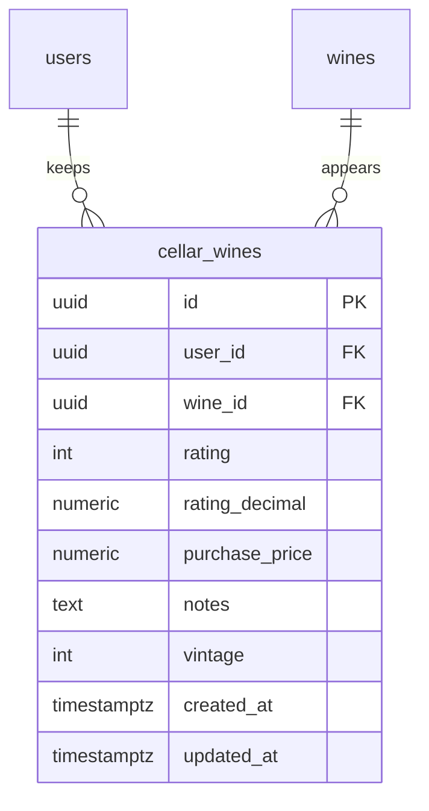

# Cellar

Each person's personal wine collection, called “My Cellar” on the web and the
app. Each catalog wine is stored once, with a private rating, notes and purchase
price, and the cellar shows collection metrics. From the cellar a note can be
published as a review ([Reviews](../reviews/README.md)); the wines come from the
[Wines](../wines/README.md) catalog.

- Module code: `CEL`.
- Backend: package [`cellar`](../../../../backend/src/main/java/com/vinnot/cellar/).
- [Use cases](use-cases/README.md) · [Requirements](requirements.md) ·
  [Architecture](architecture.md) · [Testing](testing.md)

## Actors

| Actor | What they do in this module |
|---|---|
| Signed-in user | Views their cellar, adds, edits and removes wines and publishes notes as reviews; sees other members' cellars when their setting allows it |
| Administrator | Can read another person's cellar and statistics from the API |

## Business rules

| Rule | Detail | Where |
|---|---|---|
| Access | The cellar needs a session and the `CELLAR_MANAGE_OWN` permission | [`CellarController.java`](../../../../backend/src/main/java/com/vinnot/cellar/infrastructure/web/controller/CellarController.java) |
| Privacy | Each person only changes their own cellar; the full per-user routes, with notes and prices, allow the owner or an administrator | [`CellarController.java`](../../../../backend/src/main/java/com/vinnot/cellar/infrastructure/web/controller/CellarController.java) |
| Public cellar | Each member chooses who sees their cellar on the public profile: `PUBLIC` (default), `FOLLOWERS` or `PRIVATE`, from `PATCH /users/me` (`cellarVisibility`). `GET /users/{id}/cellar` lists wine, vintage, rating and date added, newest first and only for active wines; it never includes notes or the purchase price and answers 403 `CELLAR_NOT_VISIBLE` when the setting hides it. The owner always sees their own | [Community](../community/architecture.md) |
| One wine per person | A wine appears only once in each cellar | [`AddWineToCellarCommandHandler.java`](../../../../backend/src/main/java/com/vinnot/cellar/application/command/handler/AddWineToCellarCommandHandler.java) |
| Personal data | Rating from 0.1 to 5.0 with one decimal (the same as reviews), non-negative price, notes of up to 10000 characters and the tasted vintage (1800 to next year, independent from the catalog vintage), all optional | [`CellarWine.java`](../../../../backend/src/main/java/com/vinnot/cellar/domain/model/CellarWine.java) |
| Points | Adding a wine by hand earns 1 point for the seal, once per wine ever and up to 3 per day; the entry created by publishing a review earns nothing | [Points and seals](../gamification/README.md) |
| No inventory | It does not record bottles, consumption or purchases | [`CellarWine.java`](../../../../backend/src/main/java/com/vinnot/cellar/domain/model/CellarWine.java) |
| Editing | Saving replaces rating, price and notes, empty values included; the vintage is kept unless a new one is sent or `clearVintage` removes it | [`UpdateCellarEntryCommandHandler.java`](../../../../backend/src/main/java/com/vinnot/cellar/application/command/handler/UpdateCellarEntryCommandHandler.java) |
| Reviews | Publishing or editing one's own review syncs the cellar; the notes are only replaced when the review brings a comment, and the vintage only when the review brings one; removing a wine from the cellar does not delete the review | [Reviews](../reviews/README.md) |
| List | Up to 1000 entries per request | [`GetUserCellarQueryHandler.java`](../../../../backend/src/main/java/com/vinnot/cellar/application/query/handler/GetUserCellarQueryHandler.java) |
| Metrics | Web and app calculate the same figures: count, average of the rated wines, distinct regions and type mix; neither adds up a total invested | [Architecture](architecture.md) |

## Where it lives

| Part | Location |
|---|---|
| API | [`CellarController`](../../../../backend/src/main/java/com/vinnot/cellar/infrastructure/web/controller/CellarController.java), under `/cellar` |
| Web | `/cellar` page in [`pages/cellar`](../../../../frontend-react/src/presentation/pages/cellar/) and components in [`features/cellar`](../../../../frontend-react/src/presentation/components/features/cellar/) |
| App | Screen `frontend-mobile/app/(app)/cellar.tsx` and logic in [`features/cellar`](../../../../frontend-mobile/src/presentation/features/cellar/) |

## Data

Table created in `V1__baseline_schema.sql`.

[View the full “Cellar · Data” diagram](https://images.vinnot.com/docs/diagrams/v1/en/modules-cellar-readme-cc9a1a97032c.svg)

`cellar_wines` is unique per person and wine and is deleted in cascade with the
person or the wine. V71 (#455) adds `rating_decimal`, one decimal from 0.1 to 5.0
backfilled from `rating`, which stays an integer 1–5 for the previous backend
revision; the backend reads `rating_decimal` and writes both on every save. The
taste affinities used by recommendations also read this table.
