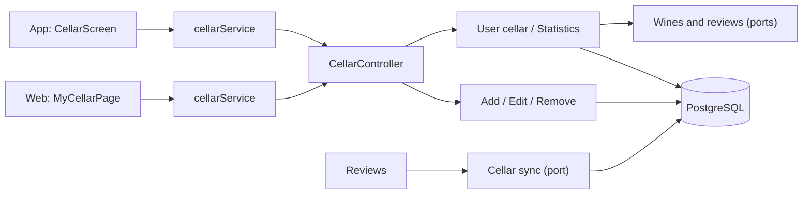
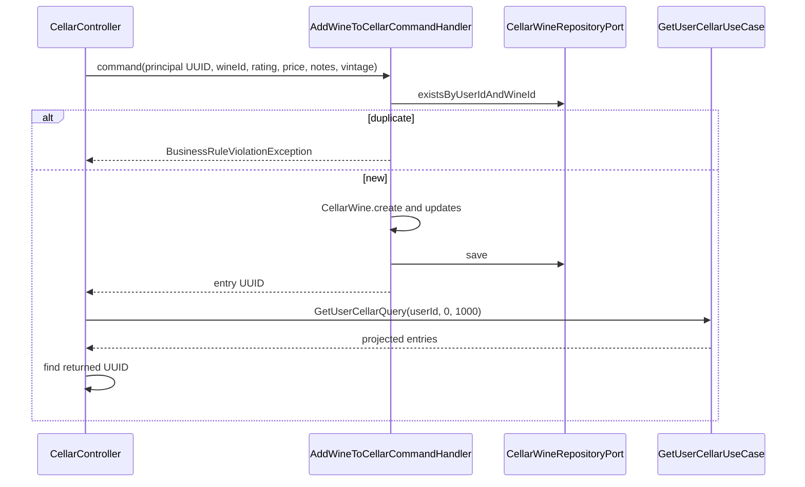

# Architecture

How the module is built in each layer. The backend follows the hexagonal flow
`controller → input port → handler → domain → output port → adapter`;
the web and the app follow `screen → hook → service → API client → HTTP transport`.



[View the full “Architecture” diagram](https://images.vinnot.com/docs/diagrams/v1/en/modules-cellar-architecture-3f5d181e3b49.svg)

## Backend

### Functional goal

The cellar models a user's personal inventory over catalog wines. It does not
copy a wine: it keeps a user-wine relation with personal rating, purchase price,
notes, tasted vintage and timestamps. Mutations of existing entries enforce ownership in the backend;
read scope is defined by each endpoint.

### Components

| Layer | Main types |
|---|---|
| Domain | `CellarWine` |
| Commands | `AddWineToCellarCommand`, `UpdateCellarEntryCommand`, `RemoveWineFromCellarCommand` |
| Queries | `GetUserCellarQuery`, `GetCellarStatsQuery` |
| Ports | `CellarWineRepositoryPort`, `WineQueryPort`, `ReviewQueryPort` |
| Persistence | `CellarWineJpaEntity`, repository, mapper and adapter |
| Entry | `CellarController` |

### Model and invariants

- `userId` and `wineId` are required and immutable in an entry.
- The user-wine combination must be unique.
- Personal rating is optional and accepts 0.1 to 5.0 with at most one decimal.
- Price and notes are optional; they never change catalog price/description.
- The tasted vintage is optional, goes from 1800 through next year
  (`INVALID_VINTAGE`) and never changes the catalog vintage.
- Creating or changing data updates `updatedAt`.
- Update/delete require `entry.userId` to match the principal.
- Wine projection comes through `WineQueryPort`, not a direct dependency on the
  `wine` module's JPA repository.

### Add flow



[View the full “Add flow” diagram](https://images.vinnot.com/docs/diagrams/v1/en/modules-cellar-architecture-e926c2ea1271.svg)

The command handler does not query WineQueryPort: the FK validates the wine reference on persistence. The wine port participates in the projection query. The controller returns HTTP 201 with the entry found in the queried page, or a null body if not found there. User identity comes from the principal, not the body. User/wine uniqueness is backed by PostgreSQL.

### Reads and identity scope

`GET /cellar` and `GET /cellar/stats` derive the UUID from the authenticated
principal. `/cellar/user/{userId}` variants receive the target UUID as a path
variable. All four routes delegate to `GetUserCellarUseCase` or
`GetCellarStatsUseCase`; handlers query the repository with the UUID carried by
the query.

`GET /cellar` builds a list of `CellarWineResponse`. Each response combines:

- entry ID and private metadata, including the tasted `vintage`;
- wine ID, name, catalog vintage (`wine.vintage`), image and type;
- winery name;
- public catalog average;
- relation timestamps;
- the owner’s `reviewId` for that wine, or `null` when absent.

`ReviewQueryPort` loads IDs in one batch bounded by owner and wines in the
current window. The bridge adapter uses the review module’s repository port.
There is no per-wine lookup and reading the cellar never publishes private notes.

The handler loads entries by user and resolves wine views through the query port.
A missing wine must not produce a partial JPA entity or trigger lazy loading
outside the transaction.

The existing list contract defaults to a window of 1,000 entries, also used by
mutation responses. The application reads that window using at most five
database pages of 200 entries, ordered by unique entry ID within a read-only
repeatable-read transaction. It stops at the recorded total, so an empty cellar
needs only one bounded read. Explicit ordinary pages retain the shared limit of
200; only the exact legacy window size receives this compatibility treatment.
Negative or overflowing offsets are rejected before repository access. HTTP
responses remain arrays, and the shared database pagination limit is not raised.

### Update

`PATCH /cellar/{id}` loads the entry, checks ownership and applies the domain
methods:

1. `updateRating` validates 0.1–5.0 with one decimal or accepts `null`;
2. `updatePurchasePrice` replaces personal price;
3. `updateNotes` replaces notes;
4. `updateVintage` validates the tasted vintage.

The request represents the supported editable state. The handler applies the
three received rating, price and notes values, including the `null` values allowed
by the contract. The vintage is the exception: an omitted or `null` `vintage` keeps
the stored one, so app versions that do not send it never erase it; a value
replaces it and `clearVintage: true` removes it (it wins over a supplied `vintage`).

### Removal

`DELETE /cellar/{id}` requires an existing owned entry and calls `delete` on the
port. An absent entry is not treated as a successful deletion.

### Statistics

`CellarStatsResponse` aggregates inventory information for the UUID carried by
`GetCellarStatsQuery`. The query stays separate from mutations and can be
optimized in persistence without changing the aggregate. The own route derives
that UUID from the JWT; `/user/{userId}/stats` uses the path as the query's target UUID.

### Review integration

After persisting a review, `CreateReviewCommandHandler` always syncs the cellar:
with a comment it invokes `CellarCommandPort.syncReviewToCellar` (rating and notes);
without one, `syncReviewRatingToCellar` (rating only, notes kept). `UpdateReviewCommandHandler` syncs only
when the author edits their own review: with notes when the edit supplied a
comment, or through `syncReviewRatingToCellar` (rating only, notes kept) when it
supplied just a rating; an administrator's edit never touches the author's
cellar. The adapter creates the relation when missing or updates it when present.
It does not catch exceptions: a failure propagates and rolls back the review
transaction. This integration does not
move cellar ownership/rules into `review`; the adapter translates intent into
the owner contract.

### Frontend

Clients consume the `CellarWineResponse` list and calculate their metrics; they do not use the statistics endpoints. GET returns `response.content()`, not the full PageResult wrapper. Cache/invalidation rules belong to each frontend's documentation; they are not a backend guarantee.

### Security and privacy

- Controller requires `CELLAR_MANAGE_OWN`.
- `GET /cellar`, `GET /cellar/stats`, and all mutations derive user identity
  from the JWT.
- Handlers enforce ownership even if UI hides actions.
- Notes and personal price are not part of public wine detail.
- Logs must not include user notes.

### Tests

- domain: `CellarWineTest` (minimum, maximum and empty rating, vintage bounds, and dates);
- handlers: `AddWineToCellarCommandHandlerTest`, `UpdateCellarEntryCommandHandlerTest`, `RemoveWineFromCellarCommandHandlerTest` and `CellarEntryOwnershipTest`;
- queries: `GetUserCellarQueryHandlerTest` and `GetCellarStatsQueryHandlerTest`;
- persistence: `WineQueryAdapterTest`, `CellarWinePersistenceMapperTest` and, from reviews, `CellarCommandAdapterTest`;
- HTTP: `CellarPrivacyTest` (owner or administrator on the per-user routes) and `CellarControllerTest` (vintage mapping and bounds).

### Reference files

- `backend/src/main/java/com/vinnot/cellar`
- `frontend-react/src/application/services/cellar.service.ts`
- `frontend-mobile/src/application/services/cellar.service.ts`
- [Reviews](../reviews/architecture.md)

### Consistency and access contract

GET /cellar/user/{userId} and /stats allow only the owner with CELLAR_MANAGE_OWN or ADMIN. Moderator, partner and institutional roles do not grant access to other users’ cellars. Rejection occurs before the use case.

[Coordination details](../../backend/architecture/session-and-data-integrity.md).

## Web

```text
MyCellarPage → useMyCellarViewModel → useCellar / useUpdateCellarEntry / useRemoveCellarEntry → cellarService → cellarClient → http
```

The cellar is the protected `/cellar` page (“My Cellar”), reached from the menu
and the home page. Quick add is on the wine's page.

| Piece | What it does |
|---|---|
| [`MyCellarPage.tsx`](../../../../frontend-react/src/presentation/pages/cellar/MyCellarPage.tsx) | Cellar cover, wine grid and loading, error and empty states |
| [`CellarCover.tsx`](../../../../frontend-react/src/presentation/components/features/cellar/CellarCover.tsx) | Cover like the app's: the cellar illustration with the title and “Add wine” over it; “Wines”, “Average” (with a glass) and “Regions”, and a bar with the type mix and its legend (the app's colors). It shows no total invested: the price is on each card. With an empty cellar it shows only the title and the button |
| [`useMyCellarViewModel.ts`](../../../../frontend-react/src/presentation/pages/cellar/useMyCellarViewModel.ts) | Takes the metrics from `summarizeCellar` ([`cellar.stats.ts`](../../../../frontend-react/src/domain/cellar/cellar.stats.ts), the same rule as the app), opens editing and review publishing, confirms before removing and says “Wine removed from your cellar” |
| [`CellarWineCard.tsx`](../../../../frontend-react/src/presentation/components/features/cellar/CellarWineCard.tsx) | Card with “Edit notes”, “Delete” and “Publish as review” or “View review” |
| [`CellarEditModal.tsx`](../../../../frontend-react/src/presentation/components/features/cellar/CellarEditModal.tsx) | Stars (tapping the chosen one clears it), notes and price |
| [`CellarReviewModal.tsx`](../../../../frontend-react/src/presentation/components/features/cellar/CellarReviewModal.tsx) and [`useCellarReviewPublication.ts`](../../../../frontend-react/src/presentation/hooks/useCellarReviewPublication.ts) | Review draft with the rating and notes; checks again for an own review before publishing |
| [`WineCellarModal.tsx`](../../../../frontend-react/src/presentation/pages/wines/WineCellarModal.tsx) and [`useCellarQuickAdd.ts`](../../../../frontend-react/src/presentation/hooks/queries/wine/useCellarQuickAdd.ts) | Add from the wine's page with rating, notes and price; on save it says “Wine added to your cellar” |
| [`cellar.service.ts`](../../../../frontend-react/src/application/services/cellar.service.ts) and [`cellar.client.ts`](../../../../frontend-react/src/infrastructure/api/clients/cellar.client.ts) | Map the DTOs and call `/cellar`; they do not use the statistics endpoints |

## App

The screen is `frontend-mobile/app/(app)/cellar.tsx`, outside the tabs. It is
opened from home, the profile's wines-in-cellar card and a wine's page; going
back returns to the origin or to home.

| Piece | What it does |
|---|---|
| [`CellarScreen.tsx`](../../../../frontend-mobile/src/presentation/features/cellar/CellarScreen.tsx) | Search with a 250 ms wait, filters, pull to refresh, add button and list |
| [`CellarStatsBanner.tsx`](../../../../frontend-mobile/src/presentation/features/cellar/CellarStatsBanner.tsx) | Cover with the cellar illustration, title and “Add wine”; “Wines”, “Average” (with a glass) and “Regions”, and a bar with the mix of types and its legend (`wineTypeSwatches` colors). The figures come from `summarizeCellar` ([`cellar.stats.ts`](../../../../frontend-mobile/src/domain/cellar/cellar.stats.ts)); it does not show a total invested. An empty cellar shows only the title and the button |
| [`CellarFilterSheet.tsx`](../../../../frontend-mobile/src/presentation/features/cellar/CellarFilterSheet.tsx) | All, rated (glass icon) or with notes |
| [`CellarEntryRow.tsx`](../../../../frontend-mobile/src/presentation/features/cellar/CellarEntryRow.tsx) | Entry that opens the wine page when tapped, with the winery, the translated type, the rating in glasses with its numeric value and a three-dots actions menu; removed by swiping, with confirmation |
| [`CellarEntryActionsMenu.tsx`](../../../../frontend-mobile/src/presentation/features/cellar/CellarEntryActionsMenu.tsx) | Three-dots menu of an entry: a bottom sheet with edit notes, view or publish the review, open the wine and delete. The chosen action runs once the sheet has closed, so the edit or publish sheet it opens is not discarded |
| [`CellarAddSheet.tsx`](../../../../frontend-mobile/src/presentation/features/cellar/CellarAddSheet.tsx) | Add with a wine search (8 results) and edit an entry, with the rating on the bottle control above the glasses; wines already in the cellar appear disabled with “Already in your cellar” |
| [`CellarReviewSheet.tsx`](../../../../frontend-mobile/src/presentation/features/cellar/CellarReviewSheet.tsx) and [`useCellarReviewPublication.ts`](../../../../frontend-mobile/src/presentation/hooks/useCellarReviewPublication.ts) | Review draft with the rating and notes |
| [`discoveryNavigation.ts`](../../../../frontend-mobile/src/presentation/navigation/discoveryNavigation.ts) | Cellar route and return to the origin |
| [`cellar.service.ts`](../../../../frontend-mobile/src/application/services/cellar.service.ts) and [`cellar.client.ts`](../../../../frontend-mobile/src/infrastructure/api/clients/cellar.client.ts) | Map the DTOs and call `/cellar` |

In the catalog, each wine already in the cellar shows a badge.
