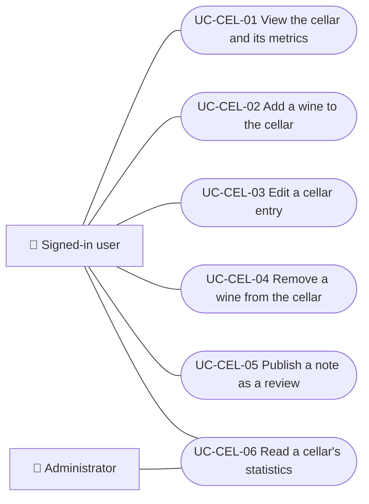

# Use cases

Use cases of the personal cellar: viewing the collection and its metrics, adding, editing and removing wines, publishing a note as a review and reading statistics from the API. Each case applies to the platforms listed.

| ID | Use case | Platforms | Actors |
|---|---|---|---|
| `UC-CEL-01` | [View the cellar and its metrics](uc-cel-01-view-cellar.md) | Web, APK | Signed-in user |
| `UC-CEL-02` | [Add a wine to the cellar](uc-cel-02-add-wine.md) | Web, APK | Signed-in user |
| `UC-CEL-03` | [Edit a cellar entry](uc-cel-03-edit-entry.md) | Web, APK | Signed-in user |
| `UC-CEL-04` | [Remove a wine from the cellar](uc-cel-04-remove-entry.md) | Web, APK | Signed-in user |
| `UC-CEL-05` | [Publish a note as a review](uc-cel-05-publish-note-as-review.md) | Web, APK | Signed-in user |
| `UC-CEL-06` | [Read a cellar's statistics](uc-cel-06-cellar-statistics.md) | Backend only | Signed-in user, Administrator |

## Use case diagram

[View the full “Use cases · Use case diagram” diagram](https://images.vinnot.com/docs/diagrams/v1/en/modules-cellar-use-cases-readme-51bf8380bb9b.svg)

## Lucidchart mapping

| ID | Lucidchart IDs |
|---|---|
| `UC-CEL-01` | [WEB UC-CEL-01](https://lucid.app/lucidchart/9f11a16b-bb5a-42fc-a9e8-0852b17bd241/edit), [APK UC-CEL-01](https://lucid.app/lucidchart/e095dd25-e8ac-41ba-bf5b-396e1055f217/edit) |
| `UC-CEL-02` | [WEB UC-CEL-02](https://lucid.app/lucidchart/9f11a16b-bb5a-42fc-a9e8-0852b17bd241/edit), [APK UC-CEL-02](https://lucid.app/lucidchart/e095dd25-e8ac-41ba-bf5b-396e1055f217/edit) |
| `UC-CEL-03` | [WEB UC-CEL-03](https://lucid.app/lucidchart/9f11a16b-bb5a-42fc-a9e8-0852b17bd241/edit), [APK UC-CEL-03](https://lucid.app/lucidchart/e095dd25-e8ac-41ba-bf5b-396e1055f217/edit) |
| `UC-CEL-04` | [WEB UC-CEL-04](https://lucid.app/lucidchart/9f11a16b-bb5a-42fc-a9e8-0852b17bd241/edit), [APK UC-CEL-04](https://lucid.app/lucidchart/e095dd25-e8ac-41ba-bf5b-396e1055f217/edit) |
| `UC-CEL-05` | [WEB UC-CEL-05](https://lucid.app/lucidchart/9f11a16b-bb5a-42fc-a9e8-0852b17bd241/edit), [APK UC-CEL-05](https://lucid.app/lucidchart/e095dd25-e8ac-41ba-bf5b-396e1055f217/edit) |
| `UC-CEL-06` | None |
