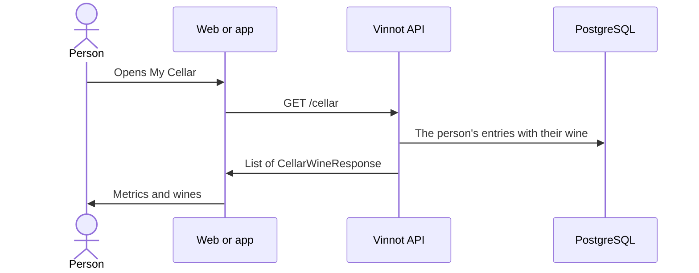

# UC-CEL-01 · View the cellar and its metrics

| Field | Value |
|---|---|
| ID | `UC-CEL-01` |
| Module | [Cellar](../README.md) |
| Platforms | Web, APK |
| Actors | Signed-in user |
| Lucidchart IDs | [WEB UC-CEL-01](https://lucid.app/lucidchart/9f11a16b-bb5a-42fc-a9e8-0852b17bd241/edit), [APK UC-CEL-01](https://lucid.app/lucidchart/e095dd25-e8ac-41ba-bf5b-396e1055f217/edit) |
| Requirements | [`RF-WEB-CEL-01`](../requirements.md), [`RF-WEB-CEL-02`](../requirements.md), [`RF-WEB-CEL-03`](../requirements.md), [`RF-APK-CEL-01`](../requirements.md), [`RF-APK-CEL-02`](../requirements.md), [`RF-APK-CEL-03`](../requirements.md), [`RF-APK-CEL-04`](../requirements.md) |
| Test cases | [`CP-CEL-01`](../testing.md), [`CP-CEL-02`](../testing.md), [`CP-CEL-03`](../testing.md), [`CP-CEL-04`](../testing.md), [`CP-CEL-05`](../testing.md) |

## Preconditions

- The person is signed in.

## Postconditions

- The wines in their cellar are shown with their personal data and the collection metrics.

## Main flow

1. The person opens “My Cellar”: on the web from the menu or the home page; on the app from home, the profile or a wine's page.
2. The client calls `GET /cellar`.
3. The API returns only the person's entries, each with the wine, the personal rating, the purchase price, the notes, the dates and their own review when there is one.
4. The client calculates the number of wines, the average of the rated ones, the distinct regions and the mix of wine types, the same on the web and in the app.
5. It shows the metrics and the wine list.

## Alternative flows

- 3a. The cellar is empty: the empty state is shown with a way to add wines.
- 5a. On the app the person searches by name, winery, region, country or notes, or filters by all, rated or with notes: the list is filtered on the device.
- 5b. On the app the person pulls down: the list reloads.
- 2a. The request fails: the error is shown with a retry option.

## Business rules

- Each person only sees their own cellar.
- The cellar does not record bottles, consumption or purchases; it stores a wine once with personal data.
- The list brings up to 1000 entries.
- Amounts are shown in Argentine pesos. Neither the web nor the app shows a total invested: the purchase price is saved and shown on each entry.

## Diagram

[View the full “UC-CEL-01 · View the cellar and its metrics” diagram](https://images.vinnot.com/docs/diagrams/v1/en/modules-cellar-use-cases-uc-cel-01-view-cellar-295561d5f1af.svg)

Component diagram in Lucidchart: [WEB UC-CEL-01](https://lucid.app/lucidchart/9f11a16b-bb5a-42fc-a9e8-0852b17bd241/edit), [APK UC-CEL-01](https://lucid.app/lucidchart/e095dd25-e8ac-41ba-bf5b-396e1055f217/edit).

## Code

| Layer | Location |
|---|---|
| Endpoints | `GET /cellar` |
| Backend | [`CellarController.java`](../../../../../backend/src/main/java/com/vinnot/cellar/infrastructure/web/controller/CellarController.java), [`GetUserCellarQueryHandler.java`](../../../../../backend/src/main/java/com/vinnot/cellar/application/query/handler/GetUserCellarQueryHandler.java), [`CellarWine.java`](../../../../../backend/src/main/java/com/vinnot/cellar/domain/model/CellarWine.java) |
| Web | [`MyCellarPage.tsx`](../../../../../frontend-react/src/presentation/pages/cellar/MyCellarPage.tsx), [`useMyCellarViewModel.ts`](../../../../../frontend-react/src/presentation/pages/cellar/useMyCellarViewModel.ts), [`CellarCover.tsx`](../../../../../frontend-react/src/presentation/components/features/cellar/CellarCover.tsx), [`cellar.stats.ts`](../../../../../frontend-react/src/domain/cellar/cellar.stats.ts), [`CellarWineCard.tsx`](../../../../../frontend-react/src/presentation/components/features/cellar/CellarWineCard.tsx), [`useCellar.ts`](../../../../../frontend-react/src/presentation/hooks/queries/cellar/useCellar.ts), [`cellar.service.ts`](../../../../../frontend-react/src/application/services/cellar.service.ts), [`cellar.client.ts`](../../../../../frontend-react/src/infrastructure/api/clients/cellar.client.ts) |
| App | [`CellarScreen.tsx`](../../../../../frontend-mobile/src/presentation/features/cellar/CellarScreen.tsx), [`CellarStatsBanner.tsx`](../../../../../frontend-mobile/src/presentation/features/cellar/CellarStatsBanner.tsx), [`cellar.stats.ts`](../../../../../frontend-mobile/src/domain/cellar/cellar.stats.ts), [`CellarFilterSheet.tsx`](../../../../../frontend-mobile/src/presentation/features/cellar/CellarFilterSheet.tsx), [`CellarEntryRow.tsx`](../../../../../frontend-mobile/src/presentation/features/cellar/CellarEntryRow.tsx), [`discoveryNavigation.ts`](../../../../../frontend-mobile/src/presentation/navigation/discoveryNavigation.ts), [`index.ts`](../../../../../frontend-mobile/src/presentation/hooks/queries/cellar/index.ts), [`cellar.service.ts`](../../../../../frontend-mobile/src/application/services/cellar.service.ts), [`cellar.client.ts`](../../../../../frontend-mobile/src/infrastructure/api/clients/cellar.client.ts) |

## Automated tests

- Backend: [`GetUserCellarQueryHandlerTest.java`](../../../../../backend/src/test/java/com/vinnot/cellar/application/query/handler/GetUserCellarQueryHandlerTest.java), [`CellarPrivacyTest.java`](../../../../../backend/src/test/java/com/vinnot/cellar/infrastructure/web/CellarPrivacyTest.java), [`WineQueryAdapterTest.java`](../../../../../backend/src/test/java/com/vinnot/cellar/infrastructure/persistence/adapter/WineQueryAdapterTest.java)
- Web: [`useMyCellarViewModel.test.tsx`](../../../../../frontend-react/src/presentation/pages/cellar/useMyCellarViewModel.test.tsx), [`cellar.mappers.test.ts`](../../../../../frontend-react/src/domain/cellar/cellar.mappers.test.ts), [`useCellarQueries.spec.tsx`](../../../../../frontend-react/tests/unit/hooks/useCellarQueries.spec.tsx)
- App: [`CellarScreen.test.tsx`](../../../../../frontend-mobile/src/presentation/features/cellar/CellarScreen.test.tsx), [`cellar.mappers.test.ts`](../../../../../frontend-mobile/src/domain/cellar/cellar.mappers.test.ts), [`discoveryNavigation.test.ts`](../../../../../frontend-mobile/src/presentation/navigation/__tests__/discoveryNavigation.test.ts)
