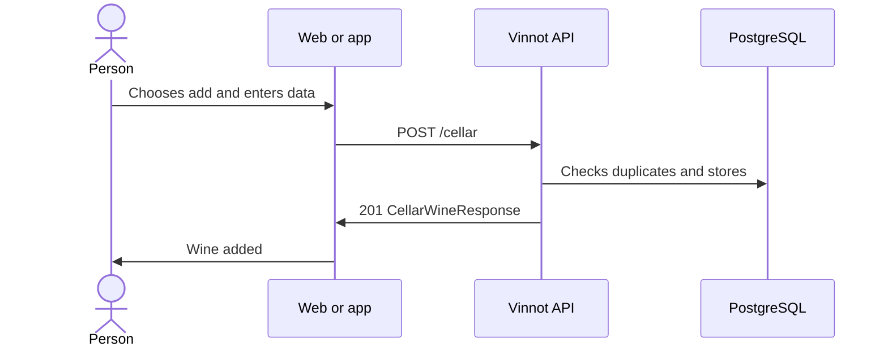

# UC-CEL-02 · Add a wine to the cellar

| Field | Value |
|---|---|
| ID | `UC-CEL-02` |
| Module | [Cellar](../README.md) |
| Platforms | Web, APK |
| Actors | Signed-in user |
| Lucidchart IDs | [WEB UC-CEL-02](https://lucid.app/lucidchart/9f11a16b-bb5a-42fc-a9e8-0852b17bd241/edit), [APK UC-CEL-02](https://lucid.app/lucidchart/e095dd25-e8ac-41ba-bf5b-396e1055f217/edit) |
| Requirements | [`RF-WEB-CEL-04`](../requirements.md), [`RF-APK-CEL-05`](../requirements.md) |
| Test cases | [`CP-CEL-06`](../testing.md), [`CP-CEL-07`](../testing.md), [`CP-CEL-08`](../testing.md), [`CP-CEL-26`](../testing.md), [`CP-CEL-09`](../testing.md) |

## Preconditions

- The person is signed in and the wine is in the catalog.

## Postconditions

- The wine is in the person's cellar with the data they entered.

## Main flow

1. On the web the person chooses “Add to Cellar” on the wine's page; on the app they use that same button on the page or the cellar's add button and search for the wine.
2. They optionally enter a rating from 0.1 to 5.0, notes, the purchase price and the vintage they tasted.
3. The client sends `POST /cellar` with the wine and that data.
4. The API checks that the wine is not already in the person's cellar and stores the entry.
5. The API answers 201 and the client confirms (“Wine added to your cellar” on the web) and updates the cellar.

## Alternative flows

- 1a. The wine is already in the cellar: the web shows it on the page and the app opens the cellar instead of the form.
- 4a. The wine is already in the cellar: the API answers 422, or 409 if two requests arrived at once.
- 1b. The app's search shows a wine that is already in the cellar: it appears with “Already in your cellar” and cannot be picked.
- 3a. The rating is outside 0.1 to 5.0 or has more than one decimal, the price is negative the notes exceed 10000 characters or the vintage is outside 1800 to 2100: the API answers 400; a vintage after next year is rejected with `INVALID_VINTAGE`.

## Business rules

- A wine appears only once in each person's cellar.
- All personal data is optional.
- Publishing a review also adds the wine to the cellar ([Reviews](../../reviews/README.md)).

## Diagram

[View the full “UC-CEL-02 · Add a wine to the cellar” diagram](https://images.vinnot.com/docs/diagrams/v1/en/modules-cellar-use-cases-uc-cel-02-add-wine-9efd1f3683a6.svg)

Component diagram in Lucidchart: [WEB UC-CEL-02](https://lucid.app/lucidchart/9f11a16b-bb5a-42fc-a9e8-0852b17bd241/edit), [APK UC-CEL-02](https://lucid.app/lucidchart/e095dd25-e8ac-41ba-bf5b-396e1055f217/edit).

## Code

| Layer | Location |
|---|---|
| Endpoints | `POST /cellar` |
| Backend | [`CellarController.java`](../../../../../backend/src/main/java/com/vinnot/cellar/infrastructure/web/controller/CellarController.java), [`AddWineToCellarCommandHandler.java`](../../../../../backend/src/main/java/com/vinnot/cellar/application/command/handler/AddWineToCellarCommandHandler.java), [`CellarWine.java`](../../../../../backend/src/main/java/com/vinnot/cellar/domain/model/CellarWine.java) |
| Web | [`WineCellarModal.tsx`](../../../../../frontend-react/src/presentation/pages/wines/WineCellarModal.tsx), [`useCellarQuickAdd.ts`](../../../../../frontend-react/src/presentation/hooks/queries/wine/useCellarQuickAdd.ts), [`cellar.service.ts`](../../../../../frontend-react/src/application/services/cellar.service.ts), [`cellar.client.ts`](../../../../../frontend-react/src/infrastructure/api/clients/cellar.client.ts) |
| App | [`CellarAddSheet.tsx`](../../../../../frontend-mobile/src/presentation/features/cellar/CellarAddSheet.tsx), [`index.ts`](../../../../../frontend-mobile/src/presentation/hooks/queries/cellar/index.ts), [`cellar.service.ts`](../../../../../frontend-mobile/src/application/services/cellar.service.ts), [`cellar.client.ts`](../../../../../frontend-mobile/src/infrastructure/api/clients/cellar.client.ts) |

## Automated tests

- Backend: [`AddWineToCellarCommandHandlerTest.java`](../../../../../backend/src/test/java/com/vinnot/cellar/application/command/handler/AddWineToCellarCommandHandlerTest.java), [`CellarWineTest.java`](../../../../../backend/src/test/java/com/vinnot/cellar/domain/model/CellarWineTest.java)
- Web: [`cellar.service.test.ts`](../../../../../frontend-react/src/application/services/cellar.service.test.ts), [`cellar-crud-flow.spec.tsx`](../../../../../frontend-react/tests/unit/integration/cellar-crud-flow.spec.tsx), [`useWineDetailsViewModel.test.tsx`](../../../../../frontend-react/src/presentation/pages/wines/useWineDetailsViewModel.test.tsx)
- App: [`cellar.service.test.ts`](../../../../../frontend-mobile/src/application/services/cellar.service.test.ts), [`CellarAddSheet.test.tsx`](../../../../../frontend-mobile/src/presentation/features/cellar/CellarAddSheet.test.tsx)
