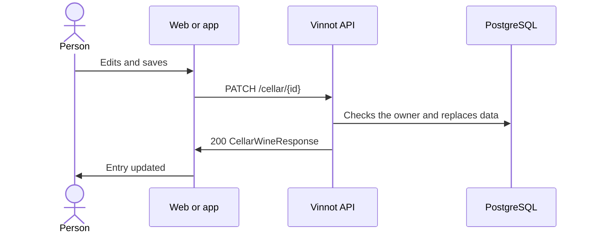

# UC-CEL-03 · Edit a cellar entry

| Field | Value |
|---|---|
| ID | `UC-CEL-03` |
| Module | [Cellar](../README.md) |
| Platforms | Web, APK |
| Actors | Signed-in user |
| Lucidchart IDs | [WEB UC-CEL-03](https://lucid.app/lucidchart/9f11a16b-bb5a-42fc-a9e8-0852b17bd241/edit), [APK UC-CEL-03](https://lucid.app/lucidchart/e095dd25-e8ac-41ba-bf5b-396e1055f217/edit) |
| Requirements | [`RF-WEB-CEL-05`](../requirements.md), [`RF-APK-CEL-06`](../requirements.md) |
| Test cases | [`CP-CEL-10`](../testing.md), [`CP-CEL-11`](../testing.md), [`CP-CEL-12`](../testing.md), [`CP-CEL-13`](../testing.md), [`CP-CEL-14`](../testing.md) |

## Preconditions

- The person has the wine in their cellar.

## Postconditions

- The entry has the new rating, price, notes and tasted vintage.

## Main flow

1. The person chooses “Edit notes” on a wine in their cellar.
2. The form opens with the current rating, notes, price and vintage.
3. The person changes the data and saves.
4. The client sends `PATCH /cellar/{id}` with the three fields and the vintage, or `clearVintage: true` to remove it.
5. The API checks that the entry belongs to the person and replaces the three fields, empty ones included; an omitted vintage keeps the stored one.
6. The API answers 200 and the client updates the entry and the metrics.

## Alternative flows

- 3a. On the web the person taps the chosen star: the rating is cleared.
- 5a. The entry belongs to someone else: the API answers 422 `CELLAR_ENTRY_OWNERSHIP`.
- 5b. The entry no longer exists: the API answers 404.
- 4a. A field is out of range: the API answers 400.

## Business rules

- Editing the cellar does not change the wine's public page or the review.
- Rating from 0.1 to 5.0 with one decimal, non-negative price, notes of up to 10000 characters and a vintage from 1800 to next year.
- Editing one's own review syncs the cellar ([Reviews](../../reviews/README.md)).

## Diagram

[View the full “UC-CEL-03 · Edit a cellar entry” diagram](https://images.vinnot.com/docs/diagrams/v1/en/modules-cellar-use-cases-uc-cel-03-edit-entry-3709a272813f.svg)

Component diagram in Lucidchart: [WEB UC-CEL-03](https://lucid.app/lucidchart/9f11a16b-bb5a-42fc-a9e8-0852b17bd241/edit), [APK UC-CEL-03](https://lucid.app/lucidchart/e095dd25-e8ac-41ba-bf5b-396e1055f217/edit).

## Code

| Layer | Location |
|---|---|
| Endpoints | `PATCH /cellar/{id}` |
| Backend | [`CellarController.java`](../../../../../backend/src/main/java/com/vinnot/cellar/infrastructure/web/controller/CellarController.java), [`UpdateCellarEntryCommandHandler.java`](../../../../../backend/src/main/java/com/vinnot/cellar/application/command/handler/UpdateCellarEntryCommandHandler.java), [`CellarWine.java`](../../../../../backend/src/main/java/com/vinnot/cellar/domain/model/CellarWine.java) |
| Web | [`CellarEditModal.tsx`](../../../../../frontend-react/src/presentation/components/features/cellar/CellarEditModal.tsx), [`useUpdateCellarEntry.ts`](../../../../../frontend-react/src/presentation/hooks/queries/cellar/useUpdateCellarEntry.ts), [`cellar.service.ts`](../../../../../frontend-react/src/application/services/cellar.service.ts), [`cellar.client.ts`](../../../../../frontend-react/src/infrastructure/api/clients/cellar.client.ts) |
| App | [`CellarAddSheet.tsx`](../../../../../frontend-mobile/src/presentation/features/cellar/CellarAddSheet.tsx), [`index.ts`](../../../../../frontend-mobile/src/presentation/hooks/queries/cellar/index.ts), [`cellar.service.ts`](../../../../../frontend-mobile/src/application/services/cellar.service.ts), [`cellar.client.ts`](../../../../../frontend-mobile/src/infrastructure/api/clients/cellar.client.ts) |

## Automated tests

- Backend: [`UpdateCellarEntryCommandHandlerTest.java`](../../../../../backend/src/test/java/com/vinnot/cellar/application/command/handler/UpdateCellarEntryCommandHandlerTest.java), [`CellarEntryOwnershipTest.java`](../../../../../backend/src/test/java/com/vinnot/cellar/application/command/handler/CellarEntryOwnershipTest.java), [`CellarWineTest.java`](../../../../../backend/src/test/java/com/vinnot/cellar/domain/model/CellarWineTest.java)
- Web: [`cellar-crud-flow.spec.tsx`](../../../../../frontend-react/tests/unit/integration/cellar-crud-flow.spec.tsx)
- App: [`cellar.service.test.ts`](../../../../../frontend-mobile/src/application/services/cellar.service.test.ts)
