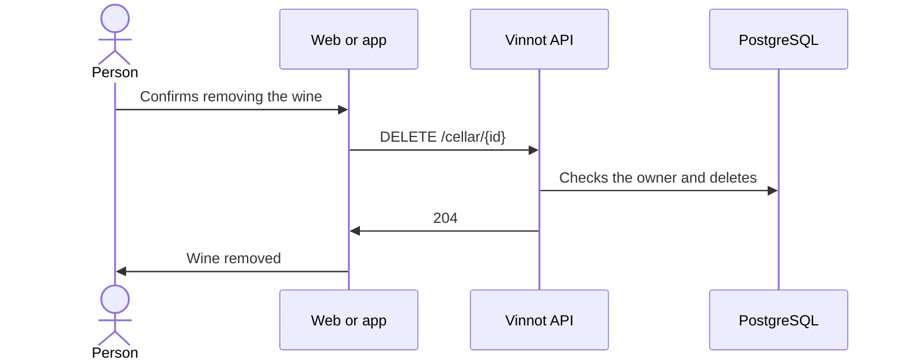

# UC-CEL-04 · Remove a wine from the cellar

| Field | Value |
|---|---|
| ID | `UC-CEL-04` |
| Module | [Cellar](../README.md) |
| Platforms | Web, APK |
| Actors | Signed-in user |
| Lucidchart IDs | [WEB UC-CEL-04](https://lucid.app/lucidchart/9f11a16b-bb5a-42fc-a9e8-0852b17bd241/edit), [APK UC-CEL-04](https://lucid.app/lucidchart/e095dd25-e8ac-41ba-bf5b-396e1055f217/edit) |
| Requirements | [`RF-WEB-CEL-06`](../requirements.md), [`RF-APK-CEL-07`](../requirements.md) |
| Test cases | [`CP-CEL-15`](../testing.md), [`CP-CEL-16`](../testing.md), [`CP-CEL-17`](../testing.md), [`CP-CEL-18`](../testing.md) |

## Preconditions

- The person has the wine in their cellar.

## Postconditions

- The wine is no longer in the cellar; the catalog wine and the review remain.

## Main flow

1. The person chooses “Delete” on the web, or on the app chooses “Delete” in the entry's “⋯” menu or swipes the entry.
2. The client asks for confirmation.
3. The client sends `DELETE /cellar/{id}`.
4. The API checks that the entry belongs to the person and deletes it.
5. The API answers 204 and the client removes the wine, updates the metrics and, on the web, says “Wine removed from your cellar”.

## Alternative flows

- 2a. The person cancels: nothing is deleted.
- 4a. The entry belongs to someone else: the API answers 422 `CELLAR_ENTRY_OWNERSHIP`.
- 4b. The entry no longer exists: the API answers 404.

## Business rules

- Removing a wine from the cellar does not delete the catalog wine or the public review.
- Deleting the review does not remove the wine from the cellar either.

## Diagram

[View the full “UC-CEL-04 · Remove a wine from the cellar” diagram](https://images.vinnot.com/docs/diagrams/v1/en/modules-cellar-use-cases-uc-cel-04-remove-entry-827df21f5d18.svg)

Component diagram in Lucidchart: [WEB UC-CEL-04](https://lucid.app/lucidchart/9f11a16b-bb5a-42fc-a9e8-0852b17bd241/edit), [APK UC-CEL-04](https://lucid.app/lucidchart/e095dd25-e8ac-41ba-bf5b-396e1055f217/edit).

## Code

| Layer | Location |
|---|---|
| Endpoints | `DELETE /cellar/{id}` |
| Backend | [`CellarController.java`](../../../../../backend/src/main/java/com/vinnot/cellar/infrastructure/web/controller/CellarController.java), [`RemoveWineFromCellarCommandHandler.java`](../../../../../backend/src/main/java/com/vinnot/cellar/application/command/handler/RemoveWineFromCellarCommandHandler.java) |
| Web | [`useMyCellarViewModel.ts`](../../../../../frontend-react/src/presentation/pages/cellar/useMyCellarViewModel.ts), [`useRemoveCellarEntry.ts`](../../../../../frontend-react/src/presentation/hooks/queries/cellar/useRemoveCellarEntry.ts), [`cellar.service.ts`](../../../../../frontend-react/src/application/services/cellar.service.ts), [`cellar.client.ts`](../../../../../frontend-react/src/infrastructure/api/clients/cellar.client.ts) |
| App | [`CellarEntryRow.tsx`](../../../../../frontend-mobile/src/presentation/features/cellar/CellarEntryRow.tsx), [`CellarScreen.tsx`](../../../../../frontend-mobile/src/presentation/features/cellar/CellarScreen.tsx), [`cellar.service.ts`](../../../../../frontend-mobile/src/application/services/cellar.service.ts), [`cellar.client.ts`](../../../../../frontend-mobile/src/infrastructure/api/clients/cellar.client.ts) |

## Automated tests

- Backend: [`RemoveWineFromCellarCommandHandlerTest.java`](../../../../../backend/src/test/java/com/vinnot/cellar/application/command/handler/RemoveWineFromCellarCommandHandlerTest.java), [`CellarEntryOwnershipTest.java`](../../../../../backend/src/test/java/com/vinnot/cellar/application/command/handler/CellarEntryOwnershipTest.java)
- Web: [`useMyCellarViewModel.test.tsx`](../../../../../frontend-react/src/presentation/pages/cellar/useMyCellarViewModel.test.tsx), [`useMyCellarViewModel.delete.test.tsx`](../../../../../frontend-react/src/presentation/pages/cellar/useMyCellarViewModel.delete.test.tsx), [`cellar-crud-flow.spec.tsx`](../../../../../frontend-react/tests/unit/integration/cellar-crud-flow.spec.tsx)
- App: [`CellarScreen.test.tsx`](../../../../../frontend-mobile/src/presentation/features/cellar/CellarScreen.test.tsx)
