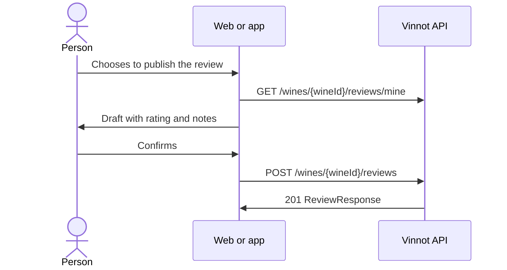

# UC-CEL-05 · Publish a note as a review

| Field | Value |
|---|---|
| ID | `UC-CEL-05` |
| Module | [Cellar](../README.md) |
| Platforms | Web, APK |
| Actors | Signed-in user |
| Lucidchart IDs | [WEB UC-CEL-05](https://lucid.app/lucidchart/9f11a16b-bb5a-42fc-a9e8-0852b17bd241/edit), [APK UC-CEL-05](https://lucid.app/lucidchart/e095dd25-e8ac-41ba-bf5b-396e1055f217/edit) |
| Requirements | [`RF-WEB-CEL-07`](../requirements.md), [`RF-APK-CEL-08`](../requirements.md) |
| Test cases | [`CP-CEL-19`](../testing.md), [`CP-CEL-20`](../testing.md), [`CP-CEL-21`](../testing.md), [`CP-CEL-22`](../testing.md) |

## Preconditions

- The person has the wine in their cellar.

## Postconditions

- The note is published as a review of the wine, or the existing review is opened.

## Main flow

1. The person chooses to publish the review from a wine in their cellar.
2. The client calls `GET /wines/{wineId}/reviews/mine` to know whether they already have a review.
3. The review form opens with the cellar's rating, notes and vintage as a draft.
4. The person reviews the draft and confirms.
5. The client publishes the review with `POST /wines/{wineId}/reviews` ([UC-REV-02](../../reviews/use-cases/uc-rev-02-publish-review.md)).

## Alternative flows

- 2a. An own review already exists: the web opens the wine's page at that review (`?review=mine`) and the app shows it for editing; it is not replaced automatically.
- 3a. The cellar has no rating: a rating must be chosen before publishing (stars on the web, glasses on the app).
- 4a. The person cancels: nothing is published and the cellar does not change.

## Business rules

- The cellar note is private until the person confirms publishing it.
- Publishing uses the reviews use case, never the cellar endpoint.
- When published, the review syncs the cellar again with its rating, comment and vintage.

## Diagram

[View the full “UC-CEL-05 · Publish a note as a review” diagram](https://images.vinnot.com/docs/diagrams/v1/en/modules-cellar-use-cases-uc-cel-05-publish-note-as-review-37bee537e0de.svg)

Component diagram in Lucidchart: [WEB UC-CEL-05](https://lucid.app/lucidchart/9f11a16b-bb5a-42fc-a9e8-0852b17bd241/edit), [APK UC-CEL-05](https://lucid.app/lucidchart/e095dd25-e8ac-41ba-bf5b-396e1055f217/edit).

## Code

| Layer | Location |
|---|---|
| Endpoints | `GET /wines/{wineId}/reviews/mine`, `POST /wines/{wineId}/reviews` |
| Backend | [`CreateReviewCommandHandler.java`](../../../../../backend/src/main/java/com/vinnot/review/application/command/handler/CreateReviewCommandHandler.java), [`CellarCommandAdapter.java`](../../../../../backend/src/main/java/com/vinnot/review/infrastructure/persistence/adapter/CellarCommandAdapter.java) |
| Web | [`CellarReviewModal.tsx`](../../../../../frontend-react/src/presentation/components/features/cellar/CellarReviewModal.tsx), [`useCellarReviewPublication.ts`](../../../../../frontend-react/src/presentation/hooks/useCellarReviewPublication.ts) |
| App | [`CellarReviewSheet.tsx`](../../../../../frontend-mobile/src/presentation/features/cellar/CellarReviewSheet.tsx), [`useCellarReviewPublication.ts`](../../../../../frontend-mobile/src/presentation/hooks/useCellarReviewPublication.ts) |

## Automated tests

- Backend: [`CellarCommandAdapterTest.java`](../../../../../backend/src/test/java/com/vinnot/review/infrastructure/persistence/adapter/CellarCommandAdapterTest.java)
- Web: [`CellarReviewModal.test.tsx`](../../../../../frontend-react/src/presentation/components/features/cellar/CellarReviewModal.test.tsx)
- App: [`CellarReviewSheet.test.tsx`](../../../../../frontend-mobile/src/presentation/features/cellar/CellarReviewSheet.test.tsx)
