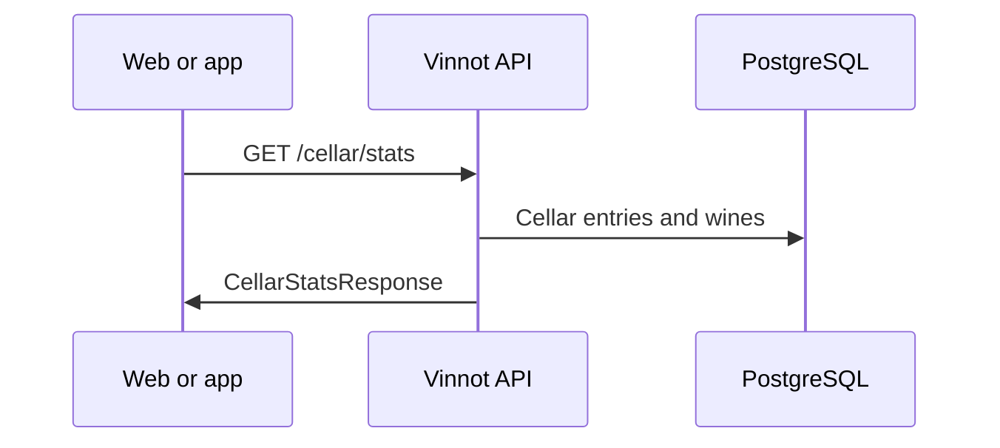

# UC-CEL-06 · Read a cellar's statistics

| Field | Value |
|---|---|
| ID | `UC-CEL-06` |
| Module | [Cellar](../README.md) |
| Platforms | Backend only |
| Actors | Signed-in user, Administrator |
| Lucidchart IDs | None |
| Requirements | None |
| Test cases | [`CP-CEL-23`](../testing.md), [`CP-CEL-24`](../testing.md), [`CP-CEL-25`](../testing.md) |

## Preconditions

- The caller is signed in; another person's cellar needs the `ADMIN` role.

## Postconditions

- The statistics or entries of the requested cellar are returned.

## Main flow

1. `GET /cellar/stats` is called for one's own cellar or `GET /cellar/user/{userId}/stats` for another.
2. The API checks that the caller is the owner or an administrator.
3. It calculates the number of wines, the rated ones, the average, the distinct wineries and regions and the count per wine type.
4. It returns `CellarStatsResponse`.

## Alternative flows

- 1a. Another person's list is requested with `GET /cellar/user/{userId}`: the same check applies.
- 2a. The caller is neither the owner nor an administrator: the API answers 403.

## Business rules

- Web and app calculate their metrics on the client and do not use these endpoints.
- A wine without a type is counted as `UNKNOWN`.

## Diagram

[View the full “UC-CEL-06 · Read a cellar's statistics” diagram](https://images.vinnot.com/docs/diagrams/v1/en/modules-cellar-use-cases-uc-cel-06-cellar-statistics-2b140aba3a47.svg)

## Code

| Layer | Location |
|---|---|
| Endpoints | `GET /cellar/stats`, `GET /cellar/user/{userId}`, `GET /cellar/user/{userId}/stats` |
| Backend | [`CellarController.java`](../../../../../backend/src/main/java/com/vinnot/cellar/infrastructure/web/controller/CellarController.java), [`GetCellarStatsQueryHandler.java`](../../../../../backend/src/main/java/com/vinnot/cellar/application/query/handler/GetCellarStatsQueryHandler.java), [`GetUserCellarQueryHandler.java`](../../../../../backend/src/main/java/com/vinnot/cellar/application/query/handler/GetUserCellarQueryHandler.java) |

## Automated tests

- Backend: [`GetCellarStatsQueryHandlerTest.java`](../../../../../backend/src/test/java/com/vinnot/cellar/application/query/handler/GetCellarStatsQueryHandlerTest.java), [`CellarPrivacyTest.java`](../../../../../backend/src/test/java/com/vinnot/cellar/infrastructure/web/CellarPrivacyTest.java)
- Web: None
- App: None
