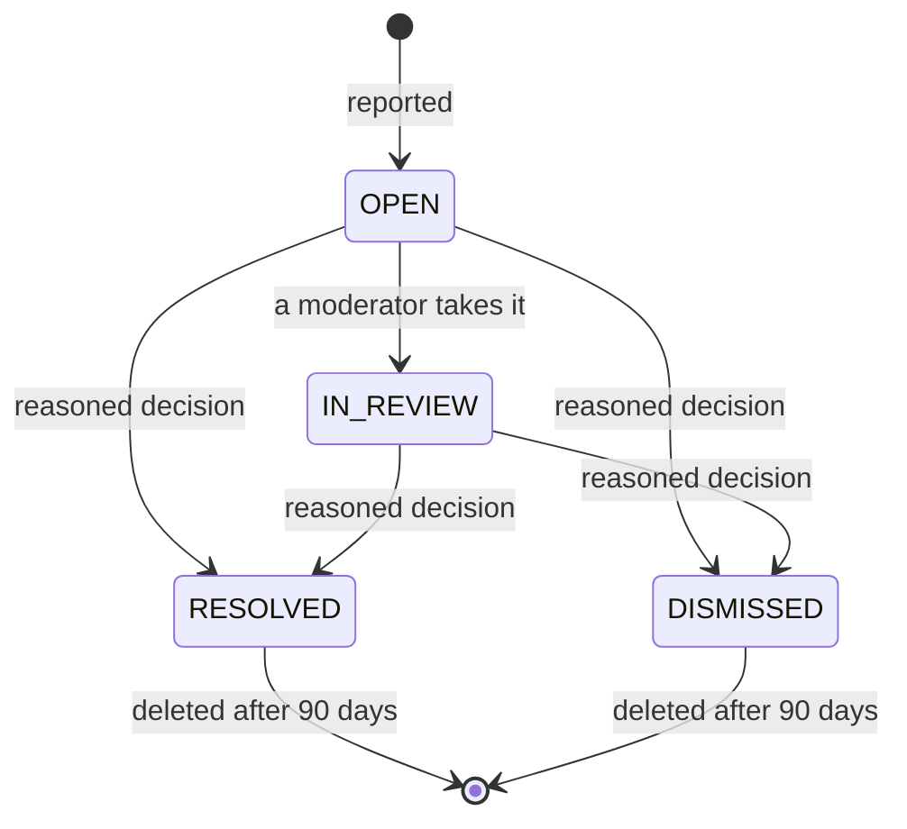
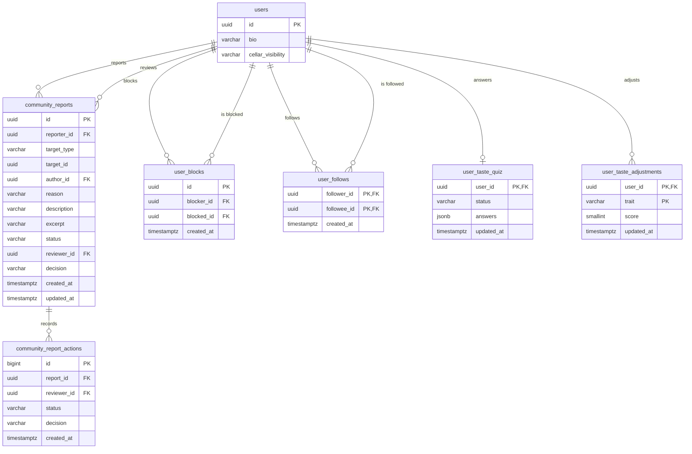

# Community

The social layer and the community safety tools: following members, public
profiles, people to follow and the following feed, plus reporting content or
people, blocking accounts and reading one's own activity. Moderation is reactive:
reviews and comments are published at once ([Reviews](../reviews/README.md)) and
the team reviews reports from [Administration](../admin/README.md).

- Module code: `COM`.
- Backend: package [`community`](../../../../backend/src/main/java/com/vinnot/community/).
- [Use cases](use-cases/README.md) · [Requirements](requirements.md) ·
  [Architecture](architecture.md) · [Testing](testing.md)

## Actors

| Actor | What they do in this module |
|---|---|
| Signed-in user | Follows members, opens public profiles, reads suggestions and the following feed, reports content, blocks and unblocks accounts and reads their activity |
| Moderator or administrator | Reviews reports and removes content (from Administration) |
| Email service | Tells the outcome of a report and the removal of content |
| Push service | Tells a member that someone started following them |

## Business rules

| Rule | Detail | Where |
|---|---|---|
| Access | Reports and blocks need a session; the identity comes from the token | [`CommunityController.java`](../../../../backend/src/main/java/com/vinnot/community/infrastructure/web/CommunityController.java) |
| What can be reported | Active users, approved reviews and comments on active wines, events already published and published routes | [`JdbcCommunityTargetAdapter.java`](../../../../backend/src/main/java/com/vinnot/community/infrastructure/persistence/JdbcCommunityTargetAdapter.java) |
| Reasons | Spam, harassment, hate, sexual content, violence, privacy, misinformation or other; “Other” needs a description of up to 2000 characters | [`CommunityReport.java`](../../../../backend/src/main/java/com/vinnot/community/domain/model/CommunityReport.java) |
| No duplicates | One open report per person and content; repeating it returns the same receipt | [`CreateReportCommandHandler.java`](../../../../backend/src/main/java/com/vinnot/community/application/command/handler/CreateReportCommandHandler.java) |
| Limits | 10 new reports per day and 10 submissions per hour under their own `report` policy, separate from support requests | [`RateLimitPolicyResolver.java`](../../../../backend/src/main/java/com/vinnot/shared/infrastructure/security/RateLimitPolicyResolver.java) |
| Block | Works both ways: hides reviews, comments and profile, stops likes, comments and notices, and ends the follows in both directions | [`ChangeUserBlockCommandHandler.java`](../../../../backend/src/main/java/com/vinnot/community/application/command/handler/ChangeUserBlockCommandHandler.java) |
| Follow | Asymmetric and without approval; idempotent; never oneself, an inactive member or across a block | [`ChangeFollowCommandHandler.java`](../../../../backend/src/main/java/com/vinnot/community/application/command/handler/ChangeFollowCommandHandler.java) |
| Follower points | One seal point per follower with a verified email and at least one approved review, up to 10 a day inside the global 40; taken back on unfollow or block | [Gamification](../gamification/README.md) |
| Cellar on the profile | `PUBLIC` (default), `FOLLOWERS` or `PRIVATE`; the owner always sees it; notes and purchase price are never public | [`CellarVisibility.java`](../../../../backend/src/main/java/com/vinnot/community/domain/model/CellarVisibility.java) |
| Taste | Wheel and affinity percentage after five rated wines; the affinity is the cosine of both taste vectors | [`TasteProfile.java`](../../../../backend/src/main/java/com/vinnot/community/domain/model/TasteProfile.java) |
| Taste quiz | Five illustrated questions at sign-up or from the profile; offered while pending and below five rated wines; skipping never erases a completed quiz; its answers fill the taste traits where real data is missing and are never public | [`TasteQuiz.java`](../../../../backend/src/main/java/com/vinnot/community/domain/model/TasteQuiz.java) |
| Adjustable palate | Members set their own structure bars (acidity, body, tannin, sweetness) from 0 to 100 with `PUT /users/me/taste-traits` and clear them with `DELETE`; a manual value replaces the computed or quiz value of its trait, is marked `adjusted` and is visible to anyone who can see the profile | [`TasteAdjustment.java`](../../../../backend/src/main/java/com/vinnot/community/domain/model/TasteAdjustment.java) |
| No automatic sanctions | No number of reports hides content or suspends accounts by itself | [Architecture](architecture.md) |
| Retention | Closed reports are deleted 90 days after closing | [`PurgeClosedReportsCommandHandler.java`](../../../../backend/src/main/java/com/vinnot/community/application/command/handler/PurgeClosedReportsCommandHandler.java) |

## Report states

[View the full “Report states” diagram](https://images.vinnot.com/docs/diagrams/v1/en/modules-community-readme-fb3a702e098b.svg)

## Where it lives

| Part | Location |
|---|---|
| API | [`CommunityController`](../../../../backend/src/main/java/com/vinnot/community/infrastructure/web/CommunityController.java), under `/community` |
| Web | `/community` page in [`pages/community`](../../../../frontend-react/src/presentation/pages/community/) and actions in [`features/community`](../../../../frontend-react/src/presentation/components/features/community/) |
| App | Screen `frontend-mobile/app/(app)/community.tsx` and logic in [`features/community`](../../../../frontend-mobile/src/presentation/features/community/) |
| Social API | [`MemberActivityController`](../../../../backend/src/main/java/com/vinnot/community/infrastructure/web/MemberActivityController.java) (a member's reviews and cellar), [`TasteQuizController`](../../../../backend/src/main/java/com/vinnot/community/infrastructure/web/TasteQuizController.java) and [`TasteTraitsController`](../../../../backend/src/main/java/com/vinnot/community/infrastructure/web/TasteTraitsController.java), under `/users`; [Users](../users/README.md) composes the public profile |
| Social web | Pages `/users/:id`, `/users/:id/followers`, `/users/:id/following`, `/feed` and `/taste-quiz` in [`pages/social`](../../../../frontend-react/src/presentation/pages/social/) and [`pages/user`](../../../../frontend-react/src/presentation/pages/user/), with components in [`features/social`](../../../../frontend-react/src/presentation/components/features/social/) and [`features/tasteQuiz`](../../../../frontend-react/src/presentation/components/features/tasteQuiz/) |
| Social app | Screens `frontend-mobile/app/(app)/users/[id].tsx`, `users/[id]/followers.tsx`, `users/[id]/following.tsx`, `feed.tsx` and `taste-quiz.tsx`, with logic in [`features/social`](../../../../frontend-mobile/src/presentation/features/social/) and [`features/tasteQuiz`](../../../../frontend-mobile/src/presentation/features/tasteQuiz/) |

## Data

Tables created in `V24`; `V25` indexes closed reports for purging. `V87`, `V88` and `V89` add the social layer and the taste profile (see below).

[View the full “Community · Data” diagram](https://images.vinnot.com/docs/diagrams/v1/en/modules-community-readme-f97857bcc022.svg)

Reported content is identified by type and ID without a foreign key, so the case
is kept even if the content is deleted. Deleting an account removes its blocks
and sets its report references to `NULL`.

`V87` adds the follows and two profile columns:

| Table or column | Content |
|---|---|
| `user_follows` | `follower_id` and `followee_id` (primary key pair, both reference `users` with `ON DELETE CASCADE`, a CHECK forbids following oneself) and `created_at`; index on `(followee_id, created_at DESC)` |
| `users.bio` | Public bio, `varchar(160)`, nullable |
| `users.cellar_visibility` | `PUBLIC`, `FOLLOWERS` or `PRIVATE` (CHECK), default `PUBLIC` |

Deleting an account removes its follows in both directions. The affinity and the
taste wheel's five-wine gate read `user_taste_affinities` (`V52`), recomputed
every night by the [Wines](../wines/README.md) recommendation job; the wheel's
grape, type and region slices are computed on request from the member's ratings.

`V88` adds `user_taste_quiz`: one row per member (`user_id` primary key,
referencing `users` with `ON DELETE CASCADE`), `status` `COMPLETED` or `SKIPPED`,
`answers` jsonb only when completed and `updated_at`. No row means the quiz is
pending. See [Taste quiz](architecture.md#taste-quiz).

`V89` adds `user_taste_adjustments`: one row per member and trait (primary key
`(user_id, trait)`, `user_id` referencing `users` with `ON DELETE CASCADE`),
`trait` `ACIDITY`, `BODY`, `TANNIN` or `SWEETNESS`, `score` from 0 to 100 and
`updated_at`. No row means the trait shows its computed value. See
[Adjustable palate](architecture.md#adjustable-palate).
