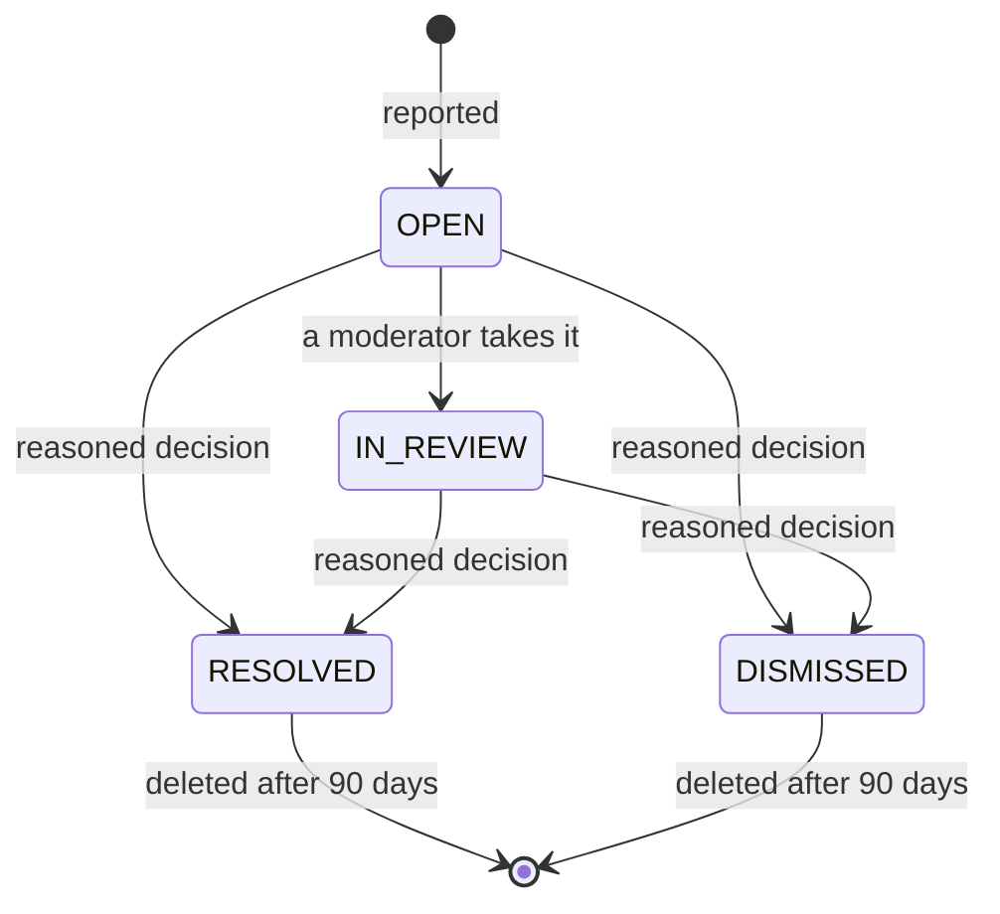
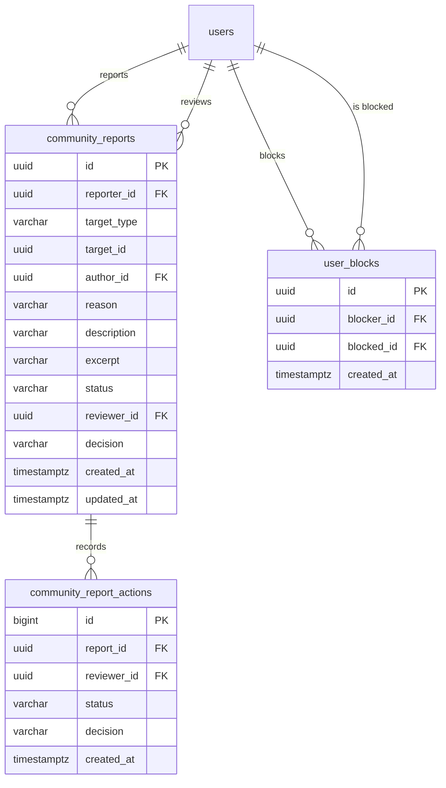

# Community

The community safety tools: reporting content or people, blocking accounts and
reading one's own activity. Moderation is reactive: reviews and comments are
published at once ([Reviews](../reviews/README.md)) and the team reviews reports
from [Administration](../admin/README.md). Vinnot has no followers or activity
feed.

- Module code: `COM`.
- Backend: package [`community`](../../../../backend/src/main/java/com/vinnot/community/).
- [Use cases](use-cases/README.md) · [Requirements](requirements.md) ·
  [Architecture](architecture.md) · [Testing](testing.md)

## Actors

| Actor | What they do in this module |
|---|---|
| Signed-in user | Reports content, blocks and unblocks accounts and reads their activity |
| Moderator or administrator | Reviews reports and removes content (from Administration) |
| Email service | Tells the outcome of a report and the removal of content |

## Business rules

| Rule | Detail | Where |
|---|---|---|
| Access | Reports and blocks need a session; the identity comes from the token | [`CommunityController.java`](../../../../backend/src/main/java/com/vinnot/community/infrastructure/web/CommunityController.java) |
| What can be reported | Active users, approved reviews and comments on active wines, events already published and published routes | [`JdbcCommunityTargetAdapter.java`](../../../../backend/src/main/java/com/vinnot/community/infrastructure/persistence/JdbcCommunityTargetAdapter.java) |
| Reasons | Spam, harassment, hate, sexual content, violence, privacy, misinformation or other; “Other” needs a description of up to 2000 characters | [`CommunityReport.java`](../../../../backend/src/main/java/com/vinnot/community/domain/model/CommunityReport.java) |
| No duplicates | One open report per person and content; repeating it returns the same receipt | [`CreateReportCommandHandler.java`](../../../../backend/src/main/java/com/vinnot/community/application/command/handler/CreateReportCommandHandler.java) |
| Limits | 10 new reports per day and 10 submissions per hour under their own `report` policy, separate from support requests | [`RateLimitPolicyResolver.java`](../../../../backend/src/main/java/com/vinnot/shared/infrastructure/security/RateLimitPolicyResolver.java) |
| Block | Works both ways: hides reviews, comments and profile, and stops likes, comments and notices | [`ChangeUserBlockCommandHandler.java`](../../../../backend/src/main/java/com/vinnot/community/application/command/handler/ChangeUserBlockCommandHandler.java) |
| No automatic sanctions | No number of reports hides content or suspends accounts by itself | [Architecture](architecture.md) |
| Retention | Closed reports are deleted 90 days after closing | [`PurgeClosedReportsCommandHandler.java`](../../../../backend/src/main/java/com/vinnot/community/application/command/handler/PurgeClosedReportsCommandHandler.java) |

## Report states

[View the full “Report states” diagram](https://images.vinnot.com/docs/diagrams/v1/en/modules-community-readme-fb3a702e098b.svg)

## Where it lives

| Part | Location |
|---|---|
| API | [`CommunityController`](../../../../backend/src/main/java/com/vinnot/community/infrastructure/web/CommunityController.java), under `/community` |
| Web | `/community` page in [`pages/community`](../../../../frontend-react/src/presentation/pages/community/) and actions in [`features/community`](../../../../frontend-react/src/presentation/components/features/community/) |
| App | Screen `frontend-mobile/app/(app)/community.tsx` and logic in [`features/community`](../../../../frontend-mobile/src/presentation/features/community/) |

## Data

Tables created in `V24`; `V25` indexes closed reports for purging.

[View the full “Community · Data” diagram](https://images.vinnot.com/docs/diagrams/v1/en/modules-community-readme-43bec693141c.svg)

Reported content is identified by type and ID without a foreign key, so the case
is kept even if the content is deleted. Deleting an account removes its blocks
and sets its report references to `NULL`.
